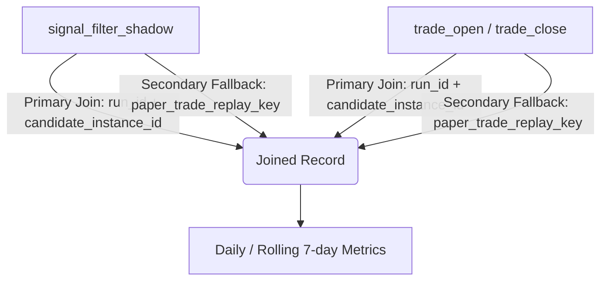

# Design Document: Phase B Daily Evidence Collector
**Task Reference**: `PHASE_B_DAILY_EVIDENCE_COLLECTOR_DESIGN_001`  
**Date**: 2026-06-21  
**Status**: DESIGN COMPLETE  
**Verdict**: **READY_FOR_DAILY_EVIDENCE_IMPLEMENTATION**

---

## 1. Collector Inputs

The collector runs offline as a daily cron job or CLI task. It reads JSONL files from three primary directories:

1. **Passive Telemetry Logs**:
   * Directory: `runtime/quant_data/signal_filter_shadow/` (and fallback `runtime/quant_data/signal_filter_shadow_phase_b/`)
   * Event Type: `signal_filter_shadow`
   * Target Keys: `run_id`, `signal_id`, `candidate_instance_id`, `paper_trade_replay_key`, `filter_name`, `filter_version`, `filter_params`, `shadow_pass`, `shadow_reason`, `would_trade`, `volatility_regime`, `proposed_size_usd`.
2. **Trade Journal Logs**:
   * Directory: `runtime/quant_data/trade_journal/`
   * Event Types: `trade_open` and `trade_close`
   * Target Keys: `run_id`, `position_id`, `paper_trade_replay_key`, `ticker`, `side`, `entry_price`, `exit_price`, `pnl`, `pnl_usdc`, `reason`, `trade_result`, `timestamp_utc`.
3. **System Health Logs**:
   * Directory: `runtime/quant_data/system_health/`
   * Event Type: `system_health`
   * Target Keys: `run_id`, `connected`, `cycle`, `risk_mode`, `open_positions`, `scan_cycle_duration_ms`, `timestamp_utc`.

---

## 2. Join Methodology

To attribute trade performance (PnL, hold time, and execution outcomes) to the passive shadow filter evaluations, the collector performs a deterministic two-pass join.



### Step 1: Reconstruct Trade Lifecycles
* Parse `trade_open` and `trade_close` events from `trade_journal/`.
* Match `trade_open` and `trade_close` using `position_id` as the primary key. If `position_id` is missing, fallback to matching `paper_trade_replay_key` + close proximity of `timestamp_utc`.
* The output is a **Reconstructed Trade Record** containing entry/exit prices, timestamps, PnL, and ultimate result (`TP`, `SL`, or `TS`).

### Step 2: Join Telemetry with Trades
* Match `signal_filter_shadow` events with the Reconstructed Trade Records.
* **Primary Key**: `(run_id, candidate_instance_id)`.
* **Secondary Fallback**: `paper_trade_replay_key`.
* **Record Resolution**:
  * **Matched**: Shadow filters successfully evaluated a candidate that became an actual trade.
  * **Telemetry Only (No Trade)**: Candidate was scanned and evaluated by shadow filters, but no actual trade occurred (due to standard budget caps or lack of EV approval). This represents the *counterfactual* state.
  * **Trade Only (No Telemetry)**: An actual trade occurred but has no matching shadow evaluation. This indicates an anomaly.

---

## 3. Output Schema

The collector writes two levels of output files:

### Level 1: Joined Records File
Saved daily to `runtime/research_exports/joined_shadow_records_<YYYY-MM-DD>.jsonl`.
* Contains one flat record per evaluation.
* **Schema**:
  ```json
  {
    "timestamp_utc": "ISO-8601 string",
    "run_id": "string",
    "candidate_instance_id": "string",
    "paper_trade_replay_key": "string",
    "asset": "string",
    "side": "string",
    "edge": "float",
    "volatility_regime": "string",
    "filter_evaluations": {
      "block_btc_shadow": {"pass": "bool", "reason": "string"},
      "block_normal_vol_shadow": {"pass": "bool", "reason": "string"},
      "combined_broad_shadow": {"pass": "bool", "reason": "string"},
      "combined_conservative_shadow": {"pass": "bool", "reason": "string"}
    },
    "actual_trade_executed": "bool",
    "actual_position_id": "string | null",
    "actual_pnl": "float | null",
    "actual_trade_result": "string | null"
  }
  ```

### Level 2: Daily Aggregated Metrics
Saved daily to `runtime/research_exports/shadow_metrics_daily.json` (appended/updated).

---

## 4. Daily Report File Format

Saved to `runtime/research_state/shadow_evidence_daily/<YYYY-MM-DD>.json`.

```json
{
  "date": "2026-06-21",
  "system_health": {
    "total_cycles": 2880,
    "uptime_pct": 100.0,
    "avg_scan_latency_ms": 12.5,
    "risk_modes_seen": ["NORMAL", "DEFENSIVE"]
  },
  "overall_baseline": {
    "total_candidates": 450,
    "actual_trades_executed": 35,
    "actual_net_pnl": 124.50,
    "actual_win_rate": 0.58
  },
  "filter_summaries": {
    "block_btc_shadow": {
      "evaluations": 450,
      "would_trade_count": 412,
      "would_block_count": 38,
      "allowed_actual_pnl": 132.80,
      "blocked_actual_pnl": -8.30,
      "would_trade_profit_factor": 1.45,
      "blocked_trade_profit_factor": 0.42
    },
    "block_normal_vol_shadow": {
      "evaluations": 450,
      "would_trade_count": 320,
      "would_block_count": 130,
      "allowed_actual_pnl": 145.20,
      "blocked_actual_pnl": -20.70,
      "would_trade_profit_factor": 1.62,
      "blocked_trade_profit_factor": 0.35
    }
  }
}
```

---

## 5. Rolling 7-Day Aggregation Logic

To avoid daily variance and capture statistically significant trends, the collector calculates a rolling 7-day window.

* **Windowing Rule**: Includes metrics from $T-6$ to $T$ (where $T$ is the report date).
* **Aggregation Aggregators**:
  * **Rolling Pass Rate**: $\frac{\sum \text{Passed Evaluations}}{\sum \text{Total Evaluations}}$
  * **Rolling Blocking Rate**: $\frac{\sum \text{Blocked Evaluations}}{\sum \text{Total Evaluations}}$
  * **Rolling Net Shadow PnL**: Sum of PnL for allowed trades.
  * **Rolling Rejected Net PnL**: Sum of PnL for blocked trades.
  * **Rolling Shadow Profit Factor (PF)**:
    $$\text{Shadow PF} = \frac{\sum \text{Allowed Positive PnLs}}{\sum \text{abs(Allowed Negative PnLs)}}$$
  * **rolling Opportunity Cost**: Realized PnL missed by blocking trades that ended up profitable.

---

## 6. Handling of Edge Cases

| Edge Case | Detection Rule | Handling Mechanism |
| :--- | :--- | :--- |
| **Missing Joins** | Record exists in `trade_journal` but no matching ID in `signal_filter_shadow`. | Flag as `TELEMETRY_MISSING`. Exclude from shadow filter metrics. Log a warning in health checks. |
| **Duplicate Joins** | Multiple telemetry records share the same `(run_id, candidate_instance_id, filter_name)`. | Deduplicate by taking the latest event based on `timestamp_utc`. |
| **Partial Lifecycle** | `trade_open` exists for today, but no `trade_close` (position still open). | Mark trade as `OPEN`. Compute PnL using the daily close/mark price. Do not calculate final PF until close event is logged. |
| **Stale Runtime** | Time gap between consecutive `system_health` heartbeats > 300 seconds. | Mark cycle as `STALE`. Exclude corresponding gaps from active denominator metrics. |
| **Schema Violations** | Log line missing mandatory keys or fails type casting. | Isolate to `runtime/quant_data/corrupted_records.jsonl`. Exclude from daily metrics. |

---

## 7. Validation Checks

Before finalizing the daily report, the collector executes three safety assertions:
1. **PnL Balance Constraint**: 
   $$\text{Actual Net PnL} = \text{Allowed Actual PnL} + \text{Blocked Actual PnL} \pm \epsilon$$
2. **Evaluation Parity Check**:
   $$\text{Total evaluations} = \text{would\_trade\_count} + \text{would\_block\_count}$$
3. **Daily File Presence**: Ensure all 3 directories have files written for the target date before starting calculation.

---

## 8. Operator Dashboard Output Fields

The daily console output or Telegram daily digest displays:

```text
=== Phase B Shadow Telemetry Daily Report [2026-06-21] ===
Runtime Status: ACTIVE | Uptime: 100.0% | Cycles: 2880

--- Performance & Attribution ---
Baseline Actual: 35 Trades | Net PnL: +$124.50 | WR: 58.0%

--- Shadow Filters Performance (7-Day Rolling) ---
1. block_btc_shadow:
   - Evaluated: 450 | Pass Rate: 91.5%
   - Allowed PnL: +$132.80 | Blocked PnL: -$8.30
   - Allowed PF:  1.45    | Blocked PF:  0.42 (Optimal Reject)
2. block_normal_vol_shadow:
   - Evaluated: 450 | Pass Rate: 71.1%
   - Allowed PnL: +$145.20 | Blocked PnL: -$20.70
   - Allowed PF:  1.62    | Blocked PF:  0.35 (Optimal Reject)
```

### Final Verdict: **READY_FOR_DAILY_EVIDENCE_IMPLEMENTATION**
