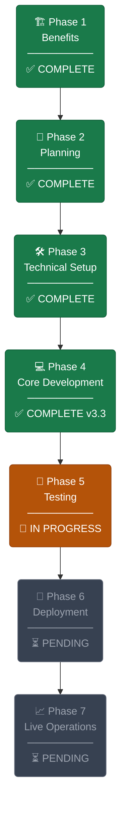
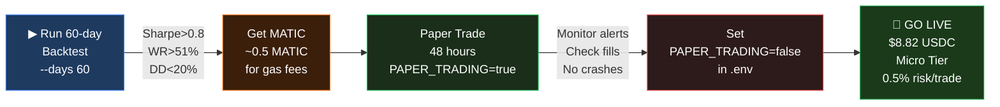
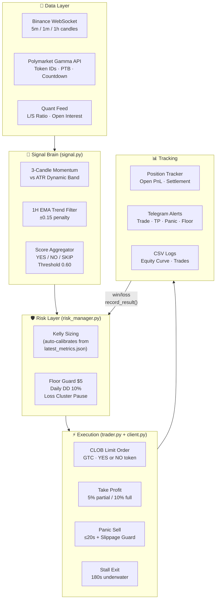

# PolyTrade Bot — Project Roadmap

> **Current Position:** Phase 5 — Testing (60-day backtest required + 48h paper trade pending)
> **Bot Version:** v3.3 | **Strategy:** Counter-Momentum / Mean Reversion | **Market:** Polymarket 5-min BTC/ETH Binary

---

## Overview Flowchart



---

## Phase Detail Flowchart

```mermaid
flowchart TD

    %% ── PHASE 1 ──────────────────────────────────────────────
    subgraph PH1["🏗️ Phase 1 — Benefits  ✅"]
        B1["24/7 Market Monitoring\n(ไม่ต้องอดนอนเฝ้ากราฟ)"]
        B2["Emotion-Free Trading\n(ตัดความกลัว / ความโลภ)"]
        B3["Faster Execution\n(เร็วกว่ามนุษย์ในตลาด 5 นาที)"]
        B4["Backtesting Capability\n(ทดสอบก่อนเสียเงินจริง)"]
        B5["Consistent Strategy\n(รักษาระบบให้คงเดิมทุกไม้)"]
    end

    %% ── PHASE 2 ──────────────────────────────────────────────
    subgraph PH2["📝 Phase 2 — Planning  ✅"]
        C1["Strategy: Counter-Momentum\nMean Reversion\nmomentum_pct = 3-candle move"]
        C2["Markets: BTC / ETH / SOL\nXRP / DOGE / HYPE / BNB\n(Polymarket 5-min binary)"]
        C3["Risk Rules\nFloor=$5 | MaxDD=10%\nKelly Quarter-Fraction\nHardCap=3%/trade"]
    end

    %% ── PHASE 3 ──────────────────────────────────────────────
    subgraph PH3["🛠️ Phase 3 — Technical Setup  ✅"]
        D1["Language: Python 3.11\npydantic-settings · pandas\nnumpy · httpx · web3"]
        D2["APIs Connected\nPolymarket CLOB (py-clob-client)\nBinance WebSocket (price feed)\nCoinbase REST (backtest data)"]
        D3["Dev Environment\nVS Code / Cursor\n.env secrets\nlogs/ · backtest_results/"]
    end

    %% ── PHASE 4 ──────────────────────────────────────────────
    subgraph PH4["💻 Phase 4 — Core Development  ✅ v3.3"]
        direction TB

        E1["📡 Data Collection\nBinance WebSocket 5m/1m/1h\nPolymarket Gamma API\nCoinbase OHLCV (backtest)"]

        subgraph SIG["Signal Engine  (signal.py)"]
            S1["3-candle Momentum %"]
            S2["ATR Dynamic Threshold\n(replaces static 0.45-1.00%)"]
            S3["RSI 35-78 Filter"]
            S4["Volume ≥ 0.4× mean"]
            S5["CVD 60s + L/S Ratio"]
            S6["Orderbook Imbalance +0.05"]
            S7["1H EMA Trend Filter\npenalty -0.15"]
            S8["Anti-Invert 1m candle\n-0.10 on conflict"]
        end

        subgraph RISK["Risk Engine  (risk_manager.py)"]
            R1["Tiered Kelly Sizing\nMicro→Growth tiers"]
            R2["Floor $5.00 Hard Stop"]
            R3["Daily DD 10% Circuit"]
            R4["Loss Cluster Pause\n3 losses → 30min rest"]
        end

        subgraph EXIT["Exit Logic  (trader.py)"]
            X1["Partial TP 5%\n(sell 50% of position)"]
            X2["Full TP 10%\n(or Let Profit Run)"]
            X3["Panic Sell ≤20s\n+ Slippage Guard\n(hold if spread > 8c)"]
            X4["Stall Exit 180s\n(underwater BUY force-close)"]
        end

        E1 --> SIG --> RISK --> EXIT
    end

    %% ── PHASE 5 ──────────────────────────────────────────────
    subgraph PH5["🧪 Phase 5 — Testing  🔄 IN PROGRESS"]
        direction TB
        T1{"60-Day Backtest\n⏳ REQUIRED\n python main.py\n --days 60"}
        T2{"Validate Metrics\nTarget:\nSharpe > 0.8\nWinRate > 51%\nMaxDD < 20%"}
        T3{"Paper Trade 48h\n⏳ REQUIRED\n PAPER_TRADING=true\n Monitor Telegram alerts"}
        T4{"Performance Analysis\nCompare live vs backtest\nCheck fill rates & latency"}

        T1 -->|Pass| T2
        T2 -->|Pass| T3
        T3 -->|Pass| T4
        T1 -->|Fail → tune params| T1
        T2 -->|Fail → re-backtest| T1
    end

    %% ── PHASE 6 ──────────────────────────────────────────────
    subgraph PH6["🚀 Phase 6 — Deployment  ⏳ PENDING"]
        direction TB
        DEP1["Get MATIC for Gas\n~0.5 MATIC to wallet\n0x645a661b...e833e2"]
        DEP2["Choose Cloud Server\nDigitalOcean / AWS\nUbuntu 22.04 LTS\n~$6/mo Droplet"]
        DEP3["Configure Server\nSystemd service\nauto-restart on crash\nlog rotation"]
        DEP4["Set PAPER_TRADING=false\nin .env\nStart with $8.82 USDC\nMicro tier (0.5% risk)"]

        DEP1 --> DEP2 --> DEP3 --> DEP4
    end

    %% ── PHASE 7 ──────────────────────────────────────────────
    subgraph PH7["📈 Phase 7 — Live Operations  ⏳ PENDING"]
        direction TB
        L1["Monitor Daily P&L\n python daily_report.py\nCompare vs backtest edge"]
        L2["Telegram Alerts\nTrade opened / closed\nPanic sell / Loss cluster\nFloor breach warning"]
        L3["Weekly Review\nRe-run 60d backtest\nAdjust params if needed\nCheck ATR multiplier"]
        L4["Scale Up\nGrow bankroll:\nMicro→Small→Conservative\nKelly scales automatically"]

        L1 --> L2 --> L3 --> L4
        L4 -->|"Bankroll > $100"| L3
    end

    %% ── CONNECTIONS ──────────────────────────────────────────
    PH1 --> PH2 --> PH3 --> PH4 --> PH5 --> PH6 --> PH7

    %% ── STYLES ───────────────────────────────────────────────
    style PH1 fill:#052e16,stroke:#16a34a,color:#bbf7d0
    style PH2 fill:#052e16,stroke:#16a34a,color:#bbf7d0
    style PH3 fill:#052e16,stroke:#16a34a,color:#bbf7d0
    style PH4 fill:#052e16,stroke:#16a34a,color:#bbf7d0
    style PH5 fill:#431407,stroke:#ea580c,color:#fed7aa
    style PH6 fill:#111827,stroke:#4b5563,color:#6b7280
    style PH7 fill:#111827,stroke:#4b5563,color:#6b7280
    style SIG  fill:#0c1a2e,stroke:#3b82f6,color:#93c5fd
    style RISK fill:#1a0a2e,stroke:#8b5cf6,color:#c4b5fd
    style EXIT fill:#1a0a0e,stroke:#ef4444,color:#fca5a5
```



---

## Status Tracker

| Phase | Status | ความคืบหน้า | สิ่งที่เหลือ |
|-------|--------|-------------|-------------|
| 1 — Benefits | ✅ Done | 100% | — |
| 2 — Planning | ✅ Done | 100% | — |
| 3 — Technical Setup | ✅ Done | 100% | — |
| 4 — Core Development | ✅ Done | 100% | Bot v3.3 พร้อม |
| 5 — Testing | 🔄 In Progress | 30% | 60d backtest + 48h paper trade |
| 6 — Deployment | ⏳ Pending | 0% | รอ Phase 5 ผ่านก่อน |
| 7 — Live Operations | ⏳ Pending | 0% | รอ MATIC + deploy |

---

## Critical Path — สิ่งที่ต้องทำก่อนไป Live



---

## Bot Architecture — Component Map



---

## Parameter Quick Reference

```
Strategy (signal.py / settings.py)
├── Score Threshold        : 0.60  (ขั้นต่ำเพื่อเข้าเทรด)
├── Momentum Lower Floor   : 0.20% (ATR-based, ไม่ต่ำกว่านี้)
├── Momentum Upper Cap     : 1.50% (ATR-based, ไม่สูงกว่านี้)
├── ATR Multiplier         : 0.80  (ปรับผ่าน ATR_MULTIPLIER ใน .env)
├── 1H EMA Period          : 21 bars
└── 1H EMA Penalty         : -0.15

Risk (risk_manager.py)
├── Floor Balance          : $5.00
├── Hard Cap / Trade       : 3%
├── Daily Drawdown Limit   : 10%
├── Loss Cluster Threshold : 3 losses → pause 30 min
└── Micro Tier Max Risk    : 0.5% / trade

Exit (trader.py)
├── Partial TP             : 5%  (sell 50%)
├── Full TP                : 10% (sell 100%)
├── Panic Sell Window      : ≤20s remaining + losing
├── Panic Sell Slippage    : hold if spread > $0.08
└── Stall Exit             : 180s underwater
```

---

*Last updated: v3.3 — 2026-04-25*
*Next milestone: Run `python main.py --mode polymarket-backtest --days 60` to validate two-sided metrics*
