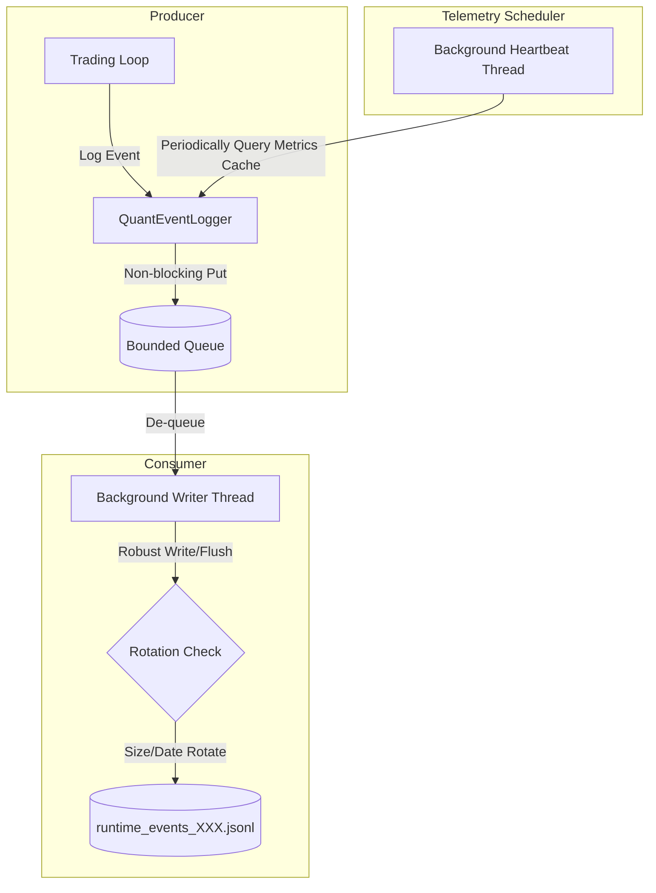

# Runtime Event Stream V1 Implementation Plan V2

This document defines the production-grade, asynchronous, file-backed **Runtime Event Stream V1** design to support continuous 24/7 VPS execution.

---

## 1. System Architecture

The V2 design introduces a completely non-blocking, queued writer architecture to decouple the latency-sensitive trading loop from disk I/O operations.



---

## 2. Queue Architecture & Non-blocking writes

- **Queue Class**: `queue.Queue(maxsize=1000)`.
- **Background Writer Thread**: A daemon thread started on initialization (`_writer_worker`) that polls the queue and appends entries to the active JSONL file.
- **Drop Policy on Queue Overflow**:
  When the queue is full (`queue.Full`), the logger applies the following prioritization strategy to prevent memory bloat without stalling the engine:
  1. **CRITICAL**: Never dropped. The logger will perform a blocking put or evict the oldest `LOW` or `NORMAL` priority event in the queue to make room.
  2. **HIGH / NORMAL**: Buffered. If full, evict `LOW` priority events first.
  3. **LOW**: Instantly dropped under pressure.
  4. **Overflow Notification**: On first eviction/drop, the writer generates and appends an `event_stream_queue_overflow_v1` warning event to the log.

---

## 3. Heartbeat Scheduler & Metrics Cache

- **Heartbeat Daemon**: A daemon thread (`_heartbeat_worker`) started by the `RuntimeEventStream` that sleeps for exactly 5 seconds, queries a thread-safe metrics cache, and dispatches a `runtime_heartbeat_v1` event.
- **Metrics Cache**: `PolymarketTrader` updates a thread-safe dictionary in the logger at the end of each cycle:
  - `loop_latency_ms`: Duration of the entire trader loop.
  - `decision_latency_ms`: Duration of the candidate selection/evaluation.
  - `paper_balance`: Virtual account cash balance.
  - `active_positions`: Open position summary.
  - `current_bankroll_tier`: Active tier string.
  - `risk_mode`: Sizing risk mode.
  - `candidate_count`: Markets checked in the cycle.
- **Queue/File Telemetry**: The background writer provides the following parameters dynamically to the heartbeat payload:
  - `queue_depth`: Current queue length (`queue.qsize()`).
  - `writer_backlog`: Queue depth.
  - `event_stream_file_size`: Active file size in bytes.
  - `last_flush_age_ms`: Elapsed time since the last disk flush.

---

## 4. Log Rotation Policy

The background writer checks file limits prior to every append operation. A file is rotated when:
- **Date Changes**: UTC date changes (daily rotation).
- **Size Exceeded**: Active file size exceeds **256 MB**.
- **Rotation Pattern**: Suffixes are appended sequentially:
  ```text
  runtime/event_stream/runtime_events_2026-06-25_001.jsonl
  runtime/event_stream/runtime_events_2026-06-25_002.jsonl
  ```

---

## 5. Event Schema Envelope

Every event must include the envelope metadata for forward and backward compatibility:

```json
{
  "global_event_uuid": "f81d4fae-7dec-11d0-a765-00a0c91e6bf6",
  "event_type": "event_type_name",
  "event_version": "1.0.0",
  "runtime_session_id": "20260625T052627Z_48728_55bb248a",
  "session_sequence": 1205,
  "timestamp_utc": "2026-06-25T10:47:57.000123Z",
  "priority": "NORMAL",
  "schema_version": "1.0.0",
  "engine_version": "1.5.0",
  "build_hash": "a1f9e2b",
  "git_commit": "de133366",
  "runtime_environment": "paper",
  "payload": {}
}
```

---

## 6. Failure Policy & Robustness

- **Asynchronous Retry**: If writing to the file fails (e.g. disk full, permission error):
  1. The event is pushed to a small local fallback buffer.
  2. The writer thread retries with exponential backoff (starting at 1.0s, capping at 60.0s).
  3. A standard log warning is emitted to stderr.
- **Zero-Exception Trading**: Under no circumstances will a writer thread failure raise an exception in the main trading thread.

---

## 7. Replay & Follow Reader (`tail -f` emulation)

The `tools/runtime_event_replay.py` tool must support the `--follow` (or `-f`) flag.
- When `--follow` is specified, the reader reads the latest log file to the end, prints the historical events matching filters, and then runs a polling sleep loop (`time.sleep(0.1)`) checking the file size and reading any newly appended JSON lines in a non-blocking fashion.

---

## 8. Dashboard Integration Principles

- **Decoupled consumption**: The future React dashboard must consume telemetry *only* by reading/tailing the Runtime Event Stream JSONL.
- **Single Source of Truth**: The React dashboard will not query the Python memory state, other status JSON files, or database internals. Reconstructing state solely from the event stream guarantees clean audit trails.

---

## 9. Implementation Roadmap

1. **Step 1: Code Skeleton**
   - Create `utils/runtime_event_stream.py` defining queueing, thread locking, daemon worker workers, and metric cache registers.
2. **Step 2: Logger Hooking**
   - Adapt `utils/quant_event_logger.py` to instantiate `RuntimeEventStream` and intercept all `_write_event` dispatches.
3. **Step 3: Trader Registry**
   - Update `PolymarketTrader` to push metric snapshots to the metrics cache at the end of each cycle execution.
4. **Step 4: Replay Tool**
   - Create `tools/runtime_event_replay.py` with support for tail-following (`-f`).
5. **Step 5: Testing**
   - Implement `tests/test_runtime_event_stream.py` to cover priority drops, backoff retry, schema compliance, and tail-follow functionality.

---

## 10. Verdict

### `READY_FOR_IMPLEMENTATION_V2`
