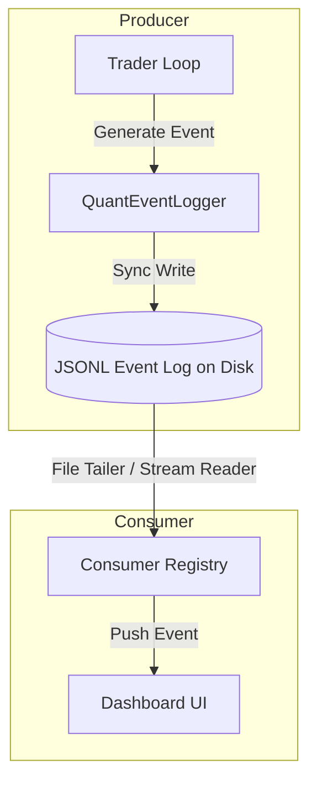

# Runtime Event Stream V1 (Architecture & System Design)

This document defines the system architecture of the **Runtime Event Stream V1** for the Polymarket Adaptive Quant Engine. The primary objective is to replace pull-based dashboard polling with a push-based, asynchronous, event-driven model.

---

## Architectural Philosophy

The event stream architecture decouples the high-frequency trading runtime (producer) from external consumers such as the terminal UI, web dashboard, and alerting systems (consumers).



### Core Design Rules
1. **Zero-Networking Runtime**: To preserve execution safety and avoid socket/network dependency failures in the trading loop, the engine writes events directly to a local, append-only, structured JSONL file.
2. **File-Backed Streaming**: Event streams are written as line-delimited JSON objects (`.jsonl`). Any external dashboard server or UI reads the file using a non-blocking `tail -f` equivalent.
3. **Decoupled Backpressure**: Since event logs are buffered by the operating system's filesystem cache, consumers can crash or experience latency spikes without affecting the trader's execution cycle.

---

## Data Flow Pipeline

1. **Generation**: During execution cycles (e.g., candidate evaluation, order placements, or risk calculations), the `PolymarketTrader` triggers event methods.
2. **Sequencing**: The `QuantEventLogger` serializes the payload, assigns a monotonic `sequence_number` and a unique `event_id`, and writes it to disk.
3. **Flushing**: Lines are written and flushed immediately to minimize latency (typically <1ms write overhead).
4. **Tailing & Consumption**: A dashboard engine tails the file, filtering by `sequence_number` to re-sync or dispatch updates to UI interfaces.

---

## Technical Specifications

### Event Stream Log File Path
Files are organized by UTC date and runtime session:
```text
runtime/quant_data/event_stream_<YYYY-MM-DD>_<SESSION_ID>.jsonl
```

### Concurrency and Locks
- The `QuantEventLogger` implements a thread-safe mutex lock (`self._lock`) around file write operations to guarantee that parallel background tasks (e.g. price feeds or shutdown cleanup) do not corrupt the stream.
