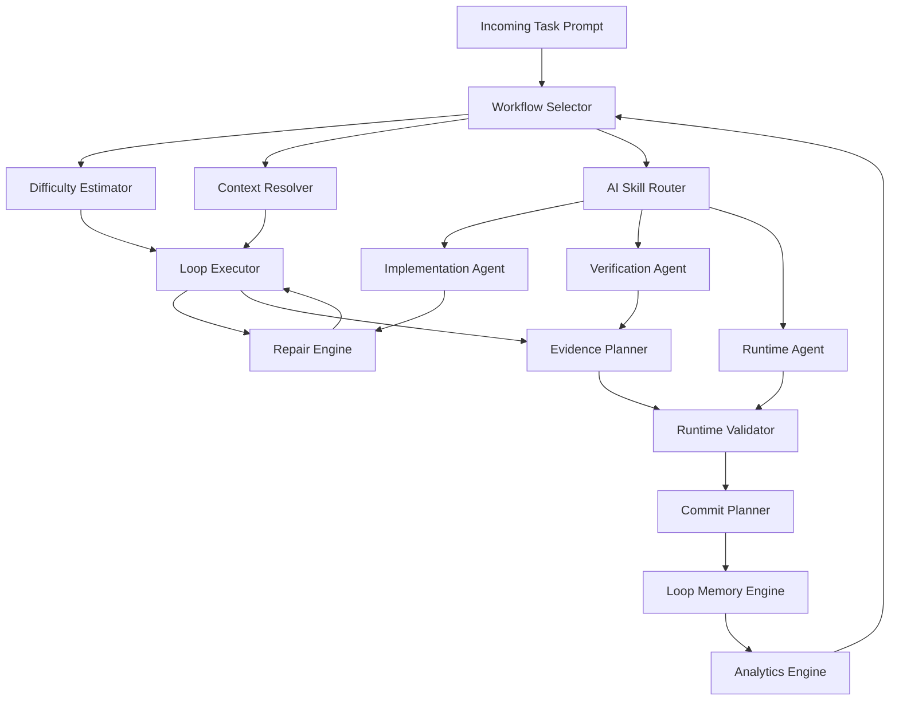
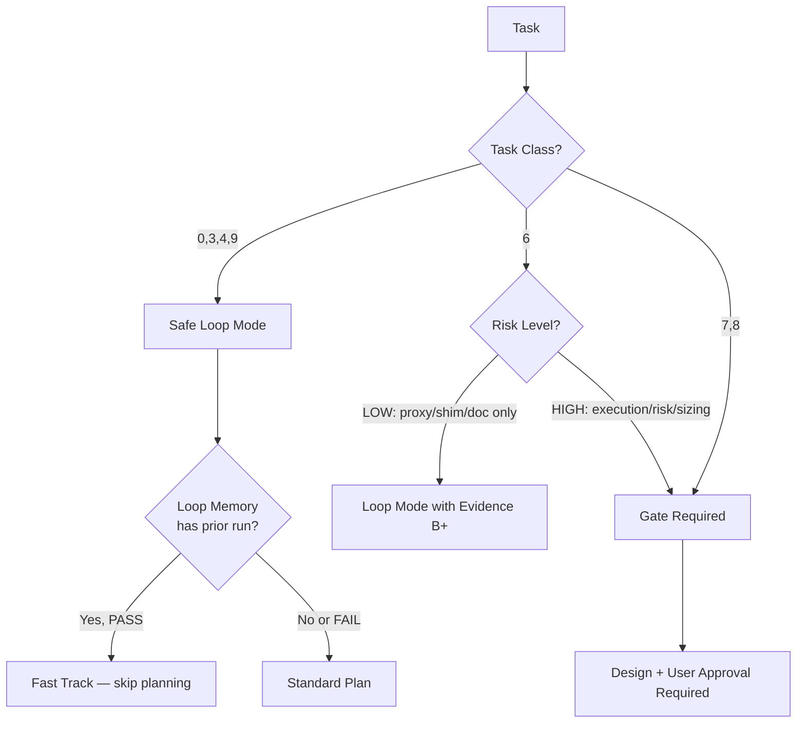
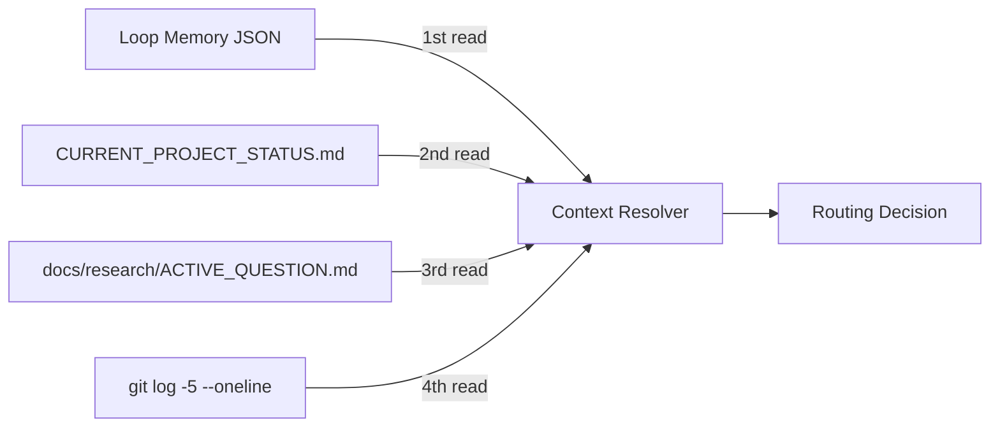
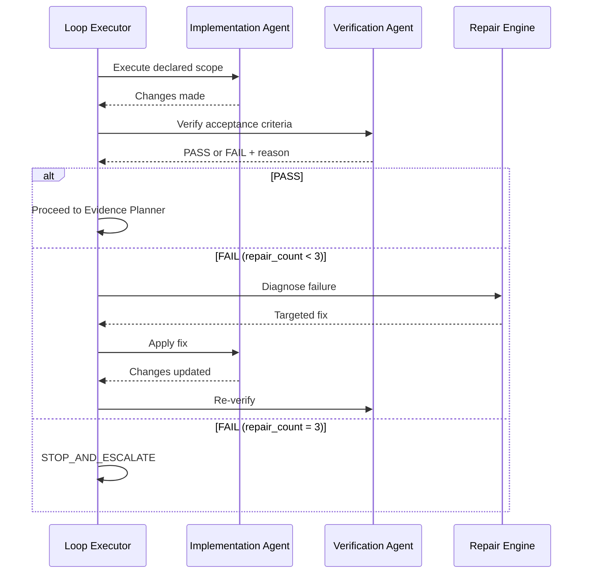
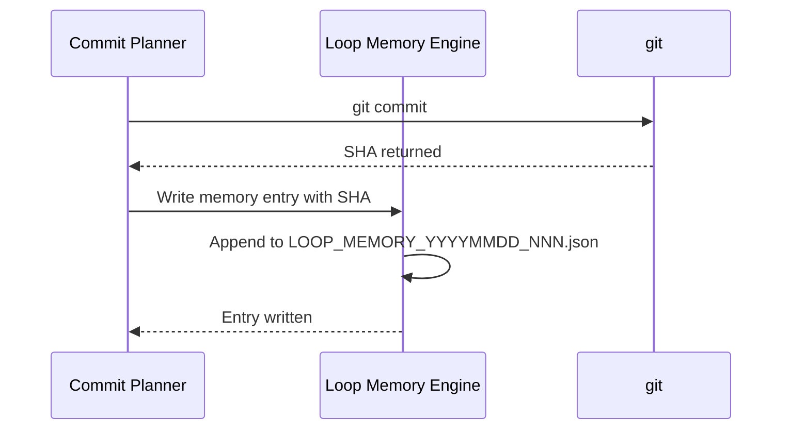
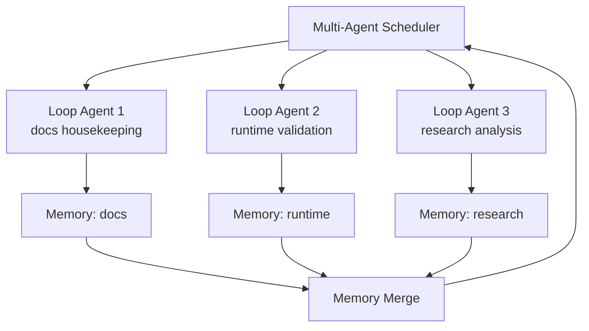
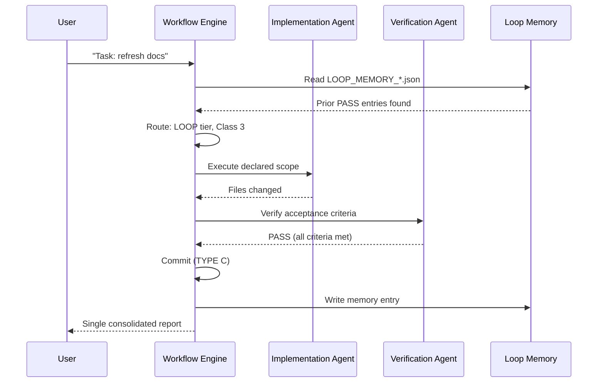
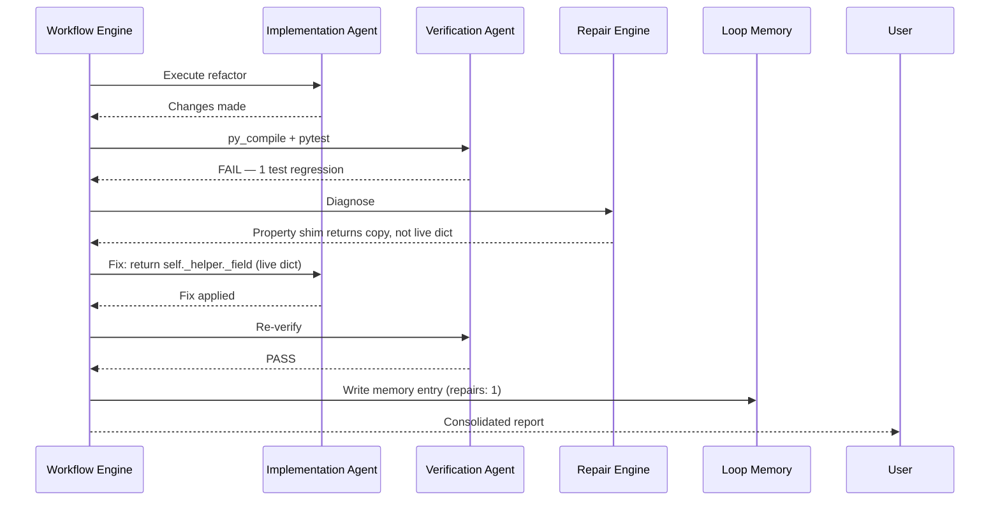
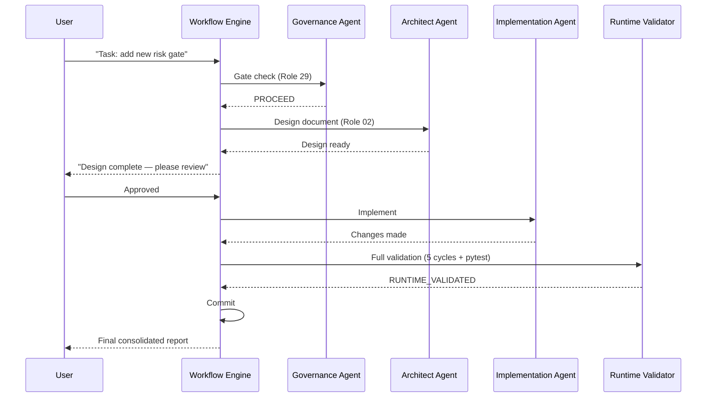

# ADAPTIVE_WORKFLOW_ENGINE_001

**Date:** 2026-06-27  
**Task Class:** 2 (DESIGN_ONLY)  
**Document type:** Architecture design  
**Destination:** `docs/architecture/`  
**Status:** DESIGN — not implemented

---

## 1. Overall Architecture

The Adaptive Workflow Engine (AWE) is a meta-layer that selects, configures, and monitors the correct engineering workflow for every incoming task. It replaces the current manual workflow selection (user chooses task class, copy-pastes reports) with an intelligent orchestration layer.



**Key design principles:**
- Memory-first: every decision consults loop history before choosing workflow
- Evidence-gated: claims require minimum grade before advancing
- Fail-safe: any forbidden scope touch triggers immediate stop
- Single consolidated report: no per-step intermediate reports

---

## 2. Workflow Selector

The Workflow Selector is the entry point. It classifies the incoming task and routes it to the appropriate workflow tier.

### 2.1 Decision Tree



### 2.2 Tier Definitions

| Tier | Task Classes | Workflow |
|------|-------------|---------|
| **FAST** | 0, 3, 9 with prior PASS memory | Memory → Execute → Verify → Report |
| **LOOP** | 0, 3, 4, 6-low, 9 | Plan → Execute → Verify → Repair(≤3) → Report |
| **STANDARD** | 6-high, 1 | Gate → Design → Execute → Validate → Report |
| **GATE** | 7, 8 | Gate → Design → Review → User Approval → Execute → Validate → Report |

---

## 3. Difficulty Estimator

Estimates the risk and complexity of a task before routing.

### 3.1 Inputs
- Task description (keyword scan)
- Scope declaration (files listed)
- Loop memory for similar past tasks
- Current `trader.py` size and extraction batch number

### 3.2 Scoring

```
difficulty_score = 0

# Scope signals
if any execution/risk/sizing file in scope: +40
if trader.py in scope: +20
if test suite in scope: +10
if docs-only scope: -20

# History signals
if prior loop PASS with 0 repairs: -15
if prior loop FAIL or 3 repairs: +25

# Context signals
if active question open: +10
if core runtime clean: -5

# Thresholds
score < 20  → FAST or LOOP
20–50       → STANDARD
> 50        → GATE required
```

### 3.3 Override Rules
- Any score with `_risk_plan_zero_diagnostics` or `_diagnostic_float/_int` in scope → force GATE
- Any score with `--mode live` → force GATE
- Class 8 always → GATE regardless of score

---

## 4. Context Resolver

Reads project context from memory and governance files to inform the workflow.

### 4.1 Context Sources (in read order)



### 4.2 Context Fields Extracted

| Field | Source | Used for |
|-------|--------|---------|
| Last loop result | Loop Memory | Fast-track eligibility |
| Next recommendation | Loop Memory | Suggest task scope |
| Active question | ACTIVE_QUESTION.md | Block strategy changes |
| HEAD commit | git log | Baseline verification |
| trader.py line count | git show HEAD:trader.py \| wc -l | Extraction batch tracking |

---

## 5. Loop Executor

Runs the task plan autonomously within declared scope.

### 5.1 Execution Sequence



### 5.2 Acceptance Criteria Evaluation

Each criterion is evaluated as a binary pass/fail. The loop advances only when ALL criteria pass. Evidence grade is updated after each step.

---

## 6. Repair Engine

Diagnoses failures and produces targeted fixes within declared scope.

### 6.1 Failure Classification

| Failure type | Repair strategy | Evidence needed |
|-------------|-----------------|----------------|
| Compile error | Fix syntax in declared file | Grade B (compile re-run) |
| Import error | Fix import path | Grade B |
| Test regression | Identify changed behavior, revert if out-of-scope | Grade C |
| JSONL field missing | Check property getter returns live dict | Grade A (paper run) |
| Scope violation | STOP — do not repair | — |

### 6.2 Repair Constraints
- Repair scope is strictly bounded by the original declared scope
- A repair that would require touching a forbidden file → STOP
- Repair #3 failure → write partial report, set verdict to STOP_AND_ESCALATE
- Repair evidence must meet the same minimum grade as the original task

---

## 7. Evidence Planner

Determines what evidence is needed and at what grade before the loop can complete.

### 7.1 Minimum Evidence Requirements by Tier

| Tier | Minimum grade | Required commands |
|------|--------------|------------------|
| FAST / LOOP (Class 3/9) | D | `git diff --name-only` |
| LOOP (Class 4/6-low) | B | `py_compile` + `IMPORT_OK` |
| LOOP with runtime | A | `py_compile` + `pytest` + 5-cycle paper run |
| STANDARD | B + C | `py_compile` + `pytest` targeted suite |
| GATE | A + C | `py_compile` + full `pytest` + paper run |

### 7.2 Evidence Collection Policy
- Summarize results in tables — no raw log pastes
- Record evidence grade in Loop Memory JSON
- Higher evidence upgrades are welcome but not required beyond minimum

---

## 8. Runtime Validator

Validates paper mode runtime when minimum evidence tier requires Grade A.

### 8.1 Validation Checklist

```
[ ] py_compile: PASS
[ ] IMPORT_OK
[ ] Paper run: 5+ cycles, exit 0
[ ] 0 AttributeError, 0 Traceback
[ ] STATUS NO LIVE ORDERS confirmed
[ ] JSONL target fields present (>0 events per field)
[ ] Paper trade lifecycle (if applicable): open + close observed
[ ] No new test failures vs baseline
```

### 8.2 Runtime Validator Outputs

| Output | Meaning |
|--------|---------|
| RUNTIME_VALIDATED | All checklist items met; loop may commit |
| RUNTIME_PARTIAL | 3+ cycles but missing JSONL fields → diagnose |
| RUNTIME_REGRESSION | New AttributeError or test failure → repair |
| RUNTIME_ABORT | Forbidden scope touched during runtime → STOP |

---

## 9. Commit Planner

Plans the commit strategy respecting the commit boundary rules from PROJECT_RULES.md.

### 9.1 Commit Type Assignment

```
Loop changes analyzed by file type:
  .py files → TYPE A (runtime Python)
  .ts/.tsx/.json (dashboard) → TYPE B
  .md files (docs) → TYPE C
  tests/*.py → TYPE D
  requirements.txt → TYPE E
  runtime/research_exports/ → TYPE F

If only one type present → single commit
If mixed types → split into multiple commits, one per type
TYPE A must NEVER be mixed with any other type
```

### 9.2 Commit Message Policy
- Single sentence: `[type]: [what changed]`
- No list of files in message (covered by git show)
- Include Co-Author if AI-generated
- Record SHA in Loop Memory after commit

---

## 10. Loop Memory Integration

After every loop, write one entry to the daily memory file.

### 10.1 Memory Write Sequence



### 10.2 Memory Entry Fields (Required)
`$schema`, `date`, `loop_id`, `task_class`, `result`, `repairs`, `evidence_grade`, `commits`, `forbidden_scope_confirmed`

### 10.3 Memory Consumption
A new session reads memory as second input (after governance files). The `next_recommendation` field from the most recent PASS entry drives the task suggestion.

---

## 11. Analytics Engine

Tracks loop health metrics over time for workflow improvement.

### 11.1 Metrics Tracked

| Metric | Source | Use |
|--------|--------|-----|
| Repair rate per task class | Loop Memory | Identify task classes with high failure rates |
| Evidence grade distribution | Loop Memory | Detect evidence shortcuts |
| Avg cycles to PASS | Loop Memory | Measure workflow efficiency |
| Forbidden scope violation rate | Loop Memory (STOP entries) | Identify overly broad declared scopes |
| Pre-existing test failure rate | Test baseline records | Distinguish new regressions from known |

### 11.2 Analytics Output

The Analytics Engine produces a weekly summary (optional) reading all memory records in `docs/operations/loop_memory/`. Output goes to `docs/reports/LOOP_ANALYTICS_YYYYMMDD_001.md`.

---

## 12. AI Skill Router

Routes subtasks to the appropriate agent role from the 29-role system.

### 12.1 Role Selection Logic

```
Task arrives:
  if task involves structural refactor → primary: 02_CODE_ARCHITECT_AGENT
  if task involves risk/sizing → primary: 03_RISK_MANAGER_AGENT (gate required)
  if task involves observability → primary: 11_OBSERVABILITY_INCIDENT_AGENT
  if task involves file routing → primary: 24_REPOSITORY_LIBRARIAN_AGENT
  if task requires gate check → primary: 29_ARCHITECTURE_GOVERNANCE_AGENT
  if task requires handoff → primary: 26_AI_HANDOFF_AGENT
  all tasks: supporting role 07_TEST_CI_AGENT
```

### 12.2 Token Budget per Role

| Role | Max context reads before work | Rationale |
|------|------------------------------|-----------|
| 24 (Librarian) | 2 (governance + target dir) | Simple routing |
| 29 (Governance) | 4 (governance + gate inputs) | Needs evidence |
| 02 (Architect) | 5 (governance + design docs + source) | Needs context |
| 03 (Risk) | 6 (governance + risk files + audit) | High-stakes |
| 07 (CI) | 1 (test file only) | Targeted |

---

## 13. Future Multi-Agent Scheduler

Planned extension for parallel loop execution across multiple independent workstreams.

### 13.1 Architecture (Future)



### 13.2 Constraints for Parallel Execution
- No two parallel loops may touch the same file
- TYPE A loops may not run in parallel with any other TYPE A loop
- Memory merge happens after all parallel loops complete
- Any STOP_AND_ESCALATE in any branch suspends all branches

### 13.3 Readiness Criteria
- Parallel execution requires: memory system operational, scope isolation enforced, branch-level git worktrees
- Not planned before Batch 3C completion and 30+ loop memory entries

---

## 14. Sequence Diagrams

### 14.1 Happy Path — LOOP Tier (Class 3)



### 14.2 Repair Path — LOOP Tier (Class 6-low)



### 14.3 Gate Path — GATE Tier (Class 7)



---

## 15. Decision Trees

### 15.1 Workflow Tier Selection

```
START
  → Read loop memory
  → Is task class 8? → YES → GATE (mandatory)
  → Is forbidden scope requested? → YES → STOP
  → Is task class 7? → YES → GATE
  → Is task class 6?
      → Does scope touch execution/risk/sizing? → YES → GATE
      → Does scope touch trader.py core logic? → YES → GATE
      → Otherwise → LOOP with Evidence B+C minimum
  → Is task class 0/3/4/9?
      → Does loop memory show prior PASS + 0 repairs? → FAST track
      → Otherwise → LOOP
  → Is task class 1? → STANDARD (research review required)
END
```

### 15.2 Repair Decision

```
Criteria FAIL detected:
  → Is the failure in forbidden scope? → YES → STOP_AND_ESCALATE
  → Is repair_count = 3? → YES → STOP_AND_ESCALATE
  → Is the fix within declared scope? → NO → STOP_AND_ESCALATE
  → YES → Apply targeted fix, repair_count++, re-verify
```

---

## 16. Migration Roadmap

### Phase 0 (COMPLETE — 2026-06-27)
- Loop Engineering Playbook created
- Loop Memory spec and first record
- Governance docs updated (AGENTS.md, PROJECT_RULES.md, MASTER_AGENT_ROUTER.md)
- Smoke test: memory sufficient for session startup

### Phase 1 (NEXT — Batch 3C period)
- Use loop memory as standard first-read context in every session
- Analytics Engine: read all memory records, produce weekly summary
- Formalize AI Skill Router: every task declares primary + supporting role

### Phase 2 (Post-Batch 3C)
- Difficulty Estimator: implement keyword-based scoring
- Context Resolver: formalize context read order
- Evidence Planner: enforce minimum grade per tier in Playbook

### Phase 3 (Long-term)
- Multi-Agent Scheduler (requires git worktrees)
- Automated memory consolidation (weekly merge of daily files)
- Cross-session analytics dashboard

---

## 17. Risks

| Risk | Severity | Mitigation |
|------|---------|-----------|
| Difficulty estimator under-scores a high-risk task → wrong tier | HIGH | Always manual override for tasks touching execution/risk/sizing |
| Memory record written with wrong evidence grade | MEDIUM | Evidence grade is self-reported; periodic analytics audit |
| Parallel loops (Phase 3) create git merge conflicts | HIGH | Strict file-level isolation enforced before any parallel execution |
| Memory file grows too large for context window | MEDIUM | Monthly archive: move old entries to `loop_memory/archive/YYYYMM.json` |
| User prompt incorrectly declares low-risk scope | HIGH | Governance Agent gate check is the last safety net for Class 7/8 |
| Analytics Engine misinterprets repair counts | LOW | Repair counts are integers, not prose — low interpretation risk |
