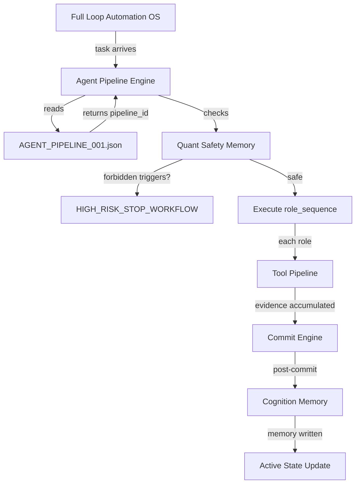
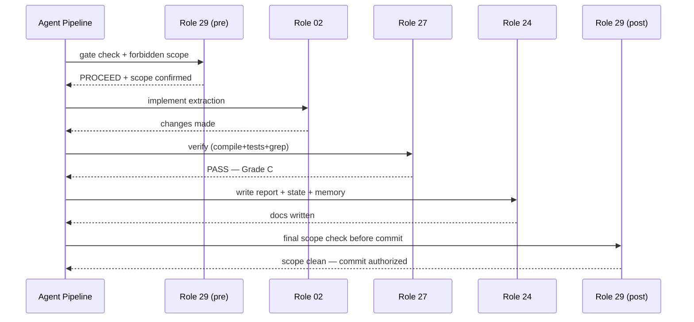
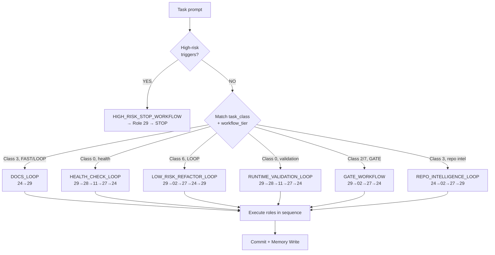

# AGENT_PIPELINE_ENGINE_001

**Date:** 2026-06-27  
**Document type:** Architecture design  
**Destination:** `docs/architecture/`  
**Status:** DESIGN — operational JSON created

---

## 1. Objective

The Agent Pipeline Engine (APE) eliminates manual role selection. Instead of the user (or AI) needing to know "for this task I should use Role 02 + Role 29 + Role 07", the APE reads `AGENT_PIPELINE_001.json` and automatically selects the correct role sequence for each workflow tier, task class, and risk level.

---

## 2. Current Manual Role Problem

| Problem | Impact |
|---------|--------|
| User must name roles explicitly | Round-trip overhead; error-prone |
| Role selection inconsistent across sessions | Different AI sessions choose different roles for same task type |
| No context budget enforcement | AI reads too much or too little |
| No memory-access policy per role | Role 02 shouldn't read quant safety memory; Role 29 always should |
| High-risk tasks not systematically routed to STOP | Depends on AI judgment |

---

## 3. Target Role Scheduler Model

```
Task arrives → APE reads pipeline_id → role_sequence executed in order
Each role: reads only declared inputs → executes declared actions → hands off to next role
Pipeline terminates at NEXT_OR_STOP or HIGH_RISK_STOP_WORKFLOW
```

Roles are executed **sequentially within a single AI session**. The AI simulates multiple roles by reading each role's playbook in order, applying its specific responsibilities, and producing compact handoff output before the next role begins.

---

## 4. Pipeline Selection Algorithm

```
1. Check task for high-risk triggers (risk/sizing/execution/live/wallet)
   → if ANY found → HIGH_RISK_STOP_WORKFLOW (overrides everything)

2. Match task_class + workflow_tier to AGENT_PIPELINE_001.json
   → select first matching pipeline

3. If multiple matches → prefer lowest risk_level

4. Read required_memory_reads before first role executes
   (quant_safety is ALWAYS read regardless of pipeline)

5. Execute role_sequence in order, each role compact-outputs

6. Run required_tools from TOOL_PIPELINES_001.json after EXECUTE

7. Write memory entries per AI_COGNITION_MEMORY_SCHEMA_001.json after COMMIT
```

---

## 5. Role Sequence Definitions

See `docs/operations/AGENT_PIPELINE_001.json` for the full 9 pipelines. Summary:

| Pipeline | Roles | Evidence |
|----------|-------|---------|
| DOCS_LOOP | 24→29 | D |
| HEALTH_CHECK_LOOP | 29→28→11→27→24 | B |
| LOW_RISK_REFACTOR_LOOP | 29→02→27→24→29 | C |
| RUNTIME_VALIDATION_LOOP | 29→28→11→27→24 | A |
| GATE_WORKFLOW | 29→02→27→24 | B |
| HIGH_RISK_STOP_WORKFLOW | 29→STOP | D (then escalate) |
| REPOSITORY_INTELLIGENCE_LOOP | 24→02→27→29 | B |
| TOOL_PIPELINE_LOOP | 29→27→24 | D |
| COGNITION_MEMORY_LOOP | 29→24→27 | D |

---

## 6. Role Responsibilities (Summary)

| Role | Core function in pipeline |
|------|--------------------------|
| 01 PM | Scope control, phase gate, handoff coordination |
| 02 Architect | Code change design, call site mapping, extraction strategy |
| 07 CI | Test selection, baseline capture, regression detection |
| 11 Observability | JSONL shape verification, telemetry field checking |
| 24 Librarian | File routing, docs output, state/queue/memory writes |
| 27 Verification Officer | Challenge Grade E claims; enforce evidence minimum |
| 28 Runtime Ops | Paper run launch/monitoring; exit code + cycle verification |
| 29 Architecture Gov | Gate verdicts; scope boundary enforcement; STOP decisions |

---

## 7. Context Budget Policy per Role

| Role | Max context reads | What to read |
|------|------------------|-------------|
| 24 Librarian | 2 | active state + target directory listing |
| 27 Verification Officer | 3 | prior tool results + evidence grades |
| 28 Runtime Ops | 3 | active state + compile result + runtime log |
| 29 Architecture Gov | 5 | active state + task queue + loop memory + quant safety + gate design |
| 02 Architect | 6 | active state + design doc + source file + call sites grep + test grep + memory |
| 11 Observability | 4 | active state + JSONL file + session events + baseline field list |
| 07 CI | 2 | test file + changed source |

---

## 8. Tool Access Policy per Role

| Role | Allowed tools |
|------|--------------|
| 24 Librarian | write_final_report, git_commit, append_loop_memory, update_active_workflow_state, update_task_queue, root_markdown_check |
| 27 Verification Officer | forbidden_scope_diff_check, high_risk_keyword_check, full_accept_guard |
| 28 Runtime Ops | paper_run_3/5_cycles, runtime_exit_code_check, traceback_check, no_live_order_check, file_size_check |
| 29 Architecture Gov | read_active_workflow_state, read_task_queue, read_loop_memory, git_log_recent, forbidden_scope_diff_check |
| 02 Architect | py_compile_runtime, import_polymarket_trader, git_diff_stat, git_diff_name_only |
| 11 Observability | jsonl_session_scan |
| 07 CI | pytest_core_suite, pytest_targeted_suite |

---

## 9. Memory Access Policy per Role

| Role | Reads | Writes |
|------|-------|--------|
| 29 Governance | quant_safety (ALWAYS), decision, failure | — |
| 02 Architect | quant_safety, repository_insight, repair | decision, repository_insight |
| 27 Verification | quant_safety, failure, repair | failure (if new) |
| 28 Runtime Ops | quant_safety, runtime_evidence | runtime_evidence |
| 11 Observability | quant_safety, runtime_evidence | tool_usage |
| 24 Librarian | — | append_loop_memory (via tool) |
| 07 CI | quant_safety | — |

---

## 10. Full Accept Safety Behavior

**Auto-accept (no user approval):** All pipelines except HIGH_RISK_STOP_WORKFLOW when:
- All acceptance criteria in `full_accept_guard` pass
- Evidence grade meets or exceeds `required_evidence`
- No forbidden scope in diff
- No high-risk keyword found
- No live orders in paper run

**Never auto-accept (always requires user):**
- HIGH_RISK_STOP_WORKFLOW — any execution/risk/sizing/live/wallet trigger
- Class 8 tasks of any kind
- Tasks where `full_accept_policy = "NEVER auto"`

---

## 11. Stop-and-Escalate Behavior

Any role in any pipeline can trigger STOP_AND_ESCALATE:

```
Role detects stop condition
  → Role 29 writes STOP report to docs/reports/
  → State updated: blocked = true, stop_reason = "..."
  → Loop Memory appended: result = FAIL, stop_reason
  → No commit of partial work
  → User notified with: stop_reason, recommended_next_action, git restore command
```

---

## 12. Integration Diagrams

### FLAOS Integration



### Role Execution Sequence (LOW_RISK_REFACTOR_LOOP example)



---

## 13. Mermaid — Pipeline Selection



---

## 14. Migration Roadmap

| Version | Name | What ships | Trigger |
|---------|------|-----------|---------|
| **v1** | JSON spec | `AGENT_PIPELINE_001.json` + this doc | NOW |
| **v2** | Checklist | AI reads pipeline_id and checks off each role as it executes | After 5+ pipeline uses |
| **v3** | Role context injector | Each role gets only its declared context reads injected automatically | Phase 3 FLAOS |
| **v4** | Parallel roles | Role 27 and Role 24 may run concurrently for speed | Phase 4 FLAOS |
| **v5** | Memory-assisted selection | Pipeline selection uses ACME failure memory to avoid repeating poor role choices | Phase 5 FLAOS |
