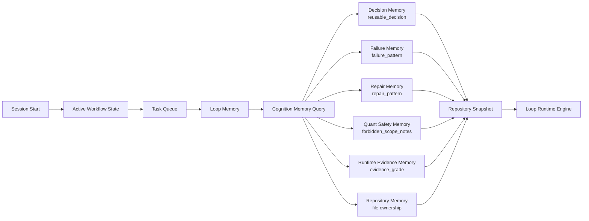
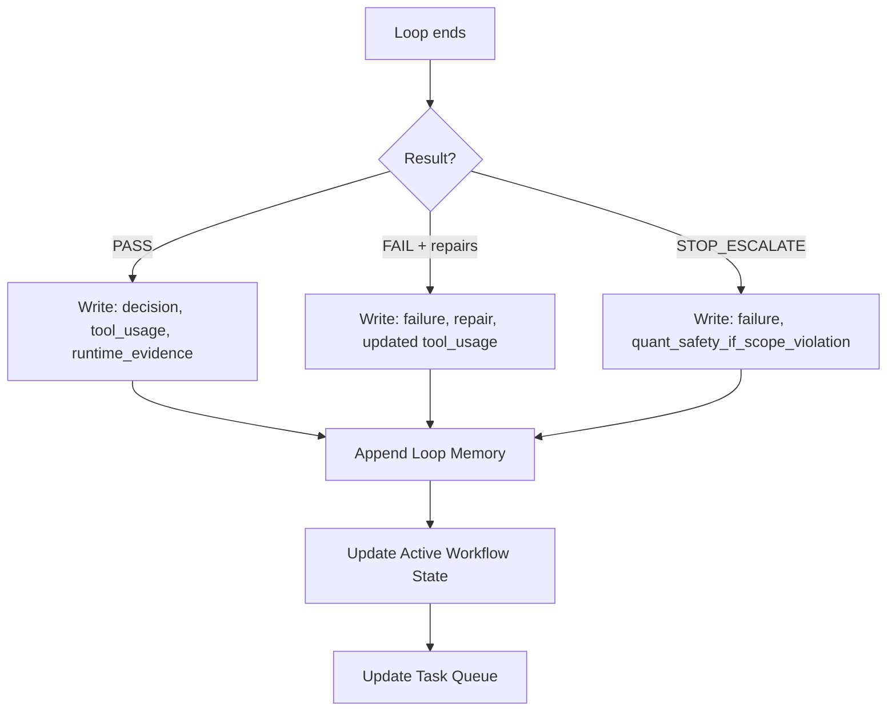
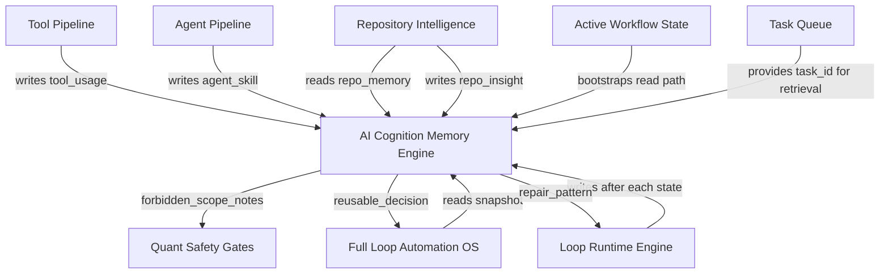
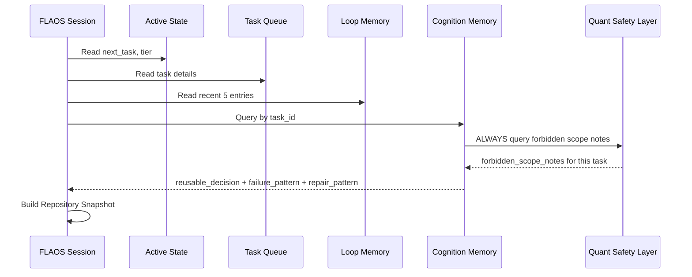
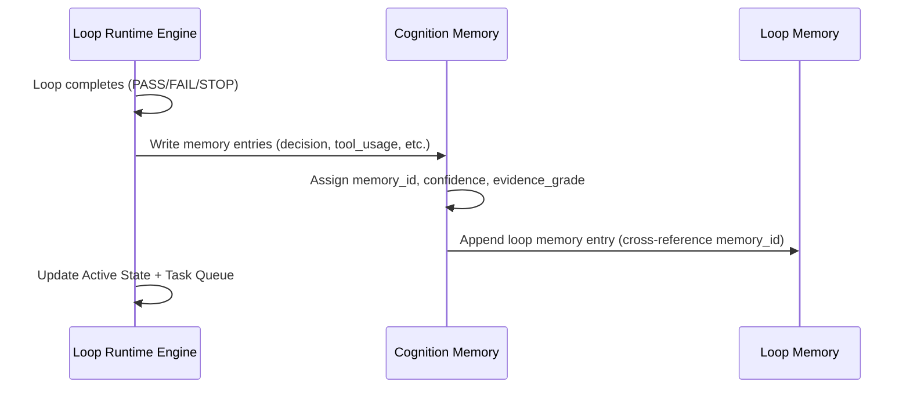
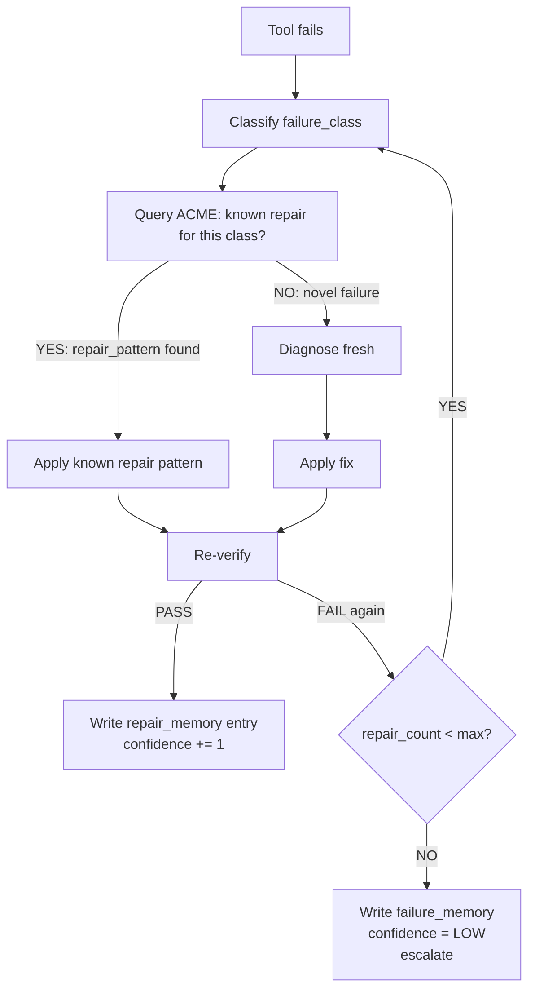
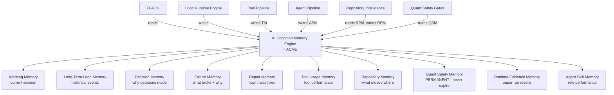

# AI_COGNITION_MEMORY_ENGINE_001

**Date:** 2026-06-27  
**Document type:** Architecture design  
**Destination:** `docs/architecture/`  
**Status:** DESIGN — v1 specification only

---

## 1. Objective

The AI Cognition Memory Engine (ACME) is the "brain" layer of the Full Loop Automation OS. It stores, retrieves, and applies structured knowledge gained from past loops — decisions made, failures encountered, repairs applied, runtime evidence gathered, and quant safety constraints observed.

While Loop Memory (`.json` files) records what happened, ACME records **why it happened**, **what was learned**, and **how to avoid repeating failures**. It bridges raw event history and intelligent decision-making.

---

## 2. Why Loop Memory is Not Enough

| Limitation | Loop Memory | ACME |
|------------|-------------|------|
| Records what happened | ✓ | ✓ |
| Records why it happened | ✗ | ✓ |
| Records lessons learned | ✗ | ✓ |
| Identifies failure patterns | ✗ | ✓ |
| Suggests repair strategies | ✗ | ✓ |
| Tracks forbidden scope violations | ✗ | ✓ |
| Stores reusable decisions | ✗ | ✓ |
| Supports retrieval by pattern | ✗ | ✓ |
| Compacts automatically | ✗ | ✓ |

Loop Memory is an **event log**. ACME is **structured knowledge**.

---

## 3. Cognition Layers

### 3.1 Working Memory
**Scope:** Single session  
**Content:** Current task contract, active tool pipeline, in-progress repair state, current evidence grade  
**Lifecycle:** Created at INIT, discarded after NEXT_OR_STOP  
**Storage:** In-session only — never persisted to disk  

### 3.2 Long-Term Loop Memory
**Scope:** Cross-session historical record  
**Content:** Loop Memory JSON files — loop_id, result, repairs, commits, evidence_grade, next_recommendation  
**Lifecycle:** Persistent; monthly compact  
**Storage:** `docs/operations/loop_memory/LOOP_MEMORY_YYYYMMDD_NNN.json`  
**Current status:** Operational (v2)  

### 3.3 Decision Memory
**Scope:** Cross-session; indexed by task type  
**Content:** Why a particular scope, tier, or approach was chosen; what alternatives were considered; what tradeoffs were accepted  
**Example:** "For Batch 3C, chose display proxy elimination before phase2 payload extraction because: (a) 0 remaining call sites, (b) dedup fix made it trivially safe, (c) phase2 methods need separate gate"  
**Storage:** `docs/operations/cognition_memory/DECISION_MEMORY_*.json`  

### 3.4 Failure Memory
**Scope:** Cross-session; indexed by failure class  
**Content:** What failed, in which file/method, which test caught it, how many repair attempts were needed  
**Example:** "Batch 3B-1: test_paper_mode.py::test_decision_event... failed because helper called trader._event_producer_label() instead of self._event_producer_label(). Root cause: Batch 3B-2 dedup fix not yet applied. Resolved in 6872a07."  
**Storage:** `docs/operations/cognition_memory/FAILURE_MEMORY_*.json`  

### 3.5 Repair Memory
**Scope:** Cross-session; indexed by failure class → repair action  
**Content:** Which repair pattern fixed which failure; confidence in the repair; risk introduced by the repair  
**Example:** "compile_error → check for missing import (hashlib) after moving static method that uses it. Applied in Batch 3C: added hashlib to trader_observability.py"  
**Storage:** `docs/operations/cognition_memory/REPAIR_MEMORY_*.json`  

### 3.6 Tool Usage Memory
**Scope:** Cross-session; indexed by tool_id  
**Content:** Tool invocation history, success rate, typical duration, known edge cases  
**Example:** "jsonl_session_scan: PID filtering must use runtime_session_id field, not raw PID — PID may appear in other fields. Observed in post-3B1 validation."  
**Storage:** `docs/operations/cognition_memory/TOOL_MEMORY_*.json`  

### 3.7 Repository Memory
**Scope:** Cross-session; indexed by file/method  
**Content:** What has been moved where, which call sites were updated, which methods remain permanently, historical line counts  
**Example:** "trader_observability.py: Batch 3A added display state; 3B-1 added 8 orderbook fields; 3B-2 added 5 cadence fields; 3B-dedup fixed round-trip display calls; 3C added 4 static phase2 utilities. Current: 10 methods, ~470 lines."  
**Storage:** `docs/operations/cognition_memory/REPO_MEMORY_*.json`  

### 3.8 Quant Safety Memory
**Scope:** Cross-session; permanent — never expires  
**Content:** Known forbidden methods, permanent methods, execution coupling warnings, active question blocks  
**Example:** "PERMANENT: _phase4_build_quote_lineage — written from execution path at lines 4338, 11583, 11689. Attempting to extract will create execution-path coupling to helper. Do not move in any future batch."  
**Storage:** `docs/operations/cognition_memory/SAFETY_MEMORY_*.json`  
**Special rule:** Quant Safety Memory entries are NEVER compacted or expired. They accumulate indefinitely.  

### 3.9 Runtime Evidence Memory
**Scope:** Cross-session; indexed by commit SHA  
**Content:** Summary of runtime validation results: cycles, JSONL field counts, exit codes, paper trade events  
**Example:** "Commit 3c5b781 (Batch 3C): 7 cycles, exit 0, orderbook_refresh_source=56 events, market_evaluation_duration_ms=28 events. No AttributeError. Paper trade: position_opened_v1=0 this run."  
**Storage:** `docs/operations/cognition_memory/RUNTIME_EVIDENCE_*.json`  

### 3.10 Agent Skill Memory
**Scope:** Cross-session; indexed by task type  
**Content:** Which agent role performed best on which task type; context budget used; quality of output  
**Example:** "29_ARCHITECTURE_GOVERNANCE_AGENT: 3 gate check tasks, all PROCEED verdicts, 0 escalations. Average context reads: 4 files. Optimal for Batch gate checks."  
**Storage:** `docs/operations/cognition_memory/AGENT_SKILL_MEMORY_*.json`  

---

## 4. Read Path



**Read order:**
1. `ACTIVE_WORKFLOW_STATE_001.json` — phase, next_task, tier
2. `TASK_QUEUE_001.json` — task details, blocked_by
3. `loop_memory/LOOP_MEMORY_*.json` — recent event history
4. `cognition_memory/SAFETY_MEMORY_*.json` — ALWAYS read before any code change
5. `cognition_memory/DECISION_MEMORY_*.json` — for task matching
6. `cognition_memory/FAILURE_MEMORY_*.json` — if task involves known failure area
7. `TOOL_REGISTRY_001.json` + `TOOL_PIPELINES_001.json` — pipeline selection
8. Repository Intelligence snapshot (if available)

---

## 5. Write Path



**Write triggers:**
- **After task completion (PASS):** Append decision memory (why scope chosen), runtime evidence (JSONL counts), tool usage (which tools ran, duration)
- **After repair:** Append failure memory (failure class, affected file), repair memory (fix applied, repair count)
- **After runtime validation:** Append runtime evidence (cycles, exit code, JSONL fields)
- **After STOP/ESCALATE:** Append failure memory; if scope violation detected → append quant safety memory with new finding
- **After design task:** Append decision memory (design rationale, scope boundaries)

---

## 6. Memory Schema

See `docs/operations/AI_COGNITION_MEMORY_SCHEMA_001.json` for the full JSON schema. Summary of required fields:

```json
{
  "memory_id": "unique identifier e.g. DECISION-20260627-BATCH3C-001",
  "memory_type": "decision|failure|repair|tool_usage|runtime_evidence|repository_insight|quant_safety|agent_skill",
  "task_id": "BATCH_3C_GATE_CHECK_001",
  "source_commit": "db21426",
  "confidence": "HIGH|MEDIUM|LOW",
  "evidence_grade": "A|B|C|D",
  "summary": "one-sentence summary",
  "lessons_learned": "what to do or avoid next time",
  "failure_pattern": "null or: failure class + affected file + root cause",
  "repair_pattern": "null or: fix applied + evidence grade after repair",
  "reusable_decision": "null or: decision that can be reused in similar tasks",
  "forbidden_scope_notes": "null or: new forbidden scope finding",
  "next_recommendation": "what to do next"
}
```

---

## 7. Retrieval Policy

| Query type | Match strategy | Example |
|-----------|---------------|---------|
| Exact task match | `task_id` equality | "BATCH_3C_GATE_CHECK_001" → return all memories for this task |
| Related module match | `source_commit` → `git show --name-only` | Files in commit → retrieve repo_insight for those files |
| Failure pattern match | `failure_pattern.failure_class` similarity | "compile_error" → retrieve all compile_error repairs |
| Tool match | `tool_usage.tool_id` | "paper_run_5_cycles" → retrieve all runtime evidence from paper runs |
| Quant safety match | `quant_safety.forbidden_method` | "_phase4_build_quote_lineage" → always retrieve any time trader.py is in scope |

**Quant safety match is MANDATORY** — it must be run before any task touching runtime Python files.

---

## 8. Forget / Compact Policy

| Memory type | Retention | Compact rule |
|------------|-----------|-------------|
| Working memory | Session only | Discarded after NEXT_OR_STOP |
| Loop memory | Keep all | Monthly: compress to `archive/YYYYMM.json` |
| Decision memory | 90 days active | After 90 days → keep summary only |
| Failure memory | 180 days active | Keep failure_pattern + repair_pattern; discard raw details |
| Repair memory | 180 days active | Keep repair_pattern; discard tool invocation details |
| Tool usage memory | Rolling 30-entry window per tool | Discard oldest |
| Repository memory | Permanent | Never discard (tracks extraction history) |
| **Quant safety memory** | **PERMANENT** | **NEVER compact, NEVER expire** |
| Runtime evidence memory | 60 days | Keep summary + JSONL field counts; discard raw log references |
| Agent skill memory | 90 days | Keep role + success rate; discard per-invocation details |

**Raw logs are NEVER stored in memory.** Only structured summaries, counts, and lessons.

---

## 9. Integration



---

## 10. Quant Safety Memory (Always On)

The Quant Safety Memory layer is the most critical. It stores known forbidden areas and their rationales. These entries are NEVER expired.

**Pre-seeded entries (from this project history):**

| Entry | Forbidden method/file | Rationale | Source |
|-------|----------------------|-----------|--------|
| QS-001 | `_phase4_build_quote_lineage` | Written from execution path (lines 4338, 11583, 11689). Extraction creates execution coupling. | Batch 3B design review |
| QS-002 | `_phase4_quote_lineage_carry` | Called from execution path. Same rationale as QS-001. | Batch 3B design review |
| QS-003 | `_last_quote_lineage_context` | Written inside `_phase4_build_quote_lineage` — execution path write. | Batch 3B design review |
| QS-004 | `_risk_plan_zero_diagnostics` | Reads bankroll tiers, risk modes, sizing rules. Cyclical back-coupling if moved. | Project wide refactor audit |
| QS-005 | `_diagnostic_float` | Used in 99+ core math paths. Moving has maximum blast radius. | Project wide refactor audit |
| QS-006 | `_diagnostic_int` | Same as QS-005. | Project wide refactor audit |
| QS-007 | `polymarket/client.py` live order methods | Never touch from paper-mode tasks. | AGENTS.md |
| QS-008 | `.env` live flags | `PAPER_TRADING=false` or `DRY_RUN=false` → treat repo as live-risk. | AGENTS.md |
| QS-009 | `runtime/` data deletion | Never delete runtime data from automated loops. | PROJECT_RULES.md |
| QS-010 | `arb_auto_execute` | Must remain false by default. | AGENTS.md safety rules |

---

## 11. Mermaid Diagrams

### Cognition Read Flow



### Cognition Write Flow



### Failure → Repair → Memory Loop



### AI Brain Integration Graph



---

## 12. Migration Roadmap

| Version | Name | What ships | Trigger |
|---------|------|-----------|---------|
| **v1** | Spec | This document + schema JSON | NOW |
| **v2** | JSON records | AI writes memory entries after each loop to `docs/operations/cognition_memory/*.json` | After 5+ loop memory entries exist |
| **v3** | Query script | `docs/tools/acme_query.py` — retrieves memories by task_id, failure_class, module | After v2 operational |
| **v4** | Vector search | Semantic similarity retrieval (embedding-based) for failure pattern matching | Post-Batch-4, requires Python embedding library |
| **v5** | Autonomous planner | ACME-assisted task planning: AI consults memory before declaring scope | Long-term |

**v1 → v2 trigger:** When 3+ distinct failure types appear in Loop Memory across different sessions — enough pattern data to justify structured memory entries.

**Current status: v1 (specification only).**
