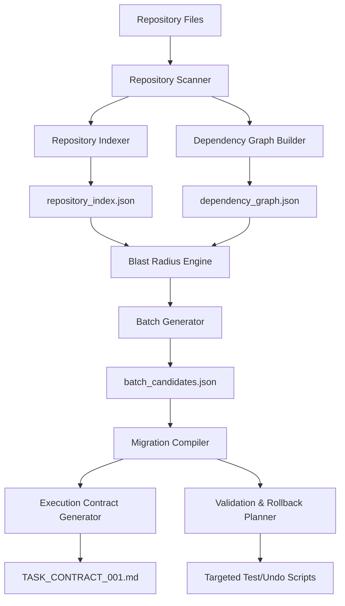

# AI_REPOSITORY_OPERATING_SYSTEM_V2_BATCH_AUTOMATION_001

**Status:** ACTIVE  
**Date:** 2026-06-28  
**Purpose:** Architecture specification for the AIROS v2 Batch Automation Layer, enabling risk-aware, automated, multi-file code reorganizations.

---

## 1. Objective

AIROS v2 introduces the **Automation Layer** to transition repository reorganizations from manual file-by-file inspection to programmatic, dependency-graph-driven batch migrations. By automating scanning, scoring, clustering, compilation, and validation planning, AIROS v2 enables future agents to safely move 15–40 files per batch in atomic execution blocks.

---

## 2. Architecture Diagram

---

## 3. Core Components

### 3.1 Repository Scanner
* **Purpose:** Programmatically scan all directories, filtering out cached/system files.
* **Mechanism:** AST (Abstract Syntax Tree) parsing of Python files to inspect imports, class hierarchies, function definitions, docstrings, and comments.
* **Output:** Flat metadata map of file locations, sizes, line counts, and modification times.

### 3.2 Repository Index Generator
* **Purpose:** Structure scanned metadata into a unified registry.
* **Output:** Creates `docs/operations/repository/repository_index.json`, providing a quick lookup cache of all files in the project.

### 3.3 Dependency Graph Generator
* **Purpose:** Map inbound and outbound dependencies across the codebase.
* **Mechanism:** Resolves import statements to construct a directed adjacency matrix.
* **Output:** Creates `docs/operations/repository/dependency_graph.json`.

### 3.4 Blast Radius Engine
* **Purpose:** Compute risk scores for migration candidates using the quantitative scoring model.
* **Mechanism:** Implements the formula from `BATCH_MIGRATION_RISK_MODEL_001.md` based on import relationships.
* **Output:** Assigns risk levels (`SAFE_ATOMIC`, `MEDIUM_ATOMIC`, `PLAN_REQUIRED`, `DO_NOT_MOVE`).

### 3.5 Batch Generator
* **Purpose:** Cluster candidate files into optimal migration batches.
* **Mechanism:** Clusters files based on shared directory targets and dependency subgraphs while adhering to size constraints (max 12 files/1,500 lines).
* **Output:** Creates `docs/operations/repository/batch_candidates.json`.

### 3.6 Migration Compiler
* **Purpose:** Translate batch candidates into concrete implementation steps.
* **Output:** Computes `git mv` command sequences and import rewrite maps.

### 3.7 Validation Planner
* **Purpose:** Generate targeted verification commands.
* **Output:** Emits compilation (`py_compile`) and test execution (`pytest`) command pipelines.

### 3.8 Rollback Planner
* **Purpose:** Guarantee non-destructive recovery in case of validation failures.
* **Output:** Emits reverse `git mv` sequences and checkout checkout instructions.

### 3.9 Execution Contract Generator
* **Purpose:** Automate task pre-execution documentation.
* **Output:** Pre-populates the required sections of the Execution Contract template under `docs/operations/execution_contracts/`.

### 3.10 Context Cache Generator
* **Purpose:** Store intermediate AST and dependency states.
* **Output:** Prevents redundant directory scans, reducing context usage and accelerating token-bound operations.

---

## 4. Safety Boundaries

The automation engine enforces strict gates to prevent dangerous file alterations:
* **Core Runtime Lock:** Any batch proposal touching `polymarket/`, `config/`, or `.env` triggers an immediate safety shutdown.
* **Risk/Sizing Core Lock:** Any module importing or referenced by trade risk paths is classified as `DO_NOT_MOVE`.
* **Cyclic Dependency Lock:** If clustering detects cyclic dependencies between candidates and core files, the batch is split or blocked.

---

## 5. Phased Implementation Roadmap

### Phase 1: Metadata & Dependency Parser (Bootstrap Layer)
* Build the AST scanner, indexer, and dependency graph builder.
* Output `repository_index.json` and `dependency_graph.json`.

### Phase 2: Decision Engine (Rules Layer)
* Build the Blast Radius Engine and Batch Generator.
* Output risk classifications and optimal batch groupings.

### Phase 3: Execution Compiler (State Layer)
* Build the Migration Compiler, Rollback Generator, and Contract Generator.
* Output executable scripts, targeted test pipelines, and pre-filled contracts.
