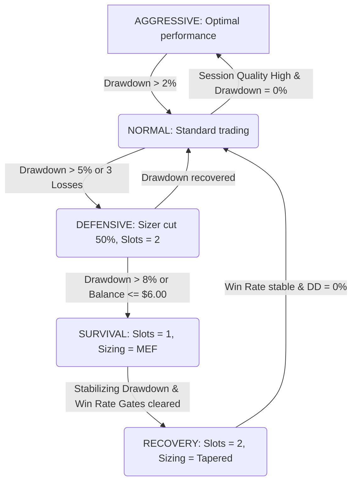

# ALWAYS_ACTIVE_ENGINE_V1_DESIGN_001
**Mode: DESIGN ONLY**  
**Date: 2026-06-24**  

This document presents the master design for the Always Active Engine of the Polymarket Crypto 5M Quant Engine. It establishes a continuous, non-halting runtime state machine designed to keep the system scanning, ranking, and evaluating opportunities 24/7 on a VPS, adapting its risk parameters dynamically rather than shutting down.

---

## 1. The "Always Active" Core Philosophy

Traditional trading engines employ hard stops or long execution pauses when drawdowns occur. In contrast, the Always Active Engine preserves signal awareness and execution readiness at all times:

1. **Continuous Scanning**:
   - The engine never halts market data ingestion or price scanning during trading drawdowns. It continues writing CSV and JSONL logs, calculating indicators, and ranking opportunities.
2. **Continuous Opportunity Ranking**:
   - Every candidate is ingested and evaluated against the current state's thresholds. High-quality opportunities remain tradeable even during drawdowns, preventing the bot from missing high-alpha regime recoveries.
3. **Selectivity Over Shutdown**:
   - Risk management is executed by raising EV/ETS thresholds, reducing active slot counts, and shrinking order sizes, rather than turning the bot off.
4. **Strict Boundaries for Hard Loops**:
   - Loop execution halts (hard stops) are strictly prohibited for trading losses. Hard halts are reserved exclusively for critical structural, system-health, or security failures.

---

## 2. Master Runtime State Parameter Calibration

The table below defines the parameters and thresholds for the five runtime states:

| Runtime State | Sizer Mode | Max Slots | Max Exposure / Slot | Min EV | Min ETS | Max Spread | Max Quote Age | Min L1 Depth |
| :--- | :---: | :---: | :---: | :---: | :---: | :---: | :---: | :---: |
| **`AGGRESSIVE`** | Kelly | 5 | 3.0% ($30.00 max) | $0.015 | 0.55 | $0.05 | 5.0s | 10x size |
| **`NORMAL`** | Kelly | 3–4 | 2.66% ($10.00 max) | $0.02 | 0.60 | $0.04 | 3.0s | 15x size |
| **`DEFENSIVE`** | Kelly (0.10) | 2 | 1.50% ($5.00 max) | $0.04 | 0.75 | $0.025 | 2.0s | 50x size |
| **`SURVIVAL`** | Flat MEF | 1* | MEF notional | $0.05 | 0.85 | $0.015 | 1.5s | 100x size |
| **`RECOVERY`** | Flat / Kelly | 2 | MEF / 1.00% | $0.03 | 0.75 | $0.02 | 2.0s | 50x size |

$$\text{*Note: } \text{Survival allows an optional 2nd slot exception under excellent microstructure conditions.}$$

---

## 3. Runtime State Transitions

The state machine transitions adaptively based on real-time feedback:

- **AGGRESSIVE**: Entered when session quality is high (win rate $>60\%$ over last 20 trades) and daily drawdown is 0%.
- **NORMAL**: Standard state.
- **DEFENSIVE**: Triggered by a 5% daily drawdown or a 3-loss cluster. Enforces a reduced aggression window.
- **SURVIVAL**: Triggered by an 8% daily drawdown or balance falling to $\le \$6.00$. Capped to MEF sizing.
- **RECOVERY**: A transitional healing state entered from Defensive or Survival. Sizing scales up gradually as win rate targets are met, preventing size jumps.
