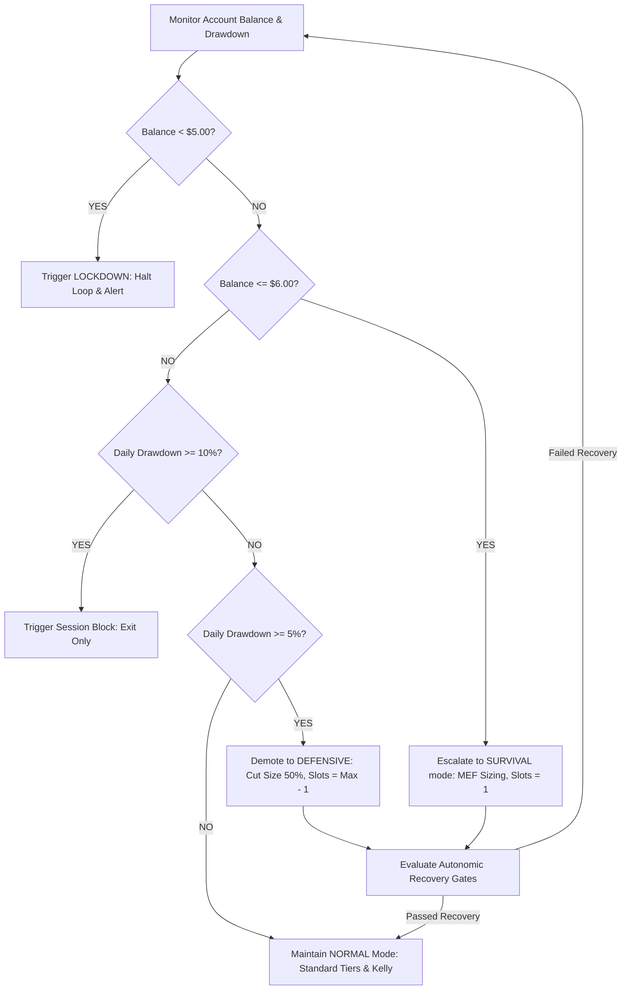

# BANKROLL_ENGINE_V1_DESIGN_001
**Mode: DESIGN ONLY**  
**Date: 2026-06-24**  

This document outlines the master architecture for the bankroll engine of the Polymarket Crypto 5M Quant Engine. It specifies the lifecycle states, drawdown handling, survival escalation, and the compounding growth framework required to scale capital safely.

---

## 1. The Compounding Growth Framework ($10 to $1000+)

The engine is designed to compound capital automatically while enforcing strict risk boundaries at each stage:

```
┌────────────────────────────────────────────────────────────────────────┐
│                      COMPOUNDING GROWTH LADDER                         │
├─────────────────┬──────────────────┬─────────────────┬─────────────────┤
│ BANKROLL SCALE  │   FAMILY CLASS   │  SIZING MODE    │ RISK POLICY     │
├─────────────────┼──────────────────┼─────────────────┼─────────────────┤
│ $10 - $25       │ Seed Micro (T0)  │ Survival (MEF)  │ Highly Defensive│
│ $25 - $50       │ Build Micro (T1) │ Survival (MEF)  │ Cheap-Pref      │
│ $50 - $100      │ Survival (T2)    │ Survival (Flat) │ Spread Guarded  │
│ $100 - $250     │ Base Build (T3)  │ Standard Kelly  │ Standard Risk   │
│ $250 - $500     │ Base Stable (T4) │ Standard Kelly  │ Tapered Risk    │
│ $500 - $1000+   │ Small Growth (T5)│ Standard Kelly  │ Multi-slot      │
└─────────────────┴──────────────────┴─────────────────┴─────────────────┘
```

1. **The Micro Stage ($10–$100)**:
   - Sizing is restricted to survival rules. Standard Kelly calculations are bypassed, and size is capped to flat notional limits or the Market Executable Floor (MEF) to prevent rapid depletion of the tiny capital base.
2. **The Base Stage ($100–$500)**:
   - Sizing transitions to fractional Kelly ($0.20$ multiplier). Sizer parameters actively scale positions, and slot counts expand to allow risk distribution across independent opportunities.
3. **The Growth Stage ($500–$1000+)**:
   - Maximizes slot counts (up to 5 concurrent) to exploit multiple uncorrelated edges. Sizing per slot tapers down to 3.0% to maintain a highly diversified portfolio with a 2x safety cushion.

---

## 2. Capacity First, Size Second Coordination

To ensure long-term capital preservation, sizing promotions are coordinated strictly in a **Capacity First** order:

1. **Slot Capacity Promotes First**:
   - When account balance crosses a tier boundary (e.g. T2 to T3), the engine first expands the available slot capacity (e.g. from 2 slots to 3 slots). This increases the bot's capacity to take independent, uncorrelated trades.
2. **Order Sizing Promotes Second**:
   - The maximum notional limit per trade is only allowed to increase *after* slot capacity has been expanded, and only if the portfolio's total exposure budget can absorb the joint loss probability.
3. **Correlation Override**:
   - If correlations are high ($\rho \ge 0.50$), the capacity is restricted and sizer sizes are scaled down to avoid double exposure, overriding default tier sizing.

---

## 3. Drawdown Handling and Survival Escalation

The engine constantly monitors session and cumulative drawdowns to escalate defensive behaviors:

- **Session Drawdown ($D_{\text{session}}$)**:
   - If $D_{\text{session}} \ge 5\%$, the engine immediately demotes the risk state to `DEFENSIVE`. Sizer weights are cut by 50% and max slots are reduced by 1.
- **Daily Drawdown ($D_{\text{daily}}$)**:
   - If $D_{\text{daily}} \ge 10\%$, the engine triggers a session veto (`VETO_DAILY_DRAWDOWN`), blocking new entries until the 00:00 UTC reset.
- **Survival Escalation (Balance near Floor)**:
   - If cash equity drops within $1.00 of the **$5.00 floor** (i.e. balance $\le \$6.00$), the engine escalates to `SURVIVAL` mode, regardless of the active tier. All Kelly sizing is suspended, slot counts default to 1, and sizing is locked to the absolute minimum executable floor (MEF).
- **Hard Lockdown**:
   - If balance falls below **$5.00**, the engine enters `LOCKDOWN` and halts all loop cycles.

---

## 4. Master Bankroll Engine Lifecycle

The diagram below maps the dynamic transitions coordinated by the bankroll engine:


