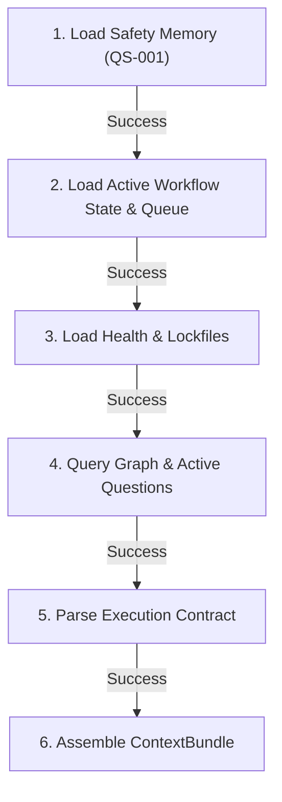
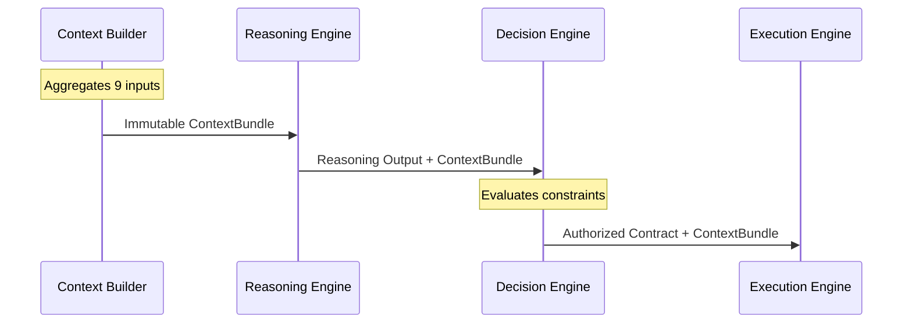

# FLAOS Context Builder - Architectural Specification

## 1. Executive Summary & Objective
The **FLAOS Context Builder** compiles all required runtime parameters, state matrices, health diagnostics, code dependencies, and safety rules into a single, immutable, and versioned **`ContextBundle`** object before any Reasoning Engine evaluation, Decision Engine check, or Execution Engine run.

---

## 2. Rationale: Why Context Builder is Needed
Prior to introducing the Decision Engine, metadata loading was distributed across individual modules (e.g. `bootstrap.py` loaded active state, but tests or telemetry loaded other files separately). This caused:
- **Synchronization gaps:** Telemetry logs could refer to tasks that had already completed or were blocked.
- **State drift:** The Reasoning Engine could evaluate models using data that differed from the Decision Engine's safety checks.
- **Inefficient redundant file reads:** Multiple modules parsed the same operational JSON files separately.

By placing the Context Builder at the absolute entrypoint of the execution pipeline, we guarantee that all subsequent layers consume the exact same structured snapshot, eliminating context drift.

---

## 3. Input Sources
The Context Builder aggregates parameters from nine independent data streams:
1. **Bootstrap Snapshot**: Allowed file scopes, pipeline mappings, and execution constraints.
2. **Active Workflow State**: Tracking active loop variables and git metadata.
3. **Task Queue**: Current task priority and relative order sequences.
4. **Memory OS V2**: Persisted active memory registries.
5. **Safety Memory**: Hardcoded quantitative risk constraints (QS-001 through QS-010).
6. **Runtime Knowledge Graph**: AST import maps and file coupling metadata.
7. **Active Questions**: Open research/quant questions blocking execution.
8. **Runtime Health**: CPU/memory status and PID locks.
9. **Execution Contract**: Safety findings, human authorizations, and scope parameters.

---

## 4. ContextBundle Schema
The assembled bundle is serialized to JSON matching this schema:
```json
{
  "$schema": "context_bundle_v1",
  "context_id": "CTX-YYYYMMDD-HHMMSS-UUID",
  "task_id": "TASK_ID",
  "generated_at": "ISO_8601_TIMESTAMP",
  "freshness_status": "FRESH | DEGRADED | STALE",
  "safety_memory": [
    {
      "rule_id": "QS-002",
      "rule_text": "Single process lock check"
    }
  ],
  "graph_evidence": {
    "blast_radius_score": "LOW",
    "coupling_violations": []
  },
  "memory_refs": {
    "memory_os_v2_status": "LOADED"
  },
  "active_questions": [
    {
      "question_id": "LOW_PRICE_TRUTH_RESOLUTION_001",
      "blocks_strategy": true
    }
  ],
  "runtime_health": {
    "process_alive": true,
    "lockfile_ok": true
  },
  "allowed_scope": ["tools/", "docs/reports/"],
  "forbidden_scope": ["polymarket/", "config/", ".env"],
  "evidence_baseline": "A",
  "confidence": 1.0
}
```

---

## 5. Freshness & Staleness Rules
- **Time Threshold**: A ContextBundle is considered **FRESH** if it was generated less than 60 seconds ago.
- **State Change Trigger**: Any change to `ACTIVE_WORKFLOW_STATE_001.json` or `TASK_QUEUE_001.json` immediately marks the current bundle **STALE**, requiring a rebuild.
- **Git Tree Invariant**: A dirty git working tree forces a **DEGRADED** status check.

---

## 6. Safety-First Loading Order
The Context Builder loads resources sequentially, failing fast if a higher-priority file is missing or corrupt:



---

## 7. Missing or Degraded Context Policy
- **Safety Memory Missing**: **FAIL-SAFE STOP**. Abort execution immediately.
- **RKG Query Missing (Class 6+ refactor/feature)**: **FAIL-SAFE STOP**. Execution is blocked.
- **Stale Runtime Health**: Warning logged. Telemetry marked as **DEGRADED**.
- **Blocked Active Question**: If an active question blocks strategy/risk but the task is a strategy task, **ABORT** execution.

---

## 8. Consumer Layers
- **Reasoning Engine**: Uses `graph_evidence` and `active_questions` to guide reasoning.
- **Decision Engine**: Verifies `safety_memory` rules and checks `allowed_scope` boundaries.
- **Planning Engine**: Checks `task_id` and `freshness_status` to sequence tasks.
- **Execution Engine**: Materializes command executions under the bundle's lock controls.
- **Supervisor Engine**: Evaluates the compliance of the final execution log against the original bundle contract.

---

## 9. Stop Conditions
The Context Builder raises a `STOP_AND_ESCALATE` condition if:
1. Safety Memory (`QS-001` to `QS-010`) is missing or has fewer than 10 records.
2. Graph Query output is missing for Class 6+ tasks.
3. Runtime health status is stale or missing for runtime/paper/live execution tasks.
4. An open active question blocks the domain of the next task in the queue.

---

## 10. Mermaid System Flow


---

## 11. Migration Roadmap
1. **v1 Design Specification**: Completed in `docs/architecture/CONTEXT_BUILDER_001.md`.
2. **v2 Checklist Template**: Introduce a markdown checklist version of the ContextBundle.
3. **v3 Python Context Builder**: Implement `tools/flaos/context_builder.py` compiling the JSON bundle.
4. **v4 Execution Contract Auto-Injection**: Configure `context_builder.py` to auto-inject snapshot data directly into execution contracts.
5. **v5 Supervisor Integration**: Enforce validation of executed actions against the ContextBundle.
