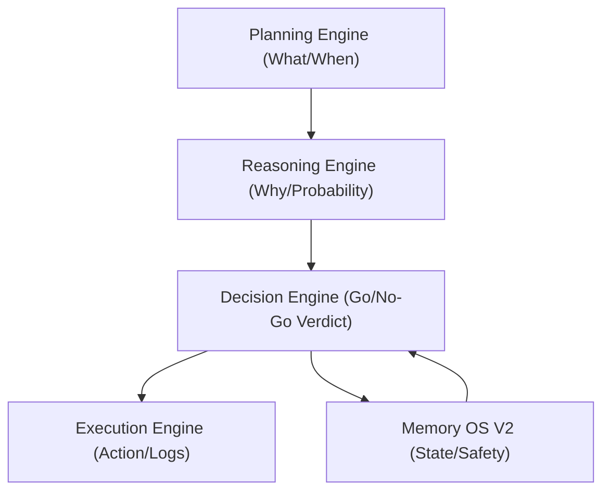
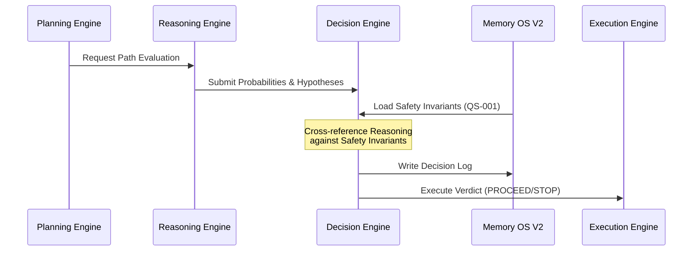

# FLAOS Decision Engine - Architectural Specification

## 1. Executive Summary & Objective
The **FLAOS Decision Engine** is the definitive execution governance module of the Full Loop Automation OS. It consumes probabilistic outcomes, telemetry reasoning, codebase graph dependencies, and safety rules to output a deterministic, governed execution verdict.

---

## 2. Conceptual Alignment
The Decision Engine operates between the Reasoning and Execution layers of the lifecycle:



- **Planning Engine**: Organizes tasks, timelines, and pipeline sequences.
- **Reasoning Engine**: Formulates hypotheses, calculates model edge, and suggests paths.
- **Decision Engine**: Governs and signs off on the final execution directive against hard safety gates.
- **Execution Engine**: Materializes the decision (spawns processes, modifies state).

---

## 3. Inputs & Context Gathering
The Decision Engine merges data from seven distinct sources to evaluate safety:
1. **Bootstrap Snapshot**: Pipeline boundaries, task class, and allowed scopes.
2. **Reasoning Engine Output**: Implied probability model evaluations and strategy suggestions.
3. **Graph Query Output**: Blast radius metrics and structural coupling checks.
4. **Memory OS V2**: Persisted active memory states and loop telemetry.
5. **Safety Memory**: Quantitative safety constraints (e.g. QS-001 through QS-010).
6. **Execution Contract**: Scope boundaries, safety findings, and human authorizations.
7. **Active Questions**: Open questions blocking execution.

---

## 4. Decision Model (Verdicts)
The engine evaluates inputs and returns one of eight deterministic verdicts:

- **`PROCEED`**: Invariants verified. Authorized to proceed.
- **`PROCEED_WITH_CONTRACT`**: Authorized to proceed under a restricted scope contract.
- **`DEFER`**: Postpone execution (e.g., waiting for data warmup or price convergence).
- **`BLOCK`**: Refuse execution due to strategy/market parameter bounds.
- **`STOP_AND_ESCALATE`**: Hault all operations, throw a fail-safe exception, and alert.
- **`REQUEST_HUMAN_AUTHORIZATION`**: Halt execution and request human operator sign-off.
- **`ROUTE_TO_GATE`**: Send the task back to the design/audit pipeline.
- **`ROUTE_TO_LOOP`**: Promote the task to autonomous loop pipeline execution.

---

## 5. Schema Definition
The output of the engine is serialized to JSON:
```json
{
  "$schema": "decision_engine_output_v1",
  "decision_id": "DEC-YYYYMMDD-HHMMSS",
  "task_id": "TASK_ID",
  "timestamp": "ISO_8601_TIMESTAMP",
  "verdict": "PROCEED | PROCEED_WITH_CONTRACT | DEFER | BLOCK | STOP_AND_ESCALATE | REQUEST_HUMAN_AUTHORIZATION",
  "evaluated_inputs": {
    "bootstrap": true,
    "reasoning": true,
    "graph_query": true,
    "safety_memory": true,
    "execution_contract": true
  },
  "safety_violations": [
    {
      "rule_id": "QS-002",
      "severity": "CRITICAL",
      "message": "Duplicate process detected"
    }
  ],
  "contract_adjustments": {
    "allowed_scope": ["tools/"]
  },
  "reason": "Justification of decision",
  "authorized_actions": ["execute --confirm"]
}
```

---

## 6. Safety Rules & Invariants
- **Process Guard**: Exit non-zero if duplicate paper/live runs are active.
- **Live Risk Guard**: Live execution parameters require manual, multi-signature human confirmation.
- **Wallet Protection**: Rejects operations modifying bankroll or allowance unless explicitly authorized by Section 16 of the Execution Contract.
- **Blast Radius Guard**: Block if Graph Query detects a coupling score exceeding the target pipeline limit.

---

## 7. Memory Writes & Lifecycle Integration
Upon issuing a decision, the engine:
1. Appends the decision record to `docs/operations/cognition_memory/`.
2. Indexes the decision record in the Memory OS V2 registry.
3. Updates `LOOP_MEMORY` history logs.
4. Signals the Execution Engine to materialize or halt the target task.

---

## 8. Integration Flow


---

## 9. Migration Roadmap
1. **Phase 1: Schema & Logging (Observability)**
   - Define schemas and log decision outcomes passively.
2. **Phase 2: Offline Integration (Gate checks)**
   - Integrate decision output into offline tools (`bootstrap.py`).
3. **Phase 3: Active Interception (Runtime)**
   - Enforce decision checks directly in `main.py` before execution launches.
