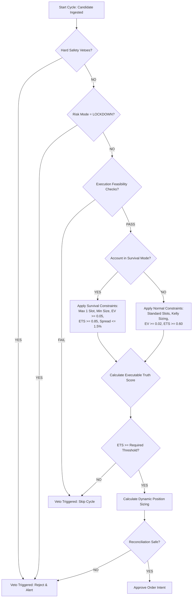

# DECISION_FRAMEWORK_V1_DESIGN_001
**Mode: DESIGN ONLY**  
**Date: 2026-06-24**  

This document outlines the master design framework for the Polymarket Crypto 5M Quant Engine decision layer. It establishes a unified logic path connecting signal prediction, market microstructure, risk constraints, bankroll parameters, and dynamic inventory states to approve or reject order intents.

---

## 1. Decision Inputs Evaluation

Before a trade intent is approved, the engine aggregates inputs from four separate layers:

```
┌────────────────────────────────────────────────────────────────────────┐
│                              DECISION INPUTS                           │
├───────────────────┬───────────────────┬────────────────┬───────────────┤
│    SIGNAL LAYER   │  MICROSTRUCTURE   │   RISK LAYER   │ BANKROLL/INV  │
├───────────────────┼───────────────────┼────────────────┼───────────────┤
│ - Model Prob (Py) │ - Bid-Ask Spread  │ - Drawdown (D) │ - Tier ID     │
│ - Fair Value (FV) │ - L1-L3 Depth     │ - Risk Mode    │ - Open Slots  │
│ - Expected Value  │ - Quote Age (dt)  │ - Loss Cluster │ - Cointegration│
│ - Signal Age      │ - Time Remaining  │ - Owner Heart  │ - Cash Equity │
└───────────────────┴───────────────────┴────────────────┴───────────────┘
```

1. **Signal Layer**:
   - **Model Probability ($P_{\text{model}}$)**: The raw directional estimate (YES or NO).
   - **Fair Value (FV)**: Implied probability price calculated from model signals.
   - **Expected Value (EV)**: Theoretical edge calculated at the mid-market price.
2. **Microstructure Layer**:
   - **Bid-Ask Spread**: The cost friction of immediate execution.
   - **L1-L3 Depth**: Volume available at the touch and near-touch orderbook price.
   - **Quote Age ($\Delta t$)**: Milliseconds elapsed since the last WebSocket orderbook update.
   - **Time Remaining**: Cycles remaining until the 5-minute contract expires (cutoff gate).
3. **Risk Layer**:
   - **Daily Drawdown ($D_{\text{daily}}$)**: Accumulated losses in the current UTC session.
   - **Risk Mode**: State variable (`NORMAL`, `DEFENSIVE`, `MICRO_RECOVERY`, `LOCKDOWN`).
   - **Loss Cluster State**: Boolean flag tracking 3 consecutive losses in the same regime.
   - **Heartbeat & Owner State**: Health checks validating lock ownership.
4. **Bankroll & Inventory Layer**:
   - **Bankroll Tier**: Capital classification (`T0` through `T5`).
   - **Open Slots**: Number of empty execution slots relative to tier limits.
   - **Cointegrated Exposure**: Correlation score representing joint risk between active assets (e.g. BTC and ETH).
   - **Cash Equity**: Available cash excluding locked oracle collateral.

---

## 2. Adaptive Survival Mode Decisions (Revised)

Survival Mode represents the engine's ultimate defensive posture. It does **not** restrict trading to cheap contracts. Instead, it enforces rigorous criteria to ensure only the highest-quality, most asymmetric opportunities are executed.

When the system enters **Survival Mode** (either through `MICRO_RECOVERY` or manually configured defensiveness), the decision logic shifts as follows:

1. **Reduce Active Slot Count**:
   - Max concurrent slots are strictly capped at **1** (regardless of the bankroll tier limit). This eliminates the possibility of simultaneous joint losses.
2. **Reduce Order Size**:
   - Order sizes are scaled down to the absolute physical floor: **1 share** or the minimum CLOB notional of **$0.05**, preventing capital depletion.
3. **Raise Required Edge Threshold**:
   - The minimum Expected Value (EV) threshold is raised from the standard **$0.02** to **$0.05** to require a wider theoretical margin of safety.
4. **Raise Executable Truth Score Threshold**:
   - The required Executable Truth Score (ETS) is raised from **0.60** to **0.85**, ensuring that only trades with near-perfect execution conditions can pass.
5. **Require Fresher Quotes**:
   - The maximum allowable quote age ($\Delta t$) is tightened from **5.0 seconds** to **1.5 seconds**. Stale market data results in an immediate veto.
6. **Require Better Liquidity**:
   - Immediate L1 orderbook depth must represent at least **100x** the target order size (raised from the standard 10x). This guarantees zero slippage.
7. **Reject Wide Spread**:
   - The maximum allowable bid-ask spread is capped at **$\le 1.5\%$** of the contract mid-price (down from the standard 5%).
8. **Avoid Correlated Exposure**:
   - Cointegrated asset checks are strictly enforced. If a trade is active in BTC, no trade in ETH may be entered under any circumstances.
9. **Opportunistic Asset Selection**:
   - Low-priced contracts ($<$0.15) are prioritized *only* if they satisfy asymmetric payoff structures and high liquidity, but they are not hard-coded. Any contract price is tradeable if it meets the elevated Survival Mode thresholds.

---

## 3. Bankroll Tier Adaptive Decisions

Decision logic adjusts parameters dynamically based on the account's [BANKROLL_TIER_FRAMEWORK_V1.md](file:///c:/quant/Polymarket-Adaptive-Quant-Engine-v.1/BANKROLL_TIER_FRAMEWORK_V1.md) tier:

- **Micro Family (T0–T2)**:
  - **Sizer Bypass**: Sizer overrides Kelly calculations and routes strictly to survival flat bets.
  - **Confidence Floor**: Relaxed to **0.40** (or 0.38 in recovery) because micro tiers trade cheap asymmetric contracts where directional accuracy is less critical than payoff leverage.
- **Base Family (T3–T4)**:
  - **Kelly Sizing**: Fractional Kelly sizing is active and interpolated smoothly.
  - **Confidence Floor**: Set to a strict **0.54** floor to filter out noise on mid-priced contracts.
- **Growth Family (T5)**:
  - **Aggressive Diversification**: Maximizes slots (up to 5 concurrent) but scales down slot risk to 3.0% to maintain a portfolio-level safety cushion.

---

## 4. Executable Truth Interaction

A signal model's raw probability is translated into an **Executable Decision** by subtracting execution friction:

1. **Spread Drag Adjustment**:
   $$\text{Executable EV} = P_{\text{model}} \times (1 - P_{\text{ask}}) - (1 - P_{\text{model}}) \times P_{\text{ask}}$$
2. **Slippage Estimation**:
   If order size exceeds L1 depth, average execution price is simulated using L2/L3 levels, updating $P_{\text{ask}}$ in the EV calculation.
3. **Latency & Time Decay**:
   If the cycle elapsed time exceeds 240 seconds, a hard time-cutoff veto is triggered.

---

## 5. Master Decision Flow Chart

The diagram below illustrates the sequence of checks executed by the decision layer:


