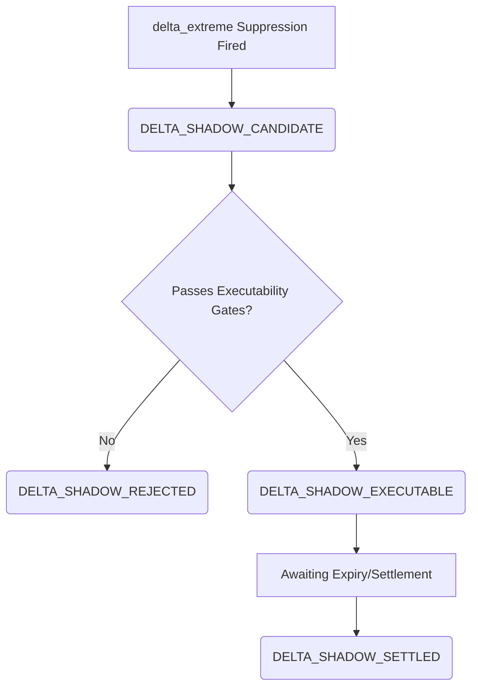

# DELTA_EXTREME_SHADOW_OVERLAY_SPEC_001

* **Date:** 2026-06-20
* **Target Workspace:** `c:\quant\Polymarket-Adaptive-Quant-Engine-v.1`
* **Status:** **`DESIGN SPECIFICATION COMPLETE`**
* **Primary Role:** `02_CODE_ARCHITECT_AGENT` (Telemetry & Systems Design)
* **Supporting Roles:** `08_RESEARCH_QUANT_AGENT` (Metrics & Sizing), `03_RISK_MANAGER_AGENT` (Safety Gates)

---

## 1. Introduction and Objectives

Recent audits (conflict resolution and executable truth audits) have revealed that the `delta_extreme` gate acts as a major alpha leak for low-priced tail contracts (under $0.05). However, live execution of these candidates is heavily gated by quote staleness (82.8% of skipped candidates are unexecutable). 

To gather empirical evidence without risking capital, this specification designs a **passive shadow telemetry overlay** for `delta_extreme` blocked candidates. This overlay runs side-by-side with the active trading engine, capturing skipped trades in real-time, validating their theoretical execution, tracking their hypothetical outcomes, and generating performance metrics.

---

## 2. Shadow Event Schema

All shadow events will be logged to a structured JSONL file: `runtime/quant_data/delta_shadow_overlay/runs/[run_id].jsonl`. Each entry represents a lifecycle step for a candidate.

```json
{
  "timestamp_utc": "2026-06-20T11:58:36.123Z",
  "run_id": "20260620T035152Z_8392_9ffcb5a5",
  "lifecycle_event": "DELTA_SHADOW_CANDIDATE",
  "market": "pm-5m-btc",
  "side": "YES",
  "token_id": "0x2791Bca1f2de4661ED88A30C99A7a9449Aa84174",
  "price": 0.025,
  "raw_bid": 0.02,
  "raw_ask": 0.03,
  "spread": 0.01,
  "bid_size": 2500.0,
  "ask_size": 1500.0,
  "quote_age_ms": 120,
  "oracle_age_ms": 350,
  "confidence": 0.584,
  "ev": 0.231,
  "delta_value": 4.85,
  "delta_reason": "Mechanism_B_closeness_clamped_max",
  "executable_pass": true,
  "executable_reject_reason": null,
  "shadow_size_usd": 1.00,
  "shadow_shares": 40.0,
  "shadow_entry_price": 0.025,
  "eventual_outcome": "YES",
  "shadow_pnl": 39.00,
  "settlement_source": "path_truth"
}
```

### Schema Field Definitions:
* **`timestamp_utc`**: ISO 8601 string of the event evaluation time.
* **`run_id`**: Active unique run identifier.
* **`lifecycle_event`**: State flag (`DELTA_SHADOW_CANDIDATE`, `DELTA_SHADOW_EXECUTABLE`, etc.).
* **`market`**: Asset market identifier (`pm-5m-btc` / `pm-5m-eth`).
* **`side`**: Model preference lean (`YES` / `NO`).
* **`token_id`**: CLOB token hex address.
* **`price`**: The reference entry price.
* **`raw_bid` / `raw_ask`**: Best bid and ask from the CLOB.
* **`spread`**: Calculated spread `(raw_ask - raw_bid)`.
* **`bid_size` / `ask_size`**: Book depth at the inside quotes.
* **`quote_age_ms`**: Milliseconds since last websocket book snapshot.
* **`oracle_age_ms`**: Milliseconds since last oracle price feed update.
* **`confidence`**: Strategy probability model confidence.
* **`ev`**: Expected value calculated before delta suppression.
* **`delta_value`**: Score computed by the delta engine.
* **`delta_reason`**: Code path category that triggered suppression (Mechanism A or B).
* **`executable_pass`**: Whether the candidate cleared all passive execution gates.
* **`executable_reject_reason`**: Specific blocker code if `executable_pass` is false.
* **`shadow_size_usd`**: Simulated allocation amount in USD.
* **`shadow_shares`**: Count of simulated shares purchased.
* **`shadow_entry_price`**: Simulated execution cost per share.
* **`eventual_outcome`**: Settlement state of the contract at expiry (`YES` / `NO`).
* **`shadow_pnl`**: Realized profit/loss in USD (`shares * ($1.00 if win else $0.00) - size`).
* **`settlement_source`**: Source system validating settlement (`path_truth` database or API).

---

## 3. Lifecycle Events



1. **`DELTA_SHADOW_CANDIDATE`**: Emitted immediately when `trader.py` skips a signal due to a `delta_extreme` state.
2. **`DELTA_SHADOW_EXECUTABLE`**: Emitted if the candidate successfully clears the 7 execution gates. Initiates simulated position tracking.
3. **`DELTA_SHADOW_REJECTED`**: Emitted if the candidate fails any of the passive execution gates, storing the failure reason for bottleneck analysis.
4. **`DELTA_SHADOW_SETTLED`**: Emitted after the 5-minute event window concludes, and settlement outcomes are retrieved. Updates the shadow PnL stats.

---

## 4. Executability Gates

Before a candidate is labeled `DELTA_SHADOW_EXECUTABLE`, it must clear the following passive logic gates:

1. **Valid Price:** Price must be numeric and bounded: `0.00 < price < 1.00`.
2. **Spread Constraint:** Bid-ask spread must be tight: `spread <= 0.06`.
3. **Orderbook Freshness:** Timestamp of orderbook cache must be fresh: `quote_age_ms <= 1000`.
4. **Oracle Freshness:** Oracle websocket stream must be fresh: `oracle_age_ms <= 5000`.
5. **Sizer Feasibility:** Sizer must be able to allocate at least 5 shares at `price` (e.g. `price * 5` is under max limits).
6. **Ask Depth Check:** Available book size must support the order: `ask_size >= shadow_shares`.
7. **Not Near Cutoff:** The timing gate must be clear: `seconds_remaining > 90` (excluding Mechanism A blocks).

---

## 5. Position Sizing Assumptions (Dual Track)

The overlay will track two independent, parallel simulated sizing tracks to evaluate optimal sizer policies:

### 5a. Standard Track
* **Sizing Rule:** Entry cost = `max(1.00, 5 * price)` USD (minimum 5 shares).
* **Cost allocation:** Under $0.20, entry is cheap ($1.00). In higher price bands, entry cost increases to guarantee a minimum exposure scale.

### 5b. Micro Track
* **Sizing Rule:** Entry cost = `max(0.05, 5 * price)` USD (minimum 5 shares).
* **Cost allocation:** Extremely small allocation ($0.05 minimum) designed for testing low-capital tail captures.

Both sizing tracks must run entirely in isolated memory and log paths, with **zero connection** to active trading accounts.

---

## 6. Metrics Calculation Engine

At each settlement event, the overlay aggregator will compute the following:

* **Counts:** `executable_count`, `rejected_count`, `quote_stale_count`, `spread_wide_count`.
* **Win/Loss Stats:** Cumulative wins, losses, and win rate.
* **Expected Value (EV) Accuracy:** Average predicted EV versus actual realized EV.
* **Profitability Buckets:** Net PnL grouped by price range:
  * `$0.01 - $0.05` (Tail)
  * `$0.05 - $0.10`
  * `$0.10 - $0.20`
  * `$0.20 - $0.40`
  * `$0.40+`
* **PnL Splitting:** PnL grouped by asset (`BTC`/`ETH`) and active market regime (`range`, `trend`, `compression`).
* **Streak Analysis:** Maximum consecutive losses and estimated peak-to-trough bankroll drawdown.

---

## 7. Dashboard and Observability Integration

Telemetry summaries will be integrated into terminal displays and Telegram reports:

### Daily Telegram Observability Block:
```text
=== DELTA EXTREME SHADOW OVERLAY ===
Candidates Evaluated: 832
Executable:           142 (17.06%)
Stale Quotes Blocked: 681 (81.85%)
Spread Blocked:       9 (1.08%)

Standard Track PnL:   +$45.20 USD (36 W - 106 L)
Micro Track PnL:      +$7.42 USD  (36 W - 106 L)
Max Loss Streak:      12
Top Price Bucket:     $0.01 - $0.05 (+$42.10 USD)
```

---

## 8. Safety Boundaries (Strict Constraints)

The shadow overlay is **strictly passive**. It must not mutate runtime execution states under any circumstances:

* **No Execution:** The system will never invoke `trader.place_order` or interact with blockchain nodes for shadow events.
* **No Order Placement:** No HTTP POST calls for orders will be made.
* **No Sizing Mutation:** Sizing variables in `position_sizing.py` must remain unaffected.
* **No Delta Gate Bypass:** The active decision filter (`delta_extreme`) must remain active, ensuring it continues to skip trades in the main loop.
* **No Live Trading:** Simulated shadow tracks are run memory-only or log-only.
* **No Config Change Yet:** No settings in `config/settings.py` or `.env` will be changed.

---

## 9. Phase Promotion Gates

```
+---------------+      Pass spec review      +-----------------------+
|  DESIGN ONLY  | -------------------------> |  SHADOW TELEMETRY     |
|               |                            |  (Logs active events) |
+---------------+                            +-----------------------+
                                                         |
                                                         | 72h continuous run &
                                                         | zero crash events
                                                         v
+---------------+      Positive PnL OOS      +-----------------------+
| STRATEGY      | <------------------------- |  PAPER EXPERIMENT     |
| CANDIDATE     |      evidence & approval   |  (Allows paper trades)|
+---------------+                            +-----------------------+
```

1. **DESIGN -> SHADOW IMPLEMENTATION:**
   * Successful design spec approval.
   * Unit tests created verifying JSONL logging formats and execution filters.
2. **SHADOW -> PAPER EXPERIMENT:**
   * 72 hours of uninterrupted execution in active shadow mode.
   * Zero uncaught exceptions or loop lags attributed to shadow logging.
   * Execution stale rate matches historical baseline (~82%).
3. **PAPER -> STRATEGY CANDIDATE:**
   * Out-of-sample shadow PnL is positive on both sizers.
   * Tail contract edge is confirmed.
   * Risk Manager approvals secured for live sizer changes.

---

## 10. Final Verdict

### **`READY_FOR_SHADOW_IMPLEMENTATION`**

The specification is complete, fits within the system's existing quant logging structures, and provides a zero-risk mechanism to validate the delta_extreme alpha leak hypothesis in active runtime environments.

---

*Report prepared by Antigravity (Crypto Trading Bot Engineer Agent).*
