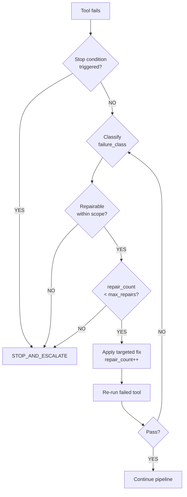
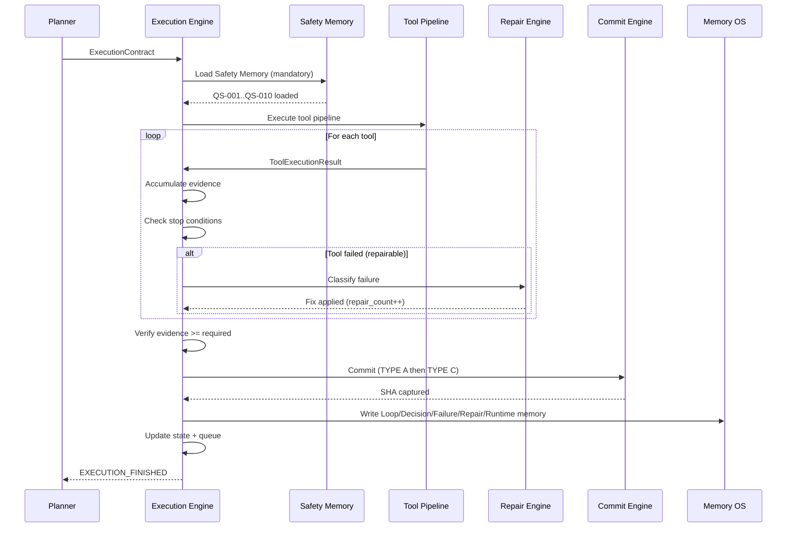
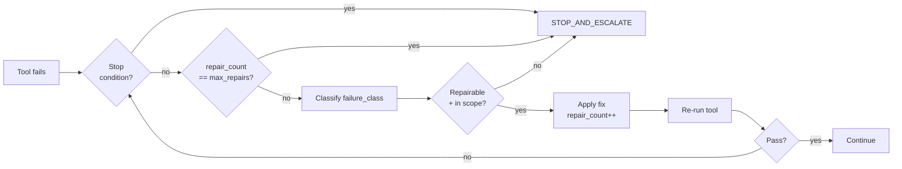
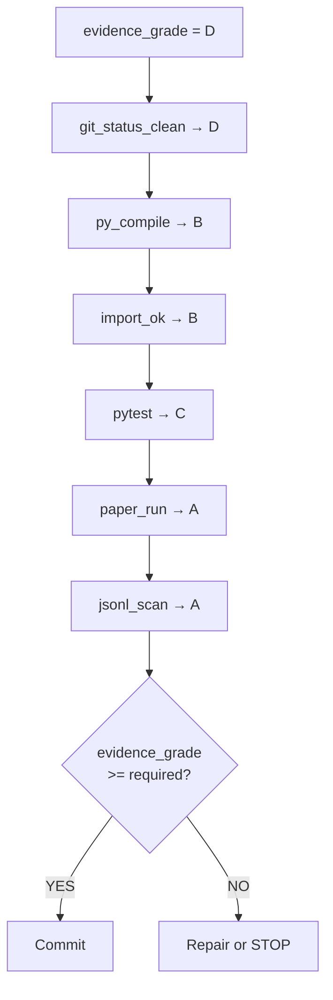

# EXECUTION_ENGINE_001

**Date:** 2026-06-27 · **Destination:** `docs/architecture/` · **Status:** DESIGN v1

---

## 1. Objective

The Execution Engine (EE) is the operational core of FLAOS. It receives a `ExecutionContract` (produced by the Planning Engine from a Bootstrap ExecutionSnapshot) and executes the declared tool pipeline, collects evidence, manages repairs, enforces stop conditions, commits changes, and writes Memory OS records.

The Execution Engine is what makes FLAOS a loop executor rather than just a context resolver.

---

## 2. Why Planner Is Not Executor

| Concern | Planning Engine | Execution Engine |
|---------|-----------------|-----------------|
| Selects workflow tier | ✓ | ✗ |
| Selects pipelines and skills | ✓ | ✗ |
| Computes risk/complexity scores | ✓ | ✗ |
| Runs tools | ✗ | ✓ |
| Collects evidence grades | ✗ | ✓ |
| Classifies failures | ✗ | ✓ |
| Repairs within scope | ✗ | ✓ |
| Enforces stop conditions | ✗ | ✓ |
| Creates commits | ✗ | ✓ |
| Writes memory records | ✗ | ✓ |
| Emits execution events | ✗ | ✓ |

Separation of concerns: the Planner knows WHAT to do; the Executor knows HOW to do it and tracks what happened.

---

## 3. Execution Engine Responsibilities

1. Load `ExecutionContract` from Planning Engine output
2. Load Safety Memory (mandatory — stop if missing for Python/GATE tasks)
3. Execute tool pipeline in declared order
4. Collect `ToolExecutionResult` for each tool
5. Accumulate evidence grade (D → A)
6. Detect failures → classify → attempt repair (up to `max_repairs`)
7. Evaluate stop conditions after each tool
8. Enforce commit boundary rules
9. Write Memory OS records (decision, failure, repair, runtime)
10. Emit execution events for observability

---

## 4. Execution Contract Schema

```json
{
  "$schema": "execution_contract_v1",
  "task_id": "string — e.g. BATCH_3C_IMPLEMENTATION_001",
  "workflow_tier": "FAST|LOOP|STANDARD|GATE",
  "agent_pipeline_id": "string — e.g. GATE_WORKFLOW",
  "tool_pipeline_id": "string — e.g. GATE_WORKFLOW",
  "skills": ["array of skill_id strings"],
  "allowed_files": ["array of file paths or glob patterns"],
  "forbidden_files": [
    "_phase4_build_quote_lineage",
    "_phase4_quote_lineage_carry",
    "_last_quote_lineage_context",
    "_risk_plan_zero_diagnostics",
    "_diagnostic_float",
    "_diagnostic_int",
    "polymarket/client.py live order methods",
    "config/.env live flags"
  ],
  "stop_conditions": ["array of stop condition identifiers"],
  "max_repairs": "int 0-3",
  "commit_policy": "TYPE_A|TYPE_B|TYPE_C|TYPE_D|TYPE_F|SPLIT|MANUAL_ONLY",
  "evidence_required": "D|C|B|A",
  "memory_reads": ["quant_safety", "decision", "failure", "..."],
  "memory_writes": ["decision", "failure", "repair", "runtime", "loop"],
  "safety_memory_ids_loaded": ["QS-001", "QS-002", "...", "QS-010"],
  "plan_id": "string — from Planning Engine",
  "risk_score": "int",
  "complexity_score": "int",
  "full_accept_override": "bool"
}
```

---

## 5. Tool Execution Result Schema

```json
{
  "$schema": "tool_execution_result_v1",
  "tool_id": "string",
  "command": "string (sanitized — no secrets)",
  "exit_code": "int",
  "stdout_summary": "string — max 500 chars (not full output)",
  "stderr_summary": "string — max 200 chars",
  "duration_ms": "int",
  "evidence_grade": "D|C|B|A",
  "status": "SUCCESS|FAILED|SKIPPED|BLOCKED",
  "stop_triggered": "bool",
  "stop_reason": "string | null",
  "repair_needed": "bool",
  "failure_class": "compile_error|import_error|unit_test_failure|runtime_error|jsonl_missing_field|scope_violation|git_state_violation|evidence_insufficient | null"
}
```

---

## 6. Evidence Collector

The Evidence Collector accumulates evidence from tool results and upgrades the session's evidence grade:

```
Start: evidence_grade = D

+ git_status_clean passes           → grade stays D (git state only)
+ py_compile passes                 → grade upgrades to B
+ import_polymarket_trader passes   → grade stays B (import is B-level)
+ pytest_core_suite passes         → grade upgrades to C
+ paper_run_5_cycles passes        → grade upgrades to A
+ jsonl_session_scan passes        → grade stays A (confirms A)
```

**Evidence accumulation rules:**
- Grades only upgrade, never downgrade within a session
- If a higher-grade tool fails, grade stays at current level (failure noted, loop may repair)
- Final evidence grade is the highest achieved before commit
- Evidence grade must meet `evidence_required` from contract before commit is allowed

### Evidence sources

| Tool | Evidence type | Grade |
|------|--------------|-------|
| `git_status_clean` | Git state | D |
| `py_compile_runtime` | Compile | B |
| `import_polymarket_trader` | Import | B |
| `forbidden_scope_diff_check` | Scope | B |
| `pytest_core_suite` | Tests | C |
| `pytest_targeted_suite` | Tests | C |
| `paper_run_5_cycles` | Runtime | A |
| `jsonl_session_scan` | JSONL telemetry | A |
| `no_live_order_check` | Safety | A |
| `memory_read_safety` | Memory | B |

---

## 7. Repair Loop



### Repairable failure classes

| Failure class | Repairable? | Max repairs | Evidence after |
|--------------|-------------|-------------|---------------|
| `compile_error` | YES | 2 | Grade B |
| `import_error` | YES | 2 | Grade B |
| `unit_test_failure` | YES | 3 | Grade C |
| `runtime_error` | YES | 2 | Grade A |
| `jsonl_missing_field` | YES | 2 | Grade A |
| `scope_violation` | **NO** | 0 | STOP |
| `git_state_violation` | **NO** | 0 | STOP |
| `evidence_insufficient` | YES | 1 | Raise grade |

### Repair boundary

Repairs must stay within `allowed_files` from the Execution Contract. A repair that requires touching a forbidden file triggers `STOP_AND_ESCALATE` regardless of repair count.

---

## 8. Commit Engine

The Commit Engine enforces commit boundary rules from `PROJECT_RULES.md`:

### File type classification

| Type | File patterns |
|------|--------------|
| A | `*.py` in `polymarket/`, `utils/`, `config/` |
| B | `tools/**`, `dashboard/**` |
| C | `*.md`, `*.json` in `docs/`, operational JSON |
| D | `tests/*.py` |
| F | `runtime/research_exports/` |

### Commit rules

```
1. Classify all changed files by type
2. If only TYPE C → single commit "docs: ..."
3. If TYPE A present:
   - TYPE A gets its own commit first
   - TYPE C (reports/state/memory) committed second
   - TYPE A never mixed with B, D alone, or F
4. If TYPE B + TYPE C → single "tools: ..." or split
5. MANUAL_ONLY for Class 8 tasks

Forbidden commit patterns:
- git add polymarket/trader.py dashboard/src/*.tsx
- Mixing TYPE A with TYPE B/D/F
- Hidden finalize commits (create one commit per logical unit)
- Amending published commits
```

### One-docs commit policy

For all Type C (docs-only) loops: one consolidated commit containing report + state + queue + memory update. No separate commit report unless explicitly requested.

---

## 9. Memory OS Integration

### Read phase (before execution)

```
1. Load Safety Memory (SAFETY_MEMORY.jsonl) — mandatory for Python/GATE/STANDARD
2. Query Memory Index for: decision, failure, repair related to current task
3. Inject into ExecutionContract.memory_reads context
4. Record memory_reads_loaded in ExecutionContract
```

### Write phase (after successful commit)

```
1. Append Loop Memory entry to LOOP_MEMORY_YYYYMMDD.jsonl
2. Append Decision Memory entry if a reusable decision was made
3. Append Failure Memory entries for any failures encountered
4. Append Repair Memory entries for any repairs applied
5. Append Runtime Memory entry if paper run was executed
6. Update MEMORY_INDEX_001.json with new entry offsets
7. Update ACTIVE_WORKFLOW_STATE_001.json
8. Update TASK_QUEUE_001.json
```

### Safety memory enforcement

```
safety_memory_required = task_class in (4, 6, 7, 8) or tier in ("GATE", "STANDARD")

if safety_memory_required and not safety_memory_loaded:
    → STOP_AND_ESCALATE("SAFETY_MEMORY_REQUIRED_BUT_INVALID")

Safety memory is READ-ONLY during execution.
Only Role 29 may append new QS entries.
```

---

## 10. Runtime Session Manager Integration

Before any paper run tool execution:

```
1. Call runtime_session.py guard
   → If active session detected: SKIP_PAPER_RUN or STOP (per task policy)
2. If paper run allowed: launch via runtime_session.py launch
3. Record session_id in ToolExecutionResult
4. After paper run: call runtime_session.py cleanup
5. Include session_id in Runtime Memory write
```

---

## 11. Maintenance / Health Integration

Before Grade A tool execution (paper runs):

```
1. Call Health Engine check: disk usage, JSONL growth, session state
2. If CRITICAL: trigger Maintenance Engine before proceeding
3. Maintenance Engine: dry_run → (if safe) execute → report
4. Re-check health after maintenance
5. Proceed with paper run only if health is HEALTHY or DEGRADED
```

---

## 12. Event Model

All events written to an in-memory event log during execution. Persisted to `docs/reports/EXECUTION_EVENT_LOG_*.json` if requested.

| Event | When emitted | Key fields |
|-------|-------------|-----------|
| `EXECUTION_STARTED` | Loop INIT | task_id, tier, plan_id, safety_memory_status |
| `TOOL_STARTED` | Before each tool | tool_id, command_summary |
| `TOOL_FINISHED` | After each tool | tool_id, exit_code, evidence_grade, duration_ms |
| `REPAIR_STARTED` | When repair needed | repair_count, failure_class, fix_summary |
| `REPAIR_FINISHED` | After repair attempt | repair_count, status |
| `STOP_TRIGGERED` | On stop condition | stop_reason, forbidden_scope_if_applicable |
| `COMMIT_CREATED` | After each commit | sha, commit_type, files_count |
| `MEMORY_WRITTEN` | After memory writes | memory_types_written, entry_count |
| `EXECUTION_FINISHED` | Loop NEXT_OR_STOP | result, evidence_grade, repairs, total_duration_ms |

---

## 13. Stop Conditions

Stop conditions trigger immediate `STOP_AND_ESCALATE` with no repair:

| Condition | Trigger | Category |
|-----------|---------|---------|
| Live mode detected | `--mode live` in any command | SAFETY |
| Wallet/bankroll mutation | wallet/allowance keywords in diff | SAFETY |
| Execution/risk/sizing modified without GATE | files in forbidden_files touched | SAFETY |
| Runtime data deletion | `runtime/` files deleted | SAFETY |
| Safety memory missing (required task) | SAFETY_MEMORY.jsonl not found or invalid | SAFETY |
| Forbidden files changed | git diff shows forbidden_files | SCOPE |
| Test regression outside scope | new test failure in unrelated module | SCOPE |
| Max repairs exhausted | repair_count == max_repairs AND still failing | LIMIT |
| Unrelated dirty files at commit | tracked dirty files outside allowed_files | STATE |
| Blocked state | `ACTIVE_WORKFLOW_STATE.blocked = true` | STATE |

---

## 14. Mermaid Diagrams

### High-Level Execution Flow



### Repair Loop



### Evidence Flow



---

## 15. Migration Roadmap

| Version | Name | What ships | Trigger |
|---------|------|-----------|---------|
| **v1** | Design | This document | NOW |
| **v2** | Checklist executor | Markdown checklist: AI fills in tool results manually; EE validates criteria | After 20+ loop memory entries |
| **v3** | Python executor (docs/tools) | `tools/flaos/executor.py` — executes docs-only and tooling loops autonomously (CLASS 3/4 only) | Post-Batch-3D |
| **v4** | Repair engine | Automated failure classification + repair suggestion for CLASS 6-low | After v3 stable |
| **v5** | Autonomous loop | Full autonomous execution including CLASS 7 (with GATE gate) | Phase 4 FLAOS |

**v2 → v3 trigger:** When 3+ distinct failure patterns exist in Failure Memory that the Repair Engine can systematically resolve.

**Safety invariant across all versions:** Live trading (CLASS 8) is ALWAYS manual. Safety memory must be loaded before any v3+ execution begins.
