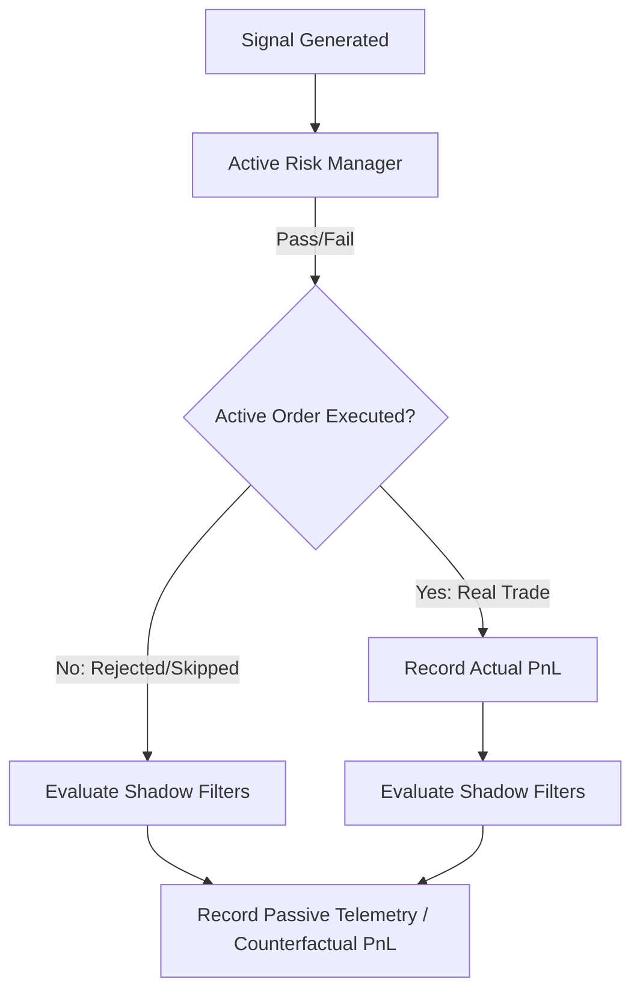

# EXECUTION_SHADOW_FILTER_SPEC_001

* **Date:** 2026-06-21
* **Target Workspace:** `c:\quant\Polymarket-Adaptive-Quant-Engine-v.1`
* **Status:** **`DESIGN SPECIFICATION COMPLETE`**
* **Primary Role:** `03_RISK_MANAGER_AGENT` (Safety Gates & Risk Controls)
* **Supporting Roles:** `02_CODE_ARCHITECT_AGENT` (Telemetry & Systems Design), `08_RESEARCH_QUANT_AGENT` (Metrics & Sizing)

---

## 1. Shadow Filter Purpose

The purpose of the **Execution Shadow Filter Telemetry** is to implement a passive validation substrate for newly identified trading filters. These filters are designed to isolate the profitable core of the system without affecting real-time capital allocation or active trading decisions.

During the shadow validation phase, these filters:
- **MUST NOT block real trades** or modify order sizes in live/paper mode.
- **MUST** run passively alongside the active trading engine.
- **MUST** label candidates, track theoretical fills, compute counterfactual PnL, and evaluate metrics.

This allows the quant team to safely compare the performance of filtered portfolios against the baseline system before promoting any filter to live blocking logic.



---

## 2. Filter Definitions

The following table summarizes the specifications for the shadow filters designed to target toxic clusters:

### Summary of Filter Criteria and Baseline Evidence

| Filter ID | Filter Code Name | Pass Condition | Reject Condition | Sample Size (Audit) | Historical PF | Historical Net PnL |
| :--- | :--- | :--- | :--- | :--- | :--- | :--- |
| **A** | `block_btc_shadow` | `asset != "BTC"` | `asset == "BTC"` | 516 (HIGH) | 1.0096 | +$1.15 |
| **B** | `block_edge_lt_005_shadow` | `edge >= 0.05` | `edge < 0.05` | 250 (HIGH) | 0.9965 | -$0.20 |
| **C** | `block_normal_vol_shadow` | `volatility_regime != "NORMAL_VOL"` | `volatility_regime == "NORMAL_VOL"` | 30 (MEDIUM) | 1.3961 | +$3.05 |
| **D** | `keep_eth_edge_005_015_shadow` | `asset == "ETH" AND edge >= 0.05 AND edge < 0.15` | Any other combination | 60 (MEDIUM) | 1.7014 | +$7.75 |
| **E** | `combined_conservative_shadow` | `asset == "ETH" AND edge >= 0.05 AND edge < 0.15` | Any other combination | 60 (MEDIUM) | 1.7014 | +$7.75 |
| **F** | `combined_broad_shadow` | `asset == "ETH" AND edge >= 0.05` | Any other combination | 166 (HIGH) | 1.1978 | +$7.20 |

---

### Detailed Filter Specifications

#### A. `block_btc_shadow`
- **Pass Condition**: `asset == "ETH"` (or any ticker not matching `"BTC"`).
- **Reject Condition**: `asset == "BTC"`.
- **Required Fields**: `asset` / `ticker`.
- **Missing Field Behavior**: Default to **PASS** to prevent false rejection spikes.
- **Audit Evidence**: Restricting to ETH only reduces trade frequency by **29.3%**, turns baseline loss (-$20.70) into marginal profit (**+$1.15**), and drops Max Drawdown from **12.87%** to **4.32%**.

#### B. `block_edge_lt_005_shadow`
- **Pass Condition**: `edge >= 0.05`.
- **Reject Condition**: `edge < 0.05`.
- **Required Fields**: `edge`.
- **Missing Field Behavior**: Default to **REJECT** (safe-side assumption for low/unquantified edge).
- **Audit Evidence**: Eliminating low-edge trades removes **65.8%** of baseline volume. PF increases to **0.9965** (Net PnL **-$0.20**), demonstrating that edge filtering alone does not achieve profitability.

#### C. `block_normal_vol_shadow`
- **Pass Condition**: `volatility_regime != "NORMAL_VOL"` (i.e. regime must be `"HIGH_VOL"` or `"EXTREME_VOL"`).
- **Reject Condition**: `volatility_regime == "NORMAL_VOL"`.
- **Required Fields**: `volatility_regime`.
- **Missing Field Behavior**: Default to **REJECT** (blocks trading under unclassified regime volatility).
- **Audit Evidence**: Removes **95.9%** of trades. Profit Factor improves to **1.3961** (Net PnL **+$3.05**) on 30 trades, showing high volatility regime setups have strong predictive power.

#### D. `keep_eth_edge_005_015_shadow` (Scenario F / E)
- **Pass Condition**: `asset == "ETH"` AND `edge >= 0.05` AND `edge < 0.15`.
- **Reject Condition**: `asset != "ETH"` OR `edge < 0.05` OR `edge >= 0.15`.
- **Required Fields**: `asset`, `edge`.
- **Missing Field Behavior**: Default to **REJECT**.
- **Audit Evidence**: Most efficient configuration. Keeps 60 trades (8.2% frequency). Win Rate jumps to **51.67%**, PF to **1.7014**, Net PnL to **+$7.75**, with Max Drawdown of only **0.66%** and Max Loss Streak of **4**.

#### E. `combined_conservative_shadow`
- **Pass Condition**: `asset == "ETH"` AND `edge >= 0.05` AND `edge < 0.15`.
- **Reject Condition**: Any other combination.
- **Required Fields**: `asset`, `edge`.
- **Missing Field Behavior**: Default to **REJECT**.
- **Audit Evidence**: Matches Scenario F (Net PnL **+$7.75**, PF **1.7014**). Formulated to protect against high-edge adverse selection.

#### F. `combined_broad_shadow`
- **Pass Condition**: `asset == "ETH"` AND `edge >= 0.05`.
- **Reject Condition**: `asset != "ETH"` OR `edge < 0.05`.
- **Required Fields**: `asset`, `edge`.
- **Missing Field Behavior**: Default to **REJECT**.
- **Audit Evidence**: Matches Scenario D. Keeps 166 trades (**22.7%** frequency). Win Rate **44.58%**, PF **1.1978**, Net PnL **+$7.20**, Max Drawdown **1.70%**. Excellent fallback if Scenario E/F frequency is too low.

---

## 3. Telemetry Schema

Passive shadow filter telemetry MUST be outputted to structured JSONL files under `runtime/quant_data/execution_paper/shadow_filters/[date].jsonl`. Each line represents an evaluation point.

```json
{
  "timestamp_utc": "2026-06-21T03:00:00.123Z",
  "run_id": "20260621T030000Z_1234_abcdef12",
  "market_slug": "pm-5m-eth-20260621-0305",
  "asset": "ETH",
  "side": "YES",
  "edge": 0.0754,
  "ev": 0.1143,
  "volatility_regime": "HIGH_VOL",
  "trend_regime": "UP_TREND",
  "active_entry_allowed": true,
  "shadow_filter_name": "combined_conservative_shadow",
  "shadow_pass": true,
  "shadow_reject_reason": null,
  "execution_pnl_5_share_model": 0.4500,
  "replay_join_key": "20260621T030000Z_1234_abcdef12_pm-5m-eth-20260621-0305_YES",
  "source_event_ref": "decision_log_line_451"
}
```

### Telemetry Field Schema Definitions
- **`timestamp_utc`**: ISO 8601 evaluation timestamp.
- **`run_id`**: Active session run ID to align with execution logs.
- **`market_slug`**: Unique identifier for the Polymarket instance.
- **`asset`**: Underlying index (`BTC` or `ETH`).
- **`side`**: Trade direction (`YES` / `NO`).
- **`edge`**: Strategy model computed edge (float or `null`).
- **`ev`**: Expected value computed after book depth spread adjustment (float or `null`).
- **`volatility_regime`**: Active classified volatility regime (e.g. `NORMAL_VOL`, `HIGH_VOL`, `EXTREME_VOL`).
- **`trend_regime`**: Active trend regime (e.g. `UP_TREND`, `DOWN_TREND`, `NO_TREND`).
- **`active_entry_allowed`**: Boolean representing whether the active trading model approved the trade.
- **`shadow_filter_name`**: Name identifier of the evaluated shadow filter.
- **`shadow_pass`**: Boolean indicating if the candidate cleared the shadow pass criteria.
- **`shadow_reject_reason`**: String code representing the failure trigger (e.g., `REJECT_BTC_ASSET`, `REJECT_EDGE_FLOOR`, `REJECT_NORMAL_VOL`).
- **`execution_pnl_5_share_model`**: Estimated PnL based on a flat 5-share simulator model (float).
- **`replay_join_key`**: Deterministic cross-stage unique join key format (`[run_id]_[market_slug]_[side]`).
- **`source_event_ref`**: Line reference or timestamp pointer back to raw source files (`decision_log` or `trade_journal`).

---

## 4. Shadow Metrics

To track passive filter performance, the daily dashboard and reports must calculate the following metrics:

### Defined Metrics Formulae
- **Candidates Evaluated**: Total count of unique closes joining a signal.
- **Candidates Passed**: Count of evaluated trades where `shadow_pass == true`.
- **Candidates Rejected**: Count of evaluated trades where `shadow_pass == false`.
- **Pass Rate**: \(\frac{\text{Candidates Passed}}{\text{Candidates Evaluated}} \times 100\%\).
- **Shadow Net PnL**: Cumulative `execution_pnl_5_share_model` for passed candidates.
- **Shadow PF (Profit Factor)**: \(\frac{\text{Sum of Positive Shadow PnL}}{\text{Sum of Absolute Negative Shadow PnL}}\).
- **Shadow WR (Win Rate)**: \(\frac{\text{Wins}}{\text{Wins} + \text{Losses}} \times 100\%\).
- **Shadow Max DD (Max Drawdown)**: Peak-to-trough drop in simulated paper equity ($250 baseline).
- **Baseline vs Shadow Delta**: 
  - \(\Delta \text{ PF} = \text{Shadow PF} - \text{Baseline PF}\)
  - \(\Delta \text{ Net PnL} = \text{Shadow Net PnL} - \text{Baseline Net PnL}\)
- **Sample Size Confidence Label**:
  - `LOW_SAMPLE` if trades < 30.
  - `MEDIUM_SAMPLE` if trades are $\ge$ 30 and $\le$ 100.
  - `HIGH_SAMPLE` if trades > 100.

---

## 5. Implementation Placement

To maintain clean code boundaries and comply with trading safety guidelines:

1. **Offline Replay Report Integration First**:
   - The filters and telemetry tracker MUST be implemented first inside the offline replay reports (`tools/replay_analyzer.py` or a dedicated `tools/shadow_filter_evaluator.py`).
   - This keeps the logic completely offline and decoupled from active execution loops.
2. **Strict Exclusions**:
   - **DO NOT** modify code in `polymarket/trader.py` or `utils/risk_manager.py` that would block active paper or live entries.
   - **DO NOT** modify `polymarket/order_manager.py` or make sizing logic changes.
   - **DO NOT** restart active VPS runtimes.

---

## 6. Promotion Gates

Promotion of any filter from shadow state to active live blocking follows a strict 4-Gate process:

```
[ Gate 1: Offline Replay Backtest ]
              │
              ▼
[ Gate 2: 7-Day Paper Shadow Telemetry ]
              │
              ▼
[ Gate 3: 14-Day Stability Audit ]
              │
              ▼
[ Gate 4: Paper Execution Experiment ]
              │
              ▼
    [ PROHIBITED: Live Execution ]
```

### Detailed Gates:
- **Gate 1: Offline Shadow Filter Backtest**: Run the shadow filters across the entire historical 32-day Phase C Replay dataset (730 trades). Verification must confirm PF $\ge$ 1.20 and Net PnL > Baseline.
- **Gate 2: 7-Day Paper Shadow Telemetry**: Run the filters in passive shadow mode in the active paper engine for 7 calendar days. Verify that zero actual trade orders are blocked.
- **Gate 3: 14-Day Stability Audit**: Accumulate at least 14 days of paper shadow data. Verify that data schema outputs have 0% unjoined/corrupted rows, and that shadow metrics consistently match simulated projections.
- **Gate 4: Paper Execution Experiment**: Promote the filter to active blocking **only within the local paper runtime** (`main.py --mode paper`). Run for 7 days to prove real-time execution safety.
- **Live Promotion**: **PROHIBITED**. No live promotion is authorized until live order placement, CLOB execution, live wallet balance, and fill/cancel reconciliation cycles are 100% verified.

---

## 7. Safety Boundaries

All implementation steps must strictly adhere to the following safety constraints:
- **No Order Blocking**: The active execution system must continue placing orders without any interruption.
- **No Sizing Modifications**: Sizing calculation pathways (e.g. `KellySizer` or `PositionSizing`) must not read shadow filter states.
- **No Live Configuration Modification**: No updates to `.env` variables or settings file fields representing live capital.
- **No Restart Required**: Designing and preparing this specification does not require stopping active processes.

---

## 8. Final Verdict

### Final Verdict: **`READY_FOR_OFFLINE_SHADOW_FILTER_AUDIT`**

> [!NOTE]
> The architectural design for the shadow filters is finalized. The system is ready to implement offline evaluation tools 
> to backtest these configurations against full historical journals before any real-time passive integration.
