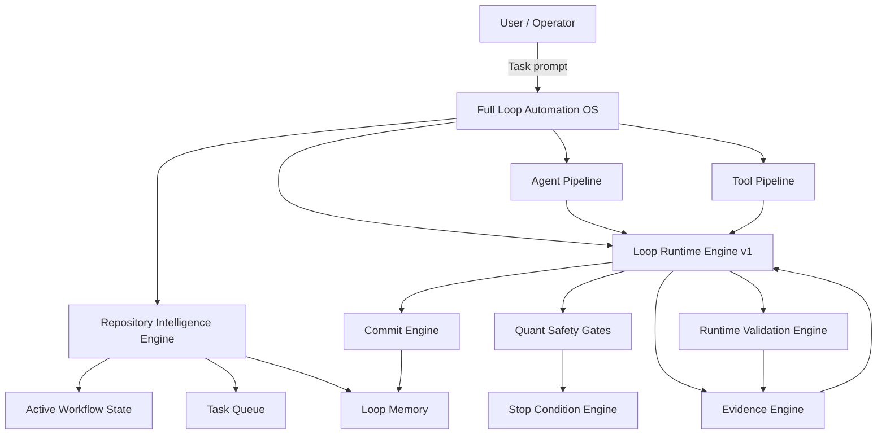
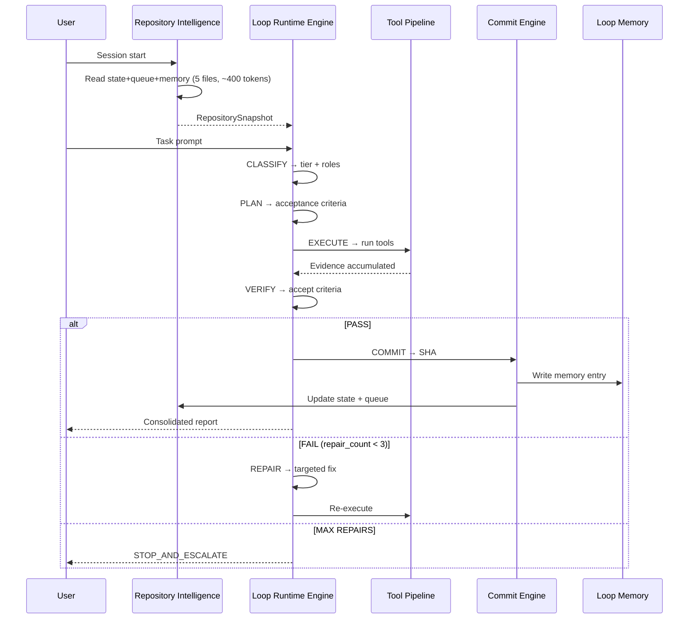
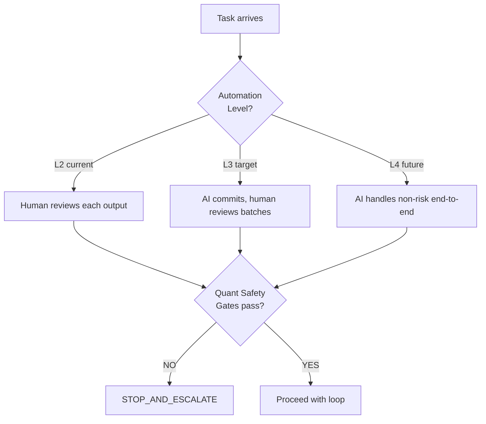

# FULL_LOOP_AUTOMATION_OS_001

**Date:** 2026-06-27  
**Document type:** Architecture design  
**Destination:** `docs/architecture/`  
**Status:** DESIGN — not implemented

---

## 1. System Overview

The Full Loop Automation OS (FLAOS) is the outermost orchestration layer of this repository. It coordinates all sub-systems — the Loop Runtime Engine, Repository Intelligence Engine, Tool Pipeline, Agent Pipeline, and quant safety gates — into a single coherent automation model.



---

## 2. Automation Levels L1–L5

| Level | Name | What the AI does | What requires human | Examples |
|-------|------|-----------------|--------------------|---------| 
| **L1** | Manual | AI suggests only | Human executes every command | Current (pre-FLAOS) |
| **L2** | Assisted | AI executes within declared scope, human reviews each output | Human approves before commit | Loop Engineering (current) |
| **L3** | Semi-Auto | AI executes + commits within scope, human reviews batches | Human approves gate + design | Target: Batch 3D+ |
| **L4** | Auto-Gated | AI handles all non-risk tasks end-to-end; gates route high-risk to human | Human handles Class 7/8 only | Post-Batch-3 goal |
| **L5** | Full Auto | All tasks automated; human receives reports only | Human reviews anomalies | Long-term (multi-agent) |

**Current level: L2.** Target for post-Batch-3: L3. L4 requires multi-agent scheduler (see AWE §13). L5 requires live trading authorization — never automated without explicit human sign-off.

---

## 3. Repository Intelligence Engine

See `REPOSITORY_INTELLIGENCE_ENGINE_001.md` for full spec. Summary:

- Reads Active Workflow State + Task Queue + Loop Memory on every session start
- Produces a `RepositorySnapshot` struct: `{phase, next_task, tier, blocked, evidence, trader_py_lines, refactor_batch}`
- Compares current git state against expected state from Loop Memory
- Flags drift: if `git log HEAD` doesn't match `last_commit` in state → force health check before continuing
- Output is the primary input to the Loop Runtime Engine's CLASSIFY state

---

## 4. Tool Registry / Tool Pipeline

See `TOOL_PIPELINE_ENGINE_001.md` for full spec. Summary:

Tools are registered functions with declared scope, evidence grade, and stop conditions. Examples:

| Tool | Grade | Scope |
|------|-------|-------|
| `py_compile` | B | compile check |
| `pytest_targeted` | C | test verification |
| `paper_run` | A | runtime validation |
| `git_diff_scope` | B | scope boundary check |
| `jsonl_field_verify` | A | telemetry shape check |
| `forbidden_grep` | B | forbidden scope detection |

The Tool Pipeline chains tools based on workflow tier. Grade A tier requires paper_run + jsonl_field_verify. Grade B requires py_compile + git_diff_scope. Grade C adds pytest_targeted.

---

## 5. Agent Pipeline Integration

The Agent Pipeline maps task types to the 29-role agent system. For each task:

```
FLAOS → AP.select_roles(task) → [primary_role, supporting_roles]
AP → LRE.CLASSIFY(roles)
```

Role selection follows MASTER_AGENT_ROUTER.md rules. The Agent Pipeline also enforces the role context budget (max tokens per role, defined in AWE §12).

---

## 6. State / Queue / Memory Integration

```
Session start:
  RI reads: ACTIVE_WORKFLOW_STATE → TASK_QUEUE → LOOP_MEMORY
  → produces RepositorySnapshot

Loop end:
  CE.commit() → SHA
  LM.write(entry with SHA)
  AS.update(next_task, last_commit)
  TQ.advance(completed → next READY)

Cross-session:
  New session reads LM first → reconstructs recent history in ~400 tokens
  Detects uncommitted memory entries (SHA = "pending-at-report-time") → flags for cleanup
```

---

## 7. Quant Safety Gates

These gates are hardcoded and cannot be bypassed by any automation level:

| Gate | Trigger | Action |
|------|---------|--------|
| Live trading gate | `--mode live` in any command | STOP_AND_ESCALATE regardless of tier |
| Execution gate | execution/risk/sizing files in diff | STOP, require Class 8 manual authorization |
| Active question gate | OPEN question blocks strategy changes | Block signal/sizer/execution tasks |
| Bankroll gate | bankroll tier code in diff | STOP |
| Lineage gate | `_phase4_*` or `_last_quote_lineage_context` in diff | STOP |
| Permanent method gate | `_risk_plan_zero_diagnostics`, `_diagnostic_*` in diff | STOP |

These gates are checked at EVERY state transition in LRE. They override any workflow tier.

---

## 8. Full Accept Policy

A loop produces a PASS verdict only when ALL of the following are true:

```
ACCEPT = (
  compile_ok AND
  import_ok AND
  zero_new_test_failures AND
  forbidden_grep_empty AND
  git_diff_only_allowed_files AND
  evidence_grade >= required_for_tier AND
  (tier < GATE OR runtime_validated) AND
  no_live_orders_in_paper_run AND
  jsonl_fields_shape_unchanged
)
```

Any single False → loop continues to REPAIR or STOP.

---

## 9. Evidence Engine

Defined in `LOOP_RUNTIME_ENGINE_V1.md` §5. FLAOS adds:

- **Evidence accumulation:** grades are additive within a loop. A loop that starts with Grade D (docs) can upgrade to Grade B (compile) without re-running earlier steps.
- **Evidence persistence:** recorded in Loop Memory per entry. Future sessions can inspect past grade distributions via Analytics Engine.
- **Grade minimum enforcement:** FLAOS refuses to call CE.commit() if evidence grade is below the tier minimum.

---

## 10. Commit Engine

Defined in `LOOP_RUNTIME_ENGINE_V1.md` §6. FLAOS adds:

- **Pre-commit checklist** (automated):
  - `git status` → confirm only allowed files are staged
  - `git diff --cached --name-only | grep -v "^[allowed_pattern]"` → must return empty
  - All acceptance criteria pass
- **Post-commit:** SHA captured → LM.write → AS.update → TQ.advance
- **Rollback trigger:** if CE.commit() fails → `git restore` declared files → STOP

---

## 11. Runtime Validation Engine

For Grade A evidence tasks:

```
RVE.run():
  1. Launch paper mode with timeout (420s default)
  2. Stream log to scratchpad
  3. After completion:
     a. Check exit code = 0
     b. Check cycle count >= 5
     c. Check AttributeError count = 0
     d. Check "STATUS NO LIVE ORDERS" in TUI
     e. Check JSONL field list from event stream
     f. Compare JSONL field set to pre-run baseline
  4. Grade = A if all pass, PARTIAL if some, FAIL if exit != 0
```

---

## 12. Log Size Governance

| Artifact | Max size | Retention | Compaction |
|----------|----------|-----------|-----------|
| `runtime/event_stream/*.jsonl` | 50 MB per file, rotate | 30 days | `.jsonl.gz` after 7 days |
| `logs/*.log` | 10 MB per file | 7 days | Rotate, no archive |
| Loop Memory JSON | 100 KB per day file | Keep all | Monthly: move to `archive/YYYYMM.json` |
| Docs reports | Unlimited | Keep all | None (docs are cheap) |
| Paper run logs (scratchpad) | Session-scoped | Deleted after session | N/A |

FLAOS checks disk usage before launching paper runs. If `runtime/event_stream/` > 80% of 5 GB disk → trigger compaction before proceeding.

---

## 13. Test Registry Design

Tests are registered with metadata that FLAOS uses to select the right test set per task:

```json
{
  "test_id": "test_paper_mode",
  "file": "tests/test_paper_mode.py",
  "covers": ["paper_mode", "cycle_loop", "observability"],
  "known_failures": ["test_decision_event_emits_orderbook_refresh_reuse_cadence_observability"],
  "grade": "C",
  "runtime_seconds": 50
}
```

FLAOS selects tests based on what changed: if `trader_observability.py` changed → run `test_paper_mode`, `test_execution_risk_controls`, `test_quote_age_phase5`.

---

## 14. Script / Tool Registry Design

```json
{
  "tool_id": "py_compile",
  "command_template": "python -m py_compile {files}",
  "evidence_grade": "B",
  "stop_on_fail": true,
  "timeout_seconds": 10,
  "scope_required": false
}
```

Tools are immutable once registered. A new version creates a new tool_id (e.g., `py_compile_v2`). FLAOS always uses the latest version unless pinned.

---

## 15. Migration Roadmap

| Phase | Automation Level | What ships | Trigger |
|-------|----------------|-----------|---------|
| **Current** | L2 | Loop Engineering Playbook + Loop Memory + LRE v1 spec | NOW |
| **Phase 1** | L2→L3 | Formalize Tool Registry schema; FLAOS as markdown checklist | After Batch 3D |
| **Phase 2** | L3 | FLAOS as shell script that validates Loop Contract fields before execution | After 20 loop memory entries |
| **Phase 3** | L3→L4 | Agent Pipeline: automated role selection from task classification | After 50 loop entries |
| **Phase 4** | L4 | Repository Intelligence Engine as Python script reading state/queue/memory | Post-Batch-4 |
| **Phase 5** | L5 | Multi-agent scheduler (git worktrees) | Long-term |

---

## 16. Mermaid Diagrams

### FLAOS Session Flow



### Automation Level Decision



---

## 17. Stop Conditions (FLAOS level)

In addition to LRE-level stop conditions, FLAOS adds:

- Session has produced > 10 uncommitted changes — prompt user before continuing
- Loop Memory shows 3 consecutive FAIL entries for same task — escalate
- Active Workflow State `blocked: true` — stop and read notes before any action
- `trader.py` line count increased (not decreased) after a refactor commit — flag for review
- Disk usage > 80% — trigger compaction before paper run
- Any tool in Tool Pipeline returns non-zero with unknown error — STOP

---

## 18. Final Compact Output Standard

Every FLAOS session concludes with a compact output block:

```
FINAL_VERDICT: [COMMITTED|STOPPED|ESCALATED]
TASK: [task_id]
COMMITS: [sha] — [message] (TYPE [A|B|C|D|F])
FILES_CHANGED: [count] ([N runtime] + [M docs])
TESTS: [pass/total] or N/A
RUNTIME: [cycles, exit code, key JSONL counts] or N/A
FORBIDDEN_SCOPE: [confirmed clean] or [VIOLATION: file]
STATE_QUEUE_MEMORY: [what changed]
NEXT: [next_task_id] — [one line description]
```

This format is machine-parseable and feeds directly into Loop Memory analytics.
