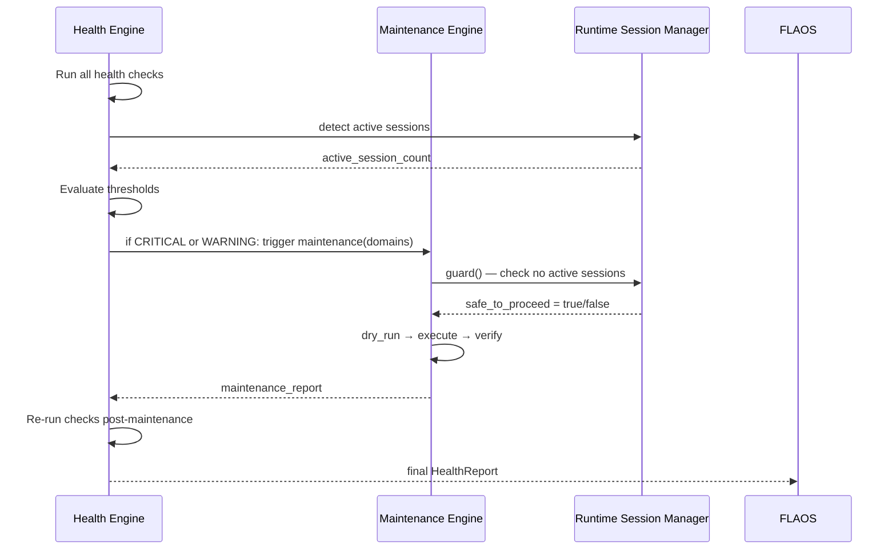

# HEALTH_ENGINE_001

**Date:** 2026-06-27 · **Destination:** `docs/architecture/` · **Status:** DESIGN v1

---

## 1. Objective

The Health Engine (HE) provides a unified, real-time (and offline) view of the operational health of the PolyTrade Bot system. It aggregates signals from disk, logs, JSONL streams, runtime sessions, processes, git state, bootstrap health, and queue health into a single `HealthReport` that FLAOS and the Maintenance Engine can act on.

---

## 2. Health Dimensions

### 2.1 Disk Usage
- `logs/` directory size
- `runtime/event_stream/` directory size
- `runtime/sessions/` directory size
- Total `runtime/` size
- Trend: bytes per day (computed from file ages)

### 2.2 Log Growth
- Active log file size
- Number of rotated backup files
- Oldest backup file age
- Estimated days until critical threshold

### 2.3 JSONL Growth
- Per-day file size
- Lines per day
- Events per session (from session metadata)
- Field schema consistency (spot check last 100 events)

### 2.4 Session State
- Active sessions (via `runtime_session.py detect`)
- Orphaned sessions (PID in metadata but process not running)
- Session age distribution (warn if any session > 12h old)
- Stale session log files (0-byte stubs left over)

### 2.5 PID / Process State
- Active `python main.py --mode paper` processes
- Duplicate processes (more than 1 active = WARNING)
- Zombie PIDs (in session metadata but not in OS process list)

### 2.6 Bootstrap Health
- Result of `tools/flaos/bootstrap.py --diagnose`
- HEALTHY / DEGRADED / STOP_AND_ESCALATE
- Missing or malformed files reported

### 2.7 Git Cleanliness
- Untracked files in root (non-entrypoint markdown = WARNING)
- Uncommitted tracked changes (dirty tree = WARNING if blocking)
- HEAD matches `ACTIVE_WORKFLOW_STATE.last_commit` (mismatch = WARNING)

### 2.8 Runtime Heartbeat
- Time since last `runtime_heartbeat_v1` event in JSONL (if applicable)
- Last paper run exit code from session metadata
- Last paper run cycle count

### 2.9 Memory Usage (future)
- Python process RSS from session manager
- Peak memory during last paper run

### 2.10 CPU Usage (future)
- CPU % during last paper run (if available from session logs)

### 2.11 Queue Health
- Number of READY tasks in queue
- Number of BLOCKED tasks
- Stale tasks (READY but blocked_by not DONE)
- Priority gaps or conflicts

---

## 3. Health Statuses

| Status | Meaning | Action |
|--------|---------|--------|
| `HEALTHY` | All dimensions within normal bounds | Proceed |
| `DEGRADED` | One semi-critical dimension out of bounds | Log warning; proceed with caution |
| `WARNING` | One critical dimension approaching limit | Alert; schedule maintenance |
| `CRITICAL` | One dimension exceeds critical threshold | Trigger Maintenance Engine; pause new sessions |
| `STOP_REQUIRED` | Immediate risk to data or runtime | Stop all non-critical activity; escalate to user |

---

## 4. Health Check Schema

```json
{
  "check_id": "string",
  "dimension": "disk|log_growth|jsonl_growth|session_state|pid|bootstrap|git|heartbeat|queue",
  "status": "HEALTHY|DEGRADED|WARNING|CRITICAL|STOP_REQUIRED",
  "value": "measured value (string or number)",
  "threshold_warning": "threshold at WARNING level",
  "threshold_critical": "threshold at CRITICAL level",
  "message": "human-readable explanation",
  "recommended_action": "string or null"
}
```

---

## 5. Health Report JSON Schema

```json
{
  "$schema": "health_report_v1",
  "generated_at": "ISO timestamp",
  "overall_status": "HEALTHY|DEGRADED|WARNING|CRITICAL|STOP_REQUIRED",
  "checks": [
    { "see Health Check Schema above" }
  ],
  "maintenance_recommended": false,
  "maintenance_domains": ["logs", "jsonl"],
  "bootstrap_result": "HEALTHY|STOP_AND_ESCALATE",
  "active_sessions": 0,
  "orphaned_pids": [],
  "disk_summary": {
    "logs_mb": 1638,
    "runtime_event_stream_mb": 217,
    "runtime_sessions_kb": 16,
    "total_runtime_mb": 233
  }
}
```

---

## 6. Threshold Examples

| Dimension | Value | Status |
|-----------|-------|--------|
| `logs/` size | < 500 MB | HEALTHY |
| `logs/` size | 500 MB – 1 GB | DEGRADED |
| `logs/` size | 1 GB – 3 GB | **WARNING** |
| `logs/` size | > 3 GB | **CRITICAL** |
| `runtime/event_stream/` daily file | < 50 MB | HEALTHY |
| `runtime/event_stream/` daily file | 50–200 MB | DEGRADED |
| `runtime/event_stream/` daily file | > 200 MB | **WARNING** |
| `runtime/event_stream/` daily file | > 500 MB | **CRITICAL** |
| Rotated backup count (`logs/.log.N`) | < 10 | HEALTHY |
| Rotated backup count | 10–50 | DEGRADED |
| Rotated backup count | > 50 | **WARNING** |
| Rotated backup count | > 200 (706 observed) | **CRITICAL** |
| Active paper sessions | 0 | HEALTHY |
| Active paper sessions | 1 | HEALTHY (expected) |
| Active paper sessions | > 1 | **WARNING** (duplicate) |
| Orphaned PIDs | 0 | HEALTHY |
| Orphaned PIDs | > 0 | **WARNING** |
| Bootstrap diagnose | HEALTHY | HEALTHY |
| Bootstrap diagnose | STOP_AND_ESCALATE | **STOP_REQUIRED** |
| Root non-entrypoint `.md` files | 0 | HEALTHY |
| Root non-entrypoint `.md` files | > 0 | **DEGRADED** |
| Queue stale READY tasks | 0 | HEALTHY |
| Queue stale READY tasks | > 3 | **DEGRADED** |

---

## 7. Integration with Maintenance Engine



---

## 8. Integration with Runtime Session Manager

The Health Engine calls `runtime_session.py detect` to enumerate active sessions before any check that touches runtime files. This prevents race conditions between health checks and active paper runs.

---

## 9. Stop Conditions

| Condition | Immediate action |
|-----------|----------------|
| Bootstrap returns STOP_AND_ESCALATE | Health Engine status = STOP_REQUIRED; no further operations |
| Disk full (`logs/` or `runtime/` > 90% of available disk) | STOP_REQUIRED; trigger emergency compaction |
| Active orphaned PIDs consuming disk | WARNING; recommend `runtime_session.py cleanup` |
| JSONL file actively growing at > 10 MB/minute | CRITICAL; check for runaway logging |
| Duplicate active paper sessions | WARNING; recommend guard check |

---

## 10. Roadmap

| Phase | What ships | Timing |
|-------|-----------|--------|
| **A** | `tools/flaos/health_check.py` — filesystem health checker: disk sizes, file counts, backup counts, bootstrap check | After Phase A log governance |
| **B** | Runtime session health integration: active PID count, orphan detection | After Runtime Session Manager stable |
| **C** | JSONL growth monitor: per-day file size trend, alert on excess | After Phase C log governance (JSONL compaction) |
| **D** | Dashboard/alerting: write HealthReport to `runtime/health_report.json`; optionally send Telegram alert | Phase 4 FLAOS |
