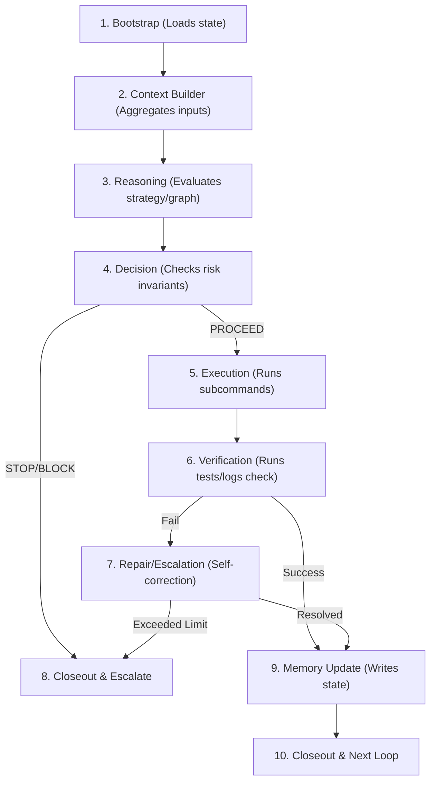
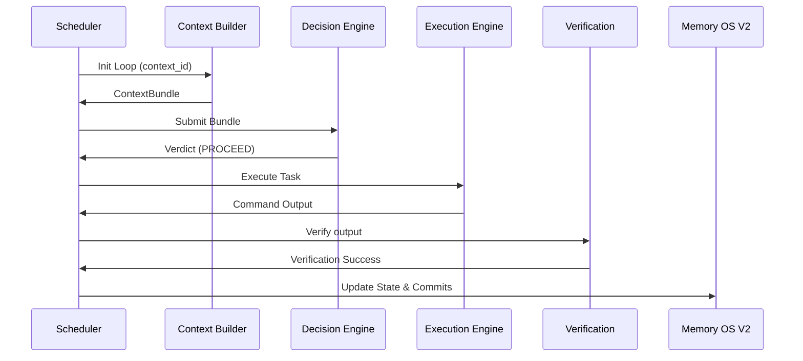

# FLAOS Loop Runtime Engine v2 - Architectural Specification

## 1. Executive Summary & Objective
The **FLAOS Loop Runtime Engine v2** binds the completed offline engines (Bootstrap, Context Builder, Reasoning, Decision, Execution, Verification, Supervisor, and Memory OS V2) into a unified, continuous execution lifecycle. It transitions FLAOS from a set of discrete tools into a continuous, self-correcting execution loop.

---

## 2. Unified Runtime Lifecycle Flow
Each iteration of the Loop Runtime Engine v2 processes through eight distinct sequential phases:

1. **Bootstrap**: Loads execution metadata and validates schema integrity.
2. **Context Builder**: Pulls 9 context inputs to generate the immutable `ContextBundle`.
3. **Reasoning**: Evaluates the AST coupling, graph query output, and strategic options.
4. **Decision**: Enforces Safety Memory (QS-001 through QS-010) and determines the verdict.
5. **Execution**: Spawns process calls asynchronously, redirecting outputs to isolated session logs.
6. **Verification**: Asserts post-execution invariants via pytest and log scanner checks.
7. **Supervisor**: Manages repair loops or elevates task exceptions if max repairs are hit.
8. **Memory Update**: Commits code changes, updates loop memories, and indexes Memory OS V2 registries.

---

## 3. Scheduler & Orchestration
The Scheduler sequences loop iterations based on task priorities defined in `TASK_QUEUE_001.json`. It maintains task dependencies and enforces a single execution thread using PID locks.

---

## 4. Health Checks
The engine executes pre-flight health checks at the start of every cycle:
- **Filesystem Integrity**: Confirms state/queue/log directories exist.
- **Process Mutual Exclusion**: Verifies no other instance of `main.py` is running under paper/live flags.
- **JSON Validator**: Confirms no malformed JSON exists in configuration files.

---

## 5. Retry, Recovery & Escalation Policies
- **Retry Policy**: Subcommand failures trigger a repair cycle. The Supervisor provides context errors back to the generator, allowing up to 3 repair attempts.
- **Recovery Policy**: If the system crashes mid-loop, a startup recovery scan reads the last session log, releases stale locks, and resets task status to `READY`.
- **Escalation Policy**: On fatal checks (e.g. safety memory corruption, forbidden scope modifications, or live mode rejection), the system transitions to `STOP_AND_ESCALATE` and shuts down.

---

## 6. Shutdown Policy
- **Graceful Teardown**: Upon receiving `SIGINT` or `SIGTERM`, the engine completes the active state transition, persists session metadata, releases the lock, and exits with code `0`.
- **Hard Stop**: If a panic condition is encountered, the engine terminates child subprocesses immediately, flags the task as `FAILED` in the queue, and exits with code `1`.

---

## 7. Event Sequence Flow

---

## 8. Migration Roadmap
1. **v1 Design Specification**: Completed in `docs/architecture/LOOP_RUNTIME_ENGINE_001.md`.
2. **v2 Checklist Template**: Create the `LOOP_CONTRACT_TEMPLATE_001.md` containing manual transition checks.
3. **v3 Python Context/Decision/Supervisor Loop (Phase A)**: Combine engines in offline CLI.
4. **v4 Full Integration (Phase B)**: Deploy the unified scheduler executing the full loop on paper validation runs.
5. **v5 Autonomous Supervisor Mode (Phase C)**: Enable autonomous repair loops.
