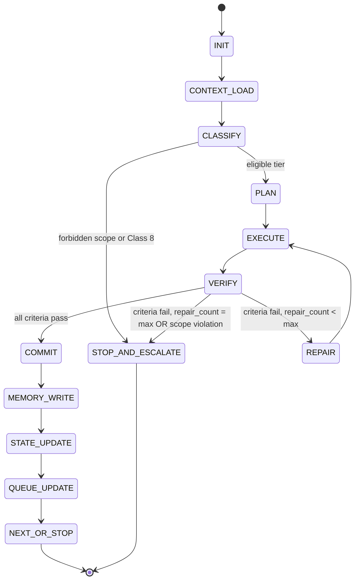
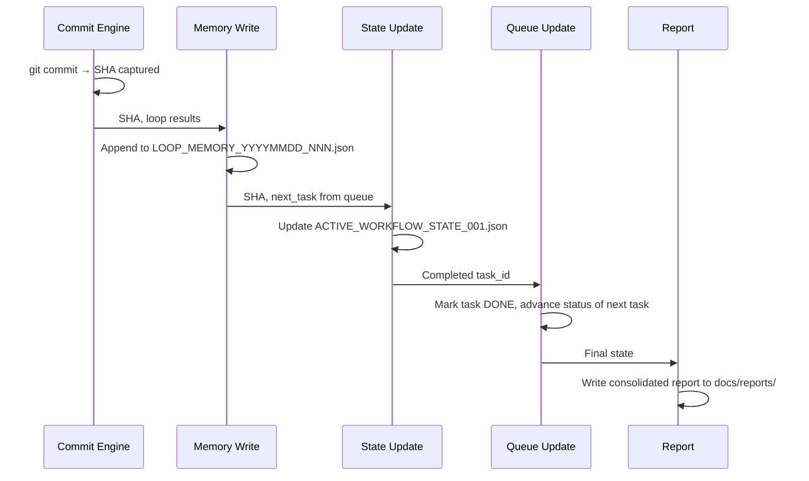
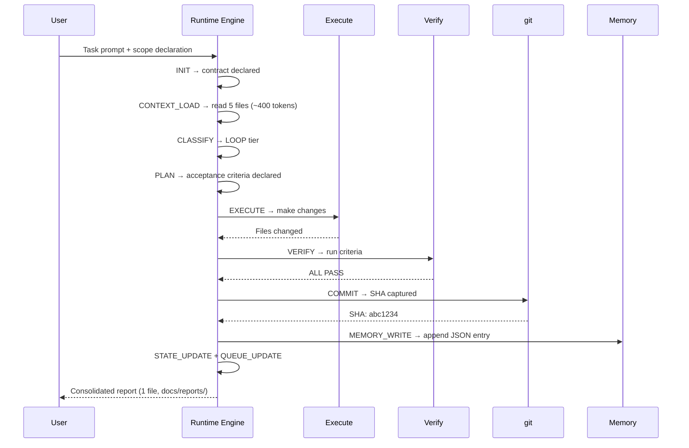
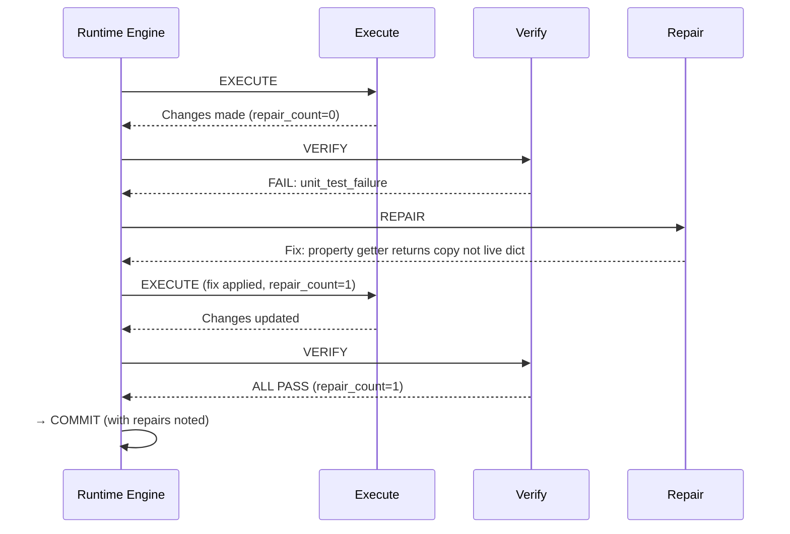
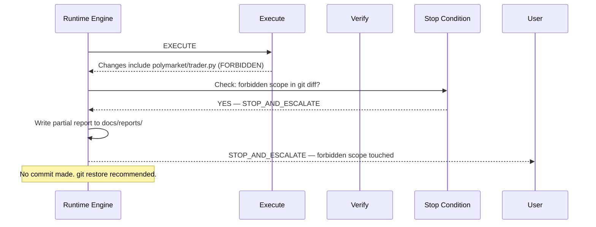

# LOOP_RUNTIME_ENGINE_V1

**Date:** 2026-06-27  
**Document type:** Architecture design  
**Destination:** `docs/architecture/`  
**Status:** v1 — specification only (not yet implemented as code)

---

## 1. Runtime State Machine

The Loop Runtime Engine operates as a 13-state machine. Every loop begins at INIT and ends at either NEXT_OR_STOP (success) or STOP_AND_ESCALATE (failure/violation).



### State Definitions

| State | Purpose | Inputs | Outputs | Transitions |
|-------|---------|--------|---------|------------|
| **INIT** | Declare loop contract | Task prompt | Loop contract object | → CONTEXT_LOAD |
| **CONTEXT_LOAD** | Read minimum context | Governance files, state JSON, loop memory | Project state snapshot | → CLASSIFY |
| **CLASSIFY** | Assign workflow tier | Task class, scope, difficulty score | Tier (FAST/LOOP/STANDARD/GATE), repair limit | → PLAN or STOP_AND_ESCALATE |
| **PLAN** | Declare acceptance criteria | Task description, tier | Criteria list, evidence grade target | → EXECUTE |
| **EXECUTE** | Apply changes within scope | Plan, allowed files | File changes | → VERIFY |
| **VERIFY** | Evaluate criteria | Changed files, test results, runtime output | Pass/fail per criterion | → COMMIT or REPAIR or STOP_AND_ESCALATE |
| **REPAIR** | Diagnose and fix | Failure reason, current changes | Targeted patch | → EXECUTE (increments repair_count) |
| **COMMIT** | Record changes to git | All changed files (scoped) | Commit SHA | → MEMORY_WRITE |
| **MEMORY_WRITE** | Append loop memory JSON | Commit SHA, results, evidence grade | Updated LOOP_MEMORY_YYYYMMDD_NNN.json | → STATE_UPDATE |
| **STATE_UPDATE** | Update active workflow state | Commit SHA, next task | Updated ACTIVE_WORKFLOW_STATE_001.json | → QUEUE_UPDATE |
| **QUEUE_UPDATE** | Update task queue statuses | Gate verdicts, completions | Updated TASK_QUEUE_001.json | → NEXT_OR_STOP |
| **NEXT_OR_STOP** | Report result, suggest next | Final state | Consolidated report to docs/reports/ | → [end] |
| **STOP_AND_ESCALATE** | Write partial report, halt | Stop reason | Partial report to docs/reports/ | → [end] |

### Stop Conditions (any state → STOP_AND_ESCALATE)

- Forbidden scope file appears in `git diff`
- Live trading path (`--mode live`) touched
- Execution/risk/sizing code modified without GATE
- `repair_count` reaches `max_repairs`
- `AttributeError` or `Traceback` in paper run output
- Ambiguous scope (changed file not in declared allowed list)
- Working tree has unrelated tracked dirty files before COMMIT

---

## 2. Loop Runtime Contract

Declared at INIT. Every loop must have all fields before execution begins.

```json
{
  "task_id": "EXAMPLE_TASK_001",
  "task_class": 3,
  "workflow_tier": "LOOP",
  "allowed_files": ["docs/reports/", "FILE_INDEX.md"],
  "forbidden_scope": ["polymarket/", "tests/", "runtime/", "dashboard/"],
  "acceptance_criteria": {
    "criterion_1": "description of what must be true",
    "criterion_2": "description"
  },
  "max_repairs": 3,
  "current_repair_count": 0,
  "evidence_required": "B",
  "commit_policy": "TYPE_C_ONLY",
  "memory_policy": "append_after_commit",
  "state_update_policy": "update_last_completed_and_next_task",
  "queue_update_policy": "mark_task_complete_advance_next"
}
```

**Validation rules at INIT:**
- `allowed_files` must be non-empty
- `forbidden_scope` must include at minimum: `polymarket/`, `runtime/`, `tests/`, `dashboard/`, `config/`
- `max_repairs` ≤ 3
- `evidence_required` must match minimum for `workflow_tier` (see Evidence Engine)
- `commit_policy` must be consistent with file types in `allowed_files`

---

## 3. Stop Condition Engine

```mermaid
flowchart TD
    CHECK[Check after each action] --> FS{Forbidden scope\nin git diff?}
    FS -->|YES| STOP
    FS -->|NO| LT{Live trading\ntouched?}
    LT -->|YES| STOP
    LT -->|NO| ERS{Exec/risk/sizing\nwithout GATE?}
    ERS -->|YES| STOP
    ERS -->|NO| TR{Traceback in\npaper run?}
    TR -->|YES| STOP
    TR -->|NO| MR{repair_count\n= max_repairs AND fail?}
    MR -->|YES| STOP
    MR -->|NO| AS{Ambiguous scope\n(file not in allowed_files)?}
    AS -->|YES| STOP
    AS -->|NO| CONTINUE[Continue loop]
    STOP[STOP_AND_ESCALATE]
```

| Stop trigger | Hard stop? | Repair allowed? |
|-------------|-----------|----------------|
| Forbidden scope in diff | YES — immediate | NO |
| Live trading touched | YES — immediate | NO |
| Execution/risk/sizing without gate | YES — immediate | NO |
| Traceback in paper run | YES | NO (escalate) |
| Max repairs exhausted | YES | NO |
| Ambiguous scope | YES | NO |
| Compile failure (declared scope) | NO | YES — repair #1 |
| Test failure (declared scope) | NO | YES — repair up to max |
| JSONL field missing | NO | YES — diagnose then re-run |

---

## 4. Repair Policy Engine

| Failure class | Repair allowed? | Max attempts | Evidence after repair | Escalation rule |
|--------------|----------------|--------------|----------------------|----------------|
| `compile_error` | YES | 2 | Grade B (re-compile) | Escalate if not in declared scope |
| `import_error` | YES | 2 | Grade B (re-import) | Escalate if circular import introduced |
| `unit_test_failure` | YES | 3 | Grade C (re-run tests) | Escalate if fix requires touching forbidden scope |
| `runtime_error` (AttributeError) | YES | 2 | Grade A (paper re-run) | Escalate if 2nd paper run also fails |
| `jsonl_missing_field` | YES | 2 | Grade A (JSONL verify) | Escalate if field was moved to helper incorrectly |
| `scope_violation` | NO | 0 | — | Immediate STOP_AND_ESCALATE |
| `git_state_violation` | NO | 0 | — | Immediate STOP_AND_ESCALATE |
| `evidence_insufficient` | YES | 1 | Raise to required grade | Escalate if evidence cannot be raised |

**Repair action format:**

```
REPAIR #{n}:
  failure_class: [class]
  diagnosis: [one sentence]
  fix: [one sentence describing exact change]
  files_touched: [list — must be in allowed_files]
  expected_outcome: [criterion that should now pass]
```

---

## 5. Evidence Engine

### Grade Definitions

| Grade | Name | What it means | Typical commands |
|-------|------|---------------|-----------------|
| D | Docs verified | File exists in correct location, git diff confirms scope | `git diff --name-only` |
| C | Test verified | Automated test suite passes | `pytest -q` |
| B | Source verified | Compile + import clean | `py_compile` + `IMPORT_OK` |
| A | Runtime verified | Paper run 5+ cycles, exit 0, JSONL fields present | `python main.py --mode paper` |

### Minimum Evidence by Workflow Tier

| Tier | Minimum grade | Justification |
|------|--------------|--------------|
| FAST (Class 3/9 repeat) | D | Docs-only, prior PASS in memory |
| LOOP (Class 3/4/9 new) | B | Any code change requires compile check |
| LOOP (Class 6-low) | B + C | Structural refactor requires tests |
| STANDARD (Class 6-high, 1) | B + C | Same, with additional review |
| GATE (Class 7) | A + C | Full runtime validation required |
| GATE (Class 8) | A + manual user sign-off | Live risk always manual |

---

## 6. Commit Engine

### File Type Classification

| Type | File patterns | Example |
|------|--------------|---------|
| A | `*.py` in `polymarket/`, `utils/`, `config/` | `trader_observability.py` |
| B | `dashboard/**`, `tools/*.py` | `dashboard/src/` |
| C | `*.md`, `*.json` in `docs/`, `*.md` root entrypoints | `docs/reports/*.md` |
| D | `tests/*.py` | `tests/test_paper_mode.py` |
| F | `runtime/research_exports/` | `*.csv`, `*.json` |

### Commit Rules

```
1. Classify all changed files by type
2. If only TYPE C → single commit, message: "docs: [description]"
3. If TYPE A present:
   - TYPE A gets its own commit: "refactor: [description]"
   - TYPE C (docs produced by the task) can accompany TYPE A in same commit
   - TYPE A must NEVER be in same commit as TYPE B, TYPE D alone, or TYPE F
4. If TYPE B + TYPE C → single commit: "dashboard: [description]" or split
5. If TYPE D alone → "tests: [description]"
6. Commit order when splitting: TYPE A first, then TYPE C
7. Commit SHA captured before MEMORY_WRITE
```

### Anti-patterns (forbidden)

```
FORBIDDEN: git add polymarket/trader.py dashboard/src/*.tsx
FORBIDDEN: git add *.py *.md  (mixes A + C in ambiguous way)
ALLOWED:   git add polymarket/trader.py docs/reports/REPORT.md
```

---

## 7. Memory / State / Queue Update Sequence

After COMMIT succeeds:



**State update fields changed:** `last_completed_task`, `last_commit`, `next_task`, `next_workflow_tier`

**Queue update:** completed task → `status: DONE`, blocked task → `status: READY` (if its `blocked_by` is now DONE)

---

## 8. Analytics Schema

```json
{
  "$schema": "loop_analytics_v1",
  "task_id": "EXAMPLE_TASK_001",
  "date": "2026-06-27",
  "workflow_tier": "LOOP",
  "task_class": 6,
  "repair_count": 1,
  "failure_classes": ["unit_test_failure"],
  "evidence_grade": "C",
  "files_changed": 2,
  "net_lines": 45,
  "commit_count": 1,
  "runtime_cycles": 0,
  "token_saving_estimate": 2000,
  "result": "PASS",
  "stop_reason": null,
  "duration_estimate_minutes": 3
}
```

Analytics records accumulate in `docs/operations/loop_memory/` alongside memory records. Weekly rollup: `docs/reports/LOOP_ANALYTICS_YYYYMMDD_001.md`.

---

## 9. Mermaid Diagrams

### 9.1 Happy Path — LOOP Tier (Class 3)



### 9.2 Repair Path



### 9.3 Stop/Escalation Path



---

## 10. Migration Plan

| Phase | Name | What ships | Timing |
|-------|------|-----------|--------|
| v1 | Spec | This document + LOOP_RUNTIME_STATE_SCHEMA_001.md | 2026-06-27 (NOW) |
| v2 | Command checklist | Markdown template: AI fills in contract fields before each loop | Post-Batch-3C |
| v3 | Semi-automated | Shell script that validates contract fields and runs stop-condition checks | After 20+ loop records |
| v4 | Multi-agent scheduler | Python orchestrator distributing loops across agents | Long-term (Phase 3 per AWE) |

**v1 → v2 trigger:** When 10+ loop memory records exist and repair rate > 10%  
**v2 → v3 trigger:** When 30+ loop records and stop-condition violations are detectable by grep  
**v3 → v4 trigger:** After Batch 3 complete and git worktree support confirmed
