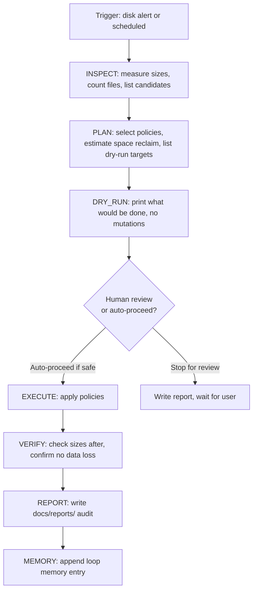

# MAINTENANCE_ENGINE_001

**Date:** 2026-06-27 · **Destination:** `docs/architecture/` · **Status:** DESIGN v1

---

## 1. Objective

The Maintenance Engine (ME) provides a structured, safe framework for all housekeeping operations on runtime artifacts: log files, JSONL event streams, session metadata, temp files, archives, and disk space. It is the engine behind log governance, JSONL compaction, and archive rotation — preventing the ad-hoc, risky pattern of manually deleting files.

**Key principle:** The Maintenance Engine never deletes without an explicit, declared policy. Every operation runs in dry-run mode first.

---

## 2. Why Log Governance Alone is Insufficient

| Gap | Log Governance | Maintenance Engine |
|-----|----------------|-------------------|
| Rotates log files | ✓ | ✓ |
| Compacts JSONL streams | ✗ | ✓ |
| Archives old session data | ✗ | ✓ |
| Monitors disk growth trends | ✗ | ✓ |
| Integrates with Health Engine | ✗ | ✓ |
| Dry-run mode before destructive ops | ✗ | ✓ |
| Compacts loop memory | ✗ | ✓ |
| Policy-driven with audit trail | ✗ | ✓ |
| Integrates with runtime session check | ✗ | ✓ |

---

## 3. Maintenance Domains

### 3.1 Logs (`logs/`)
- 1,005 files totaling 1.6 GB (observed 2026-06-27)
- 706 rotated `.log.N` backups from `RotatingFileHandler`
- **Policy:** Keep last 5 backups per log name; compress `.log.N` files older than 24h; delete compressed archives older than 7 days

### 3.2 JSONL Event Streams (`runtime/event_stream/`)
- 217 MB, 3 files, 74,639 total events
- 2026-06-26 file: 135 MB / 47,181 events (heavy session day)
- **Policy:** Compress files older than 3 days to `.jsonl.gz`; retain compressed 30 days; alert if daily file exceeds 200 MB before compression

### 3.3 Runtime Sessions (`runtime/sessions/`)
- Small (16 KB, 3 JSON files)
- **Policy:** Retain 30 most recent session metadata files; delete older

### 3.4 Temp / Validation Logs (`runtime/validation/`)
- 28 KB, 6 files; session-scoped stubs mostly 0 bytes
- **Policy:** Delete logs from sessions older than 7 days; keep current session logs intact

### 3.5 Validation Outlog (`runtime/validation_run_output.log`)
- 27.8 MB (single unrotated file)
- **Policy:** Rotate at 50 MB; keep last 3 rotations; compress older

### 3.6 Archives (`archive/`)
- Legacy prompts and stale files (low priority)
- **Policy:** Read-only; never auto-delete; manual review only

### 3.7 Loop Memory Compaction (`docs/operations/loop_memory/`)
- Currently one daily JSON file per day
- **Policy:** After 30 days, consolidate into monthly archive at `docs/operations/loop_memory/archive/YYYYMM.json`; keep all summaries, discard raw fields from old entries

### 3.8 Repository Snapshots (`docs/operations/CURRENT_SNAPSHOT.json`)
- Future: auto-generated by Repository Intelligence Engine
- **Policy:** Keep only the most recent snapshot; overwrite on each session start

### 3.9 Disk Usage Monitoring
- Alert threshold: `logs/` > 1 GB = WARNING; > 3 GB = CRITICAL
- Alert threshold: `runtime/event_stream/` > 500 MB = WARNING; > 1 GB = CRITICAL
- Alert threshold: total `runtime/` > 2 GB = WARNING

---

## 4. Maintenance Policies

### Hot/Cold Storage
| Age | Storage type | Action |
|-----|-------------|--------|
| 0–24h | Hot | Active use; no action |
| 1–3 days | Warm | Available for replay; no action |
| 3–7 days | Cold | Compress to `.gz`; retain original |
| 7–30 days | Archive | Compressed only; original deleted |
| 30+ days | Deep archive | Consolidate; monthly rollup |

### Rotation Rules
- Trigger: file size exceeds configured limit
- Action: rename current → `.log.1`, shift existing `.log.N` → `.log.N+1`
- Max backups: 5 (beyond 5, oldest is deleted)

### Compression Rules
- Only compress files that are no longer being actively written
- Verify file is closed (no active process PID holds it) before compressing
- Use `.gz` compression (stdlib `gzip` module — no dependencies)
- Store compressed alongside original; delete original after checksum verify

### Safe Cleanup Rules
- **Never delete without dry-run first**
- **Never delete files held by active PIDs**
- **Never delete files in active session directories**
- **Never delete JSONL files that haven't been compressed successfully**
- **Always write audit log to `docs/reports/` after any cleanup operation**

---

## 5. Maintenance Task Lifecycle

---

## 6. Safety Rules

| Rule | Scope |
|------|-------|
| No deletion by default | `--dry-run` is always the first mode |
| No active session mutation | Check active PIDs before touching any file |
| No live runtime interference | Never touch files currently written by running process |
| No hidden destructive commands | All deletions must be logged to stdout before execution |
| No policy-less deletion | Every file deletion must match a declared retention policy |
| Audit trail required | Every maintenance run writes a report to `docs/reports/MAINTENANCE_RUN_*.md` |
| Forbidden forever | `runtime/event_stream/` JSONL files older than 24h may NOT be deleted — only compressed |
| Forbidden forever | JSONL files that are the sole source of truth for a paper trade may NOT be deleted |

---

## 7. Integration

### With Runtime Session Manager
Before any maintenance operation: call `tools/flaos/runtime_session.py guard` to verify no active paper sessions are running. If active session detected → skip maintenance and schedule retry.

### With Tool Pipeline
Maintenance scripts are registered as CLASS 4 tools in `TOOL_REGISTRY_001.json`. They are invoked via the `TOOL_PIPELINE_LOOP` pipeline.

### With Health Engine
The Health Engine triggers maintenance when disk thresholds are breached. The Maintenance Engine reports back to the Health Engine after cleanup.

### With Loop Memory
After every maintenance execution: append a loop memory entry with files_processed, space_reclaimed_mb, and any errors.

### With Active Workflow State
After scheduled maintenance: update `ACTIVE_WORKFLOW_STATE_001.json` `current_phase` to reflect maintenance was run.

---

## 8. Roadmap

| Phase | What ships | Priority | Timing |
|-------|-----------|----------|--------|
| **A** | `tools/flaos/log_governance.py` — offline compress/archive script for `logs/` and `runtime/event_stream/` | CRITICAL (1.6 GB disk) | NEXT TASK |
| **B** | `utils/logger.py` `backupCount=5` fix + `validation_run_output.log` rotation | HIGH | Separate gate (Class 7) |
| **C** | JSONL compaction: nightly `.jsonl.gz` rotation | MEDIUM | After Phase A validated |
| **D** | Archive engine: monthly loop memory consolidation | LOW | After Phase C |
| **E** | Maintenance scheduler: cron-like trigger via `tools/flaos/scheduler.py` | FUTURE | Phase 5 FLAOS |
