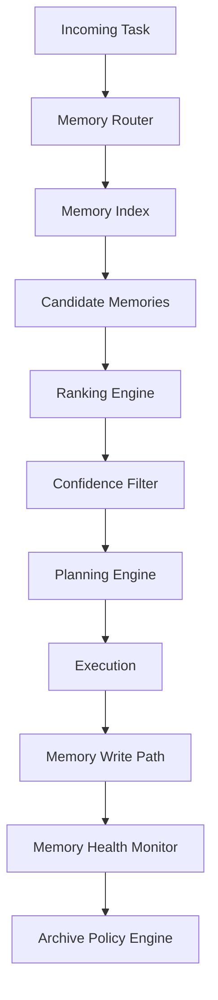
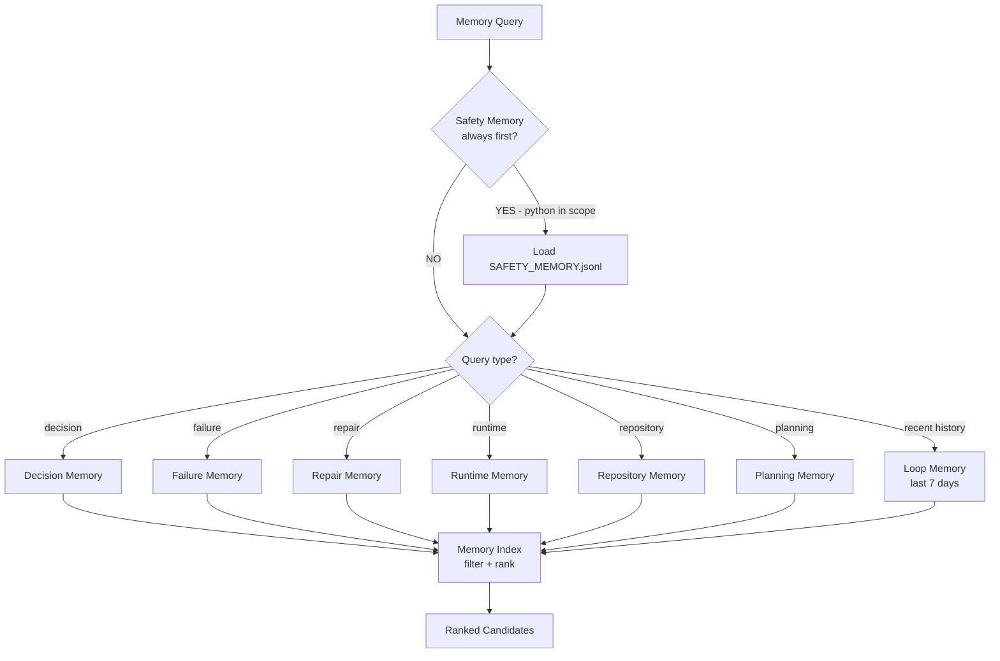
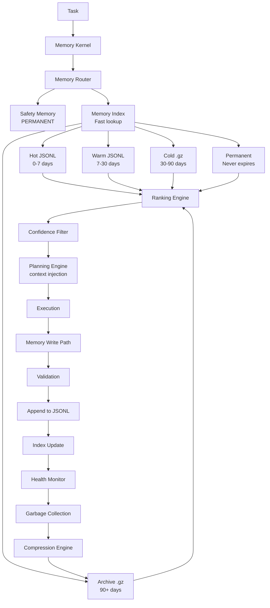
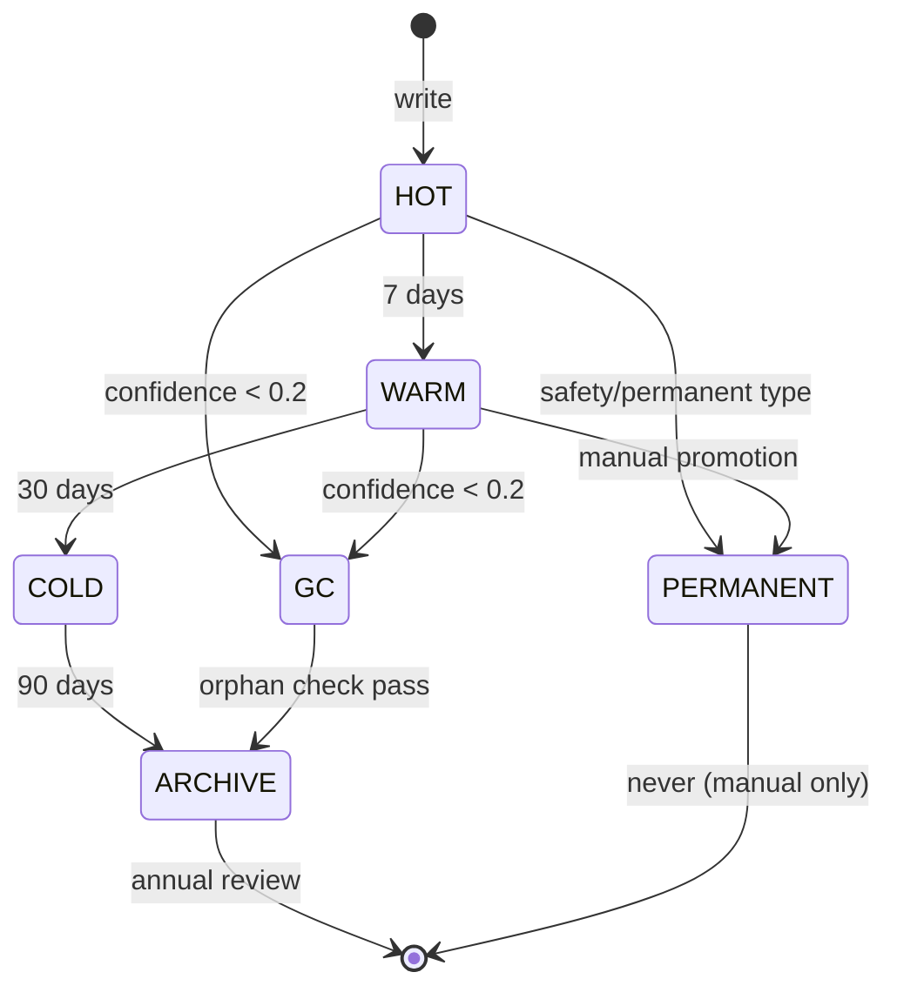

# MEMORY_OS_V2_001

**Date:** 2026-06-27 · **Destination:** `docs/architecture/` · **Status:** DESIGN v2

---

## 1. Memory Kernel

The Memory Kernel (MK) is the central coordinator of all memory subsystems. It exposes a unified read/write/query interface to all FLAOS agents, tools, and planners. Every memory access goes through the kernel — no agent reads raw memory files directly.



**Kernel responsibilities:**
- Route reads to the correct memory layer
- Enforce retention and eviction policies
- Validate memory record schemas before write
- Maintain the Memory Index
- Trigger compression and garbage collection

---

## 2. Working Memory

**Scope:** Single session, ephemeral  
**Format:** In-process dict (never persisted to disk)  
**Lifecycle:** Created at INIT state, discarded at NEXT_OR_STOP  

**Contents:**
- Current loop contract (task_id, tier, scope, criteria)
- Accumulated evidence grades (D → A as tools run)
- Repair count and last failure reason
- Active tool pipeline state
- Intermediate plan outputs

**Key rule:** Working memory is NEVER written to disk. If the session crashes, working memory is lost. Durable outcomes go to Session Memory or Loop Memory.

---

## 3. Session Memory

**Scope:** Cross-loop within one AI session  
**Format:** `docs/operations/memory/session/SESSION_YYYYMMDD_NNN.jsonl`  
**Lifecycle:** Written after each loop in the session; retained for 7 days  

**Purpose:** Allows loops within the same session to share context without re-reading all historical files. The session memory is the "recent RAM" — warm and fast.

**Schema:**
```json
{
  "memory_type": "session",
  "session_id": "20260627_001",
  "loop_id": "BATCH_3C_IMPLEMENTATION_001",
  "summary": "Removed 5 display proxy stubs, updated 2 call sites",
  "files_changed": ["polymarket/trader.py"],
  "evidence_grade": "C",
  "outcome": "PASS"
}
```

---

## 4. Loop Memory

**Scope:** Cross-session historical event log  
**Format (v2):** `docs/operations/memory/loop/LOOP_MEMORY_YYYYMMDD.jsonl` (one record per line)  
**Lifecycle:** Append-only; monthly consolidation to `archive/LOOP_YYYY_MM.jsonl.gz`  
**Migration from v1:** Convert existing `LOOP_MEMORY_20260627_001.json` arrays to JSONL

**Key change from v1:** JSONL format replaces single daily JSON array. Each entry is one line — grep-able, appendable without loading the full file, and compressible per line.

**v1 → v2 migration:** `tools/flaos/memory_migrate.py` reads v1 JSON array, writes each entry as a JSONL line.

---

## 5. Decision Memory

**Scope:** Cross-session; indexed by task_id and decision type  
**Format:** `docs/operations/memory/decision/DECISION_MEMORY.jsonl`  
**Lifecycle:** 90 days active; summarize to archive after  
**Retrieval key:** `task_type`, `scope_pattern`, `outcome`

**Contents:** Why a particular scope, tier, or approach was chosen; what alternatives were rejected; reusable decisions for similar future tasks.

```json
{
  "memory_type": "decision",
  "memory_id": "DEC-20260627-BATCH3C-001",
  "task_id": "BATCH_3C_GATE_CHECK_001",
  "decision": "Remove display proxies before phase2 payload methods",
  "rationale": "After dedup fix 6872a07, 4 proxy methods had 0 call sites — trivially safe",
  "alternatives_rejected": ["Extract phase2 payload first — risk 3/10 too low"],
  "reusable": true,
  "reuse_condition": "When dedup fix eliminates all call sites for proxy methods"
}
```

---

## 6. Failure Memory

**Scope:** Cross-session; indexed by failure_class and affected_file  
**Format:** `docs/operations/memory/failure/FAILURE_MEMORY.jsonl`  
**Lifecycle:** 180 days; keep failure_class + root_cause; discard verbose details  
**Retrieval key:** `failure_class`, `affected_module`

**Key field:** `was_pre_existing` — distinguishes regressions from known pre-existing failures.

---

## 7. Repair Memory

**Scope:** Cross-session; indexed by failure_class → repair_pattern  
**Format:** `docs/operations/memory/repair/REPAIR_MEMORY.jsonl`  
**Lifecycle:** 180 days  
**Retrieval key:** `failure_class`, `repair_pattern`

**High-value repairs accumulate confidence.** Each time the same repair pattern resolves the same failure class, `confidence` increments. High-confidence repairs are auto-suggested in REPAIR state.

---

## 8. Execution Memory

**Scope:** Cross-session; records of tool executions  
**Format:** `docs/operations/memory/execution/EXECUTION_MEMORY.jsonl`  
**Lifecycle:** 60 days  
**Retrieval key:** `tool_id`, `task_id`

**Contents:** Tool ID, command used, duration, exit code, evidence grade produced, side effects. Enables the Tool Pipeline to skip known-slow tools or route around known failures.

---

## 9. Runtime Memory

**Scope:** Cross-session; records of paper run evidence  
**Format:** `docs/operations/memory/runtime/RUNTIME_MEMORY.jsonl`  
**Lifecycle:** 60 days  
**Retrieval key:** `source_commit`, `session_pid`

**Contents:** Per-commit paper run results — cycles, exit code, JSONL field counts, position lifecycle events. Enables baseline comparison: "did this commit change runtime behavior vs the prior one?"

---

## 10. Repository Memory

**Scope:** Cross-session; PERMANENT for extraction history  
**Format:** `docs/operations/memory/repository/REPO_MEMORY.jsonl` (extractions) + `REPO_PERMANENT.jsonl` (permanent methods)  
**Lifecycle:** Extraction history = PERMANENT; file sizes = 60 days  
**Retrieval key:** `method_name`, `file`, `batch`

**Critical entry type:** `is_permanent: true` — methods that must never be extracted. Loaded unconditionally before any code change task.

---

## 11. Research Memory

**Scope:** Cross-session; quant research findings  
**Format:** `docs/operations/memory/research/RESEARCH_MEMORY.jsonl`  
**Lifecycle:** 365 days (research has long half-life)  
**Retrieval key:** `research_question`, `ticker`, `regime`

**Contents:** Results from replay analysis, signal validation, regime classification outcomes. Separate from trading code concerns.

---

## 12. Quant Knowledge Memory

**Scope:** Cross-session; stable quant facts  
**Format:** `docs/operations/memory/quant/QUANT_KNOWLEDGE.jsonl`  
**Lifecycle:** PERMANENT for validated facts  
**Retrieval key:** `concept`, `market`

**Contents:** Validated quant knowledge: "BTC/ETH 5m markets show regime compression at epoch close", "CLOB liquidity typically drops in final 30s", etc. Only entries backed by paper evidence (Grade A or B).

---

## 13. Tool Memory

**Scope:** Cross-session; tool performance history  
**Format:** `docs/operations/memory/tool/TOOL_MEMORY.jsonl`  
**Lifecycle:** Rolling 50 entries per tool_id  
**Retrieval key:** `tool_id`

**Contents:** Invocation history, success rate, average duration, known edge cases, version used.

---

## 14. Skill Memory

**Scope:** Cross-session; skill effectiveness records  
**Format:** `docs/operations/memory/skill/SKILL_MEMORY.jsonl`  
**Lifecycle:** 90 days  
**Retrieval key:** `skill_id`, `task_class`

**Contents:** Which skills performed well on which task types; how many repairs were needed per skill; which compositions worked.

---

## 15. Agent Memory

**Scope:** Cross-session; agent role performance  
**Format:** `docs/operations/memory/agent/AGENT_MEMORY.jsonl`  
**Lifecycle:** 90 days  
**Retrieval key:** `agent_role`, `task_class`

**Contents:** Role ID, task type, success/failure, context reads used, output quality score (inferred from downstream repair count).

---

## 16. Planning Memory

**Scope:** Cross-session; planning decisions and risk scores  
**Format:** `docs/operations/memory/planning/PLANNING_MEMORY.jsonl`  
**Lifecycle:** 90 days  
**Retrieval key:** `task_id`, `risk_score_range`

**Contents:** PlanContract fields: risk_score, complexity_score, tier selected, skills selected, outcome. Used by Planning Engine to calibrate future risk scoring.

---

## 17. Safety Memory

**Scope:** PERMANENT — never expires, never compacted  
**Format:** `docs/operations/memory/safety/SAFETY_MEMORY.jsonl`  
**Lifecycle:** PERMANENT  
**Retrieval key:** `forbidden_method`, `forbidden_pattern`

**Special rule:** Safety Memory is ALWAYS loaded before any task touching Python files. It cannot be disabled, filtered, or aged out.

**Pre-seeded entries:** QS-001 through QS-010 from `AI_COGNITION_MEMORY_ENGINE_001.md`:
- `_phase4_build_quote_lineage` — execution path
- `_phase4_quote_lineage_carry` — execution path
- `_last_quote_lineage_context` — execution path write
- `_risk_plan_zero_diagnostics` — risk-coupled
- `_diagnostic_float` / `_diagnostic_int` — 99+ core math paths
- `polymarket/client.py` live order methods
- `.env` live flags
- `arb_auto_execute` must remain false
- Runtime data deletion

---

## 18. Permanent Memory

**Scope:** Cross-type permanent store  
**Format:** `docs/operations/memory/permanent/PERMANENT_MEMORY.jsonl`  
**Lifecycle:** PERMANENT — reviewed annually, never auto-deleted  
**Retrieval key:** `memory_type`, `concept`

**Contents:** High-value reusable decisions, validated quant facts, critical safety entries that don't fit a single memory type. Acts as a catch-all for entries that must survive session boundaries indefinitely.

---

## 19. Archive Memory

**Scope:** Compressed historical records  
**Format:** `docs/operations/memory/archive/YYYY/MM/ARCHIVE_YYYYMM.jsonl.gz`  
**Lifecycle:** 5 years  
**Retrieval key:** Date range, task_id (requires decompression)

**Policy:** Loop Memory entries older than 30 days → compress to monthly archive. Decision/Failure/Repair entries older than retention period → summarize key fields, archive full record.

---

## 20. Memory Health

**Format:** `docs/operations/memory/MEMORY_HEALTH.json` (regenerated on demand)  
**Retrieval:** read-only snapshot of memory layer health

**Health dimensions:**

| Dimension | Measurement | Warning threshold |
|-----------|------------|------------------|
| Coverage | % tasks with a memory entry | < 70% = DEGRADED |
| Duplication | % entries with identical summary | > 10% = WARNING |
| Staleness | % entries past retention date | > 5% = WARNING |
| Confidence | Average confidence across entries | < 0.5 = DEGRADED |
| Fragmentation | % memory types with < 3 entries | > 50% = DEGRADED |
| Retrieval latency | ms to scan Memory Index | > 100ms = WARNING |
| Compression ratio | compressed/raw bytes | < 0.3 = WARNING |
| Growth rate | new entries/day | > 20/day = WARNING |

---

## 21. Memory Router

Routes read requests to the correct memory layer based on task type, scope, and query intent.



**Router algorithm:**
1. If task touches Python → load Safety Memory first (mandatory)
2. Map task_class → primary memory types (e.g., Class 6 → [safety, repair, repository, decision])
3. Query Memory Index for each type
4. Return ranked candidates (max 10 per type, max 50 total)

---

## 22. Memory Retrieval Engine

Implements the query pipeline from index lookup to ranked output.

```
retrieve(query: MemoryQuery) → list[MemoryRecord]:
  1. Router selects memory types
  2. Index.search(query.task_id, query.scope, query.tags)
  3. Load matching JSONL records from disk
  4. Filter: evidence_level >= query.min_evidence
  5. Filter: not expired
  6. Rank by retrieval_score
  7. Return top-N
```

---

## 23. Memory Ranking

Ranking score (0–1) computed at retrieval time:

```
retrieval_score = (
    0.30 * recency_score        # 1.0 for today, 0.0 for 90 days ago
  + 0.25 * task_match_score     # 1.0 if same task_id, 0.5 if same task_class
  + 0.20 * confidence           # direct field from memory record
  + 0.15 * importance           # direct field from memory record
  + 0.10 * evidence_score       # A=1.0, B=0.75, C=0.5, D=0.25
)
```

---

## 24. Memory Confidence

`confidence` (0–1) tracks how well-validated a memory entry is:

| Initial value | Source |
|--------------|--------|
| 0.5 | AI-inferred (Grade E) |
| 0.7 | First successful application |
| 0.85 | Confirmed by test (Grade C) |
| 0.9 | Confirmed by compile/import (Grade B) |
| 1.0 | Confirmed by paper run (Grade A) |

Confidence decays at 0.01/week for non-permanent entries. Entries with confidence < 0.2 are candidates for garbage collection.

---

## 25. Memory Compression

**Hot → Warm → Cold → Archive → Permanent**

| State | Age | Access time | Storage |
|-------|-----|------------|---------|
| Hot | 0–7 days | Immediate (JSONL) | `memory/*/CURRENT.jsonl` |
| Warm | 7–30 days | Fast (JSONL) | `memory/*/RECENT.jsonl` |
| Cold | 30–90 days | Slow (gzipped JSONL) | `memory/*/COLD_YYYYMM.jsonl.gz` |
| Archive | 90+ days | Decompression required | `memory/archive/YYYY/MM/` |
| Permanent | No expiry | Immediate (small file) | `memory/permanent/PERMANENT_MEMORY.jsonl` |

**Compression policy:** Hot → Warm (weekly batch), Warm → Cold (monthly), Cold → Archive (quarterly). Safety Memory never compressed.

---

## 26. Archive Policy

| Memory type | Hot retention | Archive policy |
|------------|--------------|---------------|
| Safety | PERMANENT | Never archive |
| Permanent | PERMANENT | Never archive |
| Loop | 30 days | Monthly `.jsonl.gz` archive |
| Decision | 90 days | Summarize key fields, archive full |
| Failure | 180 days | Keep failure_class + root_cause |
| Repair | 180 days | Keep repair_pattern only |
| Runtime | 60 days | Keep field counts + verdict |
| Repository | PERMANENT for extractions | Archive file sizes at 60d |
| Research | 365 days | Archive with full content |
| Tool | Rolling 50/tool | Oldest removed when cap hit |

---

## 27. Memory Index

The Memory Index is the primary lookup structure — small enough to load in one read (~2 KB), providing O(1) access to memory entries without scanning full JSONL files.

**Format:** `docs/operations/memory/MEMORY_INDEX.json`

```json
{
  "$schema": "memory_index_v2",
  "last_updated": "2026-06-27T12:00:00Z",
  "entry_count": 156,
  "entries": [
    {
      "memory_id": "DEC-20260627-BATCH3C-001",
      "memory_type": "decision",
      "task_id": "BATCH_3C_GATE_CHECK_001",
      "tags": ["batch_3c", "display_proxy", "refactor"],
      "importance": 0.8,
      "confidence": 0.9,
      "evidence_level": "B",
      "created_at": "2026-06-27",
      "expires": "2026-09-27",
      "file": "docs/operations/memory/decision/DECISION_MEMORY.jsonl",
      "line_offset": 42
    }
  ]
}
```

**Key design:** `line_offset` allows seeking to the exact byte position in the JSONL file for O(1) record retrieval without scanning.

---

## 28. Memory Graph

Memory entries have typed relationships forming a directed graph:

| Edge type | From → To | Example |
|-----------|-----------|---------|
| `caused_by` | Failure → Repair | "test failure caused this repair" |
| `confirmed_by` | Decision → Runtime | "decision confirmed by paper run" |
| `supersedes` | Decision → Decision | "new decision overrides prior" |
| `related_to` | Any → Any | "related task context" |
| `contradicts` | Failure → Decision | "failure contradicts prior decision" |
| `uses` | Skill → Tool | "skill used this tool" |

Graph stored in `docs/operations/memory/MEMORY_GRAPH.json` — lightweight adjacency list.

---

## 29. Memory Relationships

Every memory record carries a `related_tasks`, `related_files`, and `related_decisions` array. These power the graph and enable forward/backward navigation.

When a repair succeeds: Repair Memory entry links back to the Failure Memory entry that triggered it and forward to the Loop Memory entry that recorded the outcome.

---

## 30. Memory Tags

Standard tag vocabulary (extensible):

| Tag | Used for |
|-----|---------|
| `batch_3*` | Refactor batch context |
| `safety_critical` | Entries that must survive |
| `quant_strategy` | Strategy-relevant findings |
| `runtime_validated` | Backed by paper run evidence |
| `tool_edge_case` | Tool-specific known issues |
| `deprecated` | Entries that no longer apply |
| `high_confidence` | confidence ≥ 0.85 |

---

## 31. Memory Lifecycle

```
CREATE → VALIDATE → WRITE (Hot) → INDEX_UPDATE
→ [age] → WARM → [age] → COLD → COMPRESS
→ [age or capacity] → ARCHIVE → [annual review] → DELETE or PERMANENT
```

**Hard rules:**
- Safety Memory: CREATE → WRITE (Permanent) → never leave this state
- Quant Knowledge: CREATE → VALIDATE (Grade A/B required) → WRITE → Permanent consideration

---

## 32. Memory Versioning

Each memory record carries `version` (integer, starting at 1). When an entry is updated:
- Increment `version`
- Update `updated_at`
- Preserve previous version in `docs/operations/memory/versions/` (single-depth history)

Memory Index stores the current version's location. Previous versions accessible via `versions/` subdirectory.

---

## 33. Memory Garbage Collection

Triggered by Memory Health Monitor when:
- `confidence < 0.2` for a non-permanent entry
- Entry is past retention period
- `deprecated` tag is set

GC policy:
1. Dry-run first: list candidates
2. Confirm no `related_decisions` reference the entry (orphan check)
3. Move to Archive (never hard-delete without archiving first)
4. Update Memory Index

---

## 34. Memory Validation

Before any memory write:
```
validate(record: MemoryRecord) → ValidationResult:
  1. Check required fields: memory_id, memory_type, created_at, source, confidence
  2. Check memory_type is in approved set
  3. If memory_type = "safety": check expires = null
  4. If memory_type = "decision": check reusable field present
  5. If evidence_level = "A": require source_commit
  6. Check memory_id not already in index (no duplicate write)
```

---

## 35. Memory Consistency

Memory is consistent when:
- Every entry in the Memory Index exists in its declared JSONL file at the declared `line_offset`
- No JSONL entry is orphaned from the index
- Graph edges reference valid `memory_id` values
- Safety Memory has all QS-001 through QS-010 entries

Consistency check runs as part of `tools/flaos/memory_os.py validate` subcommand.

---

## 36. Memory Replay

For any task, the Memory OS can produce a "replay" — what memories were loaded, in what order, at what confidence — to explain why the AI made a particular decision. Stored in `docs/operations/memory/replay/REPLAY_YYYYMMDD_NNN.json`.

---

## 37. Memory Explainability

Every retrieval request returns a `retrieval_explanation`:
```json
{
  "query": {"task_id": "BATCH_3C_IMPLEMENTATION_001", "scope": "polymarket/"},
  "safety_memory_loaded": true,
  "types_queried": ["safety", "repair", "repository", "decision"],
  "candidates_found": 8,
  "top_entries": ["DEC-20260627-001", "QS-004", "REPO-BATCH3B1-001"],
  "retrieval_scores": [0.92, 0.88, 0.75]
}
```

---

## 38. Memory Provenance

Every entry records `source` (which agent or tool wrote it), `agent` (role ID), and `tool` (tool_id if applicable). Provenance is immutable — the creating agent is recorded permanently even after updates.

---

## 39. Memory Evidence

Evidence level maps directly to the FLAOS evidence grade system:

| evidence_level | Minimum for write |
|----------------|------------------|
| A | Paper run confirmed (Grade A) |
| B | Compile + import confirmed (Grade B) |
| C | Tests passed (Grade C) |
| D | Documented only (Grade D) |
| E | AI inferred — WRITE ALLOWED but retrieval_score capped at 0.3 |

---

## 40. Memory Governance

**Rules:**
1. Safety Memory: written only by Role 29 (Architecture Governance). Cannot be overwritten by any other role.
2. Quant Knowledge Memory: requires Grade B minimum before write.
3. Decision Memory: written at MEMORY_WRITE state after COMMIT. Not written on STOP_AND_ESCALATE.
4. All writes go through Memory Kernel — no direct file access.
5. Memory Health checked weekly. Results written to `MEMORY_HEALTH.json`.

---

## 41. Memory OS JSON Schema

```json
{
  "$schema": "memory_record_v2",
  "memory_id": "string — unique, e.g. DEC-20260627-BATCH3C-001",
  "memory_type": "session|loop|decision|failure|repair|execution|runtime|repository|research|quant|tool|skill|agent|planning|safety|permanent|archive",
  "created_at": "ISO timestamp",
  "updated_at": "ISO timestamp",
  "source": "string — loop_id, tool_id, or 'manual'",
  "agent": "string — role_id e.g. 29_ARCHITECTURE_GOVERNANCE_AGENT",
  "tool": "string | null — tool_id if tool-generated",
  "confidence": "float 0.0-1.0",
  "importance": "float 0.0-1.0",
  "tags": ["array of string tags"],
  "expires": "ISO date | null (null = permanent)",
  "related_tasks": ["array of task_id strings"],
  "related_files": ["array of file paths"],
  "related_decisions": ["array of memory_id strings"],
  "evidence_level": "A|B|C|D|E",
  "retrieval_score": "float 0.0-1.0 — computed at retrieval, not stored",
  "version": "int — starts at 1",
  "summary": "string — 1-sentence summary for index display",
  "payload": "object — type-specific fields (decision, failure, repair, etc.)"
}
```

---

## 42. Migration Plan

| Phase | What ships | Trigger |
|-------|-----------|---------|
| v1 (current) | Single daily JSON array, flat structure | NOW |
| v2a | `tools/flaos/memory_migrate.py` — converts v1 JSON → JSONL per type | NEXT task |
| v2b | `MEMORY_INDEX.json` generated from JSONL files | After v2a |
| v2c | `tools/flaos/memory_os.py` — read/write/query/validate CLI | After v2b |
| v2d | Safety Memory pre-seeded from AI_COGNITION_MEMORY_ENGINE_001.md QS entries | After v2c |
| v3 | Memory Graph built from entry relationships | Post-Batch-3D |
| v4 | Memory Health Dashboard as `tools/flaos/memory_health.py` | After 100+ entries |

---

## 43. Mermaid Diagrams

### Full Memory OS V2 Architecture



### Memory Lifecycle State Machine



---

## 44. Risks

| Risk | Severity | Mitigation |
|------|---------|-----------|
| Memory Index drift (entries in index not in JSONL) | HIGH | `memory_os.py validate` runs on every session start |
| Safety Memory accidentally evicted | CRITICAL | Safety Memory file has no `expires` field; GC never touches it |
| Large JSONL file causes slow session startup | MEDIUM | Index provides O(1) lookup; JSONL only loaded for matched entries |
| Memory record versioning conflict | LOW | Monotonic version increment; no concurrent writes in v2 |
| Archive corruption | MEDIUM | Archive before delete; checksum verify on compress |
| Migration data loss (v1 → v2) | HIGH | Dry-run migrate first; keep v1 files for 30 days after migration |

---

## 45. Verification Plan

| Check | Command | Pass criterion |
|-------|---------|--------------|
| Schema validation | `memory_os.py validate` | 0 schema errors |
| Index consistency | `memory_os.py index-check` | 0 orphaned entries |
| Safety Memory integrity | `memory_os.py safety-audit` | All QS-001 to QS-010 present |
| Retrieval smoke test | `memory_os.py query --task BATCH_3C_IMPLEMENTATION_001` | Returns ≥1 relevant entry |
| Migration integrity | `memory_os.py migrate --dry-run` | 0 records lost |
| Health snapshot | `memory_os.py health` | All dimensions HEALTHY or DEGRADED (no CRITICAL) |
