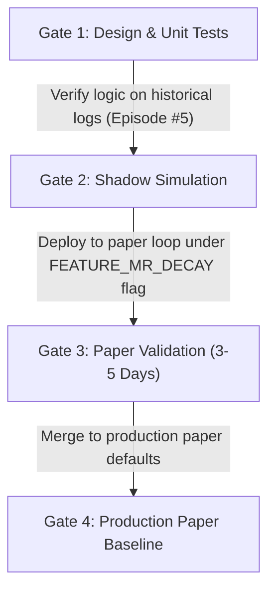

# Micro Recovery Trap Resolution Design (MICRO_RECOVERY_TRAP_RESOLUTION_DESIGN_001)

* **Date**: 2026-06-20
* **Target Workspace**: `C:\quant\Polymarket-Adaptive-Quant-Engine-v.1`
* **Status**: **`DESIGN_READY`**
* **Mode**: DESIGN ONLY (NO CODE OR CONFIG CHANGES)

---

## 1. Context and Problem Statement
The morning health check and rejections audit confirmed a structural bottleneck:
* **The Trap**: When consecutive losses reach 3, the `LOSS_CLUSTER_PAUSE` correctly stops trading for 30 minutes. Once the pause expires, the bot resumes scanning but remains locked in `MICRO_RECOVERY` mode indefinitely.
* **Lack of Decay**: The consecutive-loss counter (`_consecutive_losses`) has no decay function, daily reset, or time-based expiry in-session. 
* **The Consequences**: The system is forced to reject all signals with confidence < 0.75. In the last 24 hours, **955 signals were rejected** due to defensive and micro-recovery confidence rules, resulting in a virtual trading halt (only 2 entries in 9.5 hours, and 1 entry in the subsequent run). 
* **Intended vs. Unintended**: The 30-minute pause is a highly necessary safety feature to prevent rapid drawdowns during regimes of stream dislocation or extreme API latency. However, leaving the bot stuck in `MICRO_RECOVERY` indefinitely is an unintended *recovery trap* that locks the bot out of normal operations.

---

## 2. Proposed Fix Options

Three possible fixes have been designed to allow the engine to exit the recovery state safely:

### Option A: Time-Based Loss Decay
* **Mechanics**: Decrement `_consecutive_losses` by 1 for every 60 minutes of elapsed time during which no new losses are recorded, or reset it fully to 0 after 4 hours of no trades.
* **Bankroll Risk**: Low-to-medium. Gradually restores entry sizes, allowing the bot to check the market state.
* **Expected Trade Frequency**: Medium. Restores trading after a few hours of quiet.
* **False Recovery Risk**: Low. 60 minutes is typically sufficient for short-term market regimes or websocket feeds to stabilize.
* **Overtrading Risk**: Low. Controlled by standard fractional Kelly sizer caps.
* **Option D / Evidence Impact**: Highly compatible. Exits recovery mode gradually, which matches standard shadow evaluation requirements.

### Option B: UTC Daily Reset with Drawdown Guard
* **Mechanics**: Reset `_consecutive_losses = 0` at the UTC day boundary (`00:00 UTC`), provided that the account drawdown percentage `drawdown_pct` is `< 0.02` (2%).
* **Bankroll Risk**: Medium. If a bad regime spans multiple days, a hard daily reset immediately exposes the bankroll to a new loss cluster on the next day.
* **Expected Trade Frequency**: High. Instantly resets at the start of each UTC day.
* **False Recovery Risk**: Medium. Regime shifts do not respect UTC midnight.
* **Overtrading Risk**: Medium. The bot may place trades immediately on day-rollover.
* **Option D / Evidence Impact**: Clean. Resets are aligned to UTC day boundaries, making data parsing simple.

### Option C: Inactivity-Based Recovery Exit (Recommended)
* **Mechanics**: Return `_consecutive_losses` to 0 if the bot has scanned for **4 hours** continuously with zero new losses (due to either no opportunities passing or the bot being paused).
* **Bankroll Risk**: Low. The safest option; requires a long, verified period of market quietness before restoring risk limits.
* **Expected Trade Frequency**: Low-to-medium. Lockout durations are longer than Option A, but the trap is resolved.
* **False Recovery Risk**: Very Low. A 4-hour window covers several 5-minute prediction cycles, ensuring feed/regime stability.
* **Overtrading Risk**: Low.
* **Option D / Evidence Impact**: Outstanding. Does not impact current shadow data pipelines and keeps the transition passive.

---

## 3. Recommendation

**Option C (Inactivity-Based Recovery Exit)** is recommended for paper-only implementation.

* **Rationale**: It matches the core philosophy of a cooling-off pause. If the system has successfully scanned for 4 hours without experiencing a new loss, it is mathematically safe to assume that the immediate loss-cluster regime has passed, permitting a return to `NORMAL` risk parameters.

---

## 4. Safe Promotion Gates

To implement this design in the future, the following promotion gates must be strictly enforced:

1. **Gate 1: Design -> Shadow Simulation**: Write unit tests and verify the Option C transition logic using historical logs (replaying the 22h 44m Episode #5 log).
2. **Gate 2: Shadow -> Paper Config**: Deploy the change to the paper loop under a feature flag `FEATURE_MICRO_RECOVERY_DECAY=true` for a 3-5 day observation period.
3. **Gate 3: Paper Config -> Production Paper Default**: Enable as default for paper mode after 14 days of shadow data collection has concluded successfully.

---

## 5. Non-Modifiable Core Components
The following systems are strictly **out of scope** and must **NOT** be modified:
* **Live Trading**: No live gateways, RPC endpoints, wallet balance checks, or signing operations.
* **Sizer**: Kelly fraction calculations and dynamic min shares overrides must remain untouched.
* **Execution**: Order submission, balance check rates, and token ID bindings.
* **Stop-Loss Logic**: Option D shadow stop-loss price checks and consecutive midpoint breach counters.
* **Option D Telemetry**: The structured JSONL payloads written to `stop_loss_shadow/` must not have schema changes.

---

**Final Verdict**: **`DESIGN_READY`**
