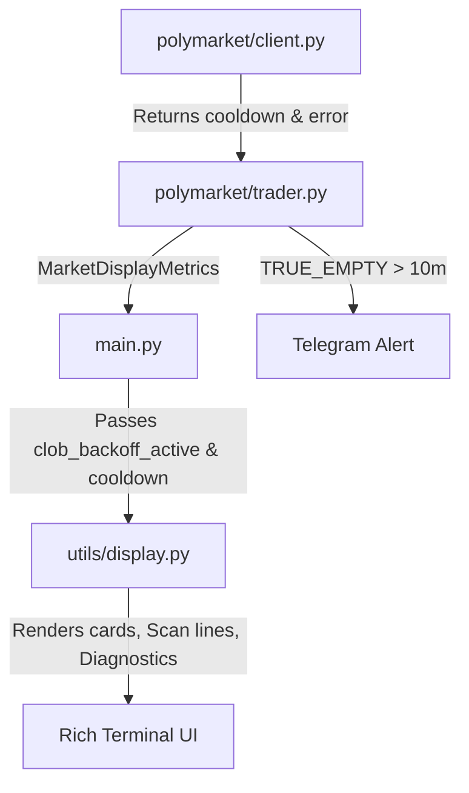

# PATCH_OBSERVABILITY_002_CLOB_CLARITY_DESIGN

## Executive Summary

The `CLOB_EMPTY_RESPONSE_FORENSIC_AUDIT` identified that the dashboard currently displays `STATUS CLOB EMPTY` when the engine is in a rate-limit/backoff/cooldown state, even though 100% of these occurrences had valid, cached serialized quotes available. This misleading labeling incorrectly indicates a true CLOB outage, causing operational confusion.

This design document outlines a display-only patch that:
1. **Passes cooldown and backoff metadata** from the trader's metrics down to the realtime display.
2. **Defines and maps four explicit states** (`TRUE_EMPTY`, `COOLDOWN_ACTIVE`, `CACHED_BOOK_AVAILABLE`, and `READY`).
3. **Revises the dashboard UI** (`utils/display.py`) to show explicit states on the market card, single scan lines, and decision diagnostics panel.
4. **Hardens Telegram alerts** to avoid cooldown spam, notifying the operator only if a true empty state persists for longer than 10 minutes.

---

## Answers to Questions

### 1. Where is CLOB EMPTY label generated?
The label is generated in `utils/display.py` in three places:
* **`_market_card` (lines 2340-2345)**: Checks if `skip_reason` is `"clob_empty_response"` or `"delta_extreme"`, or if all bids/asks are zero, and overrides the status to `CLOB EMPTY` (or `CLOB EMPTY RESPONSE`).
* **`_market_line` (lines 3129-3134)**: Performs the same check for the single-line summary inside the Market Scan table.
* **`_candidate_observability_panel` (lines 2537-2564)**: If `_orderbook_status() != "OK"` or all bids/asks are zero, it formats the panel with `Blocked: no_orderbook` and `Reason: clob_empty_response` (or `clob_empty_response` related reasons).

### 2. Where is clob_empty_response normalized?
It is normalized in several places:
* **`polymarket/client.py` (line 312)**: Maps the raw empty exception string starting with `"empty_orderbook"` to the category `"clob_empty_response"`.
* **`polymarket/client.py` (line 378)**: Re-uses `health.last_category` for cooldown errors.
* **`polymarket/trader.py` (lines 7715-7716)**: `_infer_clob_orderbook_error_category()` infers `"clob_empty_response"` if the string `"empty_orderbook_response"` is in the exception.
* **`polymarket/trader.py` (lines 7667-7669)**: `_classify_orderbook_readiness_reason()` returns `category` if it is in `CLOB_ORDERBOOK_ERROR_CATEGORIES` (which includes `"clob_empty_response"`).

### 3. What fields exist now to distinguish cooldown vs true empty?
The following fields are populated in `MarketDisplayMetrics` (and can be passed to `self._markets` in `display.py`):
* **Cooldown/Backoff Status**: 
  * `clob_backoff_active`: `bool` indicating whether the client is backing off/cooldown active.
  * `clob_cooldown_seconds_remaining`: `float` showing seconds remaining.
* **Data Availability**:
  * `yes_bid`, `yes_ask`, `no_bid`, `no_ask`: `float` values containing best bid/ask. If these are > 0.0, we have cached quotes available.
  * `has_orderbook`: `bool` indicating whether we have non-zero bid/ask quotes.

### 4. Are cached bid/ask fields available at display time?
Yes. `yes_bid`, `yes_ask`, `no_bid`, `no_ask`, `yes_mid`, and `no_mid` are already sent to `display.update_market` and `display.update_realtime_batch` in `main.py`. They are stored inside `self._markets[ticker]`.

### 5. What minimal fields must be added, if any?
No new fields need to be added to classes or data models. We only need to route **existing** fields from `metrics` (an instance of `MarketDisplayMetrics`) to `display` inside `main.py` when calling `update_market()` and `update_realtime_batch()`. Specifically:
* `clob_backoff_active`
* `clob_cooldown_seconds_remaining`
* `orderbook_error`

### 6. Can this be implemented without touching trade decision logic?
Yes. This is an observability-only patch. The trade decisions, strategy calculations, and actual orderbook fetching logic are unaffected. We only update the display mapping and add a non-trading alert layer in the trader class.

### 7. Required tests?
We should add tests to `tests/test_terminal_dashboard_display.py` asserting that the display renders:
* `STATUS CLOB COOLDOWN` and `Cached Book: YES` when in cooldown with cached quotes.
* `STATUS TRUE EMPTY` and `Cached Book: NO` when bids/asks are zero.
* `STATUS READY` when not in cooldown and orderbook has fresh quotes.

### 8. Rollback plan?
To roll back, simply run a git revert/checkout on the modified files (`main.py`, `utils/display.py`, and `polymarket/trader.py`). Since no config/storage changes are made, rollback is immediate, safe, and has zero side-effects.

---

## Proposed Changes



### Component 1: `main.py`
We need to propagate `clob_backoff_active`, `clob_cooldown_seconds_remaining`, and `orderbook_error` from `metrics` to `display`.

#### 1. In `main.py` Background Sampling Loop (approx. lines 678–710)
```diff
                             ticker_updates.setdefault(ticker, {}).update({
                                 "bid":         metrics.bid,
                                 "ask":         metrics.ask,
                                 "spread":      metrics.spread,
                                 "snipe_score": metrics.snipe_score,
                                 "edge_pct":    metrics.edge_pct,
                                 "p_yes":       metrics.p_yes,
                                 "p_no":        metrics.p_no,
                                 "model_p_yes": metrics.p_yes,
                                 "model_p_no":  metrics.p_no,
                                 "yes_bid":     metrics.yes_bid,
                                 "yes_ask":     metrics.yes_ask,
                                 "no_bid":      metrics.no_bid,
                                 "no_ask":      metrics.no_ask,
                                 "yes_mid":     metrics.yes_mid,
                                 "no_mid":      metrics.no_mid,
                                 "clob_source": metrics.clob_source,
                                 "orderbook_age_ms": metrics.orderbook_age_ms,
                                 "yes_orderbook_age_ms": metrics.yes_orderbook_age_ms,
                                 "no_orderbook_age_ms": metrics.no_orderbook_age_ms,
                                 "token_id":    metrics.token_id,
                                 "yes_token_id": metrics.yes_token_id,
                                 "no_token_id": metrics.no_token_id,
                                 "condition_id": metrics.condition_id,
                                 "market_slug": metrics.market_slug,
                                 "outcome":     metrics.outcome,
                                 "token_mapping_warning": metrics.token_mapping_warning,
                                 "ev":          metrics.ev,
                                 "min_ev":      metrics.min_ev,
                                 "delta_regime": metrics.delta_regime,
                                 "delta_multiplier": metrics.delta_multiplier,
                                 "skip_reason": metrics.skip_reason,
                                 "score":       metrics.score,
+                                "clob_backoff_active": metrics.clob_backoff_active,
+                                "clob_cooldown_seconds_remaining": metrics.clob_cooldown_seconds_remaining,
+                                "orderbook_error": metrics.orderbook_error,
```

#### 2. In `main.py` Primary Update Loop (approx. lines 818–867)
```diff
                         display.update_market(
                             ticker,
                             ref_price     = ptb_info.price_to_beat,
                             current_price = ptb_info.current_price,
                             is_above      = ptb_info.is_above_ptb,
                             price_diff    = ptb_info.price_diff_pct,
                             bid           = metrics.bid,
                             ask           = metrics.ask,
                             spread        = metrics.spread,
                             snipe_score   = metrics.snipe_score,
                             edge_pct      = metrics.edge_pct,
                             p_yes         = metrics.p_yes,
                             p_no          = metrics.p_no,
                             model_p_yes   = metrics.p_yes,
                             model_p_no    = metrics.p_no,
                             yes_bid       = metrics.yes_bid,
                             yes_ask       = metrics.yes_ask,
                             no_bid        = metrics.no_bid,
                             no_ask        = metrics.no_ask,
                             yes_mid       = metrics.yes_mid,
                             no_mid        = metrics.no_mid,
                             clob_source   = metrics.clob_source,
                             orderbook_age_ms = metrics.orderbook_age_ms,
                             yes_orderbook_age_ms = metrics.yes_orderbook_age_ms,
                             no_orderbook_age_ms = metrics.no_orderbook_age_ms,
                             token_id      = metrics.token_id,
                             yes_token_id  = metrics.yes_token_id,
                             no_token_id   = metrics.no_token_id,
                             condition_id  = metrics.condition_id,
                             market_slug   = metrics.market_slug,
                             outcome       = metrics.outcome,
                             token_mapping_warning = metrics.token_mapping_warning,
                             ev            = metrics.ev,
+                            clob_backoff_active = metrics.clob_backoff_active,
+                            clob_cooldown_seconds_remaining = metrics.clob_cooldown_seconds_remaining,
+                            orderbook_error = metrics.orderbook_error,
```

---

### Component 2: `utils/display.py`
We revise status classification, card rendering, scan lines, and decision diagnostics.

#### 1. Add Status Classification Helper (State mapping)
```python
    def _classify_clob_state(self, m: dict[str, object]) -> tuple[str, str, str, str]:
        """
        Returns:
            status_label: String (e.g. 'READY', 'CLOB COOLDOWN', 'TRUE EMPTY')
            cached_book_str: 'YES', 'NO', or 'n/a'
            bid_ask_str: 'AVAILABLE' or 'MISSING'
            time_val_str: e.g. 'Cooldown: 8.2s', 'Age: 1.2s', or ''
        """
        clob_backoff_active = bool(m.get("clob_backoff_active", False))
        cooldown_remaining = float(m.get("clob_cooldown_seconds_remaining", 0.0) or 0.0)
        age_ms = float(m.get("orderbook_age_ms", 0.0) or 0.0)

        yes_bid = float(m.get("yes_bid", 0.0) or 0.0)
        yes_ask = float(m.get("yes_ask", 0.0) or 0.0)
        no_bid = float(m.get("no_bid", 0.0) or 0.0)
        no_ask = float(m.get("no_ask", 0.0) or 0.0)
        has_cached_book = (yes_bid > 0.0 and yes_ask > 0.0) or (no_bid > 0.0 and no_ask > 0.0)

        if not has_cached_book:
            return "TRUE EMPTY", "NO", "MISSING", f"Cooldown: {cooldown_remaining:.1f}s" if clob_backoff_active else ""

        if clob_backoff_active:
            return "CLOB COOLDOWN", "YES", "AVAILABLE", f"Cooldown: {cooldown_remaining:.1f}s"

        # Ready state (not in cooldown, book is available)
        age_seconds = age_ms / 1000.0
        return "READY", "n/a", "AVAILABLE", f"Age: {age_seconds:.1f}s"
```

#### 2. Update `_market_card` (approx. lines 2336–2358)
Instead of hiding the entire card details on `clob_empty_response`, we split cards logically:
```python
        # Determine explicit CLOB status
        status_label, cached_book, bid_ask, time_val = self._classify_clob_state(m)

        # Render Header Section
        lines = [
            self._line([("Oracle ", "grey70"), (self._fmt_price(price), f"bold {price_style}"), (" | PTB ", "grey70"), (self._fmt_price(ptb), "bold white")], spec.panel_width),
        ]

        # Status and Cooldown Lines
        if status_label == "TRUE EMPTY":
            lines.extend([
                self._line([("STATUS ", "grey70"), ("TRUE EMPTY", "bold bright_red")], spec.panel_width),
                self._line([("Cached Book: ", "grey70"), ("NO", "bold bright_red"), (" | Bid/Ask: ", "grey70"), ("MISSING", "bright_red")], spec.panel_width),
                self._line([("Action ", "grey70"), ("waiting for first valid book", "bright_yellow")], spec.panel_width),
                self._line([("Token ", "grey70"), (self._clip(str(m.get("token_id", "") or "--"), 16), "grey62")], spec.panel_width),
                self._line([("Regime ", "grey70"), (self._clip(regime, 16), "bold bright_cyan")], spec.panel_width),
                self._line([("Decision ", "grey70"), (decision, self._decision_style(decision))], spec.panel_width),
            ])
            if mapping_warning:
                lines.append(self._line([("Token mapping ", "bold bright_yellow"), (self._clip(mapping_warning, max(12, spec.panel_width - 16)), "bold bright_yellow")], spec.panel_width))
            return Panel(Text.assemble(*self._with_breaks(lines)), title=f"[bold bright_white]{ticker} Market[/bold bright_white]", border_style="bright_blue")

        elif status_label == "CLOB COOLDOWN":
            # Cooldown but cached quotes exist (Case A)
            lines.extend([
                self._line([("STATUS ", "grey70"), ("CLOB COOLDOWN", "bold bright_yellow")], spec.panel_width),
                self._line([("Cached Book: ", "grey70"), ("YES", "bold bright_green"), (" | Bid/Ask: ", "grey70"), ("AVAILABLE", "bright_green"), (" | Cooldown: ", "grey70"), (time_val.replace("Cooldown: ", ""), "bright_cyan")], spec.panel_width),
                self._line([("Action ", "grey70"), ("waiting for live refresh", "bright_yellow")], spec.panel_width),
            ])
        else:
            # Ready State (Case C)
            lines.extend([
                self._line([("STATUS ", "grey70"), ("READY", "bold bright_green")], spec.panel_width),
                self._line([("Cached Book: ", "grey70"), ("n/a", "grey50"), (" | Bid/Ask: ", "grey70"), ("AVAILABLE", "bright_green"), (" | ", "grey70"), (time_val, "bright_green")], spec.panel_width),
            ])

        # Standard lines for READY and COOLDOWN states
        lines.extend([
            self._line([("YES Bid ", "grey70"), (self._fmt_prob(yes_bid), "bold bright_green"), (" | YES Ask ", "grey70"), (self._fmt_prob(yes_ask), "bold bright_red")], spec.panel_width),
            self._line([("NO Bid ", "grey70"), (self._fmt_prob(no_bid), "bold bright_green"), (" | NO Ask ", "grey70"), (self._fmt_prob(no_ask), "bold bright_red"), (" | Spread ", "grey70"), (self._fmt_prob(spread), "grey70")], spec.panel_width),
            self._line([("YES Mid ", "grey70"), (self._fmt_prob(yes_mid), "bright_green"), (" | NO Mid ", "grey70"), (self._fmt_prob(no_mid), "bright_red"), (" | Age ", "grey70"), (f"{age_ms}ms" if age_ms else "--", "bright_green" if age_ms and age_ms <= 1500 else "bright_yellow")], spec.panel_width),
            self._line([("Source ", "grey70"), (self._clip(clob_source, 18), "bright_cyan"), (" | Token ", "grey70"), (self._clip(str(m.get("token_id", "") or "--"), 16), "grey62")], spec.panel_width),
            # [Standard Metrics... Model_Y, Regime, EV, Decision, timing milestones, timing latencies unchanged]
        ])
        # ...
```

#### 3. Update Scan Line `_market_line` (approx. lines 3126–3136)
```python
        status_label, cached_book, bid_ask, time_val = self._classify_clob_state(m)

        if status_label == "TRUE EMPTY":
            prefix = f" {ticker:<4} {self._fmt_price(self._as_float(m.get('ref_price', 0.0))):>10} {self._fmt_price(self._as_float(m.get('current_price', 0.0))):>10} "
            ob_segment = f"  {"TRUE EMPTY":<37} "
            suffix = (
                f"{self._fmt_prob(self._as_float(m.get('model_p_yes', m.get('p_yes', 0.0)))):>7} "
                f"{self._fmt_prob(self._as_float(m.get('model_p_no', m.get('p_no', 0.0)))):>7} "
                f"{self._as_float(m.get('ev', 0.0)):+.3f} "
                f"{decision:<8} "
                f"{blocker}"
            )
            line = prefix + ob_segment + suffix
        else:
            # Standard line layout rendering yes/no bids and spreads as usual
```

#### 4. Update Decision Diagnostics `_candidate_observability_panel` (approx. lines 2557–2564)
```python
        # Check if cooldown is active and cached book exists
        is_cooldown_active = any(bool(m.get("clob_backoff_active", False)) for m in self._markets.values())
        max_cooldown = max([float(m.get("clob_cooldown_seconds_remaining", 0.0) or 0.0) for m in self._markets.values()] + [0.0])

        all_cached_available = all(
            (self._as_float(m.get('yes_bid', 0.0)) > 0.0 and self._as_float(m.get('yes_ask', 0.0)) > 0.0) or
            (self._as_float(m.get('no_bid', 0.0)) > 0.0 and self._as_float(m.get('no_ask', 0.0)) > 0.0)
            for m in self._markets.values()
        )

        if is_cooldown_active and all_cached_available:
            lines = [
                self._line([("Blocked: ", "grey70"), ("orderbook_refresh_cooldown", "bold bright_yellow")], spec.panel_width),
                self._line([("Reason:  ", "grey70"), ("clob_orderbook_cooldown_active", "bright_yellow")], spec.panel_width),
                self._line([("Cached Book: ", "grey70"), ("available", "bright_green")], spec.panel_width),
                self._line([("Cooldown Remaining: ", "grey70"), (f"{max_cooldown:.1f}s", "bright_cyan")], spec.panel_width),
            ]
            return Panel(Text.assemble(*self._with_breaks(lines)), title="[bold bright_white]Decision Diagnostics[/bold bright_white]", border_style="bright_magenta")

        # Fallback to standard TRUE EMPTY rendering or active candidate details...
```

---

### Component 3: `polymarket/trader.py`
We add a timing guard to track `TRUE_EMPTY` duration and raise Telegram alerts without spamming.

#### 1. In `polymarket/trader.py`, inside `get_market_display_metrics` (approx. line 7906–7920)
We check for true empty state and invoke the alert watcher:
```python
            # ...
            metrics.has_orderbook = metrics.yes_bid > 0 and metrics.yes_ask > 0 and metrics.no_bid > 0 and metrics.no_ask > 0
            
            # Watcher invocation
            is_true_empty = not metrics.has_orderbook
            self._check_and_alert_true_empty(ticker, token_id, is_true_empty)
```
And also inside the `except Exception as exc:` block:
```python
        except Exception as exc:
            # ...
            metrics.has_orderbook = False
            self._check_and_alert_true_empty(ticker, token_id, is_true_empty=True)
```

#### 2. Watcher Method `_check_and_alert_true_empty`
```python
    def _check_and_alert_true_empty(self, ticker: str, token_id: str, is_true_empty: bool) -> None:
        now = time.time()
        if not hasattr(self, "_true_empty_start_times"):
            self._true_empty_start_times = {}
        if not hasattr(self, "_last_true_empty_alert_times"):
            self._last_true_empty_alert_times = {}

        if is_true_empty:
            if ticker not in self._true_empty_start_times:
                self._true_empty_start_times[ticker] = now
            else:
                elapsed = now - self._true_empty_start_times[ticker]
                if elapsed >= 600:  # 10 minutes threshold
                    last_alert = self._last_true_empty_alert_times.get(ticker, 0.0)
                    # Alert every 10 minutes while TRUE_EMPTY persists
                    if now - last_alert >= 600:
                        self._last_true_empty_alert_times[ticker] = now
                        mins = int(elapsed // 60)
                        message = (
                            f"ORDERBOOK TRUE EMPTY > 10m\n"
                            f"Asset: {ticker.upper()}\n"
                            f"Token: {token_id}\n"
                            f"Cached Book: NO\n"
                            f"Duration: {mins}m"
                        )
                        self._notify_telegram("critical", message, dedup_key=f"true_empty_{ticker}")
        else:
            self._true_empty_start_times.pop(ticker, None)
            self._last_true_empty_alert_times.pop(ticker, None)
```

---

## Verification Plan

### Automated Tests
Proposed tests in `tests/test_terminal_dashboard_display.py`:
1. **`test_market_card_renders_cooldown_with_cached_book`**:
   Sets `clob_backoff_active = True`, `clob_cooldown_seconds_remaining = 8.22`, `yes_bid = 0.52`, and asserts that the rendered text contains `CLOB COOLDOWN`, `Cached Book: YES`, and `Cooldown: 8.2s`.
2. **`test_market_card_renders_true_empty`**:
   Sets `yes_bid = 0.0`, `yes_ask = 0.0`, and asserts that the rendered text contains `TRUE EMPTY` and `Cached Book: NO`.
3. **`test_market_card_renders_ready`**:
   Sets `clob_backoff_active = False`, `yes_bid = 0.52`, `orderbook_age_ms = 1200`, and asserts that the rendered text contains `READY`, `Age: 1.2s`.
4. **`test_diagnostics_cooldown_with_cached_book`**:
   Feeds mock markets with cooldown active but cached quotes available, and asserts the diagnostics panel prints `Blocked: orderbook_refresh_cooldown` and `Cached Book: available`.

Run tests using:
```bash
python -m pytest tests/test_terminal_dashboard_display.py
```

### Manual Verification
1. Run paper mode simulation:
   ```bash
   python main.py --mode paper --interval 5
   ```
2. Trigger orderbook rate limits on mock or real environments (e.g. by dropping credentials or spamming requests) to force client backoff/circuit breaking.
3. Observe the Rich UI and verify that:
   * During backoff/cooldown, the market card remains open and displays the cached YES/NO bids and asks.
   * The top line of the card shows `STATUS CLOB COOLDOWN`, `Cached Book: YES`, and remaining cooldown.
   * If credentials are completely invalid or the token doesn't exist (e.g., startup with no book), verify it shows `TRUE EMPTY` and `Cached Book: NO`.
   * Decision Diagnostics panel reflects `orderbook_refresh_cooldown` instead of raw `clob_empty_response`.
   * Wait 10 minutes with invalid tokens and verify Telegram receives exactly one alert. Restore token configuration and verify alerts stop.
