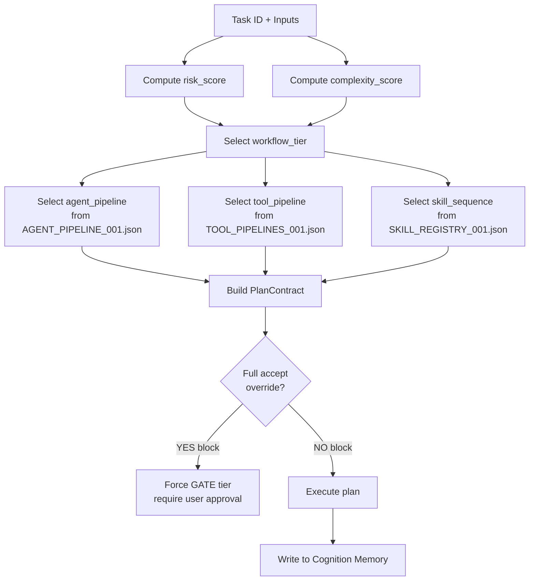

# PLANNING_ENGINE_001

**Date:** 2026-06-27 · **Destination:** `docs/architecture/` · **Status:** DESIGN v1

---

## 1. Objective

The Planning Engine (PE) is the decision layer above the Agent Pipeline and Tool Pipeline. While the Agent Pipeline answers "which roles execute in which order" and the Tool Pipeline answers "which commands to run", the Planning Engine answers "what is the complete execution plan for this task" — synthesizing all available context into a single `PlanContract` before any work begins.

---

## 2. Why Agent Pipeline + Tool Pipeline Are Not Enough

| Gap | Agent Pipeline | Tool Pipeline | Planning Engine |
|-----|----------------|---------------|----------------|
| Selects roles | ✓ | ✗ | ✓ (via pipeline) |
| Selects tools | ✗ | ✓ | ✓ (via pipeline) |
| Scores task complexity | ✗ | ✗ | ✓ |
| Scores risk | ✗ | ✗ | ✓ |
| Selects skills | ✗ | ✗ | ✓ |
| Reads repository graph | ✗ | ✗ | ✓ |
| Produces full plan before execution | ✗ | ✗ | ✓ |
| Handles multi-step dependencies | ✗ | ✗ | ✓ |
| Applies full accept override rules | ✗ | ✗ | ✓ |

---

## 3. Planning Inputs

| Input | Source | Purpose |
|-------|--------|---------|
| Active Workflow State | `ACTIVE_WORKFLOW_STATE_001.json` | Phase, next_task, blocked status |
| Task Queue | `TASK_QUEUE_001.json` | Task details, dependencies, scope |
| Loop Memory | `LOOP_MEMORY_*.json` | Recent outcomes, last repair count |
| Cognition Memory | `cognition_memory/*.json` | Decisions, failures, quant safety |
| Agent Pipeline | `AGENT_PIPELINE_001.json` | Role sequences per workflow tier |
| Tool Pipeline | `TOOL_PIPELINES_001.json` | Tool chains per pipeline |
| Skill Registry | `SKILL_REGISTRY_001.json` (future) | Available skills and compositions |
| Repository Graph | `REPO_GRAPH_*.json` (future) | Impact analysis for changed files |
| Git log | `git log -10 --oneline` | Baseline commit verification |

---

## 4. Planning Outputs — `PlanContract`

```json
{
  "plan_id": "PLAN-20260627-BATCH3D-001",
  "task_id": "BATCH_3D_GATE_CHECK_001",
  "task_class": 2,
  "workflow_tier": "GATE",
  "risk_score": 25,
  "complexity_score": 40,
  "selected_agent_pipeline": "GATE_WORKFLOW",
  "selected_tool_pipeline": "GATE_WORKFLOW",
  "selected_skill_sequence": ["quant_safety_review", "gate_check", "docs_housekeeping"],
  "required_memory_reads": ["quant_safety", "decision", "repository_insight"],
  "required_evidence": "B",
  "stop_conditions": ["forbidden_scope_in_diff", "high_risk_keyword_found"],
  "commit_policy": "TYPE_C_ONLY",
  "max_repairs": 0,
  "full_accept_override": false,
  "estimated_context_reads": 8,
  "estimated_duration_minutes": 5,
  "pre_execution_checks": ["git_status_clean", "compile_ok", "import_ok"]
}
```

---

## 5. Planning Algorithm

```
PLAN(task_id):

1. Load inputs (state, queue, memory, quant_safety)

2. Compute risk_score:
   risk_score = 0
   + 40 if execution/risk/sizing/live in scope
   + 20 if trader.py in scope (direct code change)
   + 10 if tests/ in scope
   + 15 if prior FAIL in loop memory for this task type
   + 10 if active question OPEN and task touches strategy
   - 15 if prior PASS with 0 repairs in loop memory
   - 10 if scope is docs-only

3. Compute complexity_score:
   complexity_score = 0
   + 30 if new methods must be found (no prior gate check)
   + 20 if 10+ call sites to update
   + 15 if multiple file types in scope
   + 10 if paper run required
   + 5 per dependent task in queue

4. Select workflow tier:
   if risk_score > 50 → GATE (override)
   elif risk_score > 25 or complexity_score > 40 → STANDARD
   elif risk_score < 10 and complexity_score < 20 → FAST
   else → LOOP

5. Select agent pipeline from AGENT_PIPELINE_001.json

6. Select tool pipeline from TOOL_PIPELINES_001.json

7. Select skills from SKILL_REGISTRY_001.json (future)

8. Compute required_evidence from tier

9. Apply full_accept_override rules

10. Output PlanContract
```

---

## 6. Risk Scoring

| Factor | Points | Condition |
|--------|--------|-----------|
| Execution/risk/sizing scope | +40 | ANY of these in allowed_scope |
| `trader.py` direct edit | +20 | trader.py in allowed_scope |
| Tests modified | +10 | tests/ in scope |
| Prior FAIL in memory | +15 | same task type has FAIL entry |
| Active question open (strategy) | +10 | ACTIVE_QUESTION.md is open AND task touches signal/sizer |
| Prior PASS with 0 repairs | −15 | loop memory shows PASS, repairs=0 for similar task |
| Docs-only scope | −10 | all files in scope are .md or .json |
| No prior history | +5 | no loop memory entry for this task type |

**Risk thresholds:** <10 = FAST, 10–25 = LOOP, 26–50 = STANDARD, >50 = GATE (mandatory)

---

## 7. Task Complexity Scoring

| Factor | Points | Condition |
|--------|--------|-----------|
| No prior gate check for this extraction | +30 | gate_check not found in docs/audits/ |
| 10+ call sites to update | +20 | grep finds >10 matches |
| Multiple commit types required | +15 | both TYPE A and TYPE C commits needed |
| Paper run required | +10 | workflow_tier = GATE or LOOP with runtime change |
| Dependent tasks in queue | +5 per | tasks with blocked_by = this task |
| Memory shows known repair pattern | −10 | repair memory has matching fix |

---

## 8. Full Accept Override Rules

Full accept is **blocked** (overrides pipeline auto-accept) when:
- `risk_score > 50`
- Any `quant_safety` memory entry has `forbidden_method` in scope
- Active question status blocks the task domain
- `live_trading` keyword in any input
- `prior_failures >= 3` for this task type with no resolution

Full accept is **allowed** when:
- `risk_score < 25 AND complexity_score < 30`
- No quant safety violations found
- Prior PASS in memory with 0 repairs
- Scope verified clean by `full_accept_guard` tool

---

## 9. Plan Contract JSON Shape

Full schema defined in `SKILL_ENGINE_001.md` (skills) and `TOOL_REGISTRY_001.json` (tools). The PlanContract is ephemeral (Working Memory only — not persisted) but its outcomes are recorded in Loop Memory.

---

## 10. Mermaid Planning Flow



---

## 11. Migration Roadmap

| Phase | What ships | Trigger |
|-------|-----------|---------|
| v1 | This spec | NOW |
| v2 | PE as AI checklist: fill PlanContract before each loop | After 10+ loop memory entries |
| v3 | PE as JSON schema: auto-generated from state+queue+memory | Phase 3 FLAOS |
| v4 | PE as Python module with risk/complexity scoring | Phase 4 FLAOS |
| v5 | PE with repository graph integration for impact analysis | Phase 5 FLAOS |
