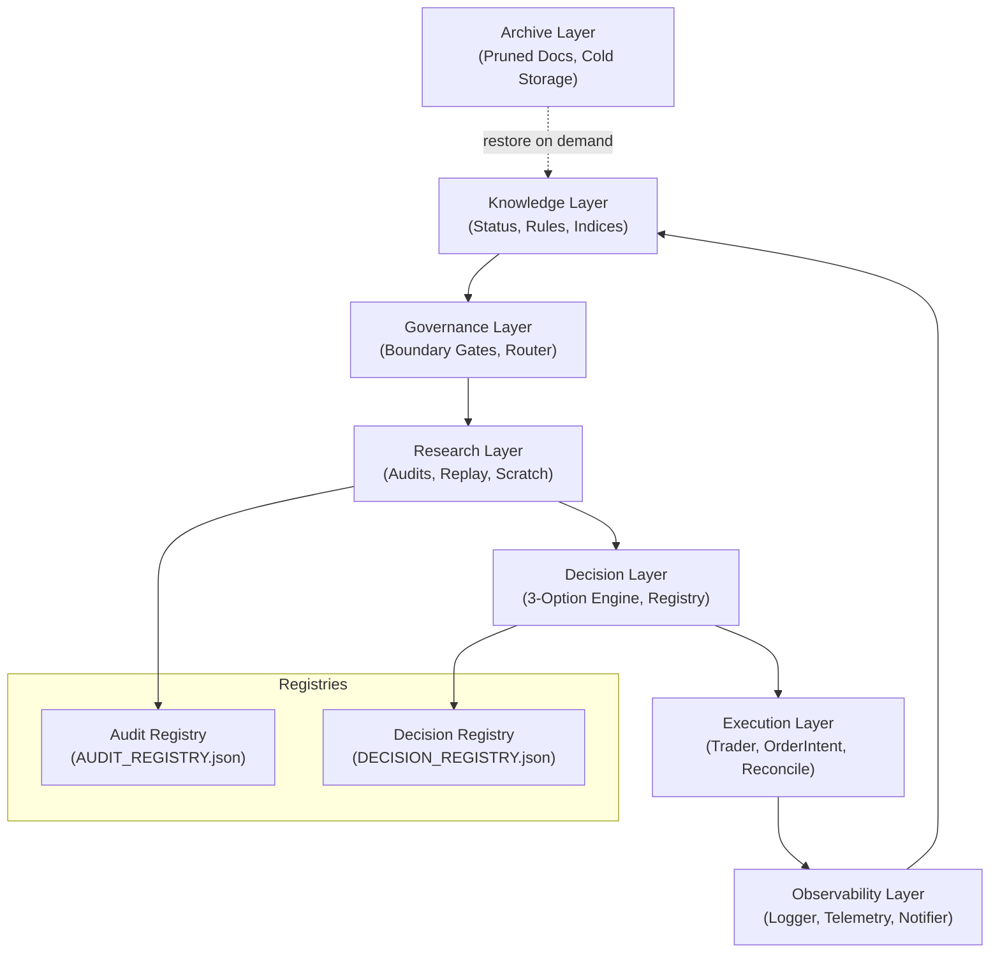

# PROJECT_OS_V1_DESIGN

## 1. Executive Summary

This document designs **Project OS V1**, a complete multi-agent Project Operating System. It defines the coordination mechanisms, registries, schemas, workflow loops, and memory structures required for multiple LLM agents (Gemini, Claude, Codex, ChatGPT) to operate on the `Polymarket-Adaptive-Quant-Engine-v.1` repository. 

Project OS V1 guarantees:
- **Zero Duplication**: Shared registries prevent repeat audits or reports.
- **Context/Token Efficiency**: Scoped search domains and index-first read paths prevent context bloating.
- **Safety Enforcement**: Rigid, step-by-step workflow gates block unauthorized live-risk updates.
- **Operational Alignment**: Formal definitions for agent operating boundaries and escalation rules.

---

## 2. Project OS Layers

Project OS V1 organizes the repository and its operations into seven distinct, decoupled layers:

| Layer | Purpose | Key Artifacts |
|---|---|---|
| **Knowledge Layer** | Stores the system's current memory, status, rules, and indices. It acts as the repository's brain. | `CODEX_START_HERE.md`, `PROJECT_RULES.md`, `CURRENT_PROJECT_STATUS.md`, `FILE_INDEX.md` |
| **Governance Layer** | Defines authorization limits, promotion gates, agent boundaries, and auditing constraints. | `AGENTS.md`, `MASTER_AGENT_ROUTER.md`, `RESEARCH_GOVERNANCE_V1.md` |
| **Research Layer** | Executes backtest sweeps, offline data analyses, and hypothesis testing. | `docs/research/`, `.codex/skills/`, replay scripts |
| **Decision Layer** | Registers official research verdicts and options chosen under the 3-option rule. | `QUANT_FUTURE_DECISION_ENGINE.md`, `docs/research/DECISION_REGISTRY.json` |
| **Execution Layer** | Coordinates real-time trading operations, paper simulations, and position reconciliations. | `main.py`, `polymarket/trader.py`, `polymarket/order_intent.py` |
| **Observability Layer** | Gathers telemetry, logs JSONL quant events, and manages operators alerts. | `utils/logger.py`, `utils/telegram_reporter.py`, `runtime/quant_data/` |
| **Archive Layer** | Compresses completed evidence and moves obsolete files to prune context size. | `docs/archive/`, `docs/archive/research/` |

---

## 3. Audit Registry

The **Audit Registry** lives in `docs/research/AUDIT_REGISTRY.json` and prevents agents from repeating completed investigations.

### Schema Fields
- `audit_id` (string, unique): e.g., `AUD_2026_06_19_SUB5C_REALITY`
- `title` (string): Human-readable summary of the audit objective.
- `date` (string, YYYY-MM-DD): The date the audit was registered.
- `status` (string, enum): `IN_PROGRESS | VERIFIED | SUPERSEDED | ABANDONED`
- `verdict` (string, enum): `EDGE_REAL | EDGE_WEAK | REPLAY_ARTIFACT | DATA_QUALITY_GAP`
- `superseded_by` (string, nullable): ID of the audit that replaces it.
- `canonical` (boolean): `true` if this is currently the source of truth for the audited domain.
- `owner` (string): The agent that executed the audit (e.g. `Claude-3.5-Sonnet`).
- `next_action` (string): The single next logical step (e.g., transition to shadow sizer design).

### Lifecycle State Machine
```text
[REGISTERED] ──> [IN_PROGRESS] ──> [VERIFIED] ──> [SUPERSEDED / ARCHIVED]
     │                                   │
     └─────────> [ABANDONED] <───────────┘
```
1. **Registered**: Created when a new research request is approved.
2. **In Progress**: Active analysis being run by the owner agent.
3. **Verified**: Complete audit report created, verdict rendered, and verified by operator review.
4. **Superseded**: Marked obsolete when a newer date range or model recalibration invalidates the findings.

---

## 4. Decision Registry

The **Decision Registry** lives in `docs/research/DECISION_REGISTRY.json` and tracks system configurations and strategy parameter changes.

### Schema Fields
- `decision_id` (string, unique): e.g., `DEC_2026_06_19_SUB5C_SHADOW`
- `date` (string, YYYY-MM-DD): Date of decision approval.
- `decision` (string): Clear statement of the system modification.
- `reason` (string): Rationale behind the decision, matching the chosen option.
- `evidence` (string): Link to the verifying `audit_id`.
- `approved_by` (string): Operator username or approval tag.
- `status` (string, enum): `ACTIVE | SUPERSEDED | DEPRECATED`
- `superseded_by` (string, nullable): ID of the decision that replaces this configuration.

### Lifecycle State Machine
```text
[PROPOSED] ──> [APPROVED & ACTIVE] ──> [SUPERSEDED / DEPRECATED]
     │
     └──> [REJECTED]
```
1. **Proposed**: Drafted following the Three-Option evaluation.
2. **Approved & Active**: Implemented in code/config and running in the current system state.
3. **Superseded**: Deprecated when a newer decision modifies the parameter or code path.

---

## 5. Research & Implementation Workflow

Every task follows a strict linear flow with mandatory approval gates to prevent untested code from reaching runtime execution:

```text
[Hypothesis Formulation] ──> (Registry Check Gate)
           │
           ▼
[Read-Only Audit] ──> [Evidence Compilation] ──> [Verdict Labeling]
                                                       │
                                                       ▼
[Three-Option Design] ──> (Operator Design Gate) ──> [Test Staging]
                                                           │
                                                           ▼
[Replay & Shadow Run] ──> (Readiness Promotion Gate) ──> [Code Release]
```

### Mandatory Gates
1. **Registry Check Gate**: Agent must verify `AUDIT_REGISTRY.json` and `DECISION_REGISTRY.json` to confirm the scope has not been completed.
2. **Operator Design Gate**: Before any code is modified, the operator must review the implementation plan.
3. **Readiness Promotion Gate**: The code must pass the import smoke tests and validation sweeps on historical and paper shadow runs before being eligible for live execution.

---

## 6. Agent Operating Model

Project OS V1 specifies the permissions and escalation boundaries for each agent type:

### A. Project Manager Agent
- **Mission**: Coordinate task sequencing, enforce phase gates, and ensure repository hygiene.
- **Allowed**: Scrutinize scopes, update registries, create implementation plans, and reject out-of-scope code.
- **Forbidden**: Writing strategy algorithms, tuning sizer weights, or disabling risk controls.
- **Escalation Rules**: If an agent commits changes that bypass gates, immediately flag a LOCKDOWN alert to the operator.

### B. Research Agent
- **Mission**: Formulate quantitative hypotheses and analyze market anomalies.
- **Allowed**: Read-only log parsing, and drafting markdown research specifications.
- **Forbidden**: Writing production execution code or editing `.env` keys.
- **Escalation Rules**: Escalates to the Project Manager if data quality anomalies invalidate historical logs.

### C. Audit Agent
- **Mission**: Reconstruct historical trades and verify edge executions.
- **Allowed**: Running offline diagnostics, checking ledger balances, and declaring verdicts.
- **Forbidden**: Modifying configuration settings, moving files, or writing database files.
- **Escalation Rules**: Escalates on detecting join-key lineage failures (e.g. orphan trade rows).

### D. Replay Agent
- **Mission**: Validate strategies against historical data.
- **Allowed**: Running backtests, measuring MAE/MFE, and calculating expectancy tables.
- **Forbidden**: Consuming live market feeds, creating orders, or modifying risk gates.
- **Escalation Rules**: Escalates when backtest expectancy diverges from paper-shadow performance.

### E. Execution Agent
- **Mission**: Oversee CLOB order placement, cancellations, and real-time fills.
- **Allowed**: Modifying trader loop states, executing paper fills, and validating `OrderIntent`.
- **Forbidden**: Loosening slippage limits or entering trades during mismatched position states.
- **Escalation Rules**: Instantly calls panic-shutdown if websocket updates lag by >3 seconds.

### F. Observability Agent
- **Mission**: Maintain logging, dashboard feeds, and Telegram alerts.
- **Allowed**: Formatting JSONL outputs, configuring telemetry thresholds, and writing logs.
- **Forbidden**: Restricting alert cooldowns, editing risk sizing parameters, or modifying trader logic.
- **Escalation Rules**: Escalates if Telegram alert delivery fails.

### G. Documentation Agent
- **Mission**: Ensure sync status and maintain file registry organization.
- **Allowed**: Reorganizing markdown files, removing duplicates (once approved), and writing maps.
- **Forbidden**: Mutating any Python scripts, configuration files, or database schemas.
- **Escalation Rules**: Escalates if doc maps fall out of sync with directory structures.

---

## 7. Memory Model

Knowledge is divided into four domains to manage search priorities and context length:

```text
[Read Priority 1: Active Knowledge]
  ├── latest_research_state.md
  └── CURRENT_PROJECT_STATUS.md
        │
        ▼
[Read Priority 2: Canonical Knowledge]
  ├── PROJECT_RULES.md, AGENTS.md, MASTER_AGENT_ROUTER.md
  └── docs/PROJECT_STRUCTURE.md, docs/KNOWN_ISSUES.md
        │
        ▼
[Read Priority 3: Historical Knowledge]
  ├── docs/research/GOVERNANCE_NAVIGATION_HUB.md
  └── docs/research/INDEX.md
        │
        ▼
[Read Priority 4: Archived Knowledge]
  └── docs/archive/research/ (Obsolete logs, only read on request)
```

- **Active Knowledge**: Checked at the start of every session to establish current status.
- **Canonical Knowledge**: Rules that govern agent behaviors and code architecture boundaries.
- **Historical Knowledge**: Summarized indices and navigation structures.
- **Archived Knowledge**: Strictly pruned from normal scans; read only when requested.

---

## 8. Anti-Loop System

To prevent agents from entering recursive loops:
1. **Audit-on-Audit Block**: Agents must not write audits of previous audits unless verifying an escalation trigger.
2. **Duplicate Script Block**: All scratch scripts must be registered in `scratch/MANIFEST.json`. Before writing a utility script, the agent must check the manifest to reuse existing code.
3. **Task Anti-Loop Limits**: 
   - Maximum polling attempts: 3.
   - Maximum wait time: 30 seconds.
   - If limits are met, agents must abort and report partial findings.

---

## 9. Token Efficiency Model

To minimize context window sizes:
- **Index-First Reading**: Agents must read `latest_research_state.md` and `FILE_INDEX.md` rather than running recursive directory walks.
- **Archive Pruning**: Any finalized research document must be moved to `docs/archive/` and pruned from active agent search scopes.
- **Grep-Limit Rules**: Instruct agents to use line-specific lookups rather than reading entire logs.

---

## 10. Final Architecture Diagram


