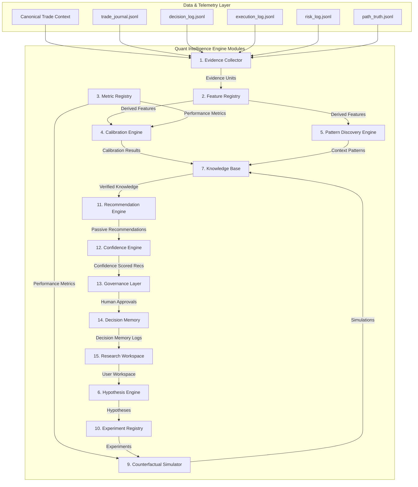
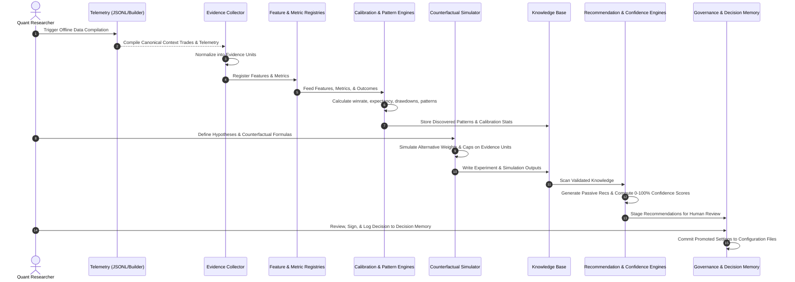
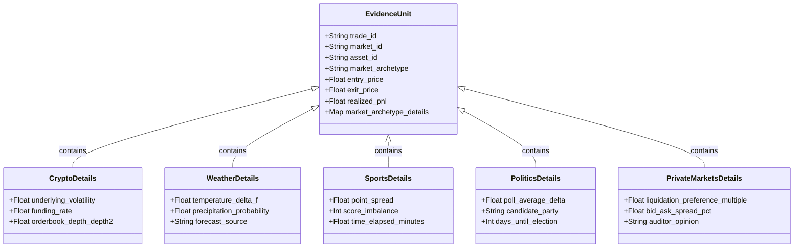

# Quant Intelligence Engine (QIE) - Enterprise Architecture Specification

> **DOCUMENT_TYPE: architecture**
> **DESTINATION:   docs/architecture/QUANT_INTELLIGENCE_ENGINE_001.md**
> **REASON:        Complete enterprise-grade architecture specification for the Quant Intelligence Engine (QIE).**
>
> **TASK_CLASS: 2 DESIGN_ONLY**
> **Status: DESIGN_ONLY**
> **Runtime Impact: NONE**

---

## 1. Executive Summary & Core Principles

The **Quant Intelligence Engine (QIE)** is the offline research, pattern discovery, calibration, and learning operating system for the Adaptive Prediction Market Quant Platform. QIE acts as a diagnostic feedback loop, turning historical runtime telemetry and completed canonical context trades into structured, versioned, and statistically verified quantitative knowledge. 

QIE is strictly **observability-only** and decoupled from the runtime execution environment. It does not place trades, size positions, alter bankroll rank, or modify live config. Instead, it provides the empirical validation layer required before active sizing policies (such as Dynamic Risk Budget or Position Size V2) consume new metrics.

### Primary Design Principles

1. **Offline-First**: Zero runtime execution dependencies. All evaluations run asynchronously on historical database dumps or JSONL log streams.
2. **Evidence-First**: Recommendations are invalid unless bound to an underlying Evidence Unit dataset.
3. **Replay-First**: No quantitative formula, cap, or threshold is promoted to staging/production without offline backtest and counterfactual replay.
4. **Human-Governed**: RECE/QIE output is passive and recommendations require explicit operator signing and manual registry promotion.
5. **Explainable**: All scores, calibrations, and pattern discoveries must expose their component-level features and mathematical lineage.
6. **Strictly Versioned**: Engine versions, schemas, formulas, features, and recommendations are tracked via semantic versioning.
7. **Deterministic**: Same input dataset + same QIE version = identical statistical results.
8. **Backward Compatible**: Legacy canonical trade context rows default gracefully to compatibility placeholders.
9. **Runtime Safe**: Zero side effects on real-time execution threads.
10. **Market Agnostic**: Abstraction layers must natively support Crypto, Weather, Sports, Politics, and Private Markets.

---

## 2. Component Diagram

---

## 3. Data Flow Diagram

---

## 4. Module Specifications

### 1. Evidence Collector
- **Description**: The ingest gateway of QIE. It reads historical logs across all categories and compiles them into flat, time-aligned, and immutable Evidence Units.
- **Inputs**: Canonical Trades, `decision_log`, `execution_log`, `risk_log`, `path_truth`, and pricing telemetry.
- **Processing**: Resolves missing fields, joins close events to their corresponding open events using `paper_trade_replay_key` or `position_id`, and maps market snapshots.
- **Outputs**: Standardized JSONL Evidence Units.

### 2. Feature Registry
- **Description**: The single source of truth for all quantitative features used by models, sizing formulas, and engines.
- **Fields**: Feature Name, Description, Formula Version, Feature Data Type, Dependency Graph, Expiration/Decay parameters, Validation Status.
- **Constraint**: Every feature must have an offline python formula that can be recalculated deterministically from an Evidence Unit.

### 3. Metric Registry
- **Description**: The central registry defining performance metrics to prevent duplicate or conflicting definitions.
- **Supported Metrics**: Sharpe Ratio, Sortino Ratio, MAR Ratio, Calmar Ratio, Expectancy (USDC and %), Profit Factor, Recovery Speed, Drawdown, Win Rate.
- **Validation**: Strict schema constraints ensuring metric calculations handle zero-denominator edge cases (e.g., zero losses in Profit Factor).

### 4. Calibration Engine
- **Description**: Performs historical grouping of trade outcomes by bankroll rank and Size Sharp buckets.
- **Calculations**: Calculates the actual realized win rate and expectancy for each category, comparing them to implied model probabilities and nominal expectations.
- **Outputs**: Calibration Quality score, Statistical Confidence (p-values), and category-level expectancy mapping.

### 5. Pattern Discovery Engine
- **Description**: Scans high-dimensional feature combinations to discover profitable and toxic context clusters.
- **Examples**: Identifies that `SizeSharp = STRONG` combined with `spread = narrow` and `lifecycle_phase = OPENING_SCAN` performs exceptionally well, while `lifecycle_phase = FINAL_DERISK` combined with `quote_age_ms > 3000` is toxic.
- **Overfitting Guard**: Employs cross-validation (80/20 train/test split) and enforces minimum support counts ($N \ge 30$) before declaring a pattern candidate.

### 6. Hypothesis Engine
- **Description**: Tracks the research lifecycle of quantitative ideas from inception to validation.
- **States**: `Draft` -> `Testing` -> `Validated` / `Rejected`.
- **Requirements**: Every hypothesis must define a null hypothesis ($H_0$), a test dataset, and a target evidence grade (minimum Grade C) to be validated.

### 7. Knowledge Base
- **Description**: Durable storage of discovered quantitative truths.
- **Fields**: Knowledge ID, Title, Scope, Market Archetype, Confidence, Expiry Date, Expiration Policy (time-based decay or regime-change trigger), Validation State.
- **Maturity**: Tracks validation quality across changing market cycles.

### 8. Knowledge Lifecycle
- **States**: `Candidate` -> `Observed` -> `Validated` -> `Production` -> `Deprecated` -> `Archived`.
- **Promotion Rules**:
  - `Candidate` to `Observed`: Found in 1 backtest / simulation.
  - `Observed` to `Validated`: Verified in independent out-of-sample paper trading data ($N \ge 100$, $p \le 0.05$).
  - `Validated` to `Production`: Manually signed off by human operators and written to configuration settings.
  - `Production` to `Deprecated`: Observed performance decays below the 95% confidence interval of original backtest performance.

### 9. Counterfactual Simulator
- **Description**: Evaluates alternative sizing, weighting, or gating logic on historical datasets.
- **Capabilities**: Simulates changing Size Sharp component weights, increasing stops, applying caps, or changing Kelly fractions.
- **Outputs**: Side-by-side performance reports (expectancy, turnover, drawdown, Sharpe) comparing the baseline config to the counterfactual candidate.

### 10. Experiment Registry
- **Description**: Stores every counterfactual simulation run and research experiment.
- **Fields**: Experiment ID, Linked Hypothesis, Baseline Config Version, Modified Config Version, Sample Size, Metrics Delta, Acceptance Status.
- **Reproducibility**: Saves the seed and QIE engine version to guarantee deterministic recovery of the experiment.

### 11. Recommendation Engine
- **Description**: Generates passive suggestions based on Knowledge Base validations.
- **Recommendations**: `INCREASE_WEIGHT`, `DECREASE_WEIGHT`, `TIGHTEN_CAP`, `LOOSEN_CAP`, `DISABLE_CONTEXT`, `COLLECT_MORE_DATA`.
- **Safety**: Out-of-bounds calculations are caught and never executed. All suggestions are written to a passive recommendation registry for human review.

### 12. Confidence Engine
- **Description**: Calculates the mathematical reliability of recommendations.
- **Variables**: Sample size ($N$), regime coverage (number of distinct volatility/trend regimes seen), time span, and out-of-sample performance consistency.
- **Output**: Real value from `0.0` to `1.0` representing statistical confidence.

### 13. Governance Layer
- **Description**: Tracks human promotion of recommendations.
- **States**: `Proposal` -> `Review` -> `Approved` -> `Experiment` -> `Production` -> `Rollback`.
- **Rules**: Dual sign-off required for live config changes. All changes must be rollback-ready with defined trigger conditions.

### 14. Decision Memory
- **Description**: Persists every design, model, or parameter decision.
- **Schema**: Stores Decision ID, Timestamp, Summary, Underlying Evidence Links, Affected Formulas, Rollback Conditions, and Expected Outcomes.
- **Hygiene**: Immutable log; decisions cannot be deleted once committed.

### 15. Research Workspace
- **Description**: Container for researcher work.
- **Includes**: Notebooks, scratch scripts, local JSON data files, intermediate charts, and study notes.
- **Isolation**: Workspaces are saved under `runtime/research_workspaces/` to keep clean separation from production code.

---

## 5. Mathematical Framework

To ensure statistical rigor, the QIE modules calculate metrics using the following mathematical formulations:

### 1. Expectancy ($E$)
Expectancy measures the average profit (in USDC or % of entry size) expected per unit of trade size:
\[E = \left( P_{\text{win}} \times R_{\text{win}} \right) - \left( P_{\text{loss}} \times R_{\text{loss}} \right)\]
Where:
- \(P_{\text{win}}\): Realized win rate (\(\frac{\text{Wins}}{N}\))
- \(P_{\text{loss}}\): Realized loss rate (\(1 - P_{\text{win}}\))
- \(R_{\text{win}}\): Average return on winning trades (in USDC or %)
- \(R_{\text{loss}}\): Average loss on losing trades (in USDC or %)

### 2. Profit Factor ($PF$)
The ratio of gross profits to gross losses:
\[PF = \frac{\sum_{i=1}^{N} \max(0, \text{PnL}_i)}{\sum_{i=1}^{N} \left| \min(0, \text{PnL}_i) \right|}\]

### 3. Sharpe Ratio ($SR$) and Sortino Ratio ($SoR$)
The annualized risk-adjusted return (calculated at trade-level intervals):
\[SR = \frac{\mu_{\text{PnL}}}{\sigma_{\text{PnL}}} \times \sqrt{K}\]
\[SoR = \frac{\mu_{\text{PnL}}}{\sigma_{\text{downside}}} \times \sqrt{K}\]
Where:
- \(\mu_{\text{PnL}}\): Mean of PnL per trade
- \(\sigma_{\text{PnL}}\): Standard deviation of PnL per trade
- \(\sigma_{\text{downside}}\): Downside standard deviation (only taking negative trade PnL)
- \(K\): Annualization factor (cycles per year, default based on average trade frequency)

### 4. Recovery Speed ($RS$)
The rate at which drawdown is recovered, defined as:
\[RS = \frac{D_{\text{peak}} - D_{\text{current}}}{T_{\text{recovery}}}\]
Where \(D_{\text{peak}}\) is peak drawdown value, and \(T_{\text{recovery}}\) is the number of cycles/days elapsed from peak to recovery.

### 5. Statistical Significance of Calibration
To evaluate if Size Sharp buckets predict outcome probabilities, we perform a Chi-squared Goodness-of-Fit test:
\[\chi^2 = \sum_{j=1}^{M} \frac{\left( O_j - E_j \right)^2}{E_j}\]
Where:
- \(O_j\): Observed wins in bucket \(j\)
- \(E_j\): Expected wins in bucket \(j\) (calculated using the implied probabilities or mid-point calibration score)
- \(M\): Number of buckets

To verify if the expectancy delta (\(\Delta E\)) between a proposed counterfactual formula and the baseline is significant, we calculate the t-statistic:
\[t = \frac{\bar{E}_{\text{proposed}} - \bar{E}_{\text{baseline}}}{\sqrt{\frac{s_{\text{p}}^2}{N_{\text{p}}} + \frac{s_{\text{b}}^2}{N_{\text{b}}}}}\]
Where \(s^2\) is the variance of trade returns and \(N\) is the sample count. We reject the null hypothesis if \(p \le 0.05\).

### 6. Pattern Discovery Strength (Mutual Information)
To discover if context combinations predict outcomes without overfitting, we calculate the Mutual Information (\(I\)) between a context state (\(X\)) and the trade outcome (\(Y\)):
\[I(X; Y) = \sum_{x \in X} \sum_{y \in Y} P(x, y) \log_2 \left( \frac{P(x, y)}{P(x) P(y)} \right)\]

---

## 6. Future Multi-Market Expansion Strategy

To support future asset classes without database structure rewrites, the Evidence Collector employs a **Polymorphic Market Archetype Model**. Market-specific details are isolated within a flat `market_archetype_details` block inside the Evidence Unit schema.

### Archetype Mapping Table

| Market Class | Archetype | Key Microstructure Metric | Target Source |
|---|---|---|---|
| **Crypto** | Imbalance & Velocity | Funding Rate, Orderbook Imbalance, 1m Volatility | Binance/Coinbase API |
| **Weather** | Real-world Delta | Forecast Bias, Current Temp/Precipitation Delta | NOAA/Copernicus |
| **Sports** | Time-decay Matchup | Score Difference, Time Elapsed, Injury Status | ESPN/Sportradar |
| **Politics** | Polling Convergence | Polling Averages, News Sentiment, Delegate Counts | FiveThirtyEight/Polymarket |
| **Private Markets** | Liquidity Premium | Valuation Delta, Secondary Bid-Ask Spread, Round Size | Secondary Market Brokers |

By using a polymorphic `market_archetype_details` column in the database, the Feature Registry and Calibration Engine can extract relevant indicators based on the `market_archetype` enum, maintaining complete backward compatibility for historical prediction market data.
