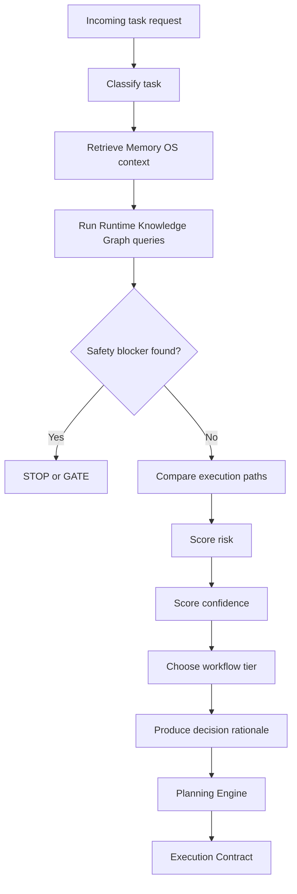
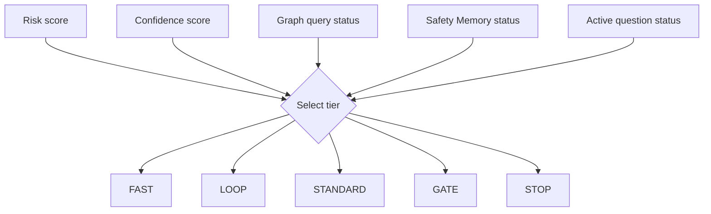
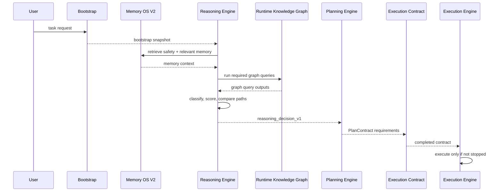

# REASONING_ENGINE_001

**Date:** 2026-06-27  
**Document type:** Architecture design  
**Destination:** `docs/architecture/`  
**Status:** v1 design only; no code implemented

---

## 1. Objective

The FLAOS Reasoning Engine is the decision layer that converts an incoming task into a structured, evidence-backed execution decision before any work begins. It connects Memory OS V2, Safety Memory, the Runtime Knowledge Graph, the Planning Engine, and the Execution Contract into one explicit reasoning process.

The Reasoning Engine does not execute tools, change repository files, or authorize runtime behavior by itself. It decides whether the next layer should stop, route to a gate, or proceed with a bounded plan.

Primary objective:

```text
Task Request
  -> Reasoning Engine
  -> selected_path / rejected_paths / risk and confidence scores
  -> Planning Engine
  -> Execution Contract
  -> Execution Engine
```

---

## 2. Inputs

| Input | Source | Required use |
| --- | --- | --- |
| Task request | User prompt, heartbeat, or task queue | Extract objective, mode, allowed files, forbidden files, expected outputs, and commit policy. |
| Bootstrap snapshot | `tools/flaos/bootstrap.py --diagnose` and `--pretty` | Confirm workflow health, selected task, tier, pipelines, Memory OS V2, and Safety Memory state. |
| Memory OS V2 | `docs/operations/memory/` and loop memory | Retrieve relevant decisions, failures, repairs, runtime evidence, repository history, and prior loop outcomes. |
| Safety Memory | QS-001 through QS-010 | Enforce permanent safety stops for live, wallet, risk, sizing, execution, runtime data deletion, protected methods, and protected fields. |
| Runtime Knowledge Graph | `docs/operations/knowledge_graph/` | Identify safety findings, blast radius, deferred history, evidence for prior commits, and graph confidence. |
| Graph query results | `tools/flaos/knowledge_graph.py` outputs | Attach structured graph evidence to reasoning and Execution Contract decisions. |
| Execution Contract | `docs/operations/EXECUTION_CONTRACT_TEMPLATE_001.md` | Determine required sections and stop when required contract evidence is missing. |

---

## 3. Reasoning Stages

The Reasoning Engine is a staged decision process. Each stage emits structured evidence and may stop the task.



### 3.1 Classify Task

The engine maps the request to:

- task_id
- task_class
- workflow_tier candidate
- scope type
- file classes touched
- evidence grade required
- commit policy
- whether implementation, runtime, risk, execution, or live behavior is in scope

Hard classification rule:

```text
If the prompt mentions live, wallet, allowance, order submit, execution, risk, sizing, reconciliation, or runtime mutation,
the initial tier cannot be lower than GATE.
```

### 3.2 Retrieve Memory

Memory retrieval must occur before graph queries and planning.

Required retrieval order:

1. Safety Memory
2. Active workflow state
3. Task queue entry
4. Relevant loop memory
5. Decision/failure/repair memory when available
6. Repository/runtime evidence memory when the task touches code or runtime validation

Memory retrieval output:

```json
{
  "memory_loaded": true,
  "safety_memory_loaded": true,
  "safety_memory_count": 10,
  "relevant_prior_tasks": [],
  "prior_failures": [],
  "prior_repairs": [],
  "reusable_decisions": []
}
```

### 3.3 Run Graph Query

Graph query requirements depend on task class and scope.

| Scope | Minimum graph queries |
| --- | --- |
| Class 0/2/3 docs-only | `graph-health` recommended, required if task is graph or governance related. |
| Class 4 tooling | `graph-health` plus targeted query when tool affects governance. |
| Class 6 refactor | `safety-check`, `blast-radius`, `evidence-for-commit`. |
| Class 7 feature | Class 6 queries plus `why-deferred` and dependency history when applicable. |
| Class 8 live risk | STOP/GATE; graph evidence cannot replace operator authorization. |

Hard stop:

```text
Class 6+ without graph query evidence = GRAPH_QUERY_NOT_EXECUTED = STOP.
```

### 3.4 Detect Safety Blockers

Safety blockers are evaluated from both Safety Memory and RKG.

Immediate STOP/GATE triggers:

- live or wallet scope
- risk, sizing, execution, or reconciliation scope
- `.env` or config live flag scope
- runtime data deletion
- protected permanent method or field scope
- graph `STOP_REQUIRED`
- missing Safety Memory when required
- low graph confidence on a code-changing task

### 3.5 Compare Options

The engine must compare at least two viable paths and one stop/defer path when the task is not trivially docs-only.

Example path types:

| Path | Meaning |
| --- | --- |
| `PROCEED_LOOP` | Low-risk docs/tooling/refactor work can proceed under bounded loop rules. |
| `PROCEED_GATE` | Design or implementation may proceed only through gate workflow. |
| `DESIGN_ONLY` | Produce specification, do not execute. |
| `READ_ONLY_AUDIT` | Gather evidence only, no modification. |
| `STOP_FOR_OPERATOR` | Human decision required before any next action. |
| `DEFER` | Task is valid but blocked by missing evidence, active question, or unresolved governance. |

### 3.6 Score Risk

Risk score is 0 to 100.

| Factor | Points |
| --- | ---: |
| Docs-only, architecture only | +5 |
| Operations JSON state/queue/memory update | +10 |
| Offline tool code | +25 |
| Tests modified | +10 |
| `polymarket/` or `utils/` touched | +35 |
| `trader.py` touched | +45 |
| risk/sizing/execution/reconciliation scope | +60 |
| live/wallet/allowance scope | +80 |
| protected QS node or field touched | +100 |
| prior failed loop for same task type | +15 |
| graph-health degraded | +15 |
| graph query stop condition | +100 |

Risk classification:

| Score | Class |
| ---: | --- |
| 0-15 | LOW |
| 16-35 | MODERATE |
| 36-60 | HIGH |
| 61-100 | CRITICAL |

### 3.7 Score Confidence

Confidence score is 0.0 to 1.0.

Inputs:

- bootstrap status
- Safety Memory loaded status
- graph health
- graph query confidence
- evidence grade available
- prior loop pass/fail history
- test or runtime validation availability
- ambiguity in user scope

Confidence bands:

| Score | Meaning | Required action |
| ---: | --- | --- |
| 0.80-1.00 | high | Proceed according to selected tier. |
| 0.60-0.79 | medium | GATE or explicit caveats required. |
| 0.40-0.59 | low | GATE required; no autonomous implementation. |
| <0.40 | insufficient | STOP or READ_ONLY_AUDIT only. |

Hard rule:

```text
Low confidence = GATE.
```

### 3.8 Choose Workflow Tier

The tier decision combines task class, risk score, confidence score, graph output, and active blockers.



Tier rules:

- `FAST`: repeat docs-only task with prior PASS and no state mutation.
- `LOOP`: bounded docs/tooling task with healthy bootstrap and no protected scope.
- `STANDARD`: tooling or governance code with tests and no runtime trading path.
- `GATE`: architecture decisions, refactors, runtime-adjacent designs, low confidence, active blocker interaction.
- `STOP`: forbidden scope, missing required graph query, missing safety memory, live/risk/sizing/execution mutation without explicit authorization.

### 3.9 Produce Decision Rationale

The rationale must be concise, evidence-graded, and contract-ready.

Required fields:

- why selected path is safe enough
- why rejected paths were not selected
- what evidence supports the decision
- what would force STOP
- which Execution Contract sections are required

---

## 4. Output Schema

The Reasoning Engine output is a `reasoning_decision_v1` object.

```json
{
  "$schema": "reasoning_decision_v1",
  "reasoning_id": "REASON-20260627-001",
  "task_id": "REASONING_ENGINE_DESIGN_001",
  "task_class": 2,
  "workflow_tier": "GATE",
  "selected_path": {
    "path_id": "DESIGN_ONLY",
    "summary": "Create architecture design and report only.",
    "allowed_files": [
      "docs/architecture/REASONING_ENGINE_001.md",
      "docs/reports/REASONING_ENGINE_DESIGN_001.md",
      "docs/operations/ACTIVE_WORKFLOW_STATE_001.json",
      "docs/operations/TASK_QUEUE_001.json",
      "docs/operations/loop_memory/LOOP_MEMORY_20260627_001.json"
    ]
  },
  "rejected_paths": [
    {
      "path_id": "IMPLEMENT_PYTHON_EVALUATOR",
      "reason": "Implementation not authorized by task."
    },
    {
      "path_id": "MODIFY_RUNTIME",
      "reason": "Trading runtime changes are explicitly forbidden."
    }
  ],
  "risk_score": 15,
  "risk_class": "LOW",
  "confidence_score": 0.9,
  "evidence": [
    {
      "grade": "A",
      "source": "bootstrap --diagnose",
      "claim": "Bootstrap is healthy and Safety Memory is loaded."
    },
    {
      "grade": "D",
      "source": "architecture docs",
      "claim": "Planning Engine, Memory OS V2, RKG, and Execution Contract designs exist."
    }
  ],
  "stop_conditions": [
    "forbidden_scope_in_diff",
    "graph_query_not_executed_for_class6_plus",
    "safety_memory_missing",
    "live_or_execution_scope_detected",
    "low_confidence_without_gate"
  ],
  "required_contract_sections": [
    "1",
    "2",
    "7",
    "10b if Class 6+",
    "13",
    "18",
    "19"
  ]
}
```

---

## 5. Safety Rules

The Reasoning Engine is safety-first. It must never downgrade a safety stop into a proceed decision.

### 5.1 STOP/GATE Rules

| Rule | Decision |
| --- | --- |
| live trading scope | STOP or GATE with explicit operator authorization |
| wallet/allowance scope | STOP or GATE with explicit operator authorization |
| risk/sizing/execution/reconciliation changes | STOP or GATE |
| `.env` or live flags | STOP or GATE |
| protected QS node or protected RKG edge | STOP |
| missing Safety Memory when required | STOP |
| Class 6+ missing graph query | STOP |
| graph query returns `STOP_REQUIRED` | STOP or GATE depending on task type |
| low confidence | GATE |
| active question blocks task domain | STOP or DEFER |

### 5.2 Non-Authorization Rules

The Reasoning Engine cannot authorize:

- live order submission
- wallet mutation
- allowance changes
- risk limit changes
- sizing changes
- strategy threshold changes
- execution path rewrites
- runtime data deletion

It can only recommend the workflow tier and stop conditions required for those scopes.

---

## 6. Integration

### 6.1 Planning Engine

The Reasoning Engine feeds the Planning Engine with:

- selected_path
- rejected_paths
- risk_score
- confidence_score
- required evidence
- workflow tier
- required graph queries
- stop conditions

The Planning Engine converts that reasoning result into a concrete `PlanContract`.

### 6.2 Execution Engine

The Execution Engine consumes only approved plans. It must refuse execution if:

- reasoning output is missing
- selected path is STOP or DEFER
- required contract sections are incomplete
- graph evidence is missing for Class 6+

### 6.3 Memory OS

Memory OS provides the historical context and receives the final loop memory record after commit. Reasoning output should be summarized into Decision Memory when it is reusable across future task classes.

### 6.4 Runtime Knowledge Graph

The RKG provides structural and safety context. Reasoning uses RKG output for:

- safety stop detection
- blast radius score
- deferred history
- evidence grade for prior commits
- confidence adjustment

### 6.5 Agent and Tool Pipelines

Reasoning selects the workflow tier; the bootstrap and Planning Engine select matching agent/tool pipelines. The Reasoning Engine may override a lower tier upward when risk or confidence requires it.

---

## 7. End-to-End Decision Flow



---

## 8. Example: Class 6 Refactor Reasoning

```text
Input:
  task_class = 6
  scope = polymarket/trader.py + helper file

Reasoning:
  Safety Memory required: yes
  Graph queries required: safety-check + blast-radius + evidence-for-commit
  Risk score: high because trader.py is touched
  Confidence score: medium/high if graph is healthy and tests are known
  Selected tier: LOOP only if graph has no STOP_REQUIRED and scope avoids QS nodes; otherwise GATE/STOP

Required contract:
  Full Execution Contract
  Section 10b graph evidence mandatory
```

---

## 9. Example: Docs-Only Governance Design

```text
Input:
  task_class = 2
  scope = docs/architecture + docs/reports + docs/operations state

Reasoning:
  Safety Memory loaded via bootstrap because workflow tier is GATE
  Graph health checked if task concerns RKG/FLAOS governance
  Risk score low because no runtime or Python files are modified
  Confidence high if bootstrap is HEALTHY and scope is clean
  Selected path: DESIGN_ONLY

Required contract:
  Abbreviated or report-level contract; no runtime tests required
```

---

## 10. Failure Modes

| Failure | Handling |
| --- | --- |
| Bootstrap not healthy | STOP before planning. |
| Safety Memory missing | STOP if required. |
| Graph health degraded | GATE or STOP depending on task; cannot proceed for Class 6+ if graph evidence is unreliable. |
| Active question blocks domain | DEFER or STOP. |
| Ambiguous task scope | GATE and request explicit scope. |
| Low confidence | GATE. |
| Missing Execution Contract for required task | STOP. |
| Forbidden file appears in diff | STOP; do not commit. |

---

## 11. Migration Roadmap

| Version | Name | What ships | Gate to next |
| --- | --- | --- | --- |
| v1 | Design | This document and design report. | Human review confirms architecture is sufficient. |
| v2 | Checklist reasoning form | Markdown or JSON checklist filled before Planning Engine output. | 5 successful uses with no missed STOP conditions. |
| v3 | Python reasoning evaluator | Offline stdlib tool that emits `reasoning_decision_v1`. | Query parity with manual checklist and tests. |
| v4 | Planner integration | Planning Engine consumes evaluator output before PlanContract. | Execution Contract smoke tests pass. |
| v5 | Autonomous reasoning loop | Reasoning, planning, execution, verification, memory write chained under Loop Runtime Engine. | 20+ successful loops with zero forbidden-scope incidents. |

---

## 12. Version 1 Verdict

Reasoning Engine v1 is ready as a design-layer governance component.

It is not yet implemented as Python and must not be treated as an automated authorization system. Its immediate value is to make the decision step explicit, evidence-graded, and contract-ready before future Planning Engine or Execution Engine work.

