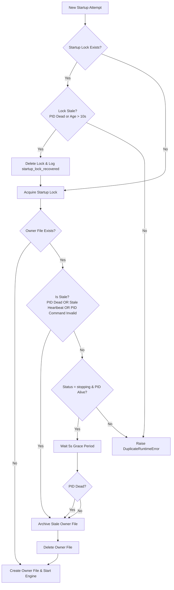

# RUNTIME_24_7_SELF_RECOVERY_HARDENING_DESIGN

This document presents the technical design for the **24/7 Runtime Reliability & Self-Recovery Hardening Patch**. It describes the design patterns, code edits, telemetry integration, and tests required to enable the Polymarket trading engine paper runtime to run continuously without requiring manual file cleanups or operator interventions during system crashes, PID reuse, or heartbeat/startup lock hangs.

---

## 1. Problem Statement

The engine uses single-instance ownership guards (via `utils/runtime_ownership.py`) to prevent duplicate instances from executing concurrently and corrupting paper-run trade history.
However, the current ownership guard fails to recover gracefully in several critical edge cases:
1. **Stale Lock Files:** A crashed runtime leaves a `.startup.lock` file, preventing subsequent startups forever.
2. **Stopping States & Dead PIDs:** If a process crashes or is killed during shutdown while in the `stopping` state, the manager blocks the next instance because it detects an active file.
3. **PID Re-use:** When a bot PID dies and is reused by a different OS process (such as a text editor or web browser extension), the manager believes the bot is still running and blocks startup.
4. **Heartbeat Hangs:** If the main thread hangs, there is no watchdog alerting or clean restart.

---

## 2. Proposed Architecture & Verification Logic



### Proposed Changes to `utils/runtime_ownership.py`

#### A. Process Command Verification
Use `psutil` if available with subprocess fallbacks (`wmic` on Windows, `/proc/<pid>/cmdline` on Unix) to read process cmdlines:
```python
def _get_process_cmdline(pid: int) -> str | None:
    try:
        import psutil
        proc = psutil.Process(pid)
        return " ".join(proc.cmdline())
    except Exception:
        # Fallback for Windows
        if os.name == "nt":
            try:
                import subprocess
                out = subprocess.check_output(
                    ["wmic", "process", "where", f"ProcessId={pid}", "get", "CommandLine"],
                    stderr=subprocess.DEVNULL,
                    text=True
                )
                lines = [l.strip() for l in out.splitlines() if l.strip()]
                if len(lines) > 1:
                    return lines[1]
            except Exception:
                pass
        # Fallback for Linux /proc
        else:
            try:
                cmdline_file = Path(f"/proc/{pid}/cmdline")
                if cmdline_file.exists():
                    return cmdline_file.read_text(encoding="utf-8").replace("\x00", " ")
            except Exception:
                pass
    return None
```
Verify the command line contains `"python"`, `"main.py"`, and the current repo root path to filter out non-bot processes.

#### B. Stale Lock Recovery
In `RuntimeOwnerManager.acquire()`, before attempting lock creation, inspect the age and process of the existing lock:
```python
        if lock_path.exists():
            try:
                content = lock_path.read_text(encoding="utf-8").strip().split("\n")
                if len(content) >= 3:
                    lock_pid = int(content[0])
                    lock_time = datetime.fromisoformat(content[2].replace("Z", "+00:00"))
                    age = (datetime.now(timezone.utc) - lock_time).total_seconds()
                    
                    if not self.process_checker(lock_pid) or age > 10.0:
                        lock_path.unlink(missing_ok=True)
                        if self.telemetry_emit:
                            self.telemetry_emit("log_system_health", {
                                "event_type": "startup_lock_recovered",
                                "pid": lock_pid,
                                "lock_age": age
                            })
            except Exception:
                try:
                    lock_path.unlink(missing_ok=True)
                except OSError:
                    pass
```

#### C. Stopping State Grace Period
If `status == "stopping"` and the PID is alive, wait for up to 5 seconds for it to exit:
```python
if status == "stopping" and pid_alive:
    for _ in range(5):
        time.sleep(1.0)
        if not self.process_checker(existing_pid):
            pid_alive = False
            break
```
If it is still alive after 5 seconds, classify it as hung and recover anyway.

---

## 3. Heartbeat Watchdog Implementation

A daemon thread `HeartbeatWatchdog` will be spawned in `main.py` at startup to monitor `last_owner_heartbeat_tick`:
- **Execution Interval:** Sleep 10 seconds.
- **Toxicity Check:** If `time.monotonic() - last_owner_heartbeat_tick > 45.0` (3 missed heartbeats), it logs a warning locally and notifies Telegram.
- **Watchdog Alert Template:**
  `🚨 WARNING | Heartbeat stale: main thread may be hung | Run:5498d1f9`

---

## 4. Telegram Alert Templates

Alerts will be dispatched via `utils/telegram_alerts.py` in the following compact formats:

1. **`runtime_started`:**
   `🚀 START | PAPER | Run:5498d1f9 | Interval:60s`
2. **`runtime_alive` (Hourly):**
   `🟢 ALIVE | PAPER | Up:01:00:00 | Run:5498d1f9`
3. **`stale_owner_detected`:**
   `🚨 STALE_OWNER | Detected stale owner run_id=run-a, pid=1234`
4. **`stale_owner_recovered`:**
   `🟢 STALE_OWNER | Recovered stale owner run_id=run-a, pid=1234`
5. **`runtime_blocked_active_owner`:**
   `🚨 BLOCKED | Blocked by active owner pid=1234, run_id=run-a`
6. **`runtime_shutdown_clean`:**
   `🛑 STOP | Clean shutdown completed | Run:5498d1f9`
7. **`runtime_shutdown_unclean`:**
   `🛑 STOP | Unclean shutdown detected | Run:5498d1f9`

---

## 5. Operations Runbook

The operations runbook has been successfully written and is available at:
[docs/operations/RUNTIME_24_7_RUNBOOK.md](file:///c:/quant/Polymarket-Adaptive-Quant-Engine-v.1/docs/operations/RUNTIME_24_7_RUNBOOK.md)

---

## 6. Required Tests

Tests will be added to `tests/test_runtime_ownership.py`:

1. **Active Owner with live main.py PID Blocks Startup:** Mock `process_checker` to return True and command line to be valid -> should raise `DuplicateRuntimeError`.
2. **Active Owner with dead PID Recovers:** Mock `process_checker` to return False -> recovers owner file, creates backup in archive, and starts.
3. **Stopping Owner with dead PID Recovers:** Status = stopping and PID = dead -> recovers immediately.
4. **PID Reused by non-main.py process Recovers:** Mock cmdline to return "chrome.exe" or another process -> recovers.
5. **Stale Heartbeat Recovers:** Heartbeat timestamp > 60s ago -> recovers.
6. **Fresh Heartbeat Blocks Duplicate:** Heartbeat timestamp < 15s ago, PID alive -> blocks.
7. **Startup Lock Stale Recovery:** Lock age > 10s -> recovers lock.
8. **Telemetry Emitted:** Asserts that `telemetry_emit` is called with `stale_owner_detected`, `stale_owner_recovered`, and `startup_lock_recovered`.
9. **Owner Archive File Created:** Asserts that stale owner file backup is copied to `runtime/ownership/archive/` before delete.

---

## 7. Safety Constraints Check

- **Strategy Integrity:** No strategy parameters or logic are altered.
- **EV Integrity:** No EV or expectation bounds are changed.
- **Risk Policy Integrity:** Sizing, bankroll ranks, and lockdown limits are not bypassed.
- **Live Trading Mode:** Stays disabled (realtime loop verify code remains unchanged).

---

## Final Design Verdict: IMPLEMENT_RUNTIME_SELF_RECOVERY

We recommend proceeding with the implementation of this design. It resolves a significant operational bottleneck (manual cleanup of stale ownership locks/files) without introducing any execution or financial risks to live/paper accounts.
