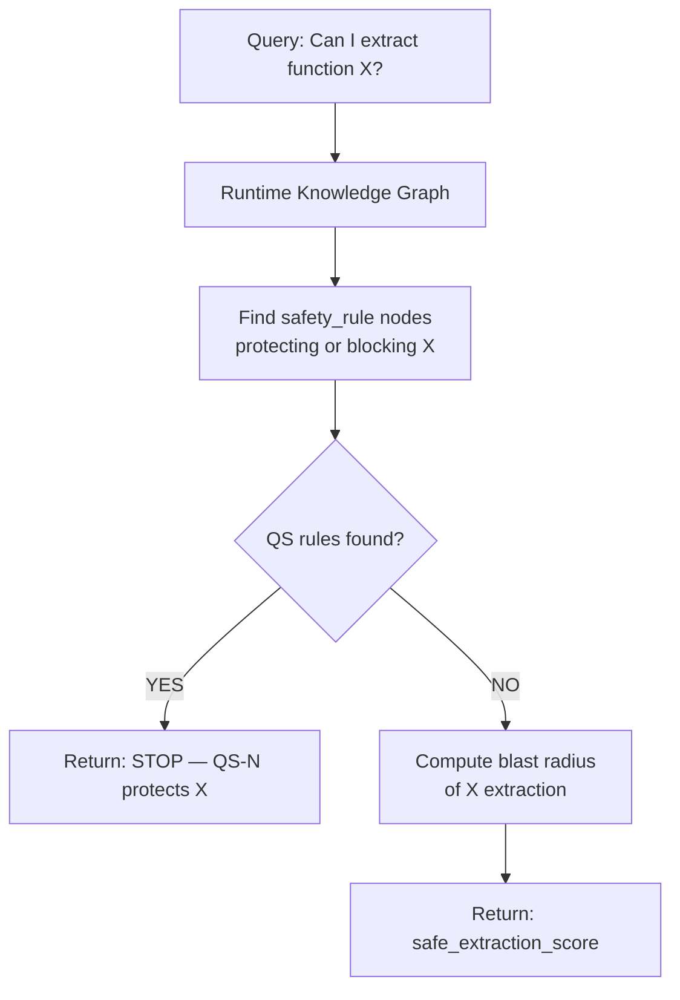
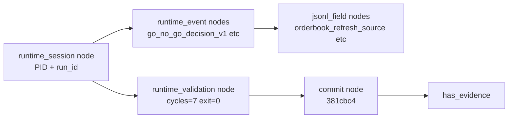
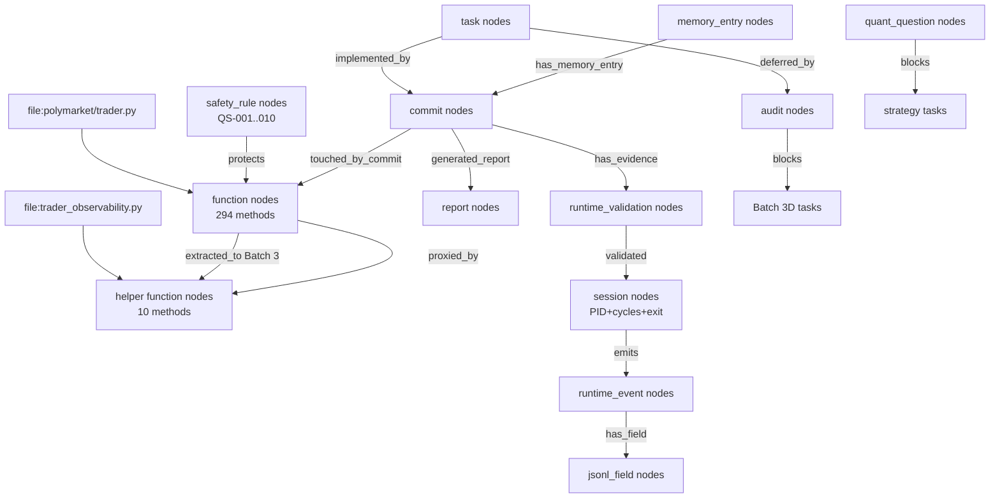
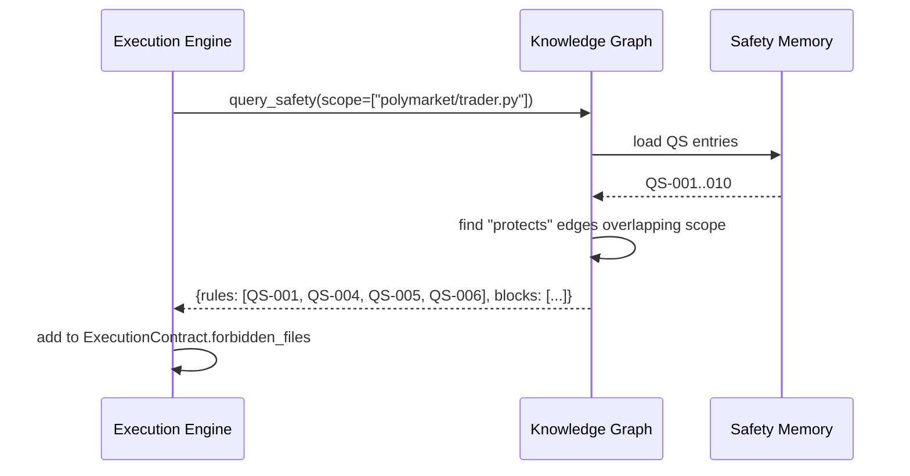
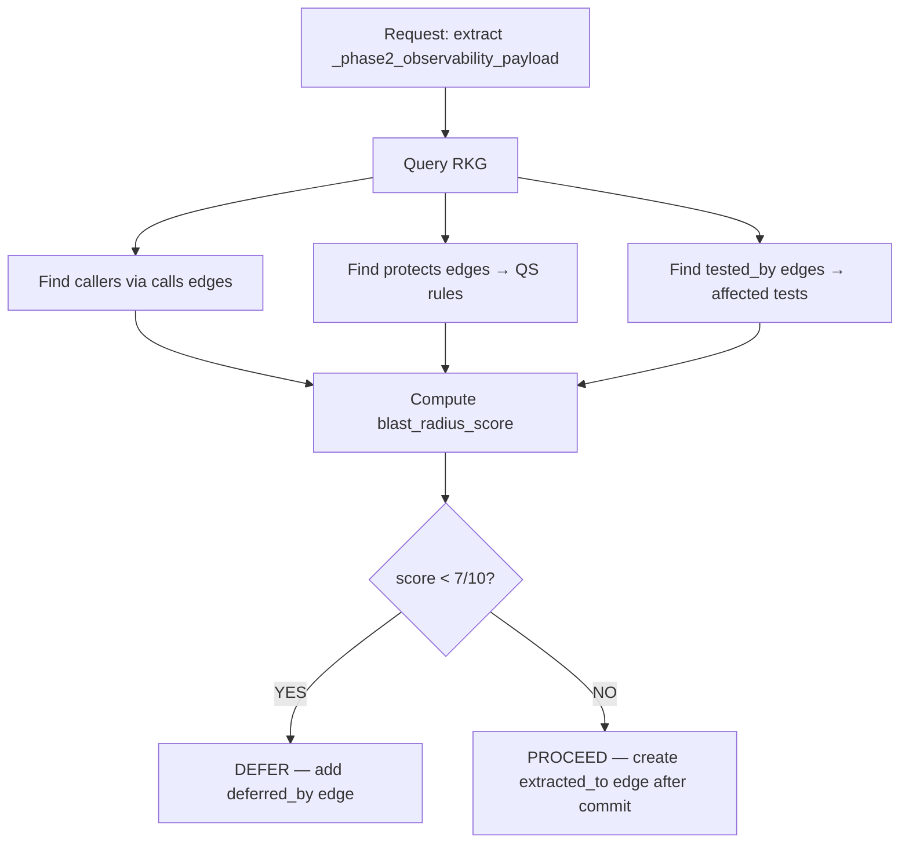

# RUNTIME_KNOWLEDGE_GRAPH_001

**Date:** 2026-06-27 · **Destination:** `docs/architecture/` · **Status:** DESIGN v1

---

## 1. Objective

The Repository Graph Engine (`REPOSITORY_GRAPH_ENGINE_001.md`) models static code structure — files, modules, functions, and their relationships. The **Runtime Knowledge Graph (RKG)** extends this into a unified operational knowledge base that connects:

- Repository structure (files, functions, extraction history)
- Runtime behavior (paper run events, JSONL fields, session outcomes)
- Memory OS V2 (safety rules, decisions, failure patterns)
- Execution governance (contracts, commits, audit trails)
- Quant research (active questions, strategy constraints)
- Validation evidence (gate checks, paper run reports, regression signals)

**Why the Repository Graph alone is insufficient:**

| Dimension | Repository Graph | Runtime Knowledge Graph |
|-----------|-----------------|------------------------|
| Code structure | ✓ | ✓ |
| Runtime events | ✗ | ✓ |
| Safety rule enforcement | ✗ | ✓ (QS-001..010 as nodes) |
| Refactor extraction history | Partial | ✓ (per-batch nodes) |
| Paper run evidence | ✗ | ✓ |
| Decision audit trail | ✗ | ✓ |
| Quant research constraints | ✗ | ✓ |
| Memory OS links | ✗ | ✓ |
| Execution contract references | ✗ | ✓ |

---

## 2. Node Types

```json
{
  "node_types": [
    "file",           // any file in the repository
    "module",         // Python module (importable)
    "class",          // Python class
    "function",       // Python function or method
    "method",         // bound method on a class
    "field",          // class-level field / dataclass field
    "runtime_event",  // event type emitted to event stream (e.g. go_no_go_decision_v1)
    "jsonl_field",    // named field in a JSONL event payload
    "test",           // pytest test function or class
    "report",         // document in docs/reports/
    "audit",          // document in docs/audits/
    "commit",         // git commit SHA
    "memory_entry",   // entry in Memory OS V2 (identified by memory_id)
    "safety_rule",    // QS-001 through QS-010
    "decision",       // a reusable decision from Decision Memory
    "quant_question", // open/closed research question (ACTIVE_QUESTION.md)
    "task",           // task_id from TASK_QUEUE
    "agent_role",     // role_id from AGENT_PIPELINE_001.json
    "tool",           // tool_id from TOOL_REGISTRY_001.json
    "skill",          // skill_id from SKILL_REGISTRY_001.json
    "pipeline",       // pipeline_id from AGENT_PIPELINE or TOOL_PIPELINES
    "session",        // paper run session (PID + run_id)
    "runtime_validation", // post-commit validation run record
    "maintenance_action"  // log governance or compaction action
  ]
}
```

---

## 3. Edge Types

```json
{
  "edge_types": [
    "imports",              // module → module
    "calls",                // function → function (direct call)
    "owns",                 // class → method, class → field
    "reads",                // function → field, function → file
    "writes",               // function → field, function → file
    "emits",                // function → runtime_event
    "validates",            // test → function, runtime_validation → commit
    "protects",             // safety_rule → function (forbidden extraction)
    "blocks",               // quant_question → task, safety_rule → task
    "depends_on",           // function → function (indirect dependency)
    "implemented_by",       // task → commit (task was implemented by this commit)
    "tested_by",            // function → test
    "documented_by",        // function → report, commit → report
    "decided_by",           // task → decision (what decision was made)
    "supersedes",           // decision → decision (newer overrides)
    "deferred_by",          // task → audit (gate said DEFER)
    "touched_by_commit",    // function → commit (commit modified this function)
    "generated_report",     // commit → report (commit produced this evidence)
    "has_evidence",         // commit → runtime_validation (paper run evidence)
    "related_to_quant_question", // task → quant_question
    "requires_safety_memory",    // task → safety_rule (task scope overlaps this QS rule)
    "extracted_to",         // function → function (method was extracted: source → destination)
    "proxied_by",           // function → function (proxy delegates to helper)
    "migrated_in_batch",    // function → task (batch task that performed extraction)
    "has_memory_entry"      // any_node → memory_entry (linked Memory OS record)
  ]
}
```

---

## 4. Core Schemas

### 4.1 Graph Node

```json
{
  "$schema": "rkg_node_v1",
  "node_id": "fn:polymarket.trader.PolymarketTrader._mark_orderbook_refresh",
  "node_type": "function",
  "name": "_mark_orderbook_refresh",
  "qualified_name": "polymarket.trader.PolymarketTrader._mark_orderbook_refresh",
  "file": "polymarket/trader.py",
  "is_permanent": false,
  "is_proxy": true,
  "is_extracted": true,
  "extraction_batch": "Batch-3B-1",
  "extraction_commit": "a491820",
  "proxy_target": "fn:polymarket.orchestration.trader_observability.TraderObservabilityHelper._mark_orderbook_refresh",
  "line_number": null,
  "tags": ["batch_3b1", "observability"],
  "created_at": "2026-06-27",
  "confidence": 0.95,
  "last_verified_at": "2026-06-27"
}
```

### 4.2 Graph Edge

```json
{
  "$schema": "rkg_edge_v1",
  "edge_id": "EDGE-fn:trader._mark-proxied_by-fn:helper._mark",
  "edge_type": "proxied_by",
  "from_node": "fn:polymarket.trader.PolymarketTrader._mark_orderbook_refresh",
  "to_node": "fn:polymarket.orchestration.trader_observability.TraderObservabilityHelper._mark_orderbook_refresh",
  "source": "a491820",
  "confidence": 1.0,
  "evidence_grade": "A",
  "created_by": "BATCH_3B1_IMPLEMENTATION_001",
  "last_verified_at": "2026-06-27",
  "tags": ["batch_3b1"]
}
```

### 4.3 Graph Snapshot

```json
{
  "$schema": "rkg_snapshot_v1",
  "snapshot_id": "SNAP-20260627-001",
  "generated_at": "2026-06-27T00:00:00Z",
  "node_count": 450,
  "edge_count": 1200,
  "node_type_counts": {"function": 294, "field": 45, "safety_rule": 10, "...": "..."},
  "coverage": {
    "trader_py_functions": 294,
    "helper_functions": 32,
    "safety_rules_mapped": 10,
    "tests_linked": 128,
    "commits_linked": 12
  },
  "files": [
    "docs/operations/memory/repository/REPO_GRAPH_NODES.jsonl",
    "docs/operations/memory/repository/REPO_GRAPH_EDGES.jsonl"
  ]
}
```

### 4.4 Query Result

```json
{
  "$schema": "rkg_query_result_v1",
  "query_id": "QUERY-20260627-001",
  "query_type": "blast_radius",
  "target": "fn:polymarket.trader.PolymarketTrader._phase2_complete_lifecycle_observability",
  "result_nodes": ["fn:...", "test:..."],
  "result_edges": ["EDGE-..."],
  "safety_rules_triggered": ["QS-005", "QS-006"],
  "confidence": 0.7,
  "evidence_grade": "B",
  "recommendations": ["Extraction requires calling _diagnostic_int via trader ref — cannot be pure helper method"]
}
```

### 4.5 Blast Radius Report

```json
{
  "$schema": "rkg_blast_radius_v1",
  "target": "fn:polymarket.trader.PolymarketTrader._phase2_observability_payload",
  "callers": [
    {"node_id": "fn:..._phase2_complete_lifecycle_observability", "call_count": 1, "coupling": "DIRECT"}
  ],
  "tests_affected": ["test:test_paper_mode.py::test_cycle_*"],
  "safety_rules": [
    {"rule_id": "QS-005", "reason": "calls _diagnostic_float which is QS-protected"},
    {"rule_id": "QS-006", "reason": "calls _diagnostic_int which is QS-protected"}
  ],
  "extraction_risk": "HIGH",
  "safe_extraction_score": "3/10",
  "recommendation": "DEFER — high coupling to _diagnostic_int/_float (permanent methods)"
}
```

---

## 5. Safety Integration

QS-001..010 from `SAFETY_MEMORY.jsonl` become permanent `safety_rule` nodes in the RKG:

| Safety Rule | Node ID | Protects | Edge type |
|-------------|---------|---------|---------|
| QS-001 | `qs:_phase4_build_quote_lineage` | `fn:..._phase4_build_quote_lineage` | `protects` |
| QS-002 | `qs:_phase4_quote_lineage_carry` | `fn:..._phase4_quote_lineage_carry` | `protects` |
| QS-003 | `qs:_last_quote_lineage_context` | `field:..._last_quote_lineage_context` | `protects` |
| QS-004 | `qs:_risk_plan_zero_diagnostics` | `fn:..._risk_plan_zero_diagnostics` | `protects` |
| QS-005 | `qs:_diagnostic_float` | `fn:..._diagnostic_float` | `protects` |
| QS-006 | `qs:_diagnostic_int` | `fn:..._diagnostic_int` | `protects` |
| QS-007 | `qs:live_trading` | `fn:client.live_order_methods` | `blocks` |
| QS-008 | `qs:env_live_flags` | `file:.env` | `protects` |
| QS-009 | `qs:runtime_data_deletion` | `file:runtime/` | `protects` |
| QS-010 | `qs:exec_risk_sizing` | `module:polymarket.order_intent`, `module:utils.risk_manager` | `blocks` |

**Safety query flow:**



---

## 6. Runtime Integration



**Key runtime node types:**
- `session` — one per paper run PID, includes cycle count, exit code, start/end
- `runtime_event` — one per distinct event type emitted (e.g., `go_no_go_decision_v1`)
- `jsonl_field` — one per named payload field (`orderbook_refresh_source`, `market_evaluation_duration_ms`)
- `runtime_validation` — summary of a post-commit validation run (commit + evidence)
- `maintenance_action` — log governance execute runs (856 files deleted, 1.4 GB reclaimed)

---

## 7. Memory OS Integration

The RKG stores **references** to Memory OS records, not duplicates of their content:

```json
{
  "edge_type": "has_memory_entry",
  "from_node": "commit:3c5b781",
  "to_node": "mem:LOOP-BATCH_3C_IMPLEMENTATION_001",
  "memory_file": "docs/operations/memory/loop/2026/06/2026-06-27.jsonl",
  "byte_offset": 14200,
  "evidence_grade": "C"
}
```

This allows the graph to query "what memory records relate to this commit?" without loading full memory files.

---

## 8. Refactor History

**Pre-seeded extraction history edges (from Batch 3 work):**

| Batch | Source node | Destination node | Edge type | Commit |
|-------|------------|-----------------|-----------|--------|
| Batch 1 | `fn:trader.*display_*` | `fn:trader_presentation.*` | `extracted_to` | `e76581fb` |
| Batch 2A | `fn:trader.init_*` | `fn:trader_lifecycle.*` | `extracted_to` | `c3b2bd2` |
| Batch 3A | `fn:trader._record_display_trade` | `fn:trader_observability.*` | `extracted_to` | `3c24111` |
| Batch 3B-1 | `field:trader._last_orderbook_refresh_*` (×8) | `field:trader_observability.*` | `extracted_to` | `a491820` |
| Batch 3B-2 | `field:trader._market_evaluation_*` (×5) | `field:trader_observability.*` | `extracted_to` | `381cbc4` |
| Batch 3C | `fn:trader._display_*` (×5 stubs) | deleted (0 callers) | `extracted_to` | `3c5b781` |
| Batch 3C | `fn:trader._phase2_candidate_hash` etc (×4) | `fn:trader_observability.*` | `extracted_to` | `3c5b781` |

**Deferred extraction (Batch 3D):**

| Method | Deferred by | Edge type | Reason |
|--------|------------|-----------|--------|
| `_phase2_complete_lifecycle_observability` | `audit:BATCH_3D_GATE_CHECK_001` | `deferred_by` | safe_extraction_score=5/10, _diagnostic_int coupling |
| `_phase2_observability_payload` | `audit:BATCH_3D_GATE_CHECK_001` | `deferred_by` | safe_extraction_score=3/10, too many trader state reads |

---

## 9. Query Examples

### Q1: What breaks if `_phase2_complete_lifecycle_observability` moves?

```
RKG.query("blast_radius", target="_phase2_complete_lifecycle_observability")
→ callers: [_phase2_decision_observability, _phase2_ev_null_reason_detail]
→ safety_rules: [QS-005, QS-006] (calls _diagnostic_float, _diagnostic_int)
→ extraction_risk: HIGH
→ recommendation: DEFER (safe_score=5/10)
```

### Q2: Which safety rules protect field `_last_quote_lineage_context`?

```
RKG.query("protecting_rules", target="_last_quote_lineage_context")
→ [QS-003: protects _last_quote_lineage_context (written from execution path)]
→ is_permanent: true
```

### Q3: What reports validated commit `3c5b781`?

```
RKG.query("evidence", target_commit="3c5b781")
→ [
    report:TRADER_REFACTOR_BATCH_003C_REPORT.md,
    runtime_validation:POST_BATCH_3C_RUNTIME_VALIDATION_001 (7 cycles, 56 JSONL events, exit 0)
  ]
```

### Q4: Which runtime events depend on helper `TraderObservabilityHelper`?

```
RKG.query("runtime_deps", target="fn:TraderObservabilityHelper")
→ [
    runtime_event:go_no_go_decision_v1 (via _scheduler_cadence_observability_detail),
    runtime_event:orderbook_state_changed_v1 (via _mark_orderbook_refresh),
    jsonl_field:market_evaluation_duration_ms,
    jsonl_field:orderbook_refresh_source
  ]
```

### Q5: Which tasks touched `trader.py`?

```
RKG.query("touched_by", target="file:polymarket/trader.py")
→ [
    task:BATCH_1_IMPLEMENTATION_001 (commit e76581fb, -98 lines),
    task:BATCH_2A_IMPLEMENTATION_001 (commit c3b2bd2, -170 lines),
    task:BATCH_3A_IMPLEMENTATION_001 (commit 3c24111, -145 lines),
    task:BATCH_3B1_IMPLEMENTATION_001 (commit a491820, -105 lines),
    task:BATCH_3B2_IMPLEMENTATION_001 (commit 381cbc4, -144 lines),
    task:BATCH_3C_IMPLEMENTATION_001 (commit 3c5b781, -49 lines)
  ]
```

### Q6: Why was Batch 3D deferred?

```
RKG.query("deferred_reason", target="task:BATCH_3D_IMPLEMENTATION_001")
→ deferred_by: audit:BATCH_3D_GATE_CHECK_001
→ reason: "PAUSE_BATCH_3D_DEFER — safe_extraction_scores 3/10 and 5/10"
→ blocking_rules: [QS-005 (_diagnostic_float), QS-006 (_diagnostic_int)]
→ recommendation: "Keep in trader.py as controller-level orchestration"
```

---

## 10. Graph Lifecycle

| Phase | Action | Tool |
|-------|--------|------|
| `seed` | Create initial nodes from known facts (Batch 3 history, QS rules) | Manual JSONL authoring (v2) |
| `update` | Add new nodes/edges after each commit | `memory_os.py append_and_index` (v3) |
| `validate` | Check graph consistency (no orphan edges, all node_ids valid) | `memory_os.py validate` (v3) |
| `compact` | Merge duplicate nodes, remove superseded edges | Monthly batch (v4) |
| `archive` | Move old snapshot data to `memory/archive/` | Archive policy (v4) |
| `rebuild` | Full rebuild from git history + AST parsing | Python tool (v4) |

---

## 11. Evidence Model

Every edge carries evidence metadata:

```json
{
  "source": "BATCH_3B1_IMPLEMENTATION_001",
  "confidence": 1.0,
  "evidence_grade": "A",
  "created_by": "02_CODE_ARCHITECT_AGENT",
  "last_verified_at": "2026-06-27",
  "verification_method": "paper_run_5_cycles + jsonl_field_check"
}
```

**Evidence grade determines edge reliability:**
- A: verified by paper run (method calls confirmed in JSONL)
- B: verified by compile + import (static analysis)
- C: verified by tests (test coverage confirms call)
- D: documented only (from design docs or reports)
- E: AI inferred (lowest confidence — triggers warning in blast radius queries)

---

## 12. Integration with Execution Contract

Future CLASS 6+ contracts must include a `graph_query_results` section:

```
graph_query_results:
  blast_radius_query: [paste output of RKG.query("blast_radius", target=X)]
  safety_rules_triggered: [list of QS entries that protect functions in scope]
  extraction_risk: [LOW | MEDIUM | HIGH]
  notes: [any edge type = E (low confidence) noted for manual review]
```

This ensures the Execution Engine has graph context before approving the repair loop.

---

## 13. Mermaid Diagrams

### High-Level Graph Architecture



### Safety Query Flow



### Refactor Blast Radius Flow



---

## 14. Migration Roadmap

| Version | Name | What ships | Trigger |
|---------|------|-----------|---------|
| **v1** | Design | This document | NOW |
| **v2** | Seed JSON | `docs/operations/memory/repository/REPO_GRAPH_NODES.jsonl` and `REPO_GRAPH_EDGES.jsonl` seeded with: QS-001..010 safety nodes, Batch 3 extraction history, permanent method flags, BATCH_3D defer decision | NEXT TASK |
| **v3** | Python graph builder | `tools/flaos/knowledge_graph.py` — reads seed files, queries by node_id, computes blast radius | After seed validated |
| **v4** | AST + call graph integration | Python `ast` module parses trader.py to build complete call graph; updates RKG incrementally on each commit | Phase 3 FLAOS |
| **v5** | Runtime event integration | Connects runtime_event and jsonl_field nodes from JSONL event stream to function nodes | Phase 4 FLAOS |
