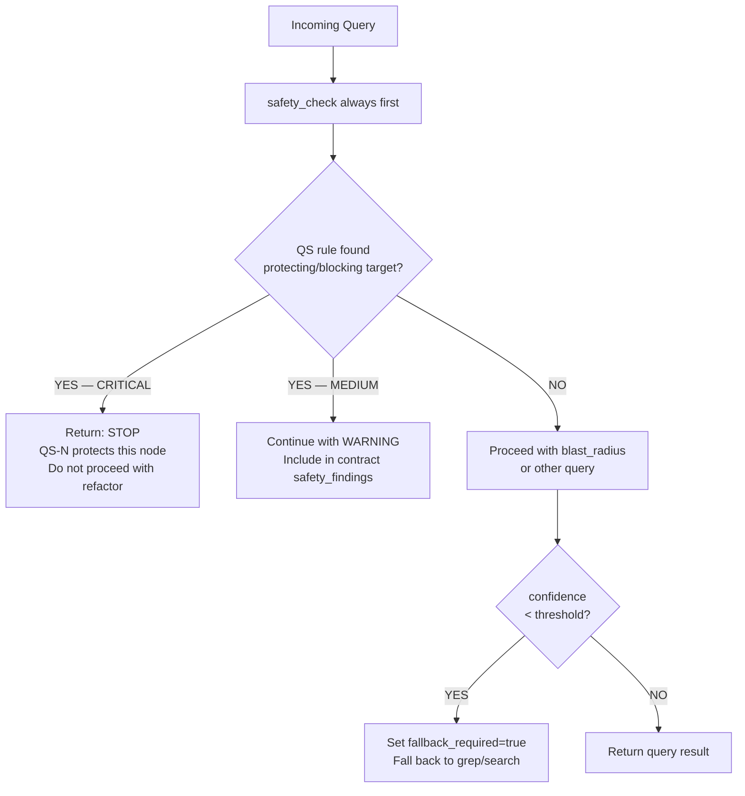
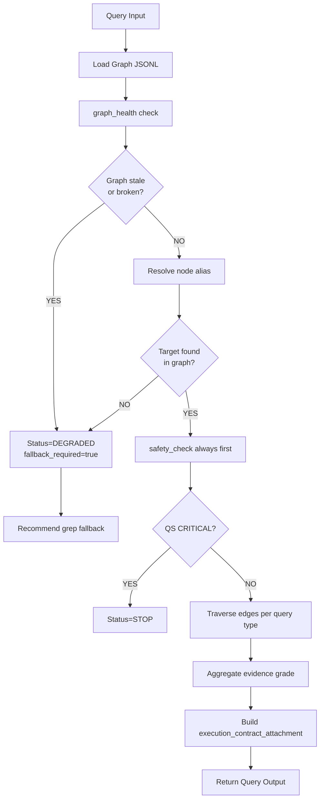
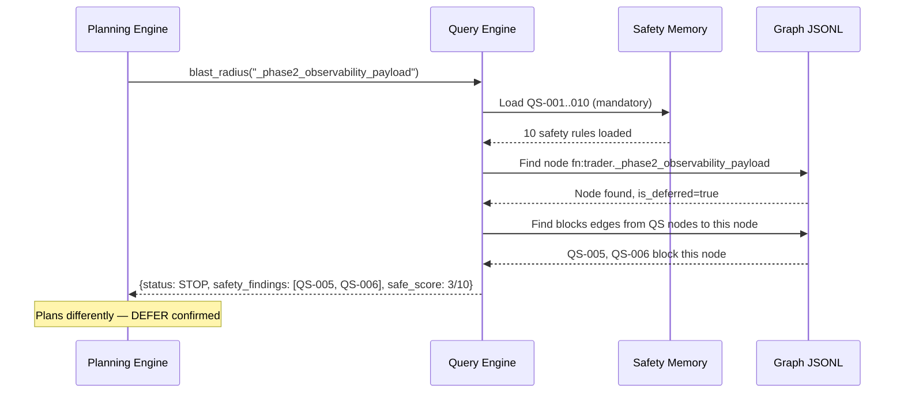
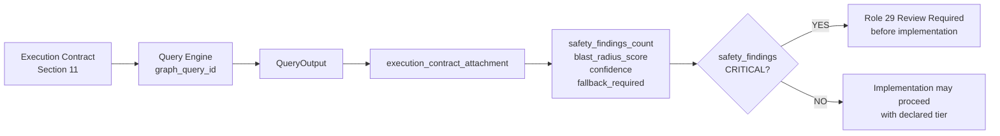

# RUNTIME_KNOWLEDGE_GRAPH_QUERY_ENGINE_001

**Date:** 2026-06-27 · **Destination:** `docs/architecture/` · **Status:** DESIGN v1

---

## 1. Objective

The Runtime Knowledge Graph seed (`REPO_GRAPH_NODES_001.jsonl`, `REPO_GRAPH_EDGES_001.jsonl`) is data without actionable intelligence. The **RKG Query Engine (RKGQE)** transforms this data into structured answers that the Planning Engine, Execution Contract, and future refactor safety checks can consume.

**Why the seed alone is insufficient:**

| Capability | Seed files | Query Engine |
|-----------|-----------|-------------|
| Store nodes and edges | ✓ | ✓ |
| Answer "what breaks if X moves?" | ✗ | ✓ |
| Surface safety rules before planning | ✗ | ✓ |
| Generate Execution Contract attachments | ✗ | ✓ |
| Validate graph health | ✗ | ✓ |
| Grade evidence of query results | ✗ | ✓ |
| Detect stale graph data | ✗ | ✓ |
| Recommend workflow tier from graph | ✗ | ✓ |

---

## 2. Query Engine Responsibilities

1. **Load graph** — read `REPO_GRAPH_NODES_001.jsonl` and `REPO_GRAPH_EDGES_001.jsonl` into in-memory dicts indexed by `node_id`
2. **Validate graph health** — check all edge `from_node`/`to_node` references resolve, count orphaned edges, check QS-001..010 all present
3. **Resolve node aliases** — `_mark_orderbook_refresh` → `fn:helper._mark_orderbook_refresh` (short name → qualified node_id)
4. **Traverse edges** — BFS/DFS from target node, depth-limited, optionally filtered by edge type
5. **Surface safety rules first** — `protects` and `blocks` edges evaluated BEFORE `calls`/`depends_on` traversal
6. **Summarize evidence** — aggregate edge evidence grades into a single result grade
7. **Generate Execution Contract attachments** — produce structured JSON block ready to embed in Section 11 of the contract

---

## 3. Core Queries

### 3.1 `blast_radius(target, max_depth=3)`

**Purpose:** What would break if `target` was extracted/moved/changed?

**Algorithm:**
```
1. safety_check(target) first — if CRITICAL found, return immediately
2. Traverse: target → callers (calls, depends_on edges, reverse direction)
3. For each caller: collect test nodes (tested_by edges)
4. Collect safety rules (protects/blocks edges on target)
5. Compute blast_radius_score = f(caller_count, safety_rules, test_count)
6. Return: affected_nodes, safety_findings, score, recommendation
```

**Output example:**
```json
{
  "query_type": "blast_radius",
  "target": "fn:trader._phase2_observability_payload",
  "safety_findings": [{"rule": "QS-005", "reason": "calls _diagnostic_float"}, {"rule": "QS-006", "reason": "calls _diagnostic_int"}],
  "affected_nodes": ["fn:trader._phase2_complete_lifecycle_observability"],
  "blast_radius_score": "HIGH",
  "safe_extraction_score": "3/10",
  "recommended_workflow_tier": "GATE",
  "recommendation": "DEFER — high coupling to permanent methods QS-005/006"
}
```

### 3.2 `safety_check(target)`

**Purpose:** Are there safety rules protecting or blocking this target?

**Algorithm:**
```
1. Load all QS nodes from safety_rule nodes in graph
2. Find all protects/blocks edges where to_node = target or target is in scope
3. Check target.is_permanent flag directly
4. Return: list of triggered rules, severity, is_permanent flag
```

**Output example (for `_last_quote_lineage_context`):**
```json
{
  "query_type": "safety_check",
  "target": "field:trader._last_quote_lineage_context",
  "safety_findings": [{"rule": "QS-003", "reason": "PERMANENT — written from execution path", "severity": "CRITICAL"}],
  "is_permanent": true,
  "status": "STOP — QS-003 protects this field",
  "confidence": 1.0,
  "evidence_grade": "B"
}
```

### 3.3 `evidence_for_commit(commit_hash)`

**Purpose:** What validation evidence exists for this commit?

**Algorithm:**
```
1. Resolve commit_hash → commit node (commit:SHA)
2. Traverse: generated_report, has_evidence, validated_by edges
3. Collect all linked report, runtime_validation, audit nodes
4. Aggregate evidence grades
5. Return: reports list, validation runs, grade
```

**Output example (commit `3c5b781`):**
```json
{
  "query_type": "evidence_for_commit",
  "target": "commit:3c5b781",
  "evidence": [
    {"node_id": "report:TRADER_REFACTOR_BATCH_003C_REPORT", "grade": "C"},
    {"node_id": "rtval:POST_BATCH_3C", "cycles": 7, "exit_code": 0, "jsonl_events": 56, "grade": "A"}
  ],
  "aggregate_grade": "A",
  "confidence": 1.0
}
```

### 3.4 `why_deferred(target)`

**Purpose:** Why was a task or method deferred?

**Algorithm:**
```
1. Find target node (task or function)
2. Traverse: deferred_by edges
3. Load audit node content (gate check verdict, reason)
4. Collect blocking safety rules (blocks edges)
5. Return: audit reference, gate verdict, blocking QS rules, deferred_batch
```

**Output example (`BATCH_3D_GATE_CHECK_001`):**
```json
{
  "query_type": "why_deferred",
  "target": "fn:trader._phase2_observability_payload",
  "deferred_by": "audit:BATCH_3D_GATE_CHECK_001",
  "gate_verdict": "PAUSE_BATCH_3D_DEFER",
  "blocking_rules": ["QS-005 (_diagnostic_float)", "QS-006 (_diagnostic_int)"],
  "safe_extraction_score": "3/10",
  "reason": "200+ lines, maximum trader state reads, controller-level orchestration",
  "recommendation": "Re-gate after Phase 5 FLAOS when AST call graph available"
}
```

### 3.5 `runtime_dependencies(target)`

**Purpose:** Which JSONL fields and runtime events depend on this helper/method?

**Algorithm:**
```
1. Find target node (class or function)
2. Traverse: emits, writes edges (target → jsonl_field, runtime_event)
3. Collect runtime_event and jsonl_field nodes
4. Return: event types, field names, evidence
```

**Output example (`class:TraderObservabilityHelper`):**
```json
{
  "query_type": "runtime_dependencies",
  "target": "class:TraderObservabilityHelper",
  "runtime_events": ["event:go_no_go_decision_v1", "event:orderbook_state_changed_v1"],
  "jsonl_fields": ["jfield:orderbook_refresh_source", "jfield:market_evaluation_duration_ms", "jfield:decision_cycle_interval_seconds"],
  "evidence_grade": "A",
  "confidence": 1.0,
  "note": "Moving TraderObservabilityHelper would break these telemetry fields"
}
```

### 3.6 `tasks_touching(target)`

**Purpose:** Which tasks have modified this file/class/method?

**Algorithm:**
```
1. Find target node
2. Traverse: touched_by_commit edges → commit nodes
3. From each commit: implemented_by edges → task nodes
4. Collect batch/task info with date and evidence
```

**Output example (`file:polymarket/trader.py`):**
```json
{
  "query_type": "tasks_touching",
  "target": "file:polymarket/trader.py",
  "tasks": [
    {"commit": "e76581fb", "batch": "Batch-1", "lines_delta": -98},
    {"commit": "3c24111", "batch": "Batch-3A"},
    {"commit": "a491820", "batch": "Batch-3B-1"},
    {"commit": "381cbc4", "batch": "Batch-3B-2"},
    {"commit": "6872a07", "batch": "Batch-3B-dedup"},
    {"commit": "3c5b781", "batch": "Batch-3C", "lines_delta": -49}
  ],
  "total_line_delta": -600,
  "current_lines": 12775,
  "confidence": 1.0
}
```

### 3.7 `method_history(method_name)`

**Purpose:** What is the full extraction/proxy history of this method?

**Algorithm:**
```
1. Resolve short name → node_id (alias resolution)
2. Collect: extracted_to, proxied_by, migrated_in_batch edges
3. Sort by batch/commit date
4. Return: original location, extraction path, proxy chain
```

### 3.8 `graph_health()`

**Purpose:** Is the graph self-consistent and up-to-date?

**Checks:**
```
- All edge from_node/to_node resolve to known node_ids
- QS-001..010 all present as safety_rule nodes
- Permanent nodes have protects edges from QS rules
- Deferred nodes have deferred_by edges
- Graph age < 30 days (for runtime refactor tasks)
- No orphaned nodes (nodes with 0 edges)
```

**Output:**
```json
{
  "query_type": "graph_health",
  "status": "HEALTHY",
  "total_nodes": 66,
  "total_edges": 45,
  "orphaned_nodes": 0,
  "orphaned_edges": 0,
  "qs_rules_complete": true,
  "graph_age_days": 0,
  "stale_for_runtime_refactor": false,
  "confidence": 1.0
}
```

---

## 4. Input Schema

```json
{
  "$schema": "rkg_query_input_v1",
  "query_type": "blast_radius | safety_check | evidence_for_commit | why_deferred | runtime_dependencies | tasks_touching | method_history | graph_health",
  "target": "string — node_id or short method name",
  "max_depth": "int — default 3, max 5",
  "include_evidence": "bool — default true",
  "include_safety": "bool — default true (always runs, cannot be disabled for Class 6+)",
  "confidence_threshold": "float 0.0-1.0 — default 0.5 (skip low-confidence edges)"
}
```

---

## 5. Output Schema

```json
{
  "$schema": "rkg_query_output_v1",
  "query_id": "QUERY-20260627-001",
  "query_type": "string",
  "target": "string",
  "status": "PASS | DEGRADED | STOP | ERROR",
  "safety_findings": [
    {"rule": "QS-N", "reason": "string", "severity": "CRITICAL|HIGH|MEDIUM"}
  ],
  "affected_nodes": ["array of node_ids"],
  "affected_edges": ["array of edge_ids"],
  "evidence": [
    {"node_id": "string", "grade": "A|B|C|D", "description": "string"}
  ],
  "recommended_workflow_tier": "FAST|LOOP|STANDARD|GATE",
  "stop_conditions": ["array of triggered stop reasons"],
  "confidence": "float 0.0-1.0",
  "evidence_grade": "A|B|C|D|E",
  "execution_contract_attachment": {
    "graph_query_id": "string",
    "graph_confidence": "float",
    "safety_findings_count": "int",
    "affected_nodes_count": "int",
    "affected_edges_count": "int",
    "fallback_required": "bool"
  }
}
```

---

## 6. Safety-First Behavior



**Rules:**
- `safety_check` runs unconditionally before `blast_radius` for ANY query on a Python method/field
- `include_safety: false` is ignored for Class 6+ tasks (safety always runs)
- QS nodes with `severity: CRITICAL` produce `status: STOP` immediately
- Result is NEVER `status: PASS` if QS-001..010 rules overlap the target

---

## 7. Execution Contract Integration

Future CLASS 6+ Execution Contracts (Section 11 — Required Tools) must include a `graph_query_attachment`:

```
GRAPH QUERY ATTACHMENT (Section 11 addition):

  graph_query_id:         QUERY-YYYYMMDD-NNN
  graph_confidence:       0.85
  safety_findings_count:  0  (0 = SAFE; >0 = review safety_findings list)
  safety_findings:        [QS-N if any]
  affected_nodes_count:   3
  affected_edges_count:   5
  blast_radius_score:     LOW | MEDIUM | HIGH
  fallback_required:      false (true = graph result uncertain, grep verification needed)
  recommended_tier:       LOOP
```

**STOP condition for Execution Contract:** If `safety_findings_count > 0` with severity CRITICAL → task must be reviewed by Role 29 before implementation proceeds.

---

## 8. Query Examples with Seeded Graph

### Example A: `safety_check("_last_quote_lineage_context")`
```
→ Found: qs:QS-003 protects field:trader._last_quote_lineage_context
→ is_permanent: true
→ status: STOP — QS-003 protects this field
→ Execution Contract: safety_findings_count=1, CRITICAL
```

### Example B: `blast_radius("_phase2_observability_payload")`
```
→ safety_check first: QS-005, QS-006 found (blocks edges)
→ safe_extraction_score: 3/10
→ blast_radius_score: HIGH
→ recommended_tier: GATE
→ deferred_by: audit:BATCH_3D_GATE_CHECK_001
→ Execution Contract: blast_radius=HIGH, fallback_required=false (seeded with grade B evidence)
```

### Example C: `evidence_for_commit("3c5b781")`
```
→ Found: report:TRADER_REFACTOR_BATCH_003C_REPORT (grade C)
→ Found: rtval:POST_BATCH_3C (7 cycles, exit 0, 56 JSONL events, grade A)
→ aggregate_grade: A
→ Execution Contract: has_evidence=true, evidence_grade=A
```

### Example D: `runtime_dependencies("TraderObservabilityHelper")`
```
→ Emits edges to: jfield:orderbook_refresh_source, jfield:market_evaluation_duration_ms
→ jfield:decision_cycle_interval_seconds, jfield:orderbook_snapshot_age_ms_at_decision
→ Note: Moving/renaming this class would break 4 JSONL telemetry fields
→ Execution Contract: affected_nodes_count=4, fallback_required=false (grade A from paper run)
```

### Example E: `why_deferred("BATCH_3D_GATE_CHECK_001")`
```
→ Found: task:BATCH_3D_GATE_CHECK_001 → deferred
→ gate_verdict: PAUSE_BATCH_3D_DEFER
→ blocking: QS-005 (_diagnostic_float), QS-006 (_diagnostic_int)
→ Deferred methods: _phase2_complete_lifecycle_observability (5/10), _phase2_observability_payload (3/10)
→ Recommendation: Re-gate when AST call graph available for precise dependency mapping
```

---

## 9. Evidence Grading

| Evidence source | Grade | Condition |
|----------------|-------|-----------|
| Graph direct edge | B | Edge exists in seeded JSONL with confidence ≥ 0.8 |
| Graph edge + source report | B+ | Edge source matches a committed report node |
| Graph edge + runtime validation | A | Edge linked to rtval node with exit_code=0 |
| Graph edge low confidence (< 0.5) | D/E | Edge present but confidence below threshold |
| Target not in graph | DEGRADED | Node_id not found; fallback_required=true |
| Graph stale (> 30 days) | DEGRADED | For runtime refactor tasks; recommend rebuild |

---

## 10. Stop Conditions

| Condition | Status | Action |
|-----------|--------|--------|
| safety_rule CRITICAL found (QS-001..006) | STOP | Immediate; no further traversal |
| Graph contradicts safety memory | STOP | Safety memory overrides graph |
| Graph stale > 30 days for Class 6+ task | DEGRADED | Warn; require fallback grep confirmation |
| Target node not resolved | DEGRADED | Set fallback_required=true |
| Edge chain broken (orphaned node) | DEGRADED | Report in graph_health |
| confidence < 0.3 for all edges | DEGRADED | fallback_required=true |
| graph_health() fails | ERROR | Abort query; fix graph first |

---

## 11. Mermaid Diagrams

### Query Flow



### Safety-First Query



### Execution Contract Integration



---

## 12. Migration Roadmap

| Version | Name | What ships | Trigger |
|---------|------|-----------|---------|
| **v1** | Design | This document | NOW |
| **v2** | Query tool (docs-only) | `docs/operations/GRAPH_QUERY_TEMPLATE_001.md` — AI fills queries manually using seeded JSONL, outputs structured JSON | NEXT TASK |
| **v3** | Python query tool | `tools/flaos/knowledge_graph.py` — implements blast_radius, safety_check, evidence_for_commit | After seed validated |
| **v4** | AST + call graph | `ast` module parses trader.py → updates graph; queries use live call graph | Phase 3 FLAOS |
| **v5** | Planner integration | Planning Engine calls graph automatically before computing risk/complexity scores | Phase 4 FLAOS |
