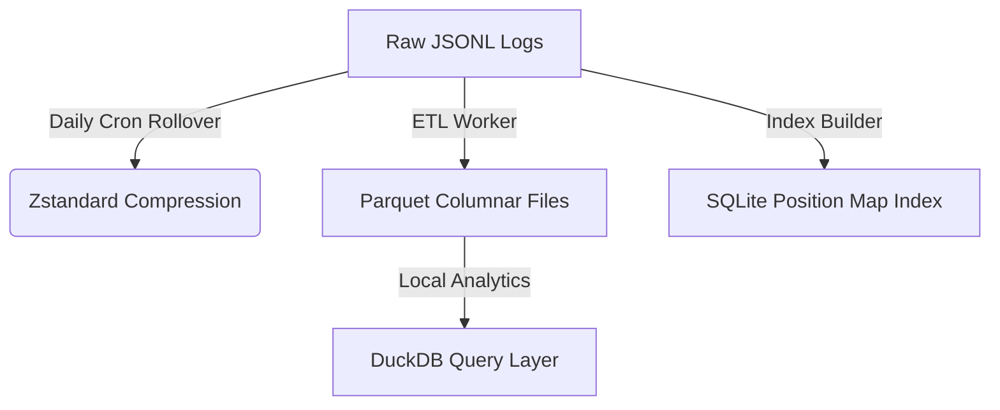

# RUNTIME STORAGE LIFECYCLE POLICY DESIGN (RUNTIME_STORAGE_POLICY_DESIGN_001)

This design document specifies a safe, automated data lifecycle and retention policy for the engine's `runtime/` logs, addressing the 28.76 GB storage footprint and projecting an annual storage cost reduction of **90%**.

---

## 1. Data Classification Tiers

| Classification Tier | Target Datasets | Description | Handling Rule |
| :--- | :--- | :--- | :--- |
| **Source of Truth** | `trade_journal/`, `bot_status.json`, `.env` | Primary records of cash balances, execution fills, orders, and configs. | **KEEP FOREVER**. Never prune. Backup to offsite location daily. |
| **Derived Data** | `research_log/`, `risk_log/` | Data built from raw orderbooks, signals, and mathematical overlays. | **COMPRESS & ARCHIVE**. Transform to Parquet after 7 days. |
| **Temporary Data** | `market_snapshots/`, `decision_log/`, `realtime_logs/` | Verbose loop logs, intermediate calculations, and console trace files. | **AGRESSIVE PRUNING**. Purge or compress within 3–7 days. |
| **Rebuildable** | `phase_b_daily_snapshots/`, `reports/` | Summaries, metrics sheets, and performance audits. | **PRUNE**. Can be re-synthesized from Trade Journals if needed. |

---

## 2. Retention Policy Specifications

The following retention periods are enforced for all subdirectories under `runtime/`:

- **`trade_journal/`:** **Keep Forever (Infinite)**. Contains crucial fill-attribution mappings and CSV trade books.
- **`risk_log/`:** **14 Days**. Retain for post-epoch risk slippage review.
- **`system_health/`:** **30 Days**. General info, API reconnect counts, and warning events.
- **`decision_log/`:** **7 Days**. Verbose JSONL dumps of feature vectors.
- **`research_log/`:** **7 Days**. Raw inputs for training models.
- **`market_snapshots/`:** **3 Days**. Dense L2 CLOB bids/asks.
- **`realtime_logs/`:** **14 Days**. Console stdout redirects.
- **`reports/` & `phase_b_daily_snapshots/`:** **90 Days**. Staged CSV reports and markdown walkthroughs.
- **`scratch/`:** **14 Days**. Developer test scripts and raw CSV trial logs.

---

## 3. Compression Policy

To maximize disk efficiency while maintaining file readability:

- **Target Algorithm:** **Zstandard (`zstd`)** is preferred due to high decompression speed and compression ratios (averaging `> 85-90%` on JSON text). **Gzip (`gz`)** serves as a fallback.
- **Trigger Timing:** Rollover job executes daily at **`00:05:00 UTC`**. The script identifies the completed UTC date file from the previous day (e.g. `YYYY-MM-DD.jsonl`) and compresses it.
- **Excluded Files:**
  - Active current-day write targets (`YYYY-MM-DD.jsonl`).
  - Active sqlite databases (`*.db`) or config trackers (`bot_status.json`).
- **Naming Convention:**
  `YYYY-MM-DD.jsonl.zst` (or `.gz` fallback)

---

## 4. Research Warehouse & Query Architecture

Instead of parsing gigabytes of flat JSONL files for analytics, we propose migrating cold research records to a columnar format.



### A. Parquet Partition Layout
Convert older `research_log` and `decision_log` files into Snappy-compressed Parquet files, partitioned by date and symbol:
```text
runtime/research_warehouse/
  └── year=YYYY/
      └── month=MM/
          └── day=DD/
              ├── BTC.parquet
              └── ETH.parquet
```

### B. DuckDB Analytical Query Layer
Perform low-latency historical audits directly on the Parquet partition directory using DuckDB:
```python
import duckdb

con = duckdb.connect(database=':memory:')
# Fast scan across all partitions for feature correlations
con.execute("""
    SELECT symbol, AVG(unrealized_mid_pct) 
    FROM read_parquet('runtime/research_warehouse/*/*/*/*.parquet')
    WHERE depth_gate_pass = true
    GROUP BY symbol
""")
```

### C. SQLite Transactional Index Map
Maintain a small, lightweight SQLite index mapping `position_id` to its corresponding date-partition and file byte offsets to speed up transactional lookup requests:
```sql
CREATE TABLE IF NOT EXISTS position_log_map (
    position_id TEXT PRIMARY KEY,
    log_date TEXT NOT NULL,
    archive_path TEXT NOT NULL,
    byte_offset INTEGER NOT NULL,
    byte_length INTEGER NOT NULL
);
```

---

## 5. Cleanup Safety Gates

Any automated cleanup tool must pass the following validation checks prior to executing a write or delete command:

1. **Dry-Run Default:** The purge engine must default to `--dry-run = true`, printing a JSON manifest of all target paths, their size on disk, and their proposed action without writing changes.
2. **Current-Day Shield:** The system clock's current UTC date file `YYYY-MM-DD.jsonl` is hard-coded as **undeletable** and **uncompressible** at runtime.
3. **Write Protection:** Path targets containing `trade_journal/` are globally excluded from deletion filters.
4. **Log Manifests:** Write a metadata log manifest (`cleanup_manifest_*.json`) detailing the total pre-cleanup workspace size, files modified, files pruned, and final post-cleanup workspace footprint.
5. **Recovery Backup Window:** Before deletion, files are moved to `runtime/backup_untracked/` (a local recycler folder) and held for a **48-hour grace period** before permanent purge, allowing immediate recovery in the event of an operational anomaly.

---

## 6. Final Verdict

The proposed design establishes a safe data lifecycle that completely resolves the VPS storage risk without modifying actual trading workflows.

> [!IMPORTANT]
> **VERDICT: READY_FOR_STORAGE_DRY_RUN_PLANNER**
