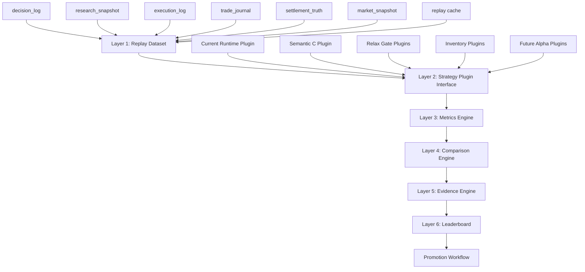
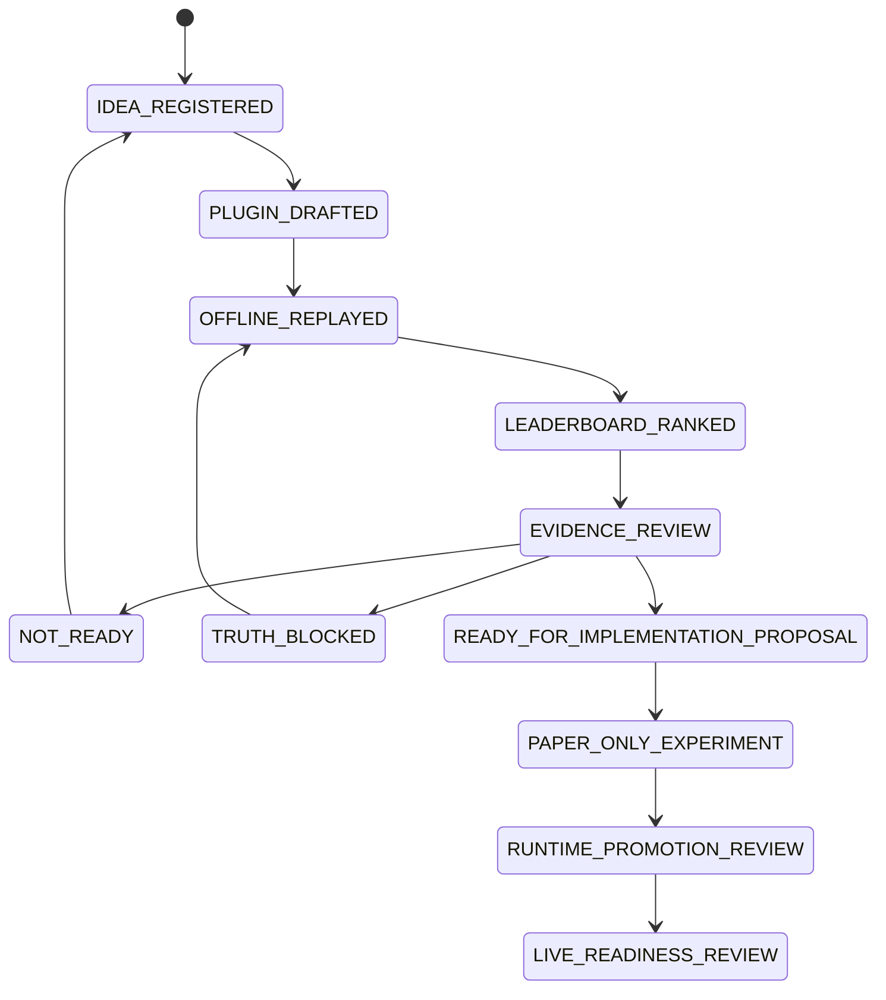

# SHADOW_STRATEGY_EVALUATION_FRAMEWORK_001

## Status

ARCHITECTURE ONLY. No runtime behavior, strategy thresholds, sizing, risk, execution, config, `.env`, paper behavior, or live behavior changed.

## Objective

Design a reusable offline Shadow Strategy Evaluation Framework for Alpha Discovery. The framework prevents every experimental strategy from becoming its own replay system by defining one shared dataset layer, one plugin interface, one metrics engine, one comparison engine, one evidence engine, and one leaderboard surface.

Target strategy families include:

- Semantic C
- Relax Delta
- Relax Confidence
- Relax EV
- Inventory Ladder
- Adaptive Inventory
- Dynamic Confidence
- Low Price Truth
- Future Alpha Ideas

## Design Verdict

READY_FOR_OFFLINE_FRAMEWORK_IMPLEMENTATION_PLAN.

The project should not build another one-off replay script for the next strategy idea. Existing tools such as `tools/backtest_engine_v2/`, Semantic C shadow tools, bounded reload replay, lifecycle replay, no-entry diagnostics, and counterfactual reports should become producers, adapters, or early strategy plugins under a common framework.

The recommended architecture is:

```text
Replay Dataset
  -> Strategy Plugin Interface
    -> Metrics Engine
      -> Comparison Engine
        -> Evidence Engine
          -> Leaderboard
            -> Promotion Workflow
```

This is offline-only. The output is evidence, not runtime authorization.

## Current Context

| Context | Design implication |
|---|---|
| Runtime stability and paper accounting have improved. | Offline strategy evaluation can now compare against actual paper lifecycle evidence. |
| `ENTRY_GATE_COUNTERFACTUAL_REPLAY_001` found no tuning justified. | Framework must separate candidate generation from promotion claims. |
| `RISK_PLAN_ZERO_SIDE_CONFIDENCE_SEMANTICS_AUDIT_001` found selected-side probability versus top-level confidence mismatch. | Semantic C should be a plugin, not a special replay path. |
| Active question `LOW_PRICE_TRUTH_RESOLUTION_001` remains open. | Low-price strategy plugins can be evaluated, but cannot promote runtime changes until truth resolution closes. |
| `tools/backtest_engine_v2/` already has replay, policy, metrics, scenario, comparison, registry, and exporter concepts. | Future implementation should extend or adapt that engine rather than duplicate the same primitives. |
| Several one-off replay tools exist. | Framework should absorb them as plugins/adapters over time. |

## Non-Goals

- No runtime execution change.
- No strategy tuning.
- No sizing/risk threshold change.
- No live trading authority.
- No automatic promotion from leaderboard rank to runtime policy.
- No all-in, martingale, unlimited averaging-down, stale-orderbook, or reconciliation-bypass design.

## Architecture

### Component Diagram



### Layer Responsibilities

| Layer | Responsibility | Must not do |
|---|---|---|
| Replay Dataset | Build deterministic, run-scoped rows from logs, journal, truth, snapshots, and cache. | Invent missing truth or mutate runtime files. |
| Strategy Plugin Interface | Run strategies against identical replay rows and return normalized decisions. | Read live state, call runtime modules, or change thresholds in production. |
| Metrics Engine | Convert decision streams into comparable performance, risk, and opportunity metrics. | Hide low sample size or data-quality gaps. |
| Comparison Engine | Compare current runtime baseline against candidate strategies. | Compare strategies on different row universes without labeling it. |
| Evidence Engine | Assign evidence grade, sample confidence, readiness, and recommendation. | Promote based on leaderboard rank alone. |
| Leaderboard | Rank strategies by multi-objective score and show trade-offs. | Collapse risk, data quality, and profitability into one opaque score. |

## Layer 1: Replay Dataset

The dataset layer owns canonical offline input preparation. Every strategy receives the same row envelope for a given evaluation scope.

### Sources

| Source | Use |
|---|---|
| `decision_log` | Candidate decisions, skip reasons, probabilities, EV, confidence, gates, risk diagnostics. |
| `research_snapshot` | Regime, indicator evidence, Size Sharp, Bankroll Rank, shadow policy fields. |
| `execution_log` | Submitted/filled paper events, order IDs, position IDs when available. |
| `trade_journal` | Trade open/close truth, realized PnL, exit reason, lifecycle events. |
| `settlement_truth` | Final market outcome and official resolution basis. |
| `market_snapshot` | Bid/ask, spread, depth, freshness, orderbook availability, time remaining. |
| `replay cache` | Deterministic normalized row store to avoid rereading large JSONL repeatedly. |

### Dataset Contract

Each row should be normalized into a replay envelope:

```text
ReplayRow
  identity:
    run_id
    row_id
    timestamp_utc
    asset
    market_slug
    condition_id
    token_id
    side
  market:
    bid
    ask
    spread
    liquidity_usd
    orderbook_state
    seconds_remaining
    market_phase
  model:
    p_yes
    p_no
    selected_probability
    model_confidence
    fair_value
    ev_after_spread
    min_ev
  runtime_decision:
    action
    skip_reason
    risk_plan_size
    blocked_reasons
  lifecycle_truth:
    filled
    position_id
    trade_open
    trade_close
    exit_reason
    realized_pnl
  path_truth:
    mfe
    mae
    tp_hit
    sl_hit
    settlement_outcome
  quality:
    row_evidence_grade
    missing_fields
    truth_source
    caveats
```

### Dataset Rules

- Use run-scoped evaluation by default.
- Preserve original emitted fields and add normalized aliases separately.
- Tag every derived field with provenance.
- Keep rows with missing fields, but force plugins and evidence scoring to see missingness.
- Do not compare strategies that used different eligible row filters unless the comparison explicitly reports that difference.

## Layer 2: Strategy Plugin Interface

Every strategy is an offline plugin. It receives a `ReplayRow` and immutable evaluation config, then returns a normalized decision.

### Plugin API

```text
StrategyPlugin
  plugin_id: string
  version: string
  family: baseline | gate_relaxation | semantic | inventory | alpha
  required_fields: list[string]
  forbidden_runtime_imports: list[string]

  evaluate(row, context) -> StrategyDecision
  reset_run(run_context) -> None
  finalize_run(run_context) -> StrategySummary
```

### Strategy Decision Output

```text
StrategyDecision
  schema_version
  plugin_id
  row_id
  action: entry | exit | hold | skip
  side
  target_price
  target_notional
  target_shares
  confidence
  reason
  reject_reasons
  metrics
  caveats
```

### Plugin Families

| Family | Examples | Expected behavior |
|---|---|---|
| Baseline | Current Runtime | Reconstruct what the runtime actually did. |
| Gate Relaxation | Relax Delta, Relax Confidence, Relax EV | Relax exactly one gate or one policy dimension per plugin. |
| Semantic | Semantic C, Dynamic Confidence | Change interpretation of evidence fields offline only. |
| Inventory | Inventory Ladder, Adaptive Inventory | Simulate position state transitions and bounded adds/reduces. |
| Low Price Truth | Low Price Truth | Evaluate sub-$0.05 opportunities only with truth caveats. |
| Future Alpha | New ideas | Must declare required fields, safety assumptions, and promotion blockers. |

### Plugin Isolation Rules

- Plugins must be deterministic for the same dataset and config.
- Plugins must not import `polymarket/trader.py`, live clients, wallet modules, or runtime order submission paths.
- Plugins may use shared pure math helpers only if those helpers are explicitly marked offline-safe.
- Plugins must emit reasons for every skip, entry, hold, and exit.
- Inventory plugins must maintain their own simulated state and never mutate runtime state.

## Layer 3: Metrics Engine

The Metrics Engine converts plugin decisions plus truth/path data into comparable metrics.

### Core Metrics

| Category | Metrics |
|---|---|
| Activity | Entry count, exit count, hold count, skip count, market coverage. |
| Outcome | Win rate, realized PnL, expected value, profit factor, TP count, SL count. |
| Path | MFE, MAE, seconds to MFE, seconds to MAE, TP-hit before SL-hit. |
| Risk | Drawdown, exposure, capital usage, risk budget used, open inventory duration. |
| Efficiency | Capital efficiency, inventory efficiency, opportunity rank capture. |
| Microstructure | Spread paid, liquidity quality, fill feasibility, adverse selection flags. |
| Persistence | Edge persistence, EV half-life, confidence decay, regime stability. |
| Operations | Missing field rate, data quality failures, replay cache hit rate. |

### Metric Principles

- Report gross and net views separately.
- Report path-based opportunity metrics separately from realized fills.
- Do not convert low sample count into strong confidence.
- Penalize strategies that win only by using stale books, late cutoff, missing truth, or unresolved low-price rows.

## Layer 4: Comparison Engine

The Comparison Engine compares all plugins on a shared scope.

### Required Comparisons

| Baseline | Candidate |
|---|---|
| Current Runtime | Semantic C |
| Current Runtime | Relax Delta |
| Current Runtime | Relax Confidence |
| Current Runtime | Relax EV |
| Current Runtime | Inventory Ladder |
| Current Runtime | Adaptive Inventory |
| Current Runtime | Dynamic Confidence |
| Current Runtime | Low Price Truth |
| Current Runtime | Future Alpha Ideas |

### Comparison Rules

- Baseline plugin must always run first.
- Candidate plugins must disclose row eligibility filters.
- Comparison must include both absolute metrics and deltas versus baseline.
- A candidate can improve entry count while still failing promotion because of drawdown, poor truth coverage, or adverse selection.
- Strategies that use unresolved low-price truth must be labeled `TRUTH_BLOCKED`.

## Layer 5: Evidence Engine

The Evidence Engine turns metrics into decision-grade research labels.

### Evidence Inputs

- Sample count.
- Row evidence grade.
- Field completeness.
- Settlement truth coverage.
- MFE/MAE coverage.
- Regime coverage.
- Asset coverage.
- Number of independent sessions.
- Paper/live safety boundary.

### Evidence Output

```text
EvidenceDecision
  plugin_id
  evidence_grade: A | B | C | D | E
  confidence: LOW | MEDIUM | HIGH
  sample_count
  recommendation: READY | NOT_READY | TRUTH_BLOCKED | DATA_BLOCKED | RISK_BLOCKED
  promotion_blockers
  notes
```

### Readiness Policy

| Recommendation | Meaning |
|---|---|
| `READY` | Candidate has enough evidence for a separate implementation proposal. |
| `NOT_READY` | Candidate is interesting but lacks sample, consistency, or quality. |
| `TRUTH_BLOCKED` | Candidate depends on unresolved settlement truth, especially low-price contracts. |
| `DATA_BLOCKED` | Missing required fields prevent fair evaluation. |
| `RISK_BLOCKED` | Metrics improve activity or PnL but violate drawdown/exposure/survivability constraints. |

## Layer 6: Leaderboard

The Leaderboard ranks strategies while preserving risk and evidence caveats.

### Ranking Dimensions

| Dimension | Examples |
|---|---|
| Expected Value | Mean EV, EV capture, EV persistence. |
| Profitability | Net PnL, profit factor, win rate. |
| Risk | Drawdown, MAE, tail loss, stop-loss rate. |
| Capital Efficiency | PnL per dollar deployed, idle capital reduction. |
| Inventory Efficiency | Exposure duration, add/reduce quality, inventory churn. |
| Sharpe-like | Mean return divided by return volatility or drawdown proxy. |
| Evidence Quality | Grade, sample count, truth coverage, data completeness. |

### Leaderboard Score

The primary ranking should be multi-objective rather than one scalar. If a scalar is required for sorting, use a transparent score:

```text
leaderboard_score =
  0.25 * ev_quality_score
  + 0.20 * profit_factor_score
  + 0.15 * drawdown_control_score
  + 0.15 * capital_efficiency_score
  + 0.10 * inventory_efficiency_score
  + 0.10 * evidence_quality_score
  + 0.05 * regime_coverage_score
```

Hard penalties:

- `TRUTH_BLOCKED`: cannot rank above any `READY` candidate.
- `RISK_BLOCKED`: cannot rank above any non-risk-blocked candidate.
- `sample_count` below minimum: show in leaderboard but mark `NOT_READY`.
- Missing settlement truth: no profitability promotion.

## Data Flow

```text
Runtime JSONL and journal files
  -> Replay Dataset Builder
  -> Normalized ReplayRow cache
  -> Plugin Runner
  -> StrategyDecision stream
  -> Metrics Engine
  -> Comparison Engine
  -> Evidence Engine
  -> Leaderboard artifact
  -> Human review and promotion workflow
```

## Evidence Flow

```text
Raw evidence
  -> provenance tags
  -> row evidence grade
  -> strategy metric confidence
  -> strategy recommendation
  -> promotion gate
```

Evidence must get stricter as a strategy approaches runtime:

| Stage | Minimum evidence |
|---|---|
| Idea exploration | D/B mixed allowed if caveats are explicit. |
| Shadow replay candidate | B historical rows plus deterministic replay. |
| Promotion proposal | A/B runtime or truth-linked evidence across multiple sessions. |
| Paper runtime experiment | A paper evidence, C tests, no live markers. |
| Runtime policy change | Separate scoped task, active question closed, tests plus paper validation. |
| Live pilot | Explicit operator approval and live-risk preflight. |

## Promotion Workflow

### State Machine



### Promotion Gates

| Gate | Required proof |
|---|---|
| Plugin gate | Deterministic output, no runtime imports, declared required fields. |
| Dataset gate | Same input rows for baseline and candidate, or explicit eligibility delta. |
| Metrics gate | EV, PnL, PF, drawdown, MFE/MAE, exposure, and sample count present. |
| Evidence gate | Recommendation not blocked by truth, data, or risk caveats. |
| Research gate | Active question does not block the proposed change. |
| Implementation gate | Separate task, tests, no forbidden scope. |
| Paper gate | Runtime paper evidence before live consideration. |

## Framework Roadmap

### Phase 0: Architecture Approval

- Accept this architecture as the common shadow strategy evaluation target.
- Freeze the rule that future strategy ideas must become plugins, not bespoke replay systems.

### Phase 1: Framework Inventory And Adapter Plan

- Inventory `tools/backtest_engine_v2/` and existing one-off replay tools.
- Decide which components become core framework modules.
- Map Semantic C, relaxed gates, and inventory replay into plugin adapters.

### Phase 2: Dataset Contract

- Define `ReplayRow` schema.
- Define provenance tags and field completeness rules.
- Define replay cache shape and cache invalidation.

### Phase 3: Plugin Runner

- Implement offline-only plugin registry.
- Add baseline current-runtime plugin.
- Add first shadow plugins as adapters: Semantic C and Relax Delta.

### Phase 4: Metrics, Comparison, Evidence

- Standardize metrics and comparison outputs.
- Add evidence recommendation logic.
- Add leaderboard artifact generation.

### Phase 5: Research Governance Integration

- Link leaderboard recommendations to `ACTIVE_QUESTION.md`, `AUDIT_REGISTRY.json`, and `DECISION_REGISTRY.json`.
- Require human approval before any runtime implementation task.

## Exactly Three Future Options

| Option | Thesis | Trade-off | Recommendation |
|---|---|---|---|
| OPTION 1 - SAFE EV PRESERVATION | Keep current one-off tools but require every new study to emit a common metrics JSON. | Lowest near-term implementation cost, but leaves duplicate replay logic alive. | Useful only as an interim bridge. |
| OPTION 2 - AGGRESSIVE INFORMATION DISCOVERY | Build the reusable plugin runner first and port Semantic C plus relaxed gates immediately. | Best research velocity, but risks weak dataset contracts if rushed. | Good after dataset schema is written. |
| OPTION 3 - STRUCTURAL / ROOT-CAUSE PATH | Start with framework inventory and dataset contract, then migrate plugins in phases. | Slower first results, strongest long-term architecture. | Recommended. |

## Risks

| Risk | Mitigation |
|---|---|
| Leaderboard overfitting | Require multi-session evidence, truth coverage, and sample-size gates. |
| Hindsight leakage | Separate path truth used for scoring from fields available at decision time. |
| Dataset drift | Version `ReplayRow` and keep raw field provenance. |
| Plugin inconsistency | Enforce common `StrategyDecision` schema. |
| Runtime creep | Keep framework under offline tools and require separate implementation task for runtime. |
| Low-price false edge | Mark affected strategies `TRUTH_BLOCKED` until active question closes. |
| Inventory fantasy fills | Require fill feasibility, spread/depth, CLOB minimum, and exposure accounting. |

## Verification Plan For Future Implementation

No implementation occurred in this task. A future implementation task should verify:

1. Plugin runner has no runtime imports.
2. Baseline plugin reproduces current runtime decisions on a fixed fixture.
3. Semantic C and relaxed-gate plugins receive identical input rows.
4. Metrics are deterministic across repeated runs.
5. Comparison engine refuses mismatched row universes unless labeled.
6. Evidence engine downgrades low sample, missing truth, and unresolved low-price rows.
7. Leaderboard preserves caveats and does not mark blocked strategies as `READY`.
8. JSON outputs validate against schema.

## Recommended Next Task

`SHADOW_STRATEGY_FRAMEWORK_INVENTORY_AND_DATASET_CONTRACT_001`

Scope:

- Architecture/tooling plan only unless separately authorized.
- Inventory existing `tools/backtest_engine_v2/` and one-off shadow replay tools.
- Define the first formal `ReplayRow` and `StrategyDecision` schemas.
- Do not modify runtime, trader, strategy, sizing, risk, execution, config, or `.env`.

## Safety Verdict

SAFE_ARCHITECTURE_ONLY. This document defines an offline framework and promotion workflow. It does not implement code, execute paper/live runtime, change thresholds, or authorize strategy promotion.
