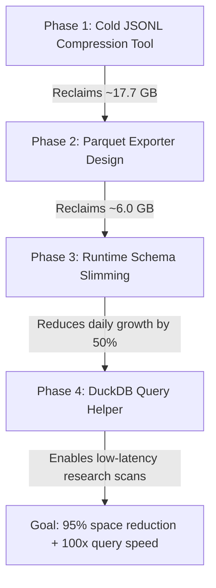

# STORAGE ARCHITECTURE ACTION PLAN (STORAGE_ARCHITECTURE_ACTION_PLAN_001)

This action plan details a phased roadmap to transition the quant engine's logging from verbose flat JSONL text files to a compact, high-performance columnar research warehouse, while achieving immediate short-term disk relief.

---

## 1. Phased Implementation Roadmap



### Phase 1: Cold JSONL Compression Tool Design
- **Objective:** Develop a robust CLI utility supporting `--dry-run` to compress cold JSONL logs older than 7 days using Zstandard/Gzip.
- **Safety Locks:** Programmatic safety overrides protecting current active day files, `trade_journal/` (cash balances/fills), and `phase_b_daily_snapshots/`.

### Phase 2: Parquet Exporter Design
- **Objective:** Build a daily background ETL script that ingests rolled-over JSONL logs, filters out redundant keys, and exports them to Snappy-compressed Parquet files.
- **Target:** Columnar conversion of `research_log/` and `decision_log/` files.

### Phase 3: Runtime Logging Schema Slimming
- **Objective:** Refactor the runtime logging code to eliminate massive field duplications.
- **Tasks:**
  - Introduce an environment flag (`SLIM_LOGGING=true`) to disable/enable the nested `payload.display` block in `decision_log`.
  - Modify `research_log` to log the full state only on cycle start/entry and write lightweight "delta" updates (event header + changed fields) on intermediate lifecycle milestones.

### Phase 4: DuckDB Query Helper
- **Objective:** Implement a lightweight local Python class wrapper (`quant_warehouse.py`) utilizing DuckDB to perform seamless queries directly across partitioned Parquet directories.

---

## 2. Short-Term Log Compression Plan

To provide immediate disk relief, we propose a safe compression utility:

- **Target Files:** Any `decision_log`, `research_log`, or `risk_log` JSONL file in `runtime/quant_data/` older than 7 days.
- **Algorithm:** Zstandard (`zstd` at level 3) for maximum compression/decompression speeds, with a fallback to `gzip` if dependencies are missing.
- **Manifest and Restore Plan:**
  - Every compression run writes a JSON manifest (`compression_manifest_*.json`) detailing the target paths and original size.
  - A corresponding rollback switch (`--restore`) decompresses files back to raw JSONL by reading the manifest.
- **Protection Rules:**
  - **Current Day Shield:** Current UTC date `YYYY-MM-DD.jsonl` is excluded at runtime.
  - **Source of Truth Shield:** Global folder exclusions for `trade_journal/`, `phase_b_daily_snapshots/`, and `ownership/`.

---

## 3. Runtime Schema Slimming Specifications

### Slimming `decision_log`
- **Current Bloat:** The nested `display` dictionary is a redundant copy of the root `payload` (sharing **281 overlapping keys**), representing **70.8%** of the payload footprint.
- **Action:** Feature-flag `payload.display` to be skipped in production/paper modes:
  ```python
  if settings.SLIM_LOGGING:
      # Exclude display dict from JSONL serialization
      payload.pop("display", None)
  ```
- **Routing Display Data:** If display output is needed for terminal monitoring, format the console display stream *in memory* inside `utils/display.py` instead of serializing it to disk.

### Slimming `research_log`
- **Current Bloat:** The engine writes up to 17 KB per transition event inside a 5-minute scan cycle, repeating the entire state.
- **Action:** Transition to a delta-based log protocol:
  1. **Snapshot Event:** Log the complete baseline state at cycle discovery (`event_subtype = discovery`).
  2. **Delta Events:** For intermediate milestones (e.g. `model_called`, `risk_checked`), write only the changed fields:
     ```json
     {
       "event_type": "research_snapshot",
       "event_subtype": "delta_update",
       "timestamp_utc": "2026-06-22T19:22:49Z",
       "changed_fields": {
         "probability_model_called": true,
         "readiness_confidence": 0.65
       }
     }
     ```
- **High-Value Research Fields to Preserve:**
  - Market identifiers: `ticker`, `condition_id`, `yes_token_id`, `no_token_id`.
  - Signal metrics: `yes_bid`, `yes_ask`, `yes_mid`, `spread`, `volatility_score`, `trend_regime`.
  - Model outputs: `true_probability`, `regime_reason`, `score`.

---

## 4. Research Warehouse & Parquet Architecture

We propose migrating historical logs to a local columnar database format:

### Directory Partition Layout
```text
runtime/research_warehouse/
  ├── parquet/
  │     ├── log_type=decision_log/
  │     │     └── year=YYYY/month=MM/day=DD/
  │     │           ├── BTC.parquet
  │     │           └── ETH.parquet
  │     ├── log_type=research_log/
  │     │     └── year=YYYY/month=MM/day=DD/
  │     │           └── BTC.parquet
  │     │           └── ETH.parquet
  │     └── log_type=market_snapshots/
  │           └── year=YYYY/month=MM/day=DD/
  │                 └── BTC.parquet
  ├── duckdb/
  │     └── quant_research.duckdb
  └── manifests/
        └── archive_manifest_001.json
```

### Partition Strategy
- Partition by **`log_type`** at the top level to segregate disjoint schemas.
- Partition by **`year/month/day`** to allow efficient date-range filtering.
- Partition by **`asset`** (BTC, ETH) inside the date folders to speed up single-asset scans.

### DuckDB Query Interface Example
```python
import duckdb

# Connect to local database file
con = duckdb.connect("runtime/research_warehouse/duckdb/quant_research.duckdb")

# Scan Parquet files directly across partitions
con.execute("""
    SELECT year, month, day, ticker, AVG(yes_mid) as avg_mid 
    FROM read_parquet('runtime/research_warehouse/parquet/log_type=research_log/*/*/*/*.parquet')
    WHERE ticker = 'BTC'
    GROUP BY year, month, day, ticker
    ORDER BY year, month, day
""")
```

---

## 5. Data Lifecycle Policy

The proposed retention and compression policy balances operational needs and research value:

| Data Type | Raw JSONL | Compressed JSONL | Parquet Warehouse |
| :--- | :--- | :--- | :--- |
| **`trade_journal/`** | **Forever** (Keep) | N/A | N/A |
| **`decision_log/`** | 7 Days | 90 Days | **Forever** (Archived) |
| **`research_log/`** | 7 Days | 90 Days | **Forever** (Archived) |
| **`market_snapshots/`**| 3 Days | 30 Days | **Forever** (Archived) |
| **`risk_log/`** | 14 Days | 90 Days | N/A (Pruned) |
| **`system_health/`** | 30 Days | N/A (Pruned) | N/A |

---

## 6. Validation & Integrity Plan

Prior to purging any flat JSONL files, the exporter utility must pass a strict three-tier verification check:

1. **Parity Check:**
   - Execute a row-count parity check comparing the source JSONL records against the exported Parquet row counts:
     $$\text{JSONL Row Count} = \text{Parquet Row Count}$$
2. **Integrity Manifest:**
   - Compute MD5/SHA-256 hashes of the raw input JSONL files and store them in the warehouse manifests directory (`manifests/archive_manifest_*.json`).
3. **Parity Queries:**
   - Execute test aggregations (e.g. `SUM(yes_mid)` and `COUNT(*)`) on both raw JSONL and Parquet, verifying identical values.
4. **Restore Test:**
   - Programmatically reconstruct a daily JSONL file from the Parquet partition and verify that it matches the original format.

---

## 7. Final Verdict

The phased storage architecture successfully resolves the storage growth threat while preserving historical research data.

> [!IMPORTANT]
> **VERDICT: READY_FOR_COLD_JSONL_COMPRESSION_TOOL_DESIGN**
