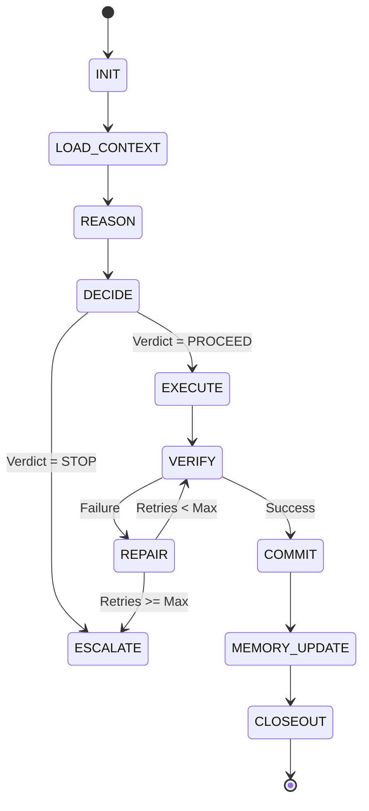

# FLAOS Supervisor Engine - Architectural Specification

## 1. Executive Summary & Objective
The **FLAOS Supervisor Engine** is the central orchestration and lifecycle coordination layer of FLAOS. It is responsible for driving the execution of tasks through their entire state progression, executing repair loops when verification fails, and enforcing hard safety boundaries.

---

## 2. Rationale: Why Supervisor is Needed
Following the design of the **Context Builder** (which aggregates context) and the **Decision Engine** (which evaluates invariants), the system needs a central process coordinator. Without a Supervisor:
- **State transitions are manual:** Process flows depend on external agents moving files.
- **Failures halt the system entirely:** If a test fails, the agent stops instead of executing a structured repair loop.
- **Auditing is unstructured:** Telemetry is gathered ad hoc rather than emitted as unified lifecycle events.

The Supervisor acts as the "kernel" of FLAOS, managing context flow, running tests, invoking repair loops, and writing persistent memory states.

---

## 3. Inputs
The Supervisor monitors the following inputs during orchestration:
- **Bootstrap Snapshot**: Task ID, class, and pipeline definitions.
- **ContextBundle**: Unified input metadata from the Context Builder.
- **Reasoning Output**: Output maps and strategy hypotheses.
- **Decision Output**: The deterministic verdict (`PROCEED`, `STOP`, etc.).
- **Execution Result**: Return codes and logs from executed subcommands.
- **Health Report**: System locks and resource utilization metrics.
- **Graph Query Output**: Blast radius metrics.
- **Memory OS**: Core safety and telemetry registers.

---

## 4. Supervisor State Machine
The Supervisor cycles through 11 distinct execution states:



- **`INIT`**: Resolves command arguments and checks environment flags.
- **`LOAD_CONTEXT`**: Invokes Context Builder to compile the `ContextBundle`.
- **`REASON`**: Feeds the bundle to the Reasoning Engine to evaluate models.
- **`DECIDE`**: Submits context and reasoning to the Decision Engine to verify invariants.
- **`EXECUTE`**: Spawns subcommands asynchronously under log redirection.
- **`VERIFY`**: Runs target test commands (e.g. pytest).
- **`REPAIR`**: Modifies files, records repair notes, and increments repair counters.
- **`ESCALATE`**: Halts execution, writes STOP alerts, and exits.
- **`COMMIT`**: Stages and commits code/docs per pipeline policies.
- **`MEMORY_UPDATE`**: Writes loop memory logs and indexes registries in Memory OS V2.
- **`CLOSEOUT`**: Releases locks and exits cleanly.

---

## 5. Stop Conditions
The Supervisor forces a transition to `ESCALATE` if:
1. Safety Memory is missing or corrupted.
2. Graph Query output is missing for Class 6+ tasks.
3. Forbidden scopes (e.g. `polymarket/`, `config/`, `.env`) are modified.
4. Unauthorized modifications to execution, risk, sizing, or wallet code are detected.
5. The maximum repair budget (e.g., 3 attempts) is exceeded.

---

## 6. Repair & Human Authorization Policies
- **Repair Policy**: The Supervisor executes a repair loop when `VERIFY` fails, capturing terminal error diagnostics and feeding them back to the agent context. Max repairs are constrained by the matched pipeline limit.
- **Human Authorization Policy**: For Class 8 (Live Risk) or Class 7 tasks with CRITICAL triggers, the Supervisor halts at the `DECIDE` state and waits for human operator approval before proceeding to `EXECUTE`.

---

## 7. Integration & Event Model
The Supervisor emits unified events during transitions:
```json
{
  "event_id": "EVT-YYYYMMDD-HHMMSS-UUID",
  "task_id": "TASK_ID",
  "timestamp": "ISO_8601_TIMESTAMP",
  "from_state": "VERIFY",
  "to_state": "REPAIR",
  "details": {
    "reason": "pytest failed in test_flaos_runtime_session.py",
    "repair_attempt": 1
  }
}
```

---

## 8. Migration Roadmap
1. **v1 Design Specification**: Completed in `docs/architecture/SUPERVISOR_ENGINE_001.md`.
2. **v2 Supervisor Checklist**: Formalize manual verification checklists for the supervisor transitions.
3. **v3 Python Supervisor (Phase A)**: Develop `tools/flaos/supervisor.py` managing docs/tooling loops.
4. **v4 Repair Integration (Phase B)**: Automate compiler and test error extraction into repair loops.
5. **v5 Autonomous Loop (Phase C)**: Implement autonomous continuous integration monitoring.
