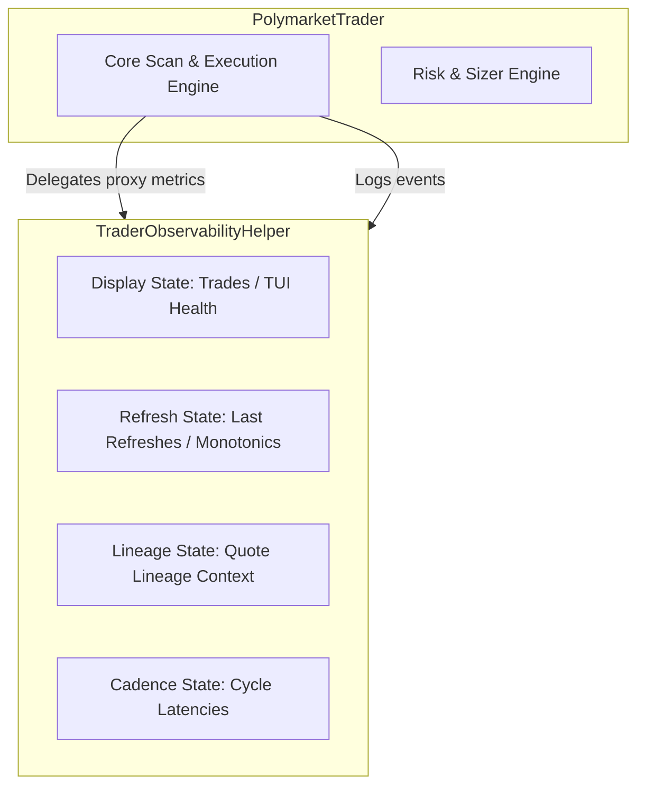

# Batch 3B Gate Check (Observability & Telemetry Extraction Audit)

**Date:** 2026-06-27  
**Role:** 29_ARCHITECTURE_GOVERNANCE_AGENT  
**Supporting Role:** 27_VERIFICATION_OFFICER_AGENT  
**Task Class:** 2 (DESIGN_ONLY / AUDIT)  
**Verdict:** PROCEED_BATCH_3B  
**Active Question Status:** OPEN — LOW_PRICE_TRUTH_RESOLUTION_001  

---

## 1. Objective & Current Git State
This gate check performs a dependency audit of the remaining observability, telemetry, and logging variables/methods in `polymarket/trader.py` to identify safe extraction boundaries for **Refactor Batch 3B**.
- **HEAD Commit:** `c1ffbd7` (docs: add batch 3A commit artifacts)
- **Working Tree:** Clean (working tree clean, no modified files)

---

## 2. Dependency Audit & Extraction Scores

For every remaining telemetry target, we evaluate read/write locations, runtime dependencies, risk profile, and assign a **Safe Extraction Score (1-10)**.

### 2.1 State Containers (Group A)

#### 1. `_last_orderbook_refresh_*`
- **Fields:** `_last_orderbook_refresh_at_utc`, `_last_orderbook_refresh_monotonic`, `_last_orderbook_refresh_source`, `_last_orderbook_refresh_trigger`, `_last_orderbook_refresh_token_pair_key`
- **Read Locations:** `_phase4_build_quote_lineage` (L1169), `_scheduler_cadence_observability_detail` (L1317), `_orderbook_refresh_observability_detail` (L1383, L1409, L1444)
- **Write Locations:** `_mark_orderbook_refresh` (L1359-1363), `__init__` constructor
- **Dependencies:** None on execution/risk. Checked only for event logging.
- **Classification:** **OBSERVABILITY_ONLY**
- **Safe Extraction Score:** 9/10 (Pure state dictionary)

#### 2. `_last_successful_yes_no_book_*`
- **Fields:** `_last_successful_yes_no_book_at_utc`, `_last_successful_yes_no_book_monotonic`, `_last_successful_yes_no_book_token_pair_key`
- **Read Locations:** `_phase4_build_quote_lineage` (L1167-1168), `_scheduler_cadence_observability_detail` (L1267, L1301-1302), `_orderbook_refresh_observability_detail` (L1384, L1410, L1446)
- **Write Locations:** `_mark_orderbook_refresh` (L1365-1367), `__init__` constructor
- **Dependencies:** Observability event tracking only.
- **Classification:** **OBSERVABILITY_ONLY**
- **Safe Extraction Score:** 9/10

#### 3. `_last_quote_lineage_context`
- **Field:** `_last_quote_lineage_context` (dictionary)
- **Read Locations:** `_phase4_quote_lineage_carry` (L1193)
- **Write Locations:** `_phase4_build_quote_lineage` (L1184-1186), `__init__` constructor
- **Dependencies:** Observability tracking to carry lineages.
- **Classification:** **OBSERVABILITY_ONLY**
- **Safe Extraction Score:** 9/10

#### 4. `_last_decision_cycle_monotonic`
- **Field:** `_last_decision_cycle_monotonic` (dictionary)
- **Read Locations:** `_orderbook_refresh_observability_detail` (L1385)
- **Write Locations:** `_orderbook_refresh_observability_detail` (L1390-1392), `__init__` constructor
- **Dependencies:** Tracking cycle intervals.
- **Classification:** **OBSERVABILITY_ONLY**
- **Safe Extraction Score:** 9/10

#### 5. `_market_evaluation_started_*`
- **Fields:** `_market_evaluation_started_monotonic`, `_market_evaluation_started_at_utc`
- **Read Locations:** `_scheduler_cadence_observability_detail` (L1266, L1283)
- **Write Locations:** `set_runtime_cadence_observability` (L1210-1211), `_mark_market_evaluation_started` (L1254-1255), `__init__` constructor
- **Dependencies:** Diagnostics only.
- **Classification:** **OBSERVABILITY_ONLY**
- **Safe Extraction Score:** 9/10

#### 6. `_current_cycle_market_sequence_*`
- **Fields:** `_current_cycle_market_sequence_index`, `_current_cycle_market_sequence_count`
- **Read Locations:** `_scheduler_cadence_observability_detail` (L1284-1285)
- **Write Locations:** `set_runtime_cadence_observability` (L1212-1213), `_mark_market_evaluation_started` (L1257-1259), `__init__` constructor
- **Dependencies:** Diagnostics only.
- **Classification:** **OBSERVABILITY_ONLY**
- **Safe Extraction Score:** 9/10

---

### 2.2 Telemetry & Utility Methods (Group B)

#### 7. `_mark_orderbook_refresh`
- **Read/Call Locations:** `PolymarketTrader` orderbook fetch/updates (L3503, L7988, L8029, L8907, L8923)
- **Dependencies:** Only writes to Group A timing trackers.
- **Classification:** **OBSERVABILITY_ONLY**
- **Safe Extraction Score:** 8/10 (Requires clean proxy shimming)

#### 8. `_orderbook_refresh_observability_detail`
- **Read/Call Locations:** Decision log builders (L4037, L8756, L8969)
- **Dependencies:** Purely returns formatted observability metrics.
- **Classification:** **OBSERVABILITY_ONLY**
- **Safe Extraction Score:** 8/10

#### 9. `_scheduler_cadence_observability_detail`
- **Read/Call Locations:** Decision/skip telemetry logs (L3983, L5493)
- **Dependencies:** Computes elapsed latency between cycles.
- **Classification:** **OBSERVABILITY_ONLY**
- **Safe Extraction Score:** 8/10

#### 10. `_emit_hybrid_v1_snapshot`
- **Read/Call Locations:** Passive shadow telemetry (L4401)
- **Dependencies:** Formats timing arrays and calls `_emit_quant_event`.
- **Classification:** **OBSERVABILITY_ONLY**
- **Safe Extraction Score:** 8/10

#### 11. `_event_producer_label`
- **Read/Call Locations:** `_emit_quant_event` (L1100, L1144)
- **Dependencies:** Maps logger strings. Stateless mapping.
- **Classification:** **OBSERVABILITY_ONLY**
- **Safe Extraction Score:** 7/10

---

### 2.3 Boundary-Line / Execution-Coupled Helpers (Group C)

#### 12. `_phase4_build_quote_lineage`
- **Read/Call Locations:** Decision loop (L4365) and **live order submission path** (L11777)
- **Dependencies:** Reads successful yes/no orderbooks. Computes lineage hash.
- **Classification:** **OBSERVABILITY_ONLY** (called from **EXECUTION_COUPLED** path)
- **Safe Extraction Score:** 6/10 (High risk of breaking execution if shimming fails)

#### 13. `_phase4_quote_lineage_carry`
- **Read/Call Locations:** Order logging (L11669) and **live order submission path** (L11775)
- **Dependencies:** Reads `_last_quote_lineage_context`.
- **Classification:** **OBSERVABILITY_ONLY** (called from **EXECUTION_COUPLED** path)
- **Safe Extraction Score:** 6/10

---

### 2.4 Forbidden / Deeply Coupled Target Helpers (Group D)

#### 14. `_risk_plan_zero_diagnostics`
- **Read/Call Locations:** Decision skip candidates (L4126, L9655)
- **Dependencies:** Reads core fields: `self._bankroll_tier_detail()`, `self._bankroll_mode()`, `self._micro_survival_active()`, `self._micro_position_size()`, `self._risk_mode_state`.
- **Classification:** **RISK_COUPLED** / **DECISION_COUPLED**
- **Safe Extraction Score:** 3/10 (Extracting this would back-couple the helper to core risk/sizing components)

#### 15. `_diagnostic_float` & `_diagnostic_int`
- **Read/Call Locations:** Called from hundreds of locations in pricing, thresholds, sizes, and telemetry.
- **Dependencies:** Stateless float/int formatting.
- **Classification:** **RUNTIME_COUPLED**
- **Safe Extraction Score:** 1/10 (Extremely high blast radius with zero structural cleanup benefit. Must remain in core/utils).

---

## 3. Architecture Graphs & Boundaries

### Ownership Graph (Proposed Batch 3B)



### Safe Extraction Groups (Allowed for Batch 3B)
- **Group 1 (State):** `_last_orderbook_refresh_*`, `_last_successful_yes_no_book_*`, `_last_quote_lineage_context`, `_last_decision_cycle_monotonic`, `_market_evaluation_started_*`, `_current_cycle_market_sequence_*`
- **Group 2 (Methods):** `_mark_orderbook_refresh`, `_orderbook_refresh_observability_detail`, `_scheduler_cadence_observability_detail`, `_emit_hybrid_v1_snapshot`

### Forbidden Groups (Not Allowed for Batch 3B)
- **Stateless Helpers:** `_diagnostic_float`, `_diagnostic_int` (Must remain static helpers on `PolymarketTrader` or inside a shared utils library).
- **Deeply Coupled Risk Diagnostics:** `_risk_plan_zero_diagnostics` (Must remain inside `PolymarketTrader` to prevent cyclical imports/dependencies to sizing engine).
- **Execution-Coupled Lineage Builders:** `_phase4_build_quote_lineage`, `_phase4_quote_lineage_carry` (Defer to a later batch; keep shims clean as they are called from order submission paths).

---

## 4. Blast Radius Assessment
- **Downstream dashboard systems:** Zero blast radius (delegation properties preserve interface).
- **Execution loops:** Zero blast radius if Group A/B only is targeted.
- **Testing suite:** Medium blast radius. A few mock tests override `_last_successful_yes_no_book_at_utc`. Proxy shims or properties must resolve these correctly.

---

## 5. Recommended Batch 3B Scope
We recommend **Option C (Reduced/Targeted Extraction)**:
1. Extract Group 1 state containers and Group 2 formatting methods to `TraderObservabilityHelper`.
2. Keep `_diagnostic_float`, `_diagnostic_int`, `_risk_plan_zero_diagnostics`, and the execution-coupled `_phase4_` lineage methods in `PolymarketTrader` (delegating lineage properties if needed).
3. Implement clean property shims in `PolymarketTrader` (e.g. `@property` for `_last_successful_yes_no_book_at_utc`) to maintain 100% test compatibility for tests that write/read mock values directly.

---

## 6. Final Verdict

```
PROCEED_BATCH_3B
```
