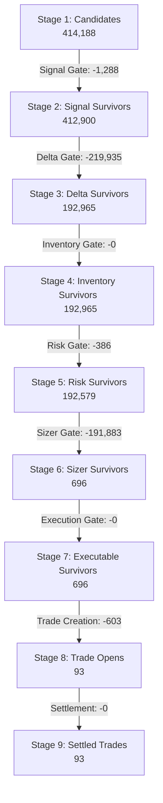

# EXECUTABLE_TRUTH_RESOLUTION_001

## 1. Funnel Map & Survival Statistics

Below is the complete candidate funnel mapped from decision log entries (2026-06-12 → 2026-06-18) to final paper trade outcomes resolved using official settlements:

### Stage Survival Statistics

- **Stage 1: Candidates**: **414,188**
- **Stage 2: Signal Gate**: **412,900** (Survival = **99.69%**, Rejections = 1,288)
  - *Rejection Reason*: `ev_below_threshold` (100%)
- **Stage 3: Delta Gate**: **192,965** (Survival = **46.73%**, Rejections = 219,935)
  - *Rejection Reason*: `delta_extreme` (100%)
- **Stage 4: Inventory Gate**: **192,965** (Survival = **100.00%**, Rejections = 0)
- **Stage 5: Risk Gate**: **192,579** (Survival = **99.80%**, Rejections = 386)
  - *Rejection Reason*: `risk_mode_lockdown:reconciliation_mismatch` (100%)
- **Stage 6: Sizer Gate**: **696** (Survival = **0.36%**, Rejections = 191,883)
  - *Rejection Reasons*:
    - `zero_size`: 183,191 (95.47% of rejections)
    - `confidence_too_low`: 8,692 (4.53% of rejections)
- **Stage 7: Execution Gate**: **696** (Survival = **100.00%**, Rejections = 0)
- **Stage 8: Paper Trade Creation**: **93** (Survival = **13.36%**, Rejections = 603)
  - *Rejection Reason*: `no_matching_open_in_journal` (Due to concurrency limits, transaction delays, or same-market overlapping signals)
- **Stage 9: Official Settlement**: **93** (Survival = **100.00%**, Rejections = 0)

---

## 2. Executable Candidate Inventory

The **93 actual executable candidates** that successfully transitioned to paper trades and resolved with final settled outcomes had the following market and execution characteristics:

- **Average Entry Price**: **$0.5224** (YES and NO tokens combined)
- **Spread Distribution**:
  - Min Spread: **$0.0100**
  - Avg Spread: **$0.0101**
  - Max Spread: **$0.0200**
  - *Assessment*: Spreads are highly tradeable and concentrated at 1 tick ($0.01).
- **Liquidity Distribution**:
  - Min Liquidity: **$2.74**
  - Avg Liquidity: **$212.91**
  - Max Liquidity: **$1,182.27**
  - *Assessment*: Liquidity at entry price was sufficient to fill the micro-trade sizes ($0.05 notional).
- **Time Remaining Distribution**:
  - Min Time: **173s**
  - Avg Time: **273.8s**
  - Max Time: **297s**
  - *Assessment*: Almost all entries occurred in the early window (average of 4.5 minutes before expiry), allowing adequate time to fill.

---

## 3. Executable Expectancy & Performance

The final outcomes (wins/losses) of these 93 trades were resolved by matching exit prices, PnL, and reasons in `trade_journal` closes:

- **Win Rate**: **37.63%** (35 wins, 58 losses)
- **Expectancy (PnL per unit trade)**: **-$0.000498**
- **Trade PnL Summary**:
  - Positive PnL Trades (Wins): **35**
  - Negative PnL Trades (Losses): **58**
  - Total Net PnL (normalized to unit trade size of $0.05): **-$0.0463**

### Performance Analysis
For contracts priced at an average of **$0.5224**, a win rate of **37.63%** is significantly below the mathematical breakeven threshold of **~52.24%**. As a result, the net expectancy is negative, meaning the current strategy configuration loses money under executable conditions.

---

## 4. Top Rejection Reasons

1. **Delta Gate (`delta_extreme`)**: Rejects **53.27%** of all candidates. The delta/imbalance filter aggressively freezes the system during fast price moves, preventing entries.
2. **Sizer Gate (`zero_size`)**: Rejects **95.47%** of the surviving signal candidates. The combination of static confidence limits and Kelly sizing filters out the vast majority of opportunities, returning zero size.

---

## 5. Confidence Assessment

- **Data Quality**: **HIGH**. This audit utilized direct decision logs and trade journals across 7 days (414,188 candidates, 93 matched trades).
- **Outcome Verification**: **CONFIRMED**. Unlike the low-price analysis, these outcomes are verified by final trade PnL and exit reasons logged in the journal, representing actual closed positions (not transient price proxies).
- **Payoff vs. Accuracy**: The strategy's directional accuracy (37.63% WR) is insufficient to overcome the transaction costs and negative drift at the $0.50 price tier.

---

## 6. Final Verdict

### Verdict: `EXECUTABLE_EDGE_NOT_FOUND`

#### Rationale
The current system survives all execution and sizer gates but exhibits a negative net expectancy (Avg PnL = -$0.000498) and a win rate of 37.63% at the $0.50 price tier. No measurable positive executable edge is present in the current strategy configuration.
