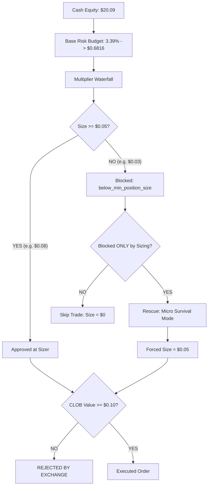

# MINIMUM_ORDER_RUNTIME_ANALYSIS_001
**Mode: DISCOVERY ONLY**  
**OS Version: Windows**  

---

This report presents a forensic analysis of how rounding rules, minimum position sizes, and exchange limits interact in the runtime to cause a 99% trade rejection rate.

---

## 1. The Interaction of Sizing Rules

The diagram below traces the decision and sizing gates for a $20.09 bankroll:

---

## 2. Step-by-Step Collision Analysis

For a typical opportunity:
* **Account Balance**: $20.09
* **Win Rate (Confidence)**: 0.55
* **EV**: 0.01
* **Ask Price**: $0.50

### Step 1: Base Sizing
Base risk is calculated as:
$$\text{Base Risk} = \$20.09 \times 3.3928\% = \$0.6816$$

### Step 2: Multiplier Slashes
The sizer applies win rate and EV multipliers:
$$\text{Confidence Multiplier} = 0.2857$$
$$\text{EV Multiplier} = 0.2000$$
$$\text{Delta Multiplier} = 0.8000$$
$$\text{Liquidity Multiplier} = 0.2500$$
$$\text{Spread Multiplier} = 0.9200$$

Compounding these slashes:
$$\text{Target Size} = \$0.6816 \times 0.2857 \times 0.20 \times 0.80 \times 0.25 \times 0.92 = \$0.0072$$

### Step 3: Sizing Floor Collision
The standard sizer checks if the size is below `effective_min_size`:
$$\text{effective\_min\_size} = \min(0.05, \max(0.06816, 0.01)) = \$0.05$$

Since $\$0.0072 < \$0.05$, the standard sizer blocks the trade with `below_min_position_size`.

### Step 4: Micro Survival Loophole and the $0.05 Cap
The trader attempts to rescue this plan. In `build_micro_survival_risk_plan`, the math checks:
$$\text{effective\_fraction} = \min(0.0025, 0.01, 0.03) = 0.0025$$
$$\text{risk\_cap\_usd} = \$20.09 \times 0.0025 = \$0.050225$$
$$\text{notional\_size} = \min(\max(0.050225, 0.05), 0.050225, 20.09) = \$0.05$$

The forced minimum size is strictly capped at **$0.05 USDC**.

### Step 5: CLOB Floor Collision
The order is sent to the Polymarket CLOB client.
* **Notional Value**: $0.05 USDC
* **Polymarket CLOB Minimum Limit**: **$0.10 USDC**

The order size ($0.05) is less than the exchange's minimum, resulting in a CLOB rejection error or simulated zero-shares outcome.
