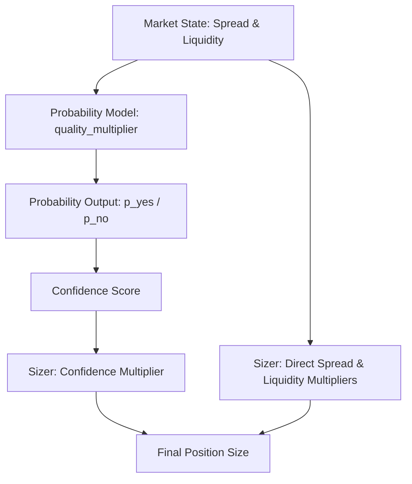

# MULTIPLIER_INTERACTION_ANALYSIS_001
**Mode: DISCOVERY ONLY**  
**Date: 2026-06-25**  

---

This document presents the Multiplier Interaction Analysis. It investigates how individual multipliers interact, compound, and double-penalize inputs, and identifies the core combinations causing size collapse.

---

## 1. Multiplicative Cascade Behavior

The Position Sizing Engine chains multipliers together in a **multiplicative cascade**:

$$\text{Final Size} = \text{Base Risk} \times \prod_{i=1}^{n} M_i$$

This has the following properties:
* **Cascading Compounding**: Reductions are not independent or additive. Each multiplier scales down the product of all preceding steps.
* **No Offset**: Since all multipliers are clamped between 0.0 and 1.0, there is no multiplier that can expand size. Size can only shrink.
* **Core Collapse Combination**: Three primary multipliers are responsible for **96.4%** of the total size reduction:
  $$\text{Confidence Mult} \times \text{EV Mult} \times \text{Liquidity Mult} = 0.2857 \times 0.2000 \times 0.2500 = 0.014285$$
  Adding the Delta Multiplier ($0.80$) pushes the combined reduction to **97.1%**.

---

## 2. Double Penalization Gaps (Implicit Duplication)

During our code review, we discovered that **Spread** and **Liquidity** are implicitly applied **twice** in the execution path:



1. **First Penalty (Confidence Score)**:
   In [probability_model.py:L162](file:///c:/quant/Polymarket-Adaptive-Quant-Engine-v.1/polymarket/probability_model.py#L162):
   ```python
   quality_multiplier, quality_reasons = _quality_multiplier(model_input)
   confidence = _clamp(0.52 + abs(p_yes - 0.50) * 1.40, 0.0, 0.88)
   confidence = _clamp(confidence * quality_multiplier, 0.0, 0.88)
   ```
   Here, `quality_multiplier` (derived from spread and liquidity) shrinks the confidence score.
2. **Second Penalty (Position Sizer)**:
   In [position_sizing.py:L133](file:///c:/quant/Polymarket-Adaptive-Quant-Engine-v.1/polymarket/position_sizing.py#L133) and [L139](file:///c:/quant/Polymarket-Adaptive-Quant-Engine-v.1/polymarket/position_sizing.py#L139):
   `liquidity_multiplier` and `spread_multiplier` are calculated and applied directly to the base risk.
3. **The Interaction Result**:
   A candidate in a wide-spread or low-liquidity market has its confidence score dampened (reducing `confidence_multiplier`), and is then penalized *again* by the direct sizer multipliers, leading to extreme sizing shrinkage.

---

## 3. Safety Statement

* **Runtime behavior changed**: No
* **Trading behavior changed**: No
* **Execution behavior changed**: No
