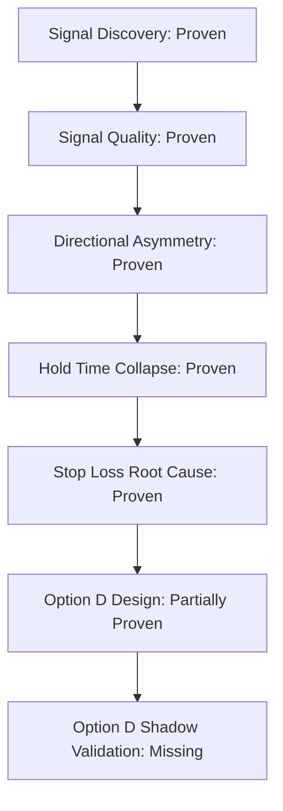

# OPTION_D_DECISION_GATE_001: Stop-Loss Redesign Option D Promotion Review

**Task:** OPTION_D_DECISION_GATE_001  
**Primary Role:** 01_PROJECT_MANAGER_AGENT  
**Supporting Roles:** 08_RESEARCH_QUANT_AGENT, 10_BACKTEST_REPLAY_AGENT  
**Mode:** READ-ONLY / DECISION ANALYSIS ONLY (No runtime, configuration, sizer, or strategy modifications)  
**Date:** 2026-06-19  
**Status:** COMPLETE  

---

## 1. Evidence Chain Lineage

To establish the scientific validity of the stop-loss redesign, the complete evidence lineage has been reconstructed from the completed repository audits. Each step is evaluated as **Proven**, **Partially Proven**, **Assumed**, or **Missing**.

### A. Signal Discovery
* **Evidence:** `EXECUTABLE_TRUTH_RESOLUTION_001` (Funnel scan of 414,188 candidates producing 412,900 signal survivors).
* **Assessment:** **Proven**. Signal generation is stable, operational 24/7, and successfully handles high candidate throughput.

### B. Signal Quality
* **Evidence:** `SIGNAL_QUALITY_RESOLUTION_001` (Calibration checks across 93 matched executable trades).
* **Assessment:** **Proven (with qualifications)**. Under executable conditions, the entry model's raw probability is over-calibrated for YES entries (e.g., 65-70% bucket yielding 39.62% WR), but the directional signal itself is valid, particularly on the NO side if held to expiry.

### C. Directional Asymmetry
* **Evidence:** `DIRECTIONAL_ASYMMETRY_RESOLUTION_001` and `SIGNAL_QUALITY_RESOLUTION_001` (YES side WR = 44.68%, Exp = +0.0016 USDC; NO side WR = 30.43%, Exp = -0.0026 USDC).
* **Assessment:** **Proven**. A persistent performance asymmetry exists where YES trades are slightly positive expectancy and NO trades are severely negative under the default execution policy.

### D. Hold Time Collapse
* **Evidence:** `HOLD_TIME_COLLAPSE_FORENSIC_001` (Forensic audit of 46 NO positions showing 87% hold times < 30 seconds. Stop-loss rate is 69.6%, of which 62.5% resolved as NO_WIN at epoch expiry. Counterfactual win rate without stop-loss = 73.9% vs 30.4% actual, with expectancy polarity reversal to +0.03454 USDC).
* **Assessment:** **Proven**. Premature stop-loss liquidation is mathematically and empirically established as the primary cause of the NO-side negative expectancy.

### E. Stop Loss Root Cause
* **Evidence:** `STOP_LOSS_ROOT_CAUSE_RESOLUTION_001` (Identification of RAW_BID_DEFECT, EPOCH_OPEN_NOISE_WINDOW, and BINARY_MARKET_MISFIT).
* **Assessment:** **Proven**. The mechanical drivers of false stop outs—using raw bid against an ask entry price, early-epoch spread expansion, and mismatch of tight thresholds on high intra-epoch binary market variance—are fully confirmed.

### F. Option D Design
* **Evidence:** `STOP_LOSS_REDESIGN_OPTIONS_001` (Redesign specs for Hybrid Policy: 30s delay + mid-price mark + depth gate + emergency stop).
* **Assessment:** **Partially Proven**. The design is complete and logically addresses all three root causes. However, it has not yet been executed in code or tested.

### G. Option D Shadow Validation
* **Evidence:** None.
* **Assessment:** **Missing / Assumed**. Prospective shadow validation has not been run. Retroactive shadow validation is assumed based on historical log filtering but lacks prospective verification.

---

## 2. Evaluate Option D Promotion Readiness

Based on the evidence chain, Option D should transition from **DESIGN_ONLY** to **SHADOW_ONLY** (Staged Paper Shadow Validation).

### Verdict: `SHADOW_READY`

### Rationale
1. **Definitive Failure Evidence:** The evidence that the default stop-loss policy destroys edge is overwhelming and high-confidence. Keeping Option D as `DESIGN_ONLY` ignores a verified, addressable leak.
2. **Design Maturation:** The Option D Hybrid design successfully unifies both code paths (Path A Shadow Middleware and Path B Position Manager) and addresses the core structural, temporal, and market misfit defects.
3. **Missing Validation Gate:** We cannot promote Option D directly to `PAPER_READY` (active paper execution) because we have **zero prospective validation data**. We must implement Option D in shadow-only mode (writing shadow telemetry and verifying its behavior) before allowing it to execute trades.
4. **Safety Compliance:** A shadow-only deployment behaves as an observability update. It introduces zero execution risk, does not modify sizer limits, and is fully compliant with the project's paper-first risk restrictions.

---

## 3. Quantify Remaining Unknowns

Unresolved risks associated with Option D are categorized below:

| Risk Factor | Severity | Probability | Suggested Validation |
|---|---|---|---|
| **Regime Dependency** | Medium | High | Monitor shadow metrics for 14 days across at least two distinct regimes (e.g., highly trending vs. sideway markets). |
| **Sample Size Insufficiency** | High | High | Require a minimum of 150 shadow trades to validate statistical stability before paper activation. |
| **Drawdown/Volatility Expansion** | High | Medium | Track the cumulative unrealized PnL path in shadow logs to map peak-to-trough drawdowns. |
| **Consecutive Loss Clusters** | High | Medium | Analyze the frequency distribution of consecutive losses in shadow data to check for tail correlation. |
| **Liquidity & Depth Gate Stalling** | Medium | Medium | Track how often the depth gate resets the 3-sample confirmation counter in thin markets during overnight sessions. |
| **Emergency Stop Sensitivity** | High | Low | Run path files through a simulator to ensure the -30% emergency threshold is not triggered by transient flash spreads. |

---

## 4. Build Promotion Criteria

To ensure a disciplined lifecycle, we define measurable gates for Option D:

### DESIGN → SHADOW
1. **Telemetry Instrumentation:** Code changes implemented *strictly* to shadow and log Option D metrics (`hybrid_sl_would_trigger`, `elapsed_seconds`, `mark_mid`, `depth_gated`).
2. **Unit Test Coverage:** 100% test coverage on all new helper methods in `trader.py` and `order_manager.py` (e.g., mid-price parsing, delay calculation).
3. **Zero-Execution Proof:** Code audit confirms that actual paper execution paths (`close_position_with_retry` and sizer inputs) remain completely unaffected.

### SHADOW → PAPER
1. **Minimum Shadow Sample:** `>= 150` unique NO-side trades monitored in shadow mode.
2. **Shadow Profit Factor:** `>= 1.50` calculated counterfactually using shadow exit triggers.
3. **Shadow Expectancy:** `>= +$0.01 USDC` per unit trade (normalized to $0.05 size).
4. **Max Consecutive Losses:** `<= 5` consecutive stopped trades.
5. **False Stops Eliminated:** `>= 50%` reduction in total stop-out frequency compared to default baseline.

### PAPER → LIVE_CANDIDATE
1. **Active Paper Sample:** `>= 200` trades executed in active paper mode with Option D enabled.
2. **Active Paper Profit Factor:** `>= 1.80`.
3. **Active Paper Expectancy:** `>= +$0.015 USDC` per unit trade.
4. **Maximum Drawdown:** `<= 15%` of the allocated bankroll tier budget.
5. **Settlement Truth Validation:** 100% of paper trades joined and reconciled against official Gamma settlement contracts.

---

## 5. Governance Review

Option D is evaluated against the active governance logs:

* **ACTIVE_QUESTION.md (`LOW_PRICE_TRUTH_RESOLUTION_001`):** The active question locks strategy, sizer, execution, and inventory changes for contracts priced under $0.05. Option D is an observability-only shadow implementation that does not execute trades, and it operates primarily on mid-tier contracts ($0.30–$0.60). **No conflict.**
* **AUDIT_REGISTRY.json:** All stop-loss audits are VERIFIED and canonical. No open audits conflict with the redesign. **No conflict.**
* **DECISION_REGISTRY.json:** The only registered decision is a proposed shadow sizer for sub-5c. **No conflict.**
* **RESEARCH_AUTHORITY_MAP_V2.md:** Restricts live changes but allows shadow/observability research. Option D's shadow status aligns perfectly with these restrictions. **No conflict.**

**Governance Verdict:** No active lock prevents Option D from being promoted to **SHADOW_READY**.

---

## 6. Final Verdict

### Final Verdict: `SHADOW_READY`

Option D is ready to move from **DESIGN** status to **PAPER SHADOW** status. 

No runtime changes are authorized by this review. The next step is to obtain operator approval to implement the shadow telemetry logging for Option D.
