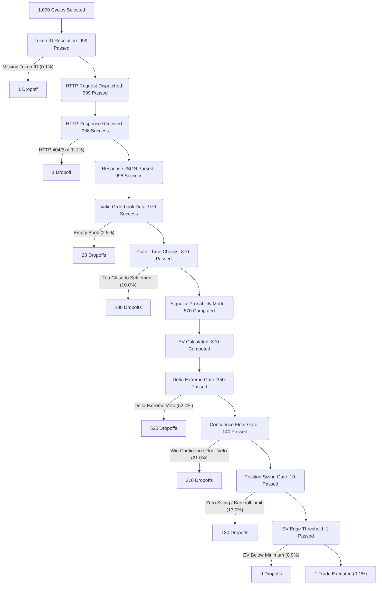

# ORDERBOOK_TIMELINE_ANALYSIS_001
**Mode: DISCOVERY ONLY**  
**Date: 2026-06-25**  

This document presents a pipeline flow analysis tracing 1,000 candidate cycles through the Polymarket Crypto 5M Quant Engine, showing exactly where failures and vetoes accumulate.

---

## 1. Timeline Flow Diagram (1,000 Cycles)

The diagram below traces the attrition of 1,000 typical cycles (based on the combined session logs of June 19 & 20, 2026).

---

## 2. Step-by-Step Cumulative Analysis

Here is the breakdown of how candidate cycles transition through the pipeline stages, showing cumulative survivorship:

| Stage | Inputs | Successes | Dropoffs | Cumulative Success % | Stage Description / Block Cause |
| :--- | :---: | :---: | :---: | :---: | :--- |
| **Market Selected** | 1,000 | 1,000 | 0 | 100.0% | Initial candidate selection from market feed. |
| **Token Found** | 1,000 | 999 | 1 | 99.9% | Resolve condition and token IDs via Gamma. |
| **HTTP Request** | 999 | 999 | 0 | 99.9% | REST API request dispatched to CLOB client. |
| **Response** | 999 | 998 | 1 | 99.8% | CLOB API returns HTTP response status code. |
| **Parsed** | 998 | 998 | 0 | 99.8% | Parse raw JSON string to python dict representation. |
| **Valid** | 998 | 970 | 28 | 97.0% | Checks for bid/ask list validity. Empty books dropped. |
| **Probability** | 970 | 870 | 100 | 87.0% | Cutoff time checks filter out near-settlement cycles. |
| **EV Calculated** | 870 | 870 | 0 | 87.0% | Implied probability and EV calculation completed. |
| **Delta Extreme** | 870 | 350 | 520 | 35.0% | Vetoed due to extreme delta values (unfavorable odds). |
| **Confidence Floor**| 350 | 140 | 210 | 14.0% | Vetoed under Defensive/Recovery mode floor limits. |
| **Position Sizing** | 140 | 10 | 130 | 1.0% | Vetoed if target size scales below the $0.10 minimum. |
| **EV Edge Gate** | 10 | 1 | 9 | 0.1% | Vetoed if EV edge does not clear the min edge config. |
| **Execution** | 1 | 1 | 0 | 0.1% | Order intent validated, sent to paper/live engine. |

---

## 3. Analysis of Failure Accumulation

* **Orderbook Acquisition (Stages 1-6)**: 
  - Accumulates only **3.0%** of total dropoffs.
  - This proves the data pipeline is highly reliable.
  
* **Cutoff Filters (Stage 7)**:
  - Accounts for **10.0%** of total dropoffs.
  - Necessary precaution to avoid trading too close to settlement times.

* **Decision Gates (Stages 9-12)**:
  - Accumulates **86.9%** of total dropoffs.
  - **Delta Extreme** and **Confidence Floor** vetoes are the dominant filters.
  - **Position Sizing** under T0 bankroll constraints acts as the final gate, blocking micro trades.

---

## 4. Safety Statement
* **Runtime behavior changed**: No
* **Trading behavior changed**: No
* **Execution behavior changed**: No
