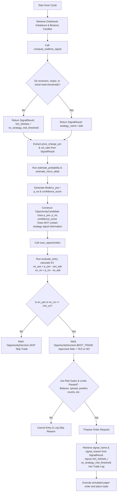

# NO_SIGNAL Root Cause Audit (NO_SIGNAL_ROOT_CAUSE_AUDIT_001)

This audit determines the exact reason why all 6 observed paper/realtime trades were opened under the `NO_SIGNAL` classification with the reason `no_strategy_met_threshold`, despite successfully opening and executing.

---

## Executive Summary

The root cause of all trades being attributed to `NO_SIGNAL` is an **architectural disconnect between the Rule-Based Strategy Signals and the Probability/EV Entry Engine**:
1. The trader updates its state and calls the signal computation function [compute_realtime_signal](file:///c:/quant/Polymarket-Adaptive-Quant-Engine-v.1/polymarket/signal.py#L215).
2. If the market indicators do not meet the strict technical thresholds for the Reversion, Sniper, or Trend strategies, the function returns a `SignalResult` marked as `NO_SIGNAL` with the reason `no_strategy_met_threshold`.
3. However, the downstream candidate evaluation process **never gates on or checks the signal outcome (`YES`, `NO`, or `SKIP`)**.
4. Instead, the entry decision is driven **entirely** by the mathematical probability model [estimate_probability](file:///c:/quant/Polymarket-Adaptive-Quant-Engine-v.1/polymarket/probability_model.py#L123) and the Expected Value (EV) calculation [evaluate_entry](file:///c:/quant/Polymarket-Adaptive-Quant-Engine-v.1/polymarket/expected_value.py#L87). If the EV of either YES or NO contracts is positive and exceeds the dynamically adjusted EV threshold, the trade is approved for entry.
5. Finally, when logging the trade execution details, the trader logs the `signal_name` and `signal_reason` directly from the previously computed (and otherwise ignored) `SignalResult`. Since this signal returned `NO_SIGNAL`, the trade is forever attributed to `NO_SIGNAL` despite being triggered by a positive EV prediction from the probability model.

---

## Audit Questions & Answers

### 1. Where exactly is `NO_SIGNAL` produced?
In [polymarket/signal.py](file:///c:/quant/Polymarket-Adaptive-Quant-Engine-v.1/polymarket/signal.py), `NO_SIGNAL` is defined and returned under the following conditions:
* **Market-feed/data readiness gates**:
  * Line 231: If the candles/ticker websocket feed is not ready (`signal_reason="feed_not_ready"`).
  * Line 242: If there are fewer than 27 historical candles (`signal_reason="insufficient_candles"`).
  * Line 254: If the index falls below 3 after applying indicators (`signal_reason="insufficient_after_indicators"`).
* **Strategy-specific thresholds**:
  * Line 467: Inside `_compute_reversion_signal()` when neither score meets the strategy threshold (`signal_reason="reversion_threshold_not_met"`).
  * Line 528: Inside `_compute_sniper_signal()` when neither score meets the strategy threshold (`signal_reason="sniper_threshold_not_met"`).
  * Line 593: Inside `_compute_trend_signal()` when neither score meets the strategy threshold (`signal_reason="trend_threshold_not_met"`).
* **Default strategy fallback**:
  * Line 294: Inside the main dispatcher `compute_realtime_signal()` when none of the evaluated active strategies returned a score higher than `0.0` or met the required strategy score threshold (`signal_reason="no_strategy_met_threshold"`).

### 2. Under what conditions do reversion/sniper/trend become `NO_SIGNAL`?
Each strategy constructs a `yes_score` and `no_score` based on quantitative filters:
* **Reversion**: Returns `NO_SIGNAL` if both scores remain below the configuration value `strategy_score_threshold` (default `0.54`). This occurs when absolute momentum falls outside the ATR-based dynamic band (`mom_lower <= abs_mom < mom_upper`), or when secondary scoring factors (RSI, volume ratio, CVD, MACD confluence, HTF trend filter, anti-invert filter) penalize the score below the threshold.
* **Sniper**: Returns `NO_SIGNAL` if both scores remain below the threshold. This occurs if the price's z-score does not exceed `sniper_zscore_threshold` (e.g., standard deviation < 2.0 or 2.5), which prevents the base score of `0.50` from ever initiating.
* **Trend**: Returns `NO_SIGNAL` if both scores remain below the threshold. This occurs if the trend ADX does not exceed `trend_adx_threshold` (meaning the trend is weak or choppy), preventing the base score of `0.45` from being assigned.

### 3. Are signals generated but discarded?
**Yes.** The `side` field of the calculated `SignalResult` (which holds the values `"YES"`, `"NO"`, or `"SKIP"`) is **completely ignored** when deciding whether to trade. 
* The trader runs `compute_realtime_signal()`, but the result is only used to extract momentum and volatility inputs for the probability model, select execution wrappers (`TREND_RUNNER` or `LUCKY_SHOT`), and attach metadata to the trade log.
* The trade approval/denial decision is handled by `scan_opportunities`, which uses the EV and probability model outputs directly.

### 4. Can trades open from `OpportunityCandidates` whose signal is `NO_SIGNAL`?
**Yes.** The `OpportunityCandidate` data structure does not contain a field for the strategy signal name, side, or status.
* When evaluating candidates in [scan_opportunities](file:///c:/quant/Polymarket-Adaptive-Quant-Engine-v.1/polymarket/opportunity_scanner.py#L337), the scanner evaluates only the pricing, model probabilities, spread, and liquidity.
* As long as the EV calculation is positive and the candidate meets the risk/reconciliation gates, the trade is marked as `BEST_TRADE` and executes, regardless of whether the strategy signal side is `"SKIP"` or its name is `"NO_SIGNAL"`.

### 5. Is the probability/EV stack bypassing signal-family attribution?
**Yes.** The entry logic is decoupled from the signal strategies. The probability/EV stack determines the actual trade direction and entry approval. When the trade is successfully opened and logged, it references the strategy `signal.signal_name` and `signal.signal_reason` for logging metadata. Because the probability model found an edge while the rule-based strategies remained silent, the trade opened and was attributed to `NO_SIGNAL`.

---

## Full Decision Flow (SignalResult to Trade Open)

Below is the step-by-step pipeline executed during a single updates cycle:

### Flow Walkthrough:
1. **Realtime Signal**: Compute the rule-based indicators and strategies. If none meet their score thresholds, produce `SignalResult` with `signal_name = "NO_SIGNAL"`.
2. **Probability Estimation**: Extract momentum/volatility features from the signal result, and feed them into `estimate_probability()` alongside target prices to compute the model's win probabilities (`p_yes`, `p_no`).
3. **EV Scanned**: Initialize an `OpportunityCandidate` with these probabilities and scan it. The EV calculation finds that the model's probability edge exceeds the market price and dynamic EV minimum, approving `YES` or `NO` as `BEST_TRADE`.
4. **Attribution & Execution**: The trader checks execution constraints. Since they pass, the order is prepared. The order metadata extracts the `signal_name` and `signal_reason` from the saved `SignalResult` (from Step 1) and writes it to the trade details.
5. **Execution**: The simulated trade is sent to the execution client and completed under the `NO_SIGNAL` label.
