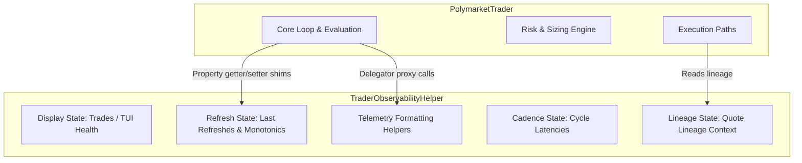

# BATCH_3B_DESIGN_001 (Trader Refactor Batch 3B: Observability telemetry)

**Date:** 2026-06-27  
**Role:** 02_CODE_ARCHITECT_AGENT  
**Supporting Role:** 29_ARCHITECTURE_GOVERNANCE_AGENT  
**Task Class:** 2 (DESIGN_ONLY)  
**Verdict:** READY_FOR_BATCH_3B_IMPLEMENTATION  
**Active Question Status:** OPEN — LOW_PRICE_TRUTH_RESOLUTION_001  

---

## 1. Objective & Scope

The objective of **Trader Refactor Batch 3B** is to extract the remaining non-critical, display-only, and logging/telemetry trackers from `polymarket/trader.py` to the newly established helper container `polymarket/orchestration/trader_observability.py`.

This extraction decouples pure event-monitoring metrics from the core trader class while preserving complete interface compatibility for downstream systems and the testing suite.

---

## 2. Ownership Diagram & Allocation Tables

### 2.1 Final Ownership Diagram



### 2.2 Candidate Classification & Allocation Table

| Candidate Name | Type | Classification | Decision | Technical Justification |
|---|---|---|---|---|
| `_last_orderbook_refresh_at_utc` | Field | OBSERVABILITY_ONLY | **SAFE TO MOVE** | Pure telemetry dictionary tracking clock times for decision/skip log events. |
| `_last_orderbook_refresh_monotonic` | Field | OBSERVABILITY_ONLY | **SAFE TO MOVE** | Monotonic timestamps used to calculate refresh age for logging only. |
| `_last_orderbook_refresh_source` | Field | OBSERVABILITY_ONLY | **SAFE TO MOVE** | Tracks transport method (WS vs HTTP) for telemetry. |
| `_last_orderbook_refresh_trigger` | Field | OBSERVABILITY_ONLY | **SAFE TO MOVE** | Tracks event triggers (TUI panel, schedule) for logging. |
| `_last_orderbook_refresh_token_pair_key` | Field | OBSERVABILITY_ONLY | **SAFE TO MOVE** | Tracks pair keys for event lineage mapping consistency. |
| `_last_successful_yes_no_book_at_utc` | Field | OBSERVABILITY_ONLY | **SAFE TO MOVE** | Tracks last successful fetch timestamps for logging. |
| `_last_successful_yes_no_book_monotonic` | Field | OBSERVABILITY_ONLY | **SAFE TO MOVE** | Tracks last successful fetch relative age. |
| `_last_successful_yes_no_book_token_pair_key` | Field | OBSERVABILITY_ONLY | **SAFE TO MOVE** | Tracks last successful fetch lineage keys. |
| `_last_quote_lineage_context` | Field | OBSERVABILITY_ONLY | **SAFE TO MOVE** | Dictionary mapping ticker to lineage trace IDs. |
| `_last_decision_cycle_monotonic` | Field | OBSERVABILITY_ONLY | **SAFE TO MOVE** | Relational times used for scheduler loop details. |
| `_market_evaluation_started_monotonic` | Field | OBSERVABILITY_ONLY | **SAFE TO MOVE** | Relational times used for scan duration calculation. |
| `_market_evaluation_started_at_utc` | Field | OBSERVABILITY_ONLY | **SAFE TO MOVE** | Timestamp used for scheduler logging events. |
| `_current_cycle_market_sequence_index` | Field | OBSERVABILITY_ONLY | **SAFE TO MOVE** | Loop iteration tracker. |
| `_current_cycle_market_sequence_count` | Field | OBSERVABILITY_ONLY | **SAFE TO MOVE** | Loop total iterations tracker. |
| `_mark_orderbook_refresh` | Method | OBSERVABILITY_ONLY | **SAFE TO MOVE** | Mutates refresh/success timings. Safe to encapsulate on helper. |
| `_orderbook_refresh_observability_detail` | Method | OBSERVABILITY_ONLY | **SAFE TO MOVE** | Formatting routine generating event JSON payloads. |
| `_scheduler_cadence_observability_detail` | Method | OBSERVABILITY_ONLY | **SAFE TO MOVE** | Formatting routine generating scheduler event payloads. |
| `_emit_hybrid_v1_snapshot` | Method | OBSERVABILITY_ONLY | **SAFE TO MOVE** | Assembles timing dict and logs hybrid snapshot event. |
| `_event_producer_label` | Method | OBSERVABILITY_ONLY | **SAFE TO MOVE** | Maps logger string identifiers. Safe to encapsulate. |
| `_risk_plan_zero_diagnostics` | Method | RISK_COUPLED | **KEEP IN TRADER** | Reads bankroll tiers, risk modes, and sizing rules. Moving it creates cyclical back-coupling to sizing logic. |
| `_phase4_build_quote_lineage` | Method | EXECUTION_COUPLED | **KEEP IN TRADER** | Generates lineage tracing IDs, but is called from order execution/submission path. Keep native to avoid risk to execution path. |
| `_phase4_quote_lineage_carry` | Method | EXECUTION_COUPLED | **KEEP IN TRADER** | Carry lineage function called from order execution/submission path. Keep native. |
| `_diagnostic_float` | Method | RUNTIME_COUPLED | **KEEP IN TRADER** | General stateless utility used in hundreds of core mathematical paths. High blast radius if moved. |
| `_diagnostic_int` | Method | RUNTIME_COUPLED | **KEEP IN TRADER** | General stateless utility. High blast radius if moved. |

---

## 3. Public Proxy & Property Compatibility Strategy

### 3.1 Method Proxies (in `polymarket/trader.py`)
To preserve backward compatibility, the following delegators are implemented:

```python
    def _mark_orderbook_refresh(self, *args, **kwargs) -> None:
        self._observability._mark_orderbook_refresh(*args, **kwargs)

    def _orderbook_refresh_observability_detail(self, *args, **kwargs) -> dict[str, object]:
        return self._observability._orderbook_refresh_observability_detail(*args, **kwargs)

    def _scheduler_cadence_observability_detail(self, *args, **kwargs) -> dict[str, object]:
        return self._observability._scheduler_cadence_observability_detail(*args, **kwargs)

    def _emit_hybrid_v1_snapshot(self, *args, **kwargs) -> None:
        self._observability._emit_hybrid_v1_snapshot(self, *args, **kwargs)

    def _event_producer_label(self, event_method: str) -> str:
        return self._observability._event_producer_label(event_method)
```

### 3.2 Property Getter/Setter Shims
Several tests override or mock successful yes/no timestamps directly on the trader object using `trader._last_successful_yes_no_book_at_utc = ...`.
To maintain 100% test compatibility, we use Python `@property` shims on `PolymarketTrader` to route these calls transparently:

```python
    @property
    def _last_successful_yes_no_book_at_utc(self) -> dict[str, str]:
        return self._observability._last_successful_yes_no_book_at_utc

    @_last_successful_yes_no_book_at_utc.setter
    def _last_successful_yes_no_book_at_utc(self, val: dict[str, str]) -> None:
        self._observability._last_successful_yes_no_book_at_utc = val

    @property
    def _last_successful_yes_no_book_monotonic(self) -> dict[str, float]:
        return self._observability._last_successful_yes_no_book_monotonic

    @_last_successful_yes_no_book_monotonic.setter
    def _last_successful_yes_no_book_monotonic(self, val: dict[str, float]) -> None:
        self._observability._last_successful_yes_no_book_monotonic = val

    @property
    def _last_successful_yes_no_book_token_pair_key(self) -> dict[str, str]:
        return self._observability._last_successful_yes_no_book_token_pair_key

    @_last_successful_yes_no_book_token_pair_key.setter
    def _last_successful_yes_no_book_token_pair_key(self, val: dict[str, str]) -> None:
        self._observability._last_successful_yes_no_book_token_pair_key = val

    @property
    def _last_quote_lineage_context(self) -> dict[str, dict]:
        return self._observability._last_quote_lineage_context

    @_last_quote_lineage_context.setter
    def _last_quote_lineage_context(self, val: dict[str, dict]) -> None:
        self._observability._last_quote_lineage_context = val
```

---

## 4. Blast Radius & Test Compatibility Plan

- **Risk: Mock overrides breaking tests (Medium):** Many tests setup the trader via `__new__` (which bypasses the constructor) and manually mock fields. Since the helper `self._observability` will not be instantiated under `__new__`, accessing properties via the `@property` shims would crash with `AttributeError`.
- **Mitigation:** Initialize `self._observability` lazily if accessed via shims under testing contexts:
  ```python
  @property
  def _last_successful_yes_no_book_at_utc(self) -> dict[str, str]:
      if not hasattr(self, "_observability"):
          from polymarket.orchestration.trader_observability import TraderObservabilityHelper
          self._observability = TraderObservabilityHelper(self.settings)
      return self._observability._last_successful_yes_no_book_at_utc
  ```
- **Execution loop protection:** All timing/telemetry helpers are fail-soft. The execution paths `_phase4_build_quote_lineage` and `_phase4_quote_lineage_carry` remain native, meaning the core order flow has zero dependency modifications.

---

## 5. Rollback Strategy
If runtime regressions or test suite failures occur during Batch 3B:
1. Discard working copy changes using `git restore polymarket/trader.py`.
2. Delete untracked helper modifications.
3. Git state is restored immediately to HEAD `c1ffbd7` (validated Batch 3A state).

---

## 6. Runtime Verification Checklist

- [ ] **Instantiation:** `TraderObservabilityHelper` initializes all 14 Group A timing dictionaries.
- [ ] **Compilation:** `py_compile` checks succeed on all files.
- [ ] **Imports:** `IMPORT_OK` verifies zero circular import dependencies.
- [ ] **Shims:** Test suite passes all mock override and timestamp tests.
- [ ] **Websocket updates:** Refresh mappings mutate timing values upon new book captures.
- [ ] **Quant Events:** Event log outputs correctly append latency, orderbook refresh ages, and cadence details.
- [ ] **Paper loop:** Run paper mode validation for 5+ cycles to verify zero memory leaks or loop slowdowns.

---

## 7. Final Verdict

```
READY_FOR_BATCH_3B_IMPLEMENTATION
```
