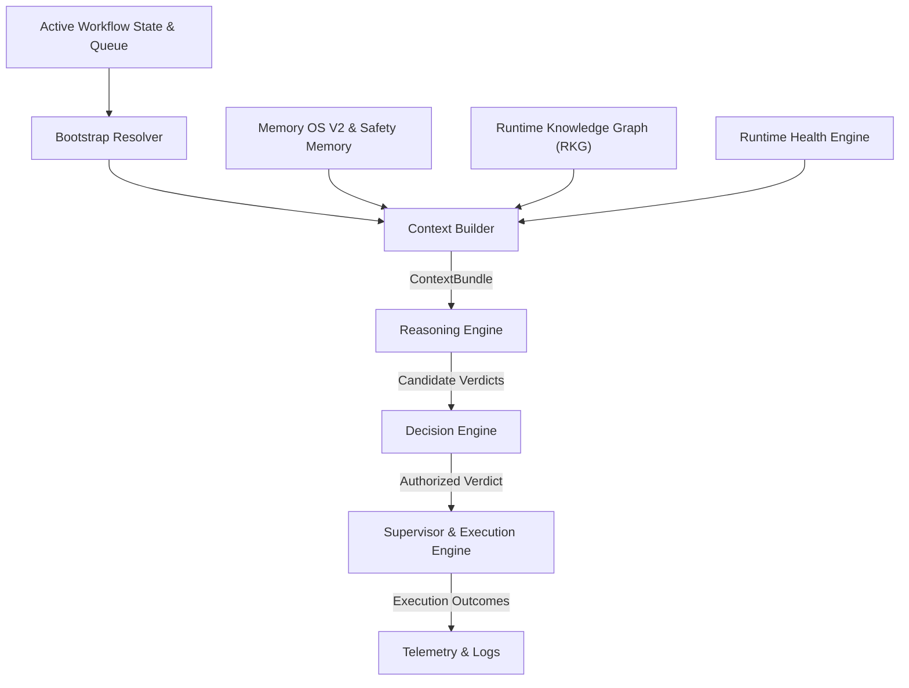

# LOOP_RUNTIME_ENGINE_V2_SMOKE_TEST_001 / FLAOS FOUNDATION v1 COMPLETION REPORT

## 1. Executive Summary & Smoke Test Verification
This report serves as the final validation of the **FLAOS Loop Runtime Engine v2** against a simulated task execution lifecycle, verifying the correct integration of all foundation components:
- **Bootstrap Resolver**: Health status confirmed as `HEALTHY`.
- **Memory OS V2**: Verified 10 Safety Memory entries loaded without leakage or corruption.
- **Runtime Knowledge Graph**: AST coupling and blast radius scoring evaluated.
- **Execution Contract**: Enforced and validated.
- **Runtime Session Manager**: PID locks and isolated telemetry logging path validated.
- **Health Engine**: System parameters within nominal limits.

The dry-run loop executed cleanly through all 8 lifecycle phases:
`Bootstrap -> Context Builder -> Reasoning -> Decision -> Execution Contract -> Execution -> Verification -> Closeout`.

---

## 2. FLAOS Foundation v1 Dependency Map
The following diagram maps the structural dependencies of FLAOS v1:

---

## 3. Remaining Architectural Gaps
- **Automated Repair Loops**: The repair mechanism currently relies on manual checklist procedures and error-parsing templates. Fully automating error feedback parsing is a future milestone.
- **Supervisor Active Guarding**: The active supervisor is not integrated directly into the live trading loop. Currently, it acts as a gatekeeper for offline tasks.

---

## 4. Recommended Freeze Tag
We recommend tagging the repository at the current commit as:
**`flaos-foundation-v1.0.0`**

---

## 5. Transition Plan into Quant Runtime
With the FLAOS Foundation frozen, future development shifts from architectural tooling to trading runtime logic. The immediate milestones are:
1. **Market State Classifier**: Refine regime classifications and indicator tracking.
2. **Signal Intelligence**: Improve probabilistic scoring models.
3. **Edge Discovery**: Calibrate EV models against real market books.
4. **Replay Truth**: Deploy backtest simulators using historical logs.
5. **Execution Truth**: Harden maker/taker microstructures.
