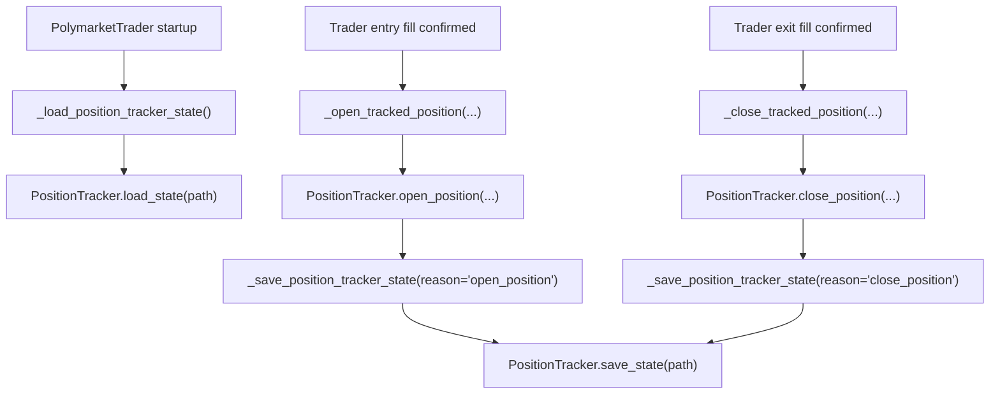

# POSITION_TRACKER_PERSISTENCE_REFACTOR_001

> Generated: 2026-06-28
> Task class: 6 REFACTOR
> Scope: persistence ownership only

## FINAL_VERDICT

`MERGE_OK_OBSERVABILITY_ONLY`

The behavior-change blocker from `BANKROLL_RANK_ENGINE_VALIDATION_GATE_001` has been removed. `PositionTracker` is again a pure domain object for open/close state transitions: it exposes `save_state(path)` and `load_state(path)`, but no longer decides when to call them or hardcodes `runtime/position_tracker_state.json`.

## Persistence Flow Audit

| Flow | Before | After |
|---|---|---|
| Load path | `PolymarketTrader.__init__` directly loaded `runtime/position_tracker_state.json` when present. | `PolymarketTrader.__init__` calls `_load_position_tracker_state()`, which owns the runtime path and calls `tracker.load_state(path)` only when persistence is enabled. |
| Save path | `PositionTracker.open_position()` and `PositionTracker.close_position()` auto-saved `runtime/position_tracker_state.json` in non-test runtime. | `PolymarketTrader._open_tracked_position()` and `_close_tracked_position()` call `tracker.save_state(path)` after trader-orchestrated open/close. |
| Startup path | Trader-owned, but inline and mixed into constructor. | Trader-owned helper, isolated behind `_position_tracker_persistence_enabled()`. |
| Shutdown path | No shutdown save hook. | No shutdown save hook added; functionality remains event-based after open/close. |

## Runtime Behavior Comparison

| Area | Result |
|---|---|
| Strategy | Unchanged |
| Sizing | Unchanged |
| Bankroll rank calculations | Unchanged |
| Execution/order submission | Unchanged |
| Risk manager | Unchanged |
| Dashboard/Telegram | Unchanged |
| Replay/canonical builder | Unchanged |
| Persistence ownership | Changed: timing moved from `PositionTracker` to `PolymarketTrader` |
| Runtime data rewrite during validation | None; builder output was written to temp directory only |

## Architecture Diagram

`PositionTracker` no longer has an edge to `runtime/position_tracker_state.json`; the runtime path is owned by `PolymarketTrader`.

## Tests

| Command | Result |
|---|---:|
| `.\\.venv\\Scripts\\python.exe -m pytest -q tests/test_position_tracker.py::PersistenceTests::test_open_and_close_do_not_decide_when_to_persist` | RED before fix: failed with 2 auto-save calls |
| `.\\.venv\\Scripts\\python.exe -m pytest -q tests/test_telemetry_backfill.py::test_trader_orchestrates_position_tracker_persistence` | RED before fix: failed with missing `_open_tracked_position` |
| `.\\.venv\\Scripts\\python.exe -m pytest -q tests/test_position_tracker.py tests/test_telemetry_backfill.py tests/test_bankroll_rank_engine.py tests/test_canonical_trade_context_builder.py` | PASS 29/29 |
| `.\\.venv\\Scripts\\python.exe -m pytest -q tests/test_execution_risk_controls.py tests/test_paper_mode.py` | PASS 128/128 |
| `.\\.venv\\Scripts\\python.exe -m py_compile utils\\position_tracker.py polymarket\\trader.py polymarket\\bankroll_rank_engine.py tools\\canonical_trade_context_builder.py` | PASS |
| `.\\.venv\\Scripts\\python.exe -c "from polymarket.trader import PolymarketTrader; from utils.position_tracker import PositionTracker; from polymarket.bankroll_rank_engine import BankrollRankEngine; from tools.canonical_trade_context_builder import CanonicalContextBuilder; print('IMPORT_OK')"` | PASS |
| `.\\.venv\\Scripts\\python.exe tools\\canonical_trade_context_builder.py --start-date 2026-06-26 --end-date 2026-06-27 --output-dir %TEMP%\\position_tracker_persistence_builder_validation_001 --pretty` | PASS; 358 rows |

## Observability-Only Guarantee

`MERGE_OK_OBSERVABILITY_ONLY`

Source verification confirms:

- `utils/position_tracker.py` no longer references `runtime/position_tracker_state.json`.
- `PositionTracker.open_position()` does not call `save_state()`.
- `PositionTracker.close_position()` does not call `save_state()`.
- `PolymarketTrader` owns the runtime path and persistence timing.
- Bankroll Rank outputs remain telemetry/metadata only and do not feed risk plan, sizing, order intent, order submission, or paper/live mode selection.

## Architecture Risk

`LOW`

The refactor restores a clean boundary:

- `PositionTracker`: domain state, validation, explicit serialization APIs.
- `PolymarketTrader`: runtime lifecycle, startup load, post-open/post-close save orchestration.

A future dedicated persistence layer could replace the trader helper methods, but that is not needed for this scope.

## Next Task

`SIZE_SHARP_ENGINE_DESIGN_001`

## TASK_OUTPUT_CONTRACT

### Task Identity
- Task name: POSITION_TRACKER_PERSISTENCE_REFACTOR_001
- Task class: 6
- Agent roles used: PRIMARY=02_CODE_ARCHITECT_AGENT SUPPORTING=07_TEST_CI_AGENT

### Files Changed
- `utils/position_tracker.py` — removed open/close auto-save side effects
- `polymarket/trader.py` — added trader-owned persistence helpers and routed trader open/close calls through them
- `tests/test_position_tracker.py` — added regression test proving tracker open/close do not decide persistence timing
- `tests/test_telemetry_backfill.py` — added regression test proving trader orchestrates persistence
- `docs/operations/graph_queries/QUERY-20260628-POSITION_TRACKER_PERSISTENCE_REFACTOR_001.md` — graph evidence
- `docs/operations/execution_contracts/POSITION_TRACKER_PERSISTENCE_REFACTOR_001_CONTRACT_001.md` — execution contract
- `docs/reports/POSITION_TRACKER_PERSISTENCE_REFACTOR_001.md` — validation report
- `docs/operations/ACTIVE_WORKFLOW_STATE_001.json` — workflow state updated
- `docs/operations/TASK_QUEUE_001.json` — task queue updated
- `docs/operations/loop_memory/LOOP_MEMORY_20260627_001.json` — loop memory updated

### Files Read (Not Changed)
- `CURRENT_PROJECT_STATUS.md` — current safety and test status
- `docs/operations/EXECUTION_CONTRACT_TEMPLATE_001.md` — Class 6 contract template
- `docs/operations/GRAPH_QUERY_TEMPLATE_001.md` — graph query requirements
- `docs/operations/knowledge_graph/REPO_GRAPH_NODES_001.jsonl` — graph nodes
- `docs/operations/knowledge_graph/REPO_GRAPH_EDGES_001.jsonl` — graph edges
- `docs/operations/AI_COGNITION_MEMORY_SCHEMA_001.json` — safety memory schema

### Tests Run
- Command: `.\\.venv\\Scripts\\python.exe -m pytest -q tests/test_position_tracker.py tests/test_telemetry_backfill.py tests/test_bankroll_rank_engine.py tests/test_canonical_trade_context_builder.py`
- Result: PASS 29/29
- Pre-existing failures: NONE
- Command: `.\\.venv\\Scripts\\python.exe -m pytest -q tests/test_execution_risk_controls.py tests/test_paper_mode.py`
- Result: PASS 128/128
- Pre-existing failures: NONE
- Command: `.\\.venv\\Scripts\\python.exe -m py_compile utils\\position_tracker.py polymarket\\trader.py polymarket\\bankroll_rank_engine.py tools\\canonical_trade_context_builder.py`
- Result: PASS
- Pre-existing failures: NONE

### Evidence
- [Grade C] Red test caught `PositionTracker` auto-save side effect before fix.
- [Grade C] Red test caught missing trader persistence orchestration helper before fix.
- [Grade B] Source search confirms `PositionTracker` only exposes `save_state()` / `load_state()` and no longer hardcodes the runtime path.
- [Grade C] Required targeted test matrix passed.
- [Grade A] Canonical builder ran on recent range and did not rewrite `runtime/reports`.

### Remaining Uncertainty
- No fresh paper runtime session was launched; runtime cycle evidence is not claimed.

### Commits Made
- NONE

### Active Question Status
- OPEN: LOW_PRICE_TRUTH_RESOLUTION_001

### Batch 2 Authorization
- NOT AUTHORIZED

### Recommended Next Task
- SIZE_SHARP_ENGINE_DESIGN_001
