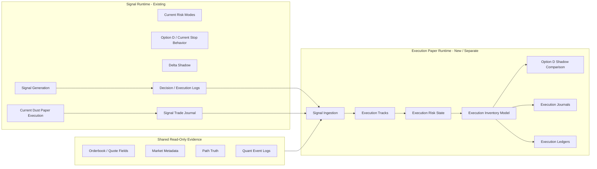

# EXECUTION_PAPER_RUNTIME_DESIGN_001

Date: 2026-06-20

Status: DESIGN ONLY / NO CODE

Runtime behavior changed: No

Strategy/risk/execution changed: No

Commit status: Not committed

## Objective

Design a completely separate Execution Paper Runtime that can validate executable-sized Polymarket paper trading without contaminating the existing dust-sized Signal Runtime.

The current Signal Runtime remains unchanged. This design does not authorize implementation, sizing changes, strategy changes, risk changes, restarts, commits, or live trading.

## Section 1 - Runtime Topology

### Topology Decision

The Execution Paper Runtime should be:

- independent as a separate process/profile;
- shared only at the data-source and signal-event level;
- mirrored against the Signal Runtime for comparable market context;
- event-driven through append-only signal journals first, not direct strategy coupling.

Recommended topology:



### Relationship Model

| Relationship | Decision | Reason |
|---|---|---|
| Independent runtime | Yes | Prevents execution-mode evidence from mutating Signal Runtime state |
| Shared source data | Yes, read-only | Market context can be reused without changing signal behavior |
| Mirrored market context | Yes | Enables side-by-side comparison using the same observed signal opportunity |
| Event-driven | Yes | Execution Runtime should react to recorded signal events, not import strategy internals |
| Direct control coupling | No | Execution Runtime must not approve, block, or alter Signal Runtime trades |

### Hard Isolation Rules

- Signal Runtime writes `signal_pnl`, signal trade journals, and current paper evidence.
- Execution Paper Runtime writes `execution_pnl`, execution journals, execution equity, and execution rejects.
- Signal Runtime must not read Execution Runtime output.
- Execution Runtime must not change Signal Runtime decisions.
- No shared mutable bankroll, inventory, risk mode, or position tracker.

## Section 2 - Signal Ingestion

### Option A - Read Signal Journal

Execution Runtime reads append-only signal evidence from existing journals/logs after Signal Runtime writes them.

| Dimension | Assessment |
|---|---|
| Coupling | Low |
| Runtime risk | Low |
| Latency | Moderate |
| Replay compatibility | Strong |
| Operational simplicity | Strong |
| Research contamination risk | Low |

Pros:

- Uses durable evidence already produced by the Signal Runtime.
- Does not require modifying the Signal Runtime event loop.
- Supports deterministic replay and resume.
- Keeps failure in Execution Runtime from affecting Signal Runtime.

Cons:

- May lag by one polling interval.
- Requires robust deduplication and checkpointing.
- Trade-open-only ingestion may miss rejected signal opportunities unless decision logs are also consumed.

### Option B - Subscribe Decision Stream

Execution Runtime subscribes to an internal live decision stream as decisions are emitted.

| Dimension | Assessment |
|---|---|
| Coupling | Medium to high |
| Runtime risk | Medium |
| Latency | Low |
| Replay compatibility | Medium |
| Operational simplicity | Medium |
| Research contamination risk | Medium |

Pros:

- Lower latency.
- Can observe approved/rejected decisions before paper fill.
- Closer to future live architecture.

Cons:

- Requires stronger integration with Signal Runtime.
- Creates more ways to affect runtime stability.
- Harder to prove no contamination.

### Option C - Replay Signal Events

Execution Runtime operates offline from historical signal events only.

| Dimension | Assessment |
|---|---|
| Coupling | None |
| Runtime risk | None |
| Latency | Not live |
| Replay compatibility | Strong |
| Operational simplicity | Strong |
| Research contamination risk | Very low |

Pros:

- Safest for first validation.
- Strong deterministic auditability.
- Good for testing ledger behavior and track math before any live paper process.

Cons:

- Does not validate operational runtime behavior.
- Cannot prove near-real-time execution journaling.

### Recommendation

Recommended ingestion path:

1. Phase A: use Option C for skeleton validation against historical signal events.
2. Phase B: use Option A as the first live paper ingestion mode.
3. Defer Option B until Execution Paper Runtime proves stable and requires lower latency.

The first operational runtime should therefore be journal-driven, not stream-subscribed.

## Section 3 - Execution Tracks

Execution Paper Runtime should support four fixed-share tracks:

| Track | Size | Role | Status |
|---|---:|---|---|
| `1_share` | 1 share | Lowest executable sanity check | Secondary diagnostic |
| `2_share` | 2 shares | Transition / stress-lite check | Secondary diagnostic |
| `5_share` | 5 shares | Primary validation track | Primary |
| `10_share` | 10 shares | Scale stress test | Secondary diagnostic |

### Primary Validation Track

Primary track:

```text
5_share
```

Reason:

- It is the strongest current candidate for minimum practical execution size.
- It is materially more realistic than `$1` notional.
- It is less capital-punitive than `10_share`.
- Liquidity audits suggest many admitted trades have enough top-of-book depth for this size, though fill realism still needs live paper validation.

### Secondary Tracks

Secondary tracks:

```text
1_share
2_share
10_share
```

Purpose:

- `1_share`: prove the runtime can operate at the smallest executable unit.
- `2_share`: measure sensitivity between minimum and primary execution size.
- `10_share`: test scalability and liquidity/drawdown stress.

Secondary tracks should not drive the main promotion verdict unless explicitly pre-registered later.

## Section 4 - Ledgers

### Signal Ledger

Signal ledger fields:

- `signal_pnl`
- `signal_equity`
- `signal_dd`
- `signal_trade_count`
- `signal_wr`
- `signal_pf`
- `signal_latest_trade_id`
- `signal_source_run_id`

Signal ledger rules:

- Computed only from existing Signal Runtime paper evidence.
- May include dust-sized fills.
- Must be labeled `SIGNAL_MODE`.
- Must not be used as executable evidence.

### Execution Ledger

Execution ledger fields:

- `execution_pnl`
- `execution_equity`
- `execution_dd`
- `execution_pf`
- `execution_wr`
- `execution_trade_count`
- `execution_reject_count`
- `execution_track`
- `execution_bankroll_start`
- `execution_bankroll_current`
- `execution_max_concurrent_exposure`
- `execution_longest_loss_streak`
- `execution_recovery_duration`

Execution ledger rules:

- Computed only from Execution Paper Runtime records.
- Must use fixed execution-size tracks.
- Must never include dust-sized Signal Runtime fills.
- Must preserve rejected execution opportunities separately from filled execution trades.

### No-Contamination Requirements

Forbidden:

- combining `signal_pnl` and `execution_pnl`;
- reporting a single PF across both runtimes;
- using Signal Runtime equity for execution risk state;
- using Execution Runtime rejects to alter Signal Runtime candidate behavior;
- treating scaled dust PnL as execution PnL.

Required:

- every report has explicit `runtime_mode`;
- every trade has explicit `source_signal_id`;
- every execution trade has explicit `execution_run_id`;
- every ledger row has explicit `ledger_type`;
- every promotion claim states whether it is signal-only or executable.

## Section 5 - Journals

Execution Paper Runtime requires dedicated journals.

Recommended storage root:

```text
runtime/quant_data/execution_paper/
```

This path is a design recommendation only.

### execution_trade_journal

Purpose: record execution-mode trade opens and closes.

Required fields:

- `event_type`
- `timestamp_utc`
- `execution_run_id`
- `source_signal_run_id`
- `source_signal_id`
- `source_trade_id`
- `condition_id`
- `market_slug`
- `asset`
- `side`
- `lifecycle_phase`
- `execution_track`
- `execution_shares`
- `execution_notional`
- `entry_price`
- `exit_price`
- `entry_quote_age_ms`
- `exit_quote_age_ms`
- `entry_spread`
- `exit_spread`
- `entry_bid_size`
- `entry_ask_size`
- `exit_bid_size`
- `exit_ask_size`
- `fill_model`
- `exit_reason`
- `execution_pnl`
- `signal_pnl_reference`
- `execution_truth_class`

### execution_position_journal

Purpose: record execution-mode inventory state.

Required fields:

- `timestamp_utc`
- `execution_run_id`
- `position_id`
- `source_signal_id`
- `condition_id`
- `asset`
- `side`
- `execution_track`
- `position_state`
- `shares_open`
- `avg_entry_price`
- `mark_price`
- `unrealized_pnl`
- `realized_pnl`
- `seconds_held`
- `max_favorable_excursion`
- `max_adverse_excursion`
- `risk_mode_execution`
- `inventory_limit_state`

### execution_equity_journal

Purpose: record execution-mode bankroll and drawdown.

Required fields:

- `timestamp_utc`
- `execution_run_id`
- `execution_track`
- `starting_bankroll`
- `current_equity`
- `realized_pnl_cumulative`
- `unrealized_pnl_total`
- `drawdown_abs`
- `drawdown_pct`
- `max_drawdown_abs`
- `max_drawdown_pct`
- `open_exposure`
- `max_open_exposure`
- `closed_trade_count`
- `win_count`
- `loss_count`
- `execution_pf`
- `execution_wr`

### execution_reject_journal

Purpose: record signals that Execution Runtime did not take.

Required fields:

- `timestamp_utc`
- `execution_run_id`
- `source_signal_id`
- `condition_id`
- `market_slug`
- `asset`
- `side`
- `lifecycle_phase`
- `execution_track`
- `reject_stage`
- `reject_reason`
- `entry_price`
- `required_shares`
- `required_notional`
- `available_bid_size`
- `available_ask_size`
- `spread`
- `quote_age_ms`
- `execution_equity`
- `risk_mode_execution`
- `inventory_state`

Rejects are first-class evidence. They define executable opportunity frequency and must not be dropped.

## Section 6 - Option D

### Option A - Reuse Current Option D

Assessment: not safe initially.

Reason: prior execution audits showed Option D behavior changes materially under larger size. Reusing it as an authoritative execution exit rule would import unvalidated dust-mode behavior into execution-mode evidence.

### Option B - Disable Initially

Assessment: safer than reuse, but incomplete.

Reason: disabling avoids false confidence, but loses the ability to measure whether Option D remains helpful or harmful under executable size.

### Option C - Run Shadow Comparison

Assessment: safest.

Recommendation:

```text
Run Option D as shadow comparison initially.
```

Design:

- Execution baseline follows the declared execution close model.
- Option D emits parallel counterfactual fields:
  - `option_d_shadow_triggered`
  - `option_d_shadow_exit_price`
  - `option_d_shadow_pnl`
  - `option_d_shadow_saved_loss`
  - `option_d_shadow_destroyed_profit`
  - `option_d_shadow_net_value`
- Option D does not control execution exits in the first execution runtime phase.
- Option D can be promoted only after execution-size evidence shows net value under the selected track.

## Section 7 - Risk Modes

### Reuse Current Risk Modes

Not recommended as the execution authority.

Current risk modes reflect Signal Runtime state and dust-sized bankroll behavior. Using them directly would import balance-state dependence and micro-recovery effects into execution validation.

### Separate Execution Risk Modes

Recommended.

Execution Paper Runtime should record current Signal Runtime risk mode as context, but compute its own execution risk state from execution ledger values.

Required separation:

| Signal Context | Execution Authority |
|---|---|
| `signal_risk_mode` | `execution_risk_mode` |
| signal equity | execution equity |
| signal drawdown | execution drawdown |
| signal exposure | execution exposure |
| signal reject reason | execution reject reason |

Initial execution risk states may mirror the same names for operator readability:

- `NORMAL`
- `DEFENSIVE`
- `MICRO_RECOVERY`
- `LOCKDOWN`

But their inputs must be execution-mode ledger inputs, not Signal Runtime bankroll inputs.

Recommendation:

```text
Use separate execution risk modes.
```

## Section 8 - Observability

Execution observability should show Signal Runtime and Execution Runtime side by side, never merged.

### Daily Side-By-Side View

| Metric | Signal Runtime | Execution Paper Runtime |
|---|---:|---:|
| runtime status | status | status |
| trade count | signal trades | execution trades |
| reject count | signal rejects | execution rejects |
| PnL | `signal_pnl` | `execution_pnl` |
| equity | `signal_equity` | `execution_equity` |
| drawdown | `signal_dd` | `execution_dd` |
| PF | `signal_pf` | `execution_pf` |
| WR | `signal_wr` | `execution_wr` |
| latest trade | signal trade id | execution trade id |
| risk mode | signal risk mode | execution risk mode |
| exposure | signal exposure | execution exposure |

### Required Dashboard Sections

1. Runtime health:
   - Signal Runtime alive/stopped.
   - Execution Runtime alive/stopped.
   - heartbeat age for each.

2. Ingestion:
   - latest signal event consumed.
   - ingestion lag.
   - duplicate skipped count.
   - missing source event count.

3. Execution tracks:
   - trade count by track.
   - reject count by track.
   - pass/reject rate.
   - primary track status.

4. Ledger comparison:
   - `signal_pnl` vs `execution_pnl`.
   - `signal_equity` vs `execution_equity`.
   - `signal_dd` vs `execution_dd`.

5. Option D shadow:
   - triggers.
   - saved losses.
   - destroyed profits.
   - net value.

6. Risk and inventory:
   - execution risk mode.
   - open exposure.
   - max concurrent positions.
   - longest loss streak.

7. Data quality:
   - missing quote fields.
   - missing source signal ids.
   - stale quote rejects.
   - journal write errors.

## Section 9 - Implementation Phases

### Phase A - Runtime Skeleton

Purpose: create a separate process/profile boundary without changing execution behavior.

Entry criteria:

- This design is accepted.
- Implementation scope is explicitly approved.
- No current Signal Runtime code path is modified for strategy, sizing, risk, or execution behavior.

Exit criteria:

- Execution runtime can start/stop independently.
- It reads no secrets beyond normal read-only data access.
- It writes only execution-paper logs.
- It cannot submit live orders.
- It cannot mutate Signal Runtime state.

### Phase B - Journal Wiring

Purpose: connect Execution Runtime to append-only signal evidence and emit dedicated journals.

Entry criteria:

- Phase A skeleton verified.
- Signal ingestion source selected.
- Deduplication and checkpointing specified.

Exit criteria:

- `execution_trade_journal` exists.
- `execution_position_journal` exists.
- `execution_equity_journal` exists.
- `execution_reject_journal` exists.
- journals are deterministic and fail-soft.

### Phase C - Execution Tracks

Purpose: enable fixed-share paper execution tracks.

Entry criteria:

- journals are stable.
- track definitions are frozen.
- bankroll assumptions are declared before run.

Exit criteria:

- `1_share`, `2_share`, `5_share`, and `10_share` can be measured.
- `5_share` is the primary validation track.
- reject reasons are recorded.
- signal and execution ledgers remain separated.

### Phase D - Validation

Purpose: evaluate whether execution-mode evidence survives realistic paper constraints.

Entry criteria:

- sufficient execution paper sample exists.
- missingness is measured.
- Option D is still shadow-only unless separately approved.

Exit criteria:

- execution PF, WR, drawdown, loss streak, and recovery duration reported from execution ledger only.
- liquidity and quote-quality rejects reported.
- Option D shadow value reported under execution size.
- validation result is labeled execution-paper, not live-ready.

### Phase E - Promotion

Purpose: decide whether execution paper evidence can move toward live-readiness review.

Entry criteria:

- Phase D validation complete.
- no active governance blocker remains.
- live readiness scope separately approved.

Exit criteria:

- live readiness checklist created separately.
- wallet, allowance, order, fill, cancel, and reconciliation proof are required before any live pilot.
- no automatic live promotion occurs.

## Final Verdict

Deliverable verdict:

```text
EXECUTION_PAPER_RUNTIME_DESIGN_READY
```

Recommended architecture:

```text
Separate Execution Paper Runtime
Journal-driven signal ingestion first
5_share primary validation track
Separate execution risk modes
Option D shadow comparison initially
Fully separate ledgers and journals
```

This design preserves current Signal Runtime continuity while creating a clean path to executable-sized paper evidence. It does not modify runtime, sizing, strategy, risk, Option D, Delta Shadow, config, or live behavior.
