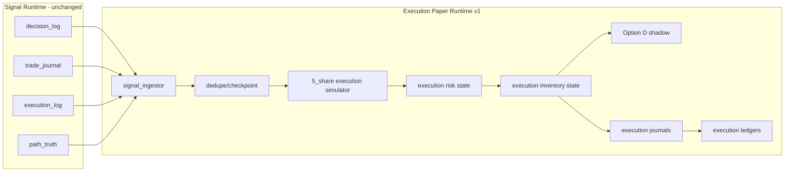

# EXECUTION_PAPER_RUNTIME_IMPLEMENTATION_PLAN_001

Date: 2026-06-20

Mode: DESIGN ONLY / NO CODE

Runtime behavior changed: No

Strategy/risk/execution changed: No

Commit status: Not committed

## Objective

Design Execution Paper Runtime v1 after the approved architecture decision:

```text
Separate Execution Paper Runtime
Primary validation track = 5_share
Recommended bankroll = $250
```

This document defines the implementation sequence and promotion gates. It does not authorize code, runtime changes, sizing changes, strategy changes, risk changes, restarts, commits, or live trading.

## Section 1 - System Topology

### Runtime Roles

| Runtime | Purpose | Authority |
|---|---|---|
| Signal Runtime | Existing dust-sized paper runtime for signal lifecycle and candidate discovery | Owns `SIGNAL_MODE` evidence only |
| Execution Paper Runtime | New separate runtime/profile for executable-sized paper validation | Owns `EXECUTION_MODE` paper evidence only |

### Interaction Model

Recommended v1 model:

```text
journal-driven, read-only signal ingestion
```

The Execution Runtime consumes append-only Signal Runtime evidence and produces its own independent execution journals and ledgers.

It must not:

- approve Signal Runtime trades;
- block Signal Runtime trades;
- alter Signal Runtime risk mode;
- alter Signal Runtime sizing;
- write into Signal Runtime trade journals;
- share mutable inventory or bankroll state.

### Data Flow



### v1 Source Priority

| Source | Use |
|---|---|
| `trade_journal` | primary source for filled signal entries/exits |
| `decision_log` | context for candidate/admission state when joinable |
| `execution_log` | optional execution context when safely joinable |
| `path_truth` | optional path-quality diagnostics, not required for v1 ledger |

v1 should start with filled signal trades only. Later versions may ingest generated-but-not-filled decisions after the execution ledger is stable.

## Section 2 - Ledger Design

### signal_journal

The Signal Runtime already produces signal-side evidence. Execution Runtime should treat signal journal data as read-only input.

Minimum fields consumed:

| Field | Meaning |
|---|---|
| `source_signal_id` | stable signal identifier when available |
| `source_trade_id` | paper position/trade id when available |
| `run_id` | Signal Runtime run id |
| `timestamp_utc` | source event timestamp |
| `event_type` | `trade_open`, `trade_close`, or decision event |
| `condition_id` | market condition id |
| `epoch_start_ts` | 5-minute epoch |
| `market_slug` | market slug |
| `asset` | BTC / ETH |
| `side` | YES / NO |
| `lifecycle_phase` | signal lifecycle phase |
| `entry_price` | signal entry price |
| `exit_price` | signal exit price when closed |
| `signal_pnl` | existing dust-sized paper PnL |
| `hold_seconds` | signal hold time |
| `exit_reason` | TP / SL / forced / other |

### signal_pnl

Signal PnL rules:

- remains dust-sized;
- remains `SIGNAL_MODE`;
- may be used only as directional/candidate evidence;
- must not be added to `execution_pnl`;
- must not be reported as executable profit.

### execution_journal

Execution Runtime v1 should emit a separate journal. Recommended logical event types:

- `execution_paper_open`
- `execution_paper_close`
- `execution_paper_reject`
- `execution_paper_position_snapshot`
- `execution_paper_equity_snapshot`

Minimum open/close schema:

| Field | Meaning |
|---|---|
| `event_type` | execution journal event |
| `timestamp_utc` | execution event timestamp |
| `execution_run_id` | independent execution runtime id |
| `source_signal_run_id` | source Signal Runtime run id |
| `source_signal_id` | source signal id |
| `source_trade_id` | source signal trade id |
| `source_replay_key` | deterministic join key |
| `condition_id` | condition id |
| `epoch_start_ts` | 5-minute epoch |
| `market_slug` | market slug |
| `asset` | BTC / ETH |
| `side` | YES / NO |
| `lifecycle_phase` | copied signal lifecycle |
| `execution_track` | `5_share` for primary v1 |
| `execution_bankroll_start` | expected `$250` for v1 validation |
| `execution_entry_price` | executable paper entry |
| `execution_exit_price` | executable paper exit |
| `execution_shares` | fixed shares, `5` in primary track |
| `execution_notional` | entry price * shares |
| `execution_pnl` | fixed-share PnL |
| `execution_exit_reason` | execution close reason |
| `signal_entry_price` | original signal entry |
| `signal_exit_price` | original signal exit |
| `signal_pnl_reference` | original signal PnL, reference only |
| `execution_liquidity_pass` | whether target depth was present |
| `execution_reject_reason` | populated for rejects |

### execution_pnl

Execution PnL rules:

- computed only from execution journal events;
- uses fixed `5_share` sizing in primary v1;
- uses its own equity curve;
- uses its own PF, WR, drawdown, and loss-streak metrics;
- never mixes with `signal_pnl`.

Minimum derived ledger fields:

| Field | Meaning |
|---|---|
| `execution_trade_count` | closed execution trades |
| `execution_win_count` | profitable execution closes |
| `execution_loss_count` | losing execution closes |
| `execution_wr` | win count / closed trades |
| `execution_gross_profit` | sum winning execution PnL |
| `execution_gross_loss` | absolute sum losing execution PnL |
| `execution_pf` | gross profit / gross loss |
| `execution_net_pnl` | sum execution PnL |
| `execution_equity` | bankroll plus cumulative PnL |
| `execution_dd` | drawdown from execution equity peak |
| `execution_max_dd` | max observed drawdown |

## Section 3 - Inventory Design

### Option A - Journal Driven

Description: compute inventory entirely by replaying execution journal events.

Pros:

- highly auditable;
- easy to replay;
- minimal mutable state.

Cons:

- harder to manage open positions in a live-running paper process;
- weaker immediate protection against duplicate opens or missed closes.

### Option B - Inventory Driven

Description: maintain live in-memory inventory state as the primary authority.

Pros:

- closer to a future execution engine;
- easier to enforce open-position limits.

Cons:

- harder to audit;
- easier to diverge from journals;
- higher contamination risk if state interacts with Signal Runtime.

### Option C - Hybrid

Description: maintain a small execution inventory state, but make journals the replayable source of truth.

Pros:

- supports runtime safety checks;
- preserves deterministic replay;
- makes reconciliation possible;
- keeps Signal Runtime isolated.

Cons:

- requires journal/state consistency checks.

Recommendation:

```text
Hybrid
```

v1 should use execution inventory state only for Execution Runtime decisions, while treating execution journals as the durable truth for audits and replay.

Minimum inventory state:

- `position_id`
- `source_signal_id`
- `condition_id`
- `asset`
- `side`
- `execution_track`
- `shares_open`
- `avg_entry_price`
- `entry_timestamp_utc`
- `latest_mark_price`
- `unrealized_pnl`
- `position_state`

## Section 4 - Risk Mode Design

### Reuse Current Modes

Not recommended as authority.

Current risk modes are tied to Signal Runtime balance state and dust-sized evidence. Reusing them directly would contaminate execution validation.

### Execution-Specific Modes

Recommended.

Execution Runtime v1 should use separate execution risk modes with familiar names:

- `NORMAL`
- `DEFENSIVE`
- `MICRO_RECOVERY`
- `LOCKDOWN`

But the inputs must be execution-specific:

| Signal Runtime | Execution Runtime |
|---|---|
| signal equity | execution equity |
| signal drawdown | execution drawdown |
| signal open exposure | execution open exposure |
| signal risk mode | execution risk mode |
| signal loss streak | execution loss streak |

v1 policy:

```text
Record signal_risk_mode as context.
Compute execution_risk_mode from execution ledger only.
Do not allow execution_risk_mode to affect Signal Runtime.
```

## Section 5 - Option D Policy

Options:

| Policy | Assessment |
|---|---|
| Disabled | safest mechanically, but loses evidence about stop behavior |
| Shadow | best v1 policy |
| Active | not safe for v1 |

Recommended v1 policy:

```text
Option D = shadow only
```

Reason:

- Prior audits found Option D behavior changes materially under fixed-share sizing.
- At `5_share`, documented Option D stops showed `$12.40` saved losses, `$13.20` destroyed profits, and net value `-$0.80` in the stop subset.
- Option D may reduce some drawdown, but current evidence does not justify making it the active execution exit policy.

Required shadow fields:

- `option_d_shadow_triggered`
- `option_d_shadow_exit_price`
- `option_d_shadow_exit_timestamp`
- `option_d_shadow_pnl`
- `option_d_shadow_saved_loss`
- `option_d_shadow_destroyed_profit`
- `option_d_shadow_net_value`
- `option_d_shadow_verdict`

Promotion rule:

Option D cannot become active in Execution Runtime until a separate execution-size Option D validation proves net benefit.

## Section 6 - Success Criteria

These are design gates for promoting the runtime through development phases. They are not live-trading approval criteria.

### Skeleton Gate

Required:

- Execution Runtime can run independently.
- It cannot submit live orders.
- It cannot mutate Signal Runtime state.
- It writes only execution-specific journals.
- It can stop without affecting Signal Runtime.

Pass condition:

```text
No runtime contamination observed.
```

### Journal Gate

Required:

- `100%` of execution events include `execution_run_id`.
- `100%` of execution events include source signal identity when source fields exist.
- duplicate source events are deduped or rejected with reason.
- journal/state reconciliation passes.

Pass condition:

```text
Execution journals are replayable and internally consistent.
```

### Validation Gate

Recommended initial thresholds for a future pre-registered validation review:

| Metric | Gate |
|---|---|
| closed execution trades | at least `100`, or a separately frozen sample target |
| primary track | `5_share` |
| starting bankroll | `$250` |
| execution PF | must be reported from execution ledger only |
| execution WR | must be reported from execution ledger only |
| max drawdown | must remain survivable under frozen bankroll |
| liquidity pass rate | must be reported by entry and round-trip feasibility |
| reject reasons | must be complete enough to explain non-fills |
| Option D | shadow-only unless separately validated |

No PF/WR threshold in v1 should authorize live trading. PF and WR are evidence outputs first; promotion thresholds should be frozen in a later validation protocol before use.

### Survivability Gate

For `5_share` v1:

- `$100` is minimum viable but `CAUTION`;
- `$250` is recommended;
- `$500` is comfortable.

Execution Runtime v1 should use `$250` as the design bankroll unless the operator explicitly scopes a different paper bankroll.

### Liquidity Gate

Required outputs:

- entry depth pass rate;
- round-trip depth pass rate;
- spread state;
- missing quote rate;
- stale quote rate when available;
- slippage sensitivity label.

No executable claim should be made if liquidity evidence is missing or not joinable.

## Section 7 - Implementation Phases

### Phase A - Runtime Skeleton

Purpose:

Create an isolated Execution Paper Runtime boundary.

Scope:

- separate command/profile;
- separate run id;
- separate log root;
- no live order capability;
- no shared mutable state with Signal Runtime.

Rollback path:

- disable/remove the separate runner entry point;
- leave Signal Runtime untouched;
- ignore execution-paper output as incomplete.

Exit criteria:

- can start/stop independently;
- no Signal Runtime files modified by the runner;
- no live credentials or order paths used.

### Phase B - Journal Wiring

Purpose:

Read Signal Runtime journals and emit execution-specific journals.

Scope:

- journal ingestion;
- source checkpointing;
- dedupe;
- execution rejects;
- execution equity snapshots;
- state/journal reconciliation.

Rollback path:

- stop Execution Runtime;
- preserve generated execution journals as experimental evidence;
- Signal Runtime remains valid.

Exit criteria:

- execution journals are deterministic;
- replay from journal reproduces ledger;
- missing source fields are classified instead of guessed.

### Phase C - 5 Share Validation Track

Purpose:

Enable the primary fixed-size execution-paper track.

Scope:

- `5_share` primary track;
- `$250` starting bankroll;
- independent execution risk state;
- Option D shadow fields;
- liquidity pass/reject labels.

Rollback path:

- disable the `5_share` track;
- retain journals as failed validation evidence;
- do not alter Signal Runtime.

Exit criteria:

- execution PnL, PF, WR, drawdown, survivability, and liquidity pass rate are produced from execution ledger only;
- no signal/execution ledger contamination;
- no promotion to live or strategy changes.

## Final Verdict

Recommended architecture:

```text
Separate Execution Paper Runtime v1
Journal-driven signal ingestion
Hybrid inventory model
Execution-specific risk modes
5_share primary validation track
$250 design bankroll
Option D shadow-only
Separate signal and execution ledgers
```

Promotion gates:

```text
Skeleton gate -> Journal gate -> 5_share validation gate
```

Implementation sequence:

```text
Phase A: Runtime skeleton
Phase B: Journal wiring
Phase C: 5_share validation track
```

Final status:

```text
DESIGN_READY_FOR_IMPLEMENTATION_PLANNING
```

No code, runtime, sizing, strategy, risk, config, commit, push, restart, or live-trading change was performed.

