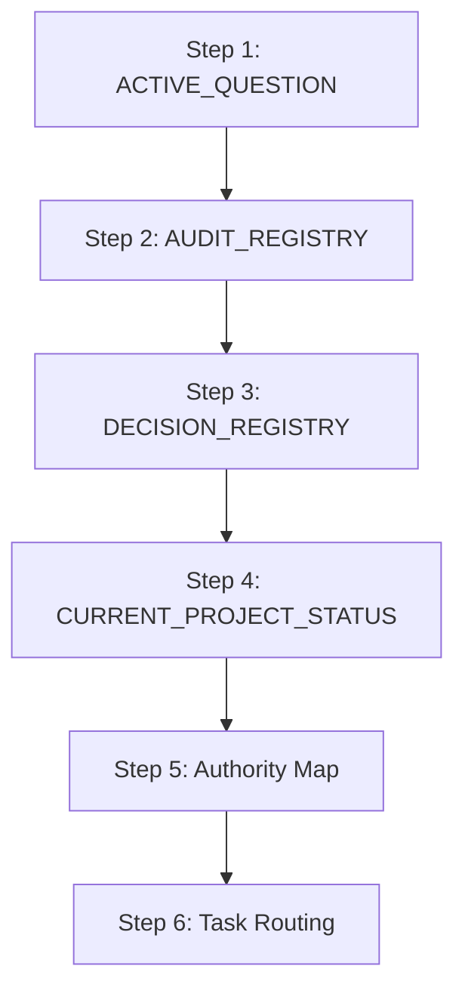

# Quant Research Governance Startup Sequence

This document defines the mandatory startup order for all AI assistants (Gemini, Claude, Codex, ChatGPT) before proposing or executing any workspace changes.

---

## 1. Startup Sequence

Any AI session must execute the following 6-step initialization sequence to align scope, prevent parameter drift, and avoid duplicate audit loops.

### Step 1: ACTIVE_QUESTION
- **File**: [ACTIVE_QUESTION.md](file:///c:/quant/Polymarket-Adaptive-Quant-Engine-v.1/docs/research/ACTIVE_QUESTION.md)
- **Action**: Check if a research question is currently active. If a question is open (e.g., `LOW_PRICE_TRUTH_RESOLUTION_001`), the codebase is locked. All strategy changes, sizer weight adjustments, execution code, threshold parameters, and inventory modifications are strictly blocked.

### Step 2: AUDIT_REGISTRY
- **File**: [AUDIT_REGISTRY.json](file:///c:/quant/Polymarket-Adaptive-Quant-Engine-v.1/docs/research/AUDIT_REGISTRY.json)
- **Action**: Review completed, verified audits. If the hypothesis, dataset, or date scope of your current task is already registered, inherit those findings immediately. Do not start duplicate forensic investigations.

### Step 3: DECISION_REGISTRY
- **File**: [DECISION_REGISTRY.json](file:///c:/quant/Polymarket-Adaptive-Quant-Engine-v.1/docs/research/DECISION_REGISTRY.json)
- **Action**: Inspect the status of design decisions. Verify if your planned parameter edits or module integrations are currently `PROPOSED`, `ACTIVE`, `REJECTED`, or `SUPERSEDED` to prevent configuration drift.

### Step 4: CURRENT_PROJECT_STATUS
- **File**: [CURRENT_PROJECT_STATUS.md](file:///c:/quant/Polymarket-Adaptive-Quant-Engine-v.1/CURRENT_PROJECT_STATUS.md)
- **Action**: Read the current governance phase, active milestones, and verify runtime evidence status to align your work with the latest project priorities.

### Step 5: Authority Map
- **File**: [RESEARCH_AUTHORITY_MAP_V2.md](file:///c:/quant/Polymarket-Adaptive-Quant-Engine-v.1/docs/research/RESEARCH_AUTHORITY_MAP_V2.md)
- **Action**: Map the authority levels (Canonical, Partial, Open Question, Superseded) of past audits to understand their limitations, allowed uses, and forbidden uses.

### Step 6: Task Routing
- **Files**: [MASTER_AGENT_ROUTER.md](file:///c:/quant/Polymarket-Adaptive-Quant-Engine-v.1/MASTER_AGENT_ROUTER.md) and [AGENTS.md](file:///c:/quant/Polymarket-Adaptive-Quant-Engine-v.1/AGENTS.md)
- **Action**: Select exactly one Primary role and zero to three Supporting roles. Declare your routing block, including files allowed to inspect and files to ignore, before proceeding with work.

---

## 2. Enforcement Constraints

- **Docs-Only Mode**: MD-only tasks must never edit Python files, sizing thresholds, or configs.
- **Active Question Lockout**: No runtime strategy or sizer updates can be implemented while a question is active.
- **Single Active Question**: The workspace allows a maximum of 1 active question. You must close the active question with operator approval before starting any new research frontiers.
