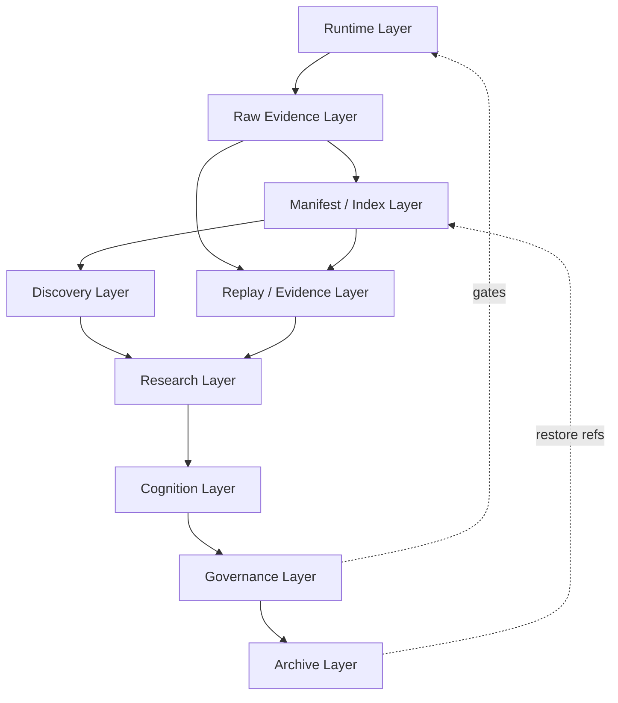

# Quant Research Infrastructure Governance Map

Date: 2026-05-28

Repo: `C:\quant\Polymarket-Adaptive-Quant-Engine-v.1`

Mode: docs-only governance map. No implementation, no runtime mutation, no indexing execution, no archive execution, no library installs, no replay, no strategy/risk/execution/live changes.

## Executive Verdict

The Quant Research Infrastructure should be governed as separate layers with strict authority boundaries:

```text
Runtime Layer
-> Raw Evidence Layer
-> Manifest / Index Layer
-> Discovery Layer
-> Research Layer
-> Cognition Layer
-> Governance Layer
-> Archive Layer
-> Replay / Evidence Layer
```

The core rule:

```text
Runtime emits compact source truth.
Offline layers discover, index, archive, replay, and interpret that truth.
Governance controls promotion, archive, mutation, and operator-review gates.
No offline layer mutates runtime or authorizes trading behavior.
```

This map consolidates the performance stack, manifest/index, archive boundary, and discovery designs into one infrastructure governance source.

## Source Design Inputs

This map consolidates:

- `docs/research/INDEX.md`
- `docs/research/performance/quant_performance_stack_roadmap.md`
- `docs/research/performance/evidence_manifest_index_design.md`
- `docs/research/performance/runtime_evidence_archive_boundary_design.md`
- `docs/research/performance/research_evidence_discovery_layer_design.md`

It does not supersede domain research findings. It defines how future infrastructure should interact with them safely.

## Layer Map



Important: the dotted `GV -> RT` relationship is approval/control only. It does not mean docs or governance scripts may directly change runtime behavior.

## 1. Runtime Layer

### Responsibilities

- Run the paper/live/verify process explicitly selected by the operator.
- Maintain websocket-first, paper-safe, risk-first behavior.
- Emit compact append-only JSONL evidence.
- Preserve orderbook freshness, risk gates, OrderIntent, reconciliation, and paper/live separation.
- Fail soft on observability where safe, without hiding critical trade/evidence failures.

### Allowed Interactions

| From | To | Allowed interaction |
|---|---|---|
| Runtime | Raw Evidence | Append compact JSONL/log events. |
| Runtime | Operator UI | Render current state and compact telemetry. |
| Runtime | Governance | Read explicitly approved config/state only when implementation is scoped. |

### Forbidden Interactions

- Runtime must not run DuckDB, Polars, PyArrow, Parquet conversion, archive compression, full evidence scans, or historical joins.
- Runtime must not consume Session Edge, Executable Truth, or Path Truth research as trading policy unless a future implementation task explicitly scopes and tests that behavior.
- Runtime must not depend on Redis, archive availability, dashboard queries, or cognition notes for safety decisions.
- Runtime must not rewrite historical JSONL.

### Runtime-Safe Operations

- Append one event at a time.
- Emit stable IDs and timestamps.
- Emit fail-soft observability fields.
- Render compact UI state.
- Maintain bounded in-memory state needed for current market/window.

### Operator-Review Required

- Any runtime code change.
- Any dependency added to runtime.
- Any change to strategy/risk/execution/live config.
- Any runtime consumer of offline research fields.

## 2. Raw Evidence Layer

### Responsibilities

- Preserve canonical JSONL and logs.
- Keep current active evidence hot.
- Keep source-specific semantics intact: trade journal, decision log, execution log, path truth, system health, market snapshots, risk log, research log.
- Preserve legacy/null rows as historical truth.

### Authority

Raw evidence is the source of historical truth, but not an automatic policy authority.

### Allowed Interactions

| From | To | Allowed interaction |
|---|---|---|
| Runtime | Raw Evidence | Append active evidence. |
| Manifest / Index | Raw Evidence | Read completed or targeted active files. |
| Replay / Evidence | Raw Evidence | Read targeted source rows. |
| Archive | Raw Evidence | Move/compress only after manifest and operator review. |

### Forbidden Interactions

- No manual editing of JSONL rows.
- No historical rewrite.
- No merge/split during first archive pass.
- No deletion without separate explicit operator approval.
- No treating raw paper/signal evidence as executable PnL.

## 3. Manifest / Index Layer

### Responsibilities

- Inventory files, dates, run IDs, source types, line counts, parse errors, hashes, schemas, event types, and field coverage.
- Build offline run, daily, lineage, Path Truth, Session Edge, Executable Truth, and schema indexes.
- Give agents small lookup surfaces instead of repeated 10GB scans.
- Preserve source pointers and lineage confidence.

### Allowed Interactions

| From | To | Allowed interaction |
|---|---|---|
| Manifest / Index | Raw Evidence | Read-only inventory and targeted parse. |
| Manifest / Index | Discovery | Provide source/date/run pointers. |
| Manifest / Index | Archive | Provide archive readiness and custody metadata. |
| Manifest / Index | Replay / Evidence | Provide join tables and source refs. |

### Forbidden Interactions

- Must not run inside runtime loop.
- Must not mutate raw evidence.
- Must not approve executable PnL.
- Must not promote Growth or live readiness.
- Must not hide parse errors or proxy joins.

### Offline-Only Operations

- File manifests.
- Run manifests.
- Schema manifests.
- Daily/session/run indexes.
- Lineage indexes.
- Path Truth indexes.
- Session Edge indexes.
- Executable Truth blocker indexes.
- Future DuckDB/Parquet generation.

## 4. Discovery Layer

### Responsibilities

- Route agents/operators from compact state to current blockers, domain docs, manifests, archive refs, and targeted raw evidence.
- Keep active review, blocker, contradiction, lineage, and domain registries discoverable.
- Avoid broad repo scans.
- Preserve domain ownership.

### Allowed Interactions

| From | To | Allowed interaction |
|---|---|---|
| Discovery | Governance | Read rules and active blockers. |
| Discovery | Research | Route to canonical domain docs. |
| Discovery | Manifest / Index | Resolve evidence location. |
| Discovery | Archive | Resolve cold evidence location. |

### Forbidden Interactions

- Must not mutate runtime.
- Must not generate indexes inside runtime.
- Must not run replay.
- Must not compress, move, or delete evidence.
- Must not treat cognition metadata as raw truth.

### Agent Discovery Flow

```text
1. Read compact research state.
2. Read docs/research/INDEX.md.
3. Select one primary domain.
4. Read active domain doc or registry card.
5. Follow manifest/index references.
6. If evidence is cold, inspect archive manifest.
7. Open raw JSONL only for targeted verification.
8. Report truth ceiling and lineage confidence.
```

## 5. Research Layer

### Responsibilities

- Produce audits, roadmaps, specs, contradiction reviews, and design docs.
- Interpret evidence with caveats.
- Keep domain docs organized:
  - `path_truth/`
  - `executable_truth/`
  - `session_edge/`
  - `runtime_health/`
  - `performance/`
  - `sessions/YYYY-MM-DD/`
- Separate hypotheses from policy.

### Allowed Interactions

| From | To | Allowed interaction |
|---|---|---|
| Research | Discovery | Publish domain docs and active review status. |
| Research | Cognition | Provide conclusions and caveats. |
| Research | Governance | Request promotion, archive, or implementation review. |
| Research | Replay / Evidence | Consume offline summaries and targeted evidence. |

### Forbidden Interactions

- Research docs must not directly change strategy, risk, execution, thresholds, live config, wallet behavior, or runtime.
- Research must not promote S3, Growth Mode, executable PnL, or live readiness without required gates.
- Research must not present proxy joins as direct truth.
- Research must not treat Path Truth as fill truth.

## 6. Governance Layer

### Responsibilities

- Define allowed actions, blocked actions, approval gates, archive rules, migration rules, and promotion constraints.
- Maintain the truth hierarchy, lineage hierarchy, archive hierarchy, discovery hierarchy, and evidence authority rules.
- Keep operator-review requirements explicit.
- Prevent docs-only work from becoming implementation by accident.

### Allowed Interactions

| From | To | Allowed interaction |
|---|---|---|
| Governance | Runtime | Authorize future scoped runtime changes through explicit task, tests, and review. |
| Governance | Archive | Authorize archive/move/compression/delete gates. |
| Governance | Research | Define domain ownership and truth ceilings. |
| Governance | Discovery | Surface current blockers and active reviews. |

### Forbidden Interactions

- Governance docs do not mutate runtime.
- Governance docs do not execute archive or index jobs.
- Governance docs do not override live safety.
- Governance docs do not convert research hypotheses into policy.

### Governance-Controlled Operations

- Moving docs across research domains.
- Archiving generated evidence.
- Compressing raw JSONL/logs.
- Deleting any source evidence.
- Adding infrastructure dependencies.
- Promoting evidence to executable truth.
- Wiring offline outputs into runtime policy.
- Changing retention windows.

## 7. Cognition Layer

### Responsibilities

- Store and summarize what the system believes, doubts, blocks, and watches.
- Maintain Hermes/operator memory:
  - truth ladder;
  - active blockers;
  - unlock conditions;
  - contradiction state;
  - ingest rules;
  - notification/digest ideas.
- Keep cognition tied to evidence refs, not free-floating assertions.

### Allowed Interactions

| From | To | Allowed interaction |
|---|---|---|
| Cognition | Discovery | Expose current beliefs and blockers. |
| Cognition | Research | Link to source docs and caveats. |
| Cognition | Governance | Respect truth ceilings and policy authority. |

### Forbidden Interactions

- Cognition must not place trades.
- Cognition must not change runtime policy.
- Cognition must not claim executable PnL when blocked.
- Cognition must not hide uncertainty or contradictions.

### Cognition Metadata

- `truth_layer`
- `blocker_status`
- `review_verdict`
- `contradiction_state`
- `Hermes_ingest_class`
- `operator_note`
- `truth_ceiling`
- `policy_authority`
- `required_unlock`

## 8. Archive Layer

### Responsibilities

- Move completed evidence from hot/warm to cold custody after manifests and operator review.
- Preserve raw JSONL/log recoverability.
- Maintain archive manifests, hashes, line counts, parse status, run IDs, and research refs.
- Restore/rehydrate evidence safely when needed.

### Allowed Interactions

| From | To | Allowed interaction |
|---|---|---|
| Archive | Raw Evidence | Move/compress completed evidence only after approval. |
| Archive | Manifest / Index | Use manifest metadata for readiness and custody. |
| Archive | Discovery | Provide archive refs and restore status. |
| Archive | Replay / Evidence | Provide restored read-only evidence on request. |

### Forbidden Interactions

- No archive action on active runtime files.
- No delete as part of archive by default.
- No archive without manifest.
- No archive when research lock is active.
- No restore over active runtime paths.
- No archive operation inside runtime loop.

### Archive-Only Operations

- Compression.
- Restore check.
- Checksum verification.
- Archive manifest creation.
- Rehydration.
- Cold evidence custody.

## 9. Replay / Evidence Layer

### Responsibilities

- Run offline replay/audit analysis when explicitly scoped.
- Validate joins, lifecycle truth, path truth, MFE/MAE, execution realism, and blocker evidence.
- Keep replay results offline-only unless future runtime-policy implementation is explicitly approved.

### Allowed Interactions

| From | To | Allowed interaction |
|---|---|---|
| Replay / Evidence | Raw Evidence | Read targeted JSONL/log files. |
| Replay / Evidence | Manifest / Index | Use indexes for source discovery and joins. |
| Replay / Evidence | Research | Publish reports and caveats. |
| Replay / Evidence | Archive | Request restored evidence if cold. |

### Forbidden Interactions

- Replay must not run unless explicitly requested.
- Replay must not mutate runtime.
- Replay must not feed runtime decisions.
- Replay must not claim live readiness.
- Replay must not rewrite evidence.

## Truth Hierarchy

Truth progresses only in this order:

```text
Signal Truth
-> Path Truth
-> Execution / Fill Truth
-> Executable Truth
-> Growth Readiness
-> Live Readiness
```

Current truth ceiling:

```text
Signal Truth + Path Truth evidence only.
Executable Truth is NOT_REACHED.
Growth Mode is BLOCKED.
Live Readiness is NOT_READY.
```

Truth authority rules:

| Truth layer | Minimum authority needed |
|---|---|
| Signal Truth | trade journal, decision evidence, paper outcome fields. |
| Path Truth | direct or qualified lineage across trade/path checkpoints. |
| Execution / Fill Truth | timestamp, quote, fill, cancel, partial-fill evidence. |
| Executable Truth | MOS authority, non-dust size, fill/cancel/partial-fill truth, path join. |
| Growth Readiness | stable executable truth plus risk/governance review. |
| Live Readiness | explicit live preflight, wallet/order/fill/cancel/reconcile proof. |

Forbidden truth jumps:

- Signal Truth -> Executable Truth.
- Path Truth -> Executable Truth.
- Session Edge -> Strategy policy.
- Paper PnL -> Live readiness.
- Dust evidence -> Growth readiness.

## Lineage Hierarchy

Preferred lineage:

```text
date
-> run_id
-> paper_trade_replay_key
-> trade_open / trade_close
-> path_truth checkpoints
-> decision / execution / health context
-> research conclusion
```

Join confidence:

| Level | Meaning | Authority |
|---|---|---|
| `DIRECT` | Exact canonical key, preferably `(run_id, paper_trade_replay_key)`. | Strong for continuity, not executable truth alone. |
| `STRONG` | Stable explicit ID with limited ambiguity. | Useful with caveats. |
| `WEAK` | Partial explicit fields and tight timestamps. | Review only. |
| `PROXY` | Inferred from timestamps/context. | Hypothesis only. |
| `BLOCKED` | Missing/contradictory identity. | No continuity claim. |

Lineage rules:

- Direct path joins do not prove fills.
- Legacy/null rows remain historical caveats.
- Candidate/decision IDs are future enhancements.
- Proxy evidence must be labeled.

## Archive Hierarchy

Evidence custody states:

```text
HOT
-> WARM
-> COLD
-> RESTORED / REHYDRATED
```

Archive authority rules:

| State | Meaning | Allowed action |
|---|---|---|
| `HOT` | Active/latest evidence. | Read carefully, do not move/compress. |
| `WARM` | Completed but active in research. | Manifest/index, keep queryable. |
| `COLD` | Archived with manifest. | Restore if needed. |
| `RESTORED` | Temporary read-only restored evidence. | Targeted audit only. |

Archive must preserve:

- source path;
- archive path;
- line count;
- parse error count;
- SHA256;
- run IDs;
- event types;
- lineage keys;
- research refs;
- operator approval ref.

## Discovery Hierarchy

Future agents should search in this order:

```text
1. runtime/research_state/latest_research_state.md
2. docs/research/INDEX.md
3. primary domain doc
4. active blocker/review/discovery registry
5. manifest/index refs
6. archive manifest if cold
7. targeted raw/restored evidence
```

Discovery rules:

- Choose one primary domain before touching evidence.
- Use manifests before raw JSONL.
- Use archive manifests before restore.
- Report evidence level and truth ceiling.
- Avoid whole-repo and whole-runtime scans.

## Evidence Authority Rules

| Evidence type | Authority | Not allowed to prove |
|---|---|---|
| Raw JSONL | Source truth for emitted events. | Executable PnL by itself. |
| Runtime logs | Incident/process context. | Trade outcome truth alone. |
| Manifest/index | Discovery and quality metadata. | Source truth replacement. |
| Parquet/DuckDB future layer | Derived offline query acceleration. | Runtime policy or canonical truth. |
| Research docs | Interpretation and design. | Runtime behavior change. |
| Cognition notes | Memory and operator framing. | Trading authority. |
| Replay reports | Offline evidence and hypotheses. | Live readiness. |
| Archive manifest | Custody and restore proof. | Strategy/risk claims. |

## Operation Classes

### Runtime-Safe Operations

- Emit compact JSONL events.
- Emit stable identifiers and timestamps.
- Render current UI/Telegram summaries if already scoped.
- Read current in-memory runtime state.
- Fail soft on non-critical observability.

### Offline-Only Operations

- Manifest generation.
- Index generation.
- DuckDB queries.
- Polars/PyArrow/Parquet conversion.
- Replay/audit analysis.
- Session-edge distributions.
- Executable-truth blocker classification.
- Archive readiness checks.

### Governance-Controlled Operations

- Moving docs.
- Changing retention policy.
- Creating archive workflows.
- Adding dependencies.
- Promoting truth layers.
- Wiring offline outputs into runtime.
- Changing runtime behavior.

### Operator-Review-Required Operations

- Any raw evidence move/compression.
- Any deletion.
- Any archive of latest completed or research-locked evidence.
- Any runtime dependency installation.
- Any runtime, strategy, risk, execution, wallet, or live config change.
- Any claim that executable PnL is unblocked.
- Any Growth/live readiness promotion.

## What Can Mutate Runtime

Only an explicitly scoped future implementation task may mutate runtime, and only with:

- named files;
- stated behavior change;
- tests;
- paper/live safety confirmation;
- strategy/risk/execution boundary statement;
- operator intent when live-risk is involved.

Docs, research, manifests, indexes, archives, discovery registries, cognition notes, and replay reports do not mutate runtime.

## What Must Never Mutate Runtime

These must never mutate runtime directly:

- Discovery layer.
- Manifest/index layer.
- Archive layer.
- Cognition layer.
- Research docs.
- Offline replay outputs.
- DuckDB/Parquet/Polars/PyArrow jobs.
- Session-edge candidate reviews.
- Executable-truth blocker summaries.
- Hermes memory notes.

They may propose future work, but they cannot become policy without a separate implementation phase.

## Agent Permissions

### Agents May

- Read compact state first.
- Read domain docs relevant to the task.
- Create docs-only designs/audits when scoped.
- Read targeted evidence when explicitly requested.
- Report blockers, truth ceilings, caveats, and next safe steps.
- Propose implementation phases without executing them.

### Agents Must Never

- Scan raw runtime evidence broadly unless explicitly scoped.
- Run replay unless explicitly requested.
- Run or restart paper/live runtime unless explicitly requested.
- Modify strategy, risk, execution, wallet, thresholds, or live config during docs-only tasks.
- Delete tests.
- Delete or move evidence without explicit approval.
- Promote S3, Growth Mode, executable PnL, or live readiness from docs alone.
- Treat planned infrastructure as implemented.

## Safe Evolution Path

### Phase 0 - Governance Consolidation

Status: this document.

Actions:

- Consolidate layer boundaries.
- Keep existing docs and runtime untouched.

### Phase 1 - Read-Only Manifest Prototype

Future only.

Actions:

- Generate small fixture/date manifests.
- No archive, no runtime changes.

### Phase 2 - Discovery Registry Prototype

Future only.

Actions:

- Build docs-derived active blocker/review registry.
- No raw evidence scan.

### Phase 3 - Archive Readiness Dry Run

Future only.

Actions:

- Produce archive readiness report for one completed date.
- No compression or moves.

### Phase 4 - Offline Query Substrate

Future only.

Actions:

- Add optional DuckDB/Parquet for completed evidence only.
- Validate against manifests and raw JSONL.

### Phase 5 - Runtime Micro-Optimization Review

Future only.

Actions:

- Consider `orjson`, bounded caches, queueing, or websocket/http tuning only after profiling and tests.

### Phase 6 - Policy Integration Review

Future only.

Actions:

- Only after executable truth is reached and governance approves, consider whether any offline outputs can become runtime policy inputs.

## Future Options

### Option 1 - Safe EV Preservation

Keep the infrastructure governance map as docs-only authority and continue manual discovery through `INDEX.md` and domain docs.

Best now.

### Option 2 - Aggressive Information Discovery

Later, implement a read-only active-review/blocker registry from docs only. No raw evidence scan and no runtime changes.

Useful next infrastructure step.

### Option 3 - Structural / Root-Cause Path

Later, implement full manifests, discovery registries, archive manifests, and offline query substrate.

Powerful, but only after governance and dry-run validation.

Recommended path: Option 1 now, Option 2 next, Option 3 after manifest and archive dry runs.

## What Not To Do

- Do not implement this map in this task.
- Do not mutate runtime.
- Do not run indexing.
- Do not run archive jobs.
- Do not run replay.
- Do not install libraries.
- Do not move or delete files.
- Do not claim executable PnL.
- Do not promote Growth Mode or live readiness.
- Do not wire offline outputs into runtime policy.

## Completion Status

This document is a governance map only.

Runtime behavior changed: No

Live behavior changed: No

Strategy/risk/execution changed: No

Indexing executed: No

Archive executed: No

Library installs: No
