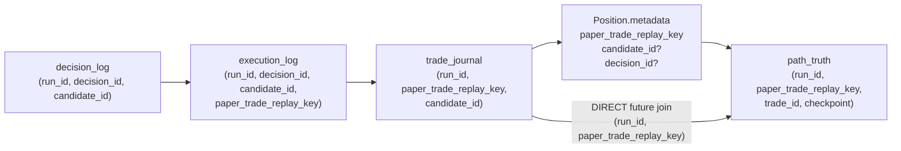

# Path Truth Identity Wiring Spec

Date: 2026-05-27

Mode: read-only, docs-only design. No code, runtime mutation, replay, promotion, strategy, risk, execution, stoploss, sizing, wallet, or live changes.

## Role Routing

Primary role: `11_OBSERVABILITY_INCIDENT_AGENT.md`

Supporting roles: `10_BACKTEST_REPLAY_AGENT.md`, `07_TEST_CI_AGENT.md`

Why selected: the task is an observability identity contract for JSONL lineage, with downstream replay/ledger joins and future regression-test implications.

Files inspected:

- `docs/research/path_join_root_cause_map.md`
- `docs/research/path_truth_field_coverage_gap_audit.md`
- `docs/research/path_truth_implementation_spec.md`
- `tests/test_path_truth_checkpoints.py`
- `polymarket/trader.py` (read-only, targeted identity/path-truth methods)
- `utils/position_tracker.py` (read-only, position metadata boundary)

Files intentionally ignored: strategy modules, risk modules, order placement logic beyond the existing entry metadata callsite, wallet/live config, runtime JSONL mutation, replay execution, and raw log rewrites.

## Executive Verdict

Future wiring should carry `paper_trade_replay_key` into `Position.metadata` at the paper entry boundary, then have `trade_path_checkpoint` read it from the same metadata object it already uses for `candidate_id`, `decision_id`, `condition_id`, `market_slug`, `epoch_start_ts`, and `lifecycle_phase`.

Canonical future direct key:

```text
(run_id, paper_trade_replay_key)
```

This is the smallest safe bridge between the two current identity islands:

```text
trade_journal / decision_log / execution_log / research_log
  key: paper_trade_replay_key

path_truth
  current key: trade_id + weak/proxy context
  missing key: paper_trade_replay_key
```

The recommended future patch is additive observability only. It should not alter strategy, risk sizing, order placement, exit logic, replay behavior, or live mode.

## Current Root Cause

`PATH_JOIN_0_77` exists because `path_truth` has checkpoints but lacks the canonical trade replay key.

Known state from `docs/research/path_join_root_cause_map.md`:

| Producer | Records | `paper_trade_replay_key` | `trade_id` | `candidate_id` | `decision_id` |
|---|---:|---:|---:|---:|---:|
| `path_truth` | 140 | 0 | 140 | 0 | 0 |
| `trade_journal` | 210 | 210 | 0 | 210 | 0 |

Direct joins fail deterministically:

```text
trade_close.paper_trade_replay_key exists
path_truth.paper_trade_replay_key missing
= direct path join impossible
```

Proxy joins by `(run_id, condition_id, asset, side)` can recover some rows, but they do not prove per-trade identity and cannot approve executable truth.

## Source Boundary Map

### Where `paper_trade_replay_key` Is Created

`polymarket/trader.py` currently creates the key in the trade journal producer:

- `_emit_trade_opened_event(...)`, around lines 3990-4140.
- Key construction around lines 4106-4111:

```python
paper_trade_replay_key = (
    f"{condition_id}|{epoch_start_ts}|{ticker}|{outcome}|{token_id}"
    if condition_id and epoch_start_ts and outcome and token_id
    else ""
)
```

It is emitted in the `log_trade_open` payload as `paper_trade_replay_key`.

`trade_close` independently reconstructs the same key:

- `_emit_trade_closed_event(...)`, around lines 4142-4173.
- It reads `condition_id` and `epoch_start_ts` from `position.metadata`.
- It reads ticker/outcome/token from the position.
- It emits the reconstructed `paper_trade_replay_key` in close evidence.

This proves the raw ingredients already exist at position close time if they were preserved in position metadata at open.

### Where Trade Position Metadata Is Created

The position metadata boundary is the `self.tracker.open_position(...)` call in `polymarket/trader.py`, around line 8696.

Current metadata includes:

```text
strategy
signal_strategy
token_id
outcome
entry_ev
confidence
delta_regime
condition_id
epoch_start_ts
market_slug
lifecycle_phase
```

Current metadata does not include:

```text
paper_trade_replay_key
candidate_id
decision_id
```

`utils/position_tracker.py` accepts arbitrary metadata:

- `Position.metadata: dict[str, Any] = field(default_factory=dict)`, line 51.
- `PositionTracker.open_position(..., metadata: dict | None = None)`, lines 149-160.
- The metadata is stored directly on the `Position`, line 179.

Therefore the position object is already the correct in-memory carrier. No schema migration is needed in `PositionTracker`.

### Where Path Truth Reads Metadata

`polymarket/trader.py` path-truth writer already depends on `Position.metadata`:

- `_path_truth_metadata(pos)`, lines 5730-5739.
- `_emit_path_truth_checkpoint(...)`, lines 5852-5929.

Current path-truth payload reads:

```python
"candidate_id": metadata.get("candidate_id") or None,
"decision_id": metadata.get("decision_id") or None,
"market_slug": metadata.get("market_slug") or None,
"condition_id": metadata.get("condition_id") or None,
```

It does not currently read or emit `paper_trade_replay_key`.

## Existing Upstream Identity Sources

The code already creates candidate and decision identity fields in the phase-2 observability path:

| Field | Current Source | Notes |
|---|---|---|
| `candidate_id` | `_phase2_observability_payload(...)` | Created from market/ticker/side/epoch context and emitted in decision/execution/trade observability. |
| `decision_id` | `_emit_decision_event(...)` | Created from market/ticker/side/epoch context and emitted in decision-boundary evidence. |
| `paper_trade_replay_key` | `_emit_trade_opened_event(...)` and `_emit_trade_closed_event(...)` | Direct trade/replay key, but not currently persisted into path-truth metadata. |

For path truth, `paper_trade_replay_key` is the highest-priority wiring field. `candidate_id` and `decision_id` are valuable secondary lineage fields, but they should not block the canonical `(run_id, paper_trade_replay_key)` bridge.

## Proposed Future Field Contract

### Position Metadata Additions

At the entry-open boundary, future implementation should add these fields to the existing metadata dict:

| Field | Required? | Source | Missing Behavior |
|---|---|---|---|
| `paper_trade_replay_key` | yes for direct joins | Same constituents currently used by `_emit_trade_opened_event`: `condition_id`, `epoch_start_ts`, `ticker`, `outcome`, `token_id` | `None` or `""`; do not block entry or checkpoint. |
| `candidate_id` | optional but recommended | Existing phase-2 candidate context when available | `None`; do not synthesize from path-truth checkpoint fields. |
| `decision_id` | optional but recommended | Existing decision context when available | `None`; do not block direct replay-key join. |
| `identity_wiring_version` | optional | constant such as `path_truth_identity_v1` | absent for legacy rows. |
| `paper_trade_replay_key_source` | optional | `position_metadata_from_entry_context` | absent for legacy rows. |

### Path Truth Payload Additions

Future `trade_path_checkpoint` payload should add:

| Field | Value |
|---|---|
| `paper_trade_replay_key` | `metadata.get("paper_trade_replay_key") or None` |
| `paper_trade_replay_key_source` | metadata source label when present, else `None` |
| `join_confidence` | `DIRECT` when `(run_id, paper_trade_replay_key)` exists, else current weak/proxy state |
| `identity_wiring_version` | copied from metadata when present |

Existing fields should remain unchanged and additive:

```text
trade_id
candidate_id
decision_id
asset
side
market_slug
condition_id
lifecycle_phase
session_hour_utc
checkpoint_elapsed_s
```

## Safest Propagation Path

Recommended future path:

1. At paper entry, compute the replay key before or inside the `open_position` metadata dict using exactly the same constituents as `_emit_trade_opened_event(...)`:

```text
condition_id | epoch_start_ts | ticker | outcome | token_id
```

2. Store the computed key on `Position.metadata` as `paper_trade_replay_key`.

3. Store `candidate_id` and `decision_id` on `Position.metadata` only if they are already available from the existing phase-2 decision/execution context.

4. Do not change order submission, sizing, risk approval, stop loss, take profit, or live configuration.

5. In `_emit_path_truth_checkpoint(...)`, read only from `metadata`:

```text
metadata.get("paper_trade_replay_key")
metadata.get("candidate_id")
metadata.get("decision_id")
```

6. Emit nulls when missing.

7. Leave old rows untouched and label them as legacy/proxy-only in offline audits.

This path avoids a deeper dependency from path-truth checkpoints back into decision logs, execution logs, replay analyzers, or raw runtime files.

## Future Join Graph



## Fallback Behavior

Fallback rules for future implementation:

| Scenario | Expected Behavior |
|---|---|
| All replay-key constituents present | Emit `paper_trade_replay_key`; classify join confidence as `DIRECT`. |
| `condition_id` missing | Emit `paper_trade_replay_key: null`; keep `condition_id: null`; do not fabricate. |
| `epoch_start_ts` missing or zero | Emit `paper_trade_replay_key: null`; preserve checkpoint. |
| `token_id` missing | Emit `paper_trade_replay_key: null`; preserve checkpoint. |
| `candidate_id` missing | Emit `candidate_id: null`; direct replay-key join can still work. |
| `decision_id` missing | Emit `decision_id: null`; direct replay-key join can still work. |
| metadata object missing or not a dict | Current `_path_truth_metadata` fail-soft behavior creates an empty dict; checkpoint emits null identity fields. |
| path-truth write failure | Existing fail-soft writer behavior applies; runtime loop must continue. |

Do not backfill a key from checkpoint-time data if entry-time metadata is missing. A checkpoint-time reconstruction can accidentally mix a later market state with an earlier trade identity. If reconstruction is ever used, it must be explicitly labeled `PROXY`, not `DIRECT`.

## Fail-Soft Rules

Future wiring must obey these rules:

1. Missing identity fields must never block paper runtime.
2. Missing identity fields must never alter trade approval, risk sizing, execution, stop loss, take profit, or close behavior.
3. Do not fake a live timestamp, fill, cancel, or executable identity.
4. Do not rewrite historical JSONL.
5. Do not infer `paper_trade_replay_key` from `candidate_trace_id`.
6. Do not treat path-truth `trade_id` as canonical cross-producer identity unless sibling producers start emitting it under a separate contract.
7. Do not promote S3, Growth Mode, or executable PnL from this wiring alone.
8. A path-truth checkpoint with null identity remains useful telemetry but must be labeled `WEAK` or `PROXY`, not `DIRECT`.

## Tests Needed Before Implementation

Future implementation should add or update display/JSONL tests only. Recommended target:

```text
tests/test_path_truth_identity_wiring.py
```

Required cases:

1. `open_position` metadata receives `paper_trade_replay_key` when `condition_id`, `epoch_start_ts`, `ticker`, `outcome`, and `token_id` are present.
2. `_emit_path_truth_checkpoint(...)` emits `paper_trade_replay_key` from `pos.metadata`.
3. Path truth emits `candidate_id` and `decision_id` from `pos.metadata` when present.
4. Missing replay-key constituents fail soft: no exception, checkpoint still emits, `paper_trade_replay_key` is null.
5. Existing missing-field behavior stays backward compatible: `candidate_id`, `decision_id`, `condition_id`, price fields, and spread can still be null.
6. Existing paper-only guard remains intact: no path-truth emission when `settings.paper_trading` is false.
7. JSONL payload shape remains nested under `payload` and additive only.
8. Direct join smoke test: a synthetic `trade_open`/`trade_close` key equals the key emitted by path truth for the same synthetic position.
9. Legacy rows without `identity_wiring_version` are classified as proxy/legacy by offline readers.

Existing adjacent test file:

```text
tests/test_path_truth_checkpoints.py
```

That file already covers schedule/no-duplicate behavior, fail-soft write failure, paper-only behavior, missing fields, and shutdown `event_end`. The identity wiring tests should extend this area rather than replacing existing tests.

## Migration Caveat For Old Rows

Historical path-truth rows before this future wiring will remain without `paper_trade_replay_key`.

Required offline treatment:

```text
legacy_path_truth_proxy_only = true
direct_join_eligible = false
join_confidence = PROXY or WEAK
```

Do not rewrite old JSONL rows. Offline audits should split coverage by schema era:

| Era | Direct Join Eligibility |
|---|---|
| pre-identity-wiring path truth | not eligible for direct `(run_id, paper_trade_replay_key)` joins |
| post-identity-wiring path truth | eligible when key is populated |

`PATH_JOIN_0_77` remains the correct historical verdict for the old sampled rows. The future wiring would start a new evidence era; it does not retroactively repair prior evidence.

## Implementation Options

OPTION 1 - SAFE EV PRESERVATION:

Add only `paper_trade_replay_key` to position metadata and path-truth payload. Leave `candidate_id` and `decision_id` unchanged until direct replay-key coverage is proven.

OPTION 2 - AGGRESSIVE INFORMATION DISCOVERY:

Add `paper_trade_replay_key`, `candidate_id`, and `decision_id` to position metadata and path truth in one observability-only patch, then run a short paper validation to measure direct join coverage.

OPTION 3 - STRUCTURAL / ROOT-CAUSE PATH:

Create a formal identity envelope shared by decision, execution, trade journal, path truth, and future replay tools, including `candidate_trace_id`, parent trace links, and schema versioning.

Recommended future path: Option 1 first. It resolves the direct `PATH_JOIN_0_77` blocker with the smallest behavioral and schema footprint. Option 2 can follow after direct key coverage is stable. Option 3 is appropriate later if Hermes needs deeper causal lineage across candidate and decision boundaries.

## What This Unlocks

When implemented and validated, direct path-truth joins should become possible:

```text
trade_close -> path_truth by (run_id, paper_trade_replay_key)
```

This unlocks safer offline evidence for:

- path truth coverage by trade;
- fast-close checkpoint truth by trade;
- session-edge path behavior;
- signal PnL with path truth attached;
- future executable-truth ledger joins.

It does not unlock by itself:

- executable PnL approval;
- live readiness;
- fill truth;
- cancel truth;
- partial fill truth;
- Growth Mode.

## What Not To Do

- Do not run replay to compensate for missing identity.
- Do not backfill historical path-truth JSONL.
- Do not use proxy joins as executable approval.
- Do not wire path truth into runtime decisions.
- Do not modify strategy, risk, sizing, stoploss, order placement, wallet, live config, or execution behavior.
- Do not promote S3 or Growth Mode based on identity wiring alone.

## Safety Confirmation

Runtime behavior changed: No

Live behavior changed: No

Strategy/risk/execution changed: No

Replay run: No

Bot/runtime launch: No

Implementation: No
